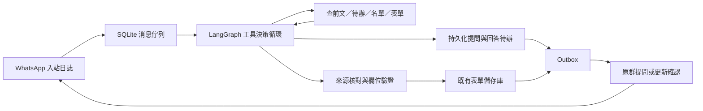

# 主日資料助理

**目前階段：不向群內發問。** `group_questions_enabled=false`，問題只留網站後台；測試及正式設定的周五催補提醒也暫時關閉。收集、明確資料寫入與請假成功回執可繼續。發送前 backend 與 bridge 都重查設定，已佇列的追問轉為 `held`；日後開啟發問也不會自動補發舊問題。只有操作者另行啟用才發新問題。

此助理連接三個 WhatsApp 資料來源群，整理資料到現有主日及同工表單。

| 資料來源 | 工作 |
| --- | --- |
| 達拉斯聖道教會 | 同工不能服事日期及本週奉獻；請假保存成功後在原群回覆「收到，已更新」並列明姓名和日期 |
| 主日讲道联络群 | 當周及未來主日的講員、講道題目、讀經經文 |
| 主日诗歌服侍交流群 | 領詩、主日詩歌及回應詩歌；沿用網站已預填領詩輪值，明確更正優先 |

三個群內明確相關的資料都可收集；主要分工決定例行缺項提問與提醒的負責群，具體消息的疑問仍在原群追問；不拒收其他群的明確補充。一般照片、旅行地名、聊天與冬令時提醒不是請假或主日安排，不因有附件就追問。

周五 **17:00 America/Chicago**，檢查接下來主日的崇拜準備欄位（含司會、領詩）。全部齊備就不提醒；有缺項按主要負責群分別提醒，每主日每群去重。講道缺項發講道群，詩歌與領詩缺項發詩歌群，司會缺項發教會群。未同步、待辦、識別失敗、未核對資料或同工安排衝突會暫緩提醒，原因顯示在管理頁面。設定可調整時間。

主日資料可由群內不同同工分次提供，每次只更新明確提到的欄位，其餘已收集內容保留。奉獻寫入既有 `donationAmount`，只記錄明確主日的奉獻總額，不收集個別捐獻者資料，也不自行換匯或推算。本教會已確認「本週／截至某日」的奉獻填目前準備的主日表單，例如10/23（周五）公布本週總額，填10/25主日；明確補報其他主日則按明確日期。只取明說總額，不把分項重加一次。奉獻不列入周五崇拜準備缺項。

## 執行架構

使用 **LangGraph + LangChain 的工具介面 + OpenAI 模型**，以一個工具決策 Agent 處理每則入站事件，不使用多 Agent 協調或通用電腦操作。



- 模型能選擇查前文、搜尋舊消息或名單、讀取當前表單／指定日期可安排狀態、更新、追問、取消待辦或略過。它不能執行任意 SQL、shell、網頁搜尋，或指定其他目的群。每輪只執行一個工具，單事件上限 20 次模型決策。
- LangGraph 使用磁碟 SQLite checkpointer 保存每則消息的模型與工具步驟；中斷後接續原步驟，不以記憶體模擬恢復。明確要求重新處理時產生新執行版本，舊記錄保留。暫停收集期間不提交寫入，恢復後可接續。
- 等人回答是獨立的業務待辦，不讓圖或模型持續空轉。新消息帶入適用的未完成事項，模型判斷是回答、更正還是新事項。不同主日、不同同工不共用一條無限增長的對話；其他人的回答需明確引用提問才能接入原事項。
- 更新工具要求先讀取目標欄位，保存不可由模型自行偽造的讀取快照。寫入前和來源核對後再次比較；其他人期間改了同一欄位就退回模型重讀或追問，獨立欄位的更新不互相覆蓋。
- 明確更正可由模型在讀取後決定替換，提案記錄 `agent_decision` 的授權來源，不能標成人工批准。各欄位來源時間會提供給模型；晚到的舊消息不能覆蓋較新安排。
- 外出日期及奉獻金額另做一次獨立的語義來源核對，避免把「某月要外出」猜成整月，或把近似金額、個人認獻、外幣推成主日總額。核對失敗會回到工具決策，由 Agent 追問。核對期間不持有表單寫入鎖。
- 同一消息有獨立的明確欄位和不明部分時，先儲存明確欄位，再追問剩餘部分。每個部分操作有持久化 action key；重啟重播不重寫或重發已成功部分，只有待辦完成才結束整則事件。
- 發送確認由寫入工具產生固定格式並入佇列，模型不能用自由文字假稱成功。模型呼叫的暫時性連線／限流／伺服器錯誤有有限重試，失敗保留執行記錄。LangSmith 外部追蹤預設關閉；私有資料和執行檢查點保存在本機狀態目錄。

## 連接方式及目前邊界

`services/whatsapp-bridge` 使用 whatsapp-web.js 和本機已安裝的 Chrome。
它是非官方 WhatsApp Web 客戶端，存在平台變更導致斷線及帳號受限的風險；參見
[專案說明](https://wwebjs.dev/guide/)。接入既有群需先用選定帳號的手機掃碼，再在管理頁選定三個群 ID。群名稱只是預設提示，不會自動按相似群名發信。

首次同步最近 30 天、WhatsApp Web 可提供的消息；這些歷史消息先進待核對，不自動套用，也不向群內補發舊請假回覆。之後保存每群游標，定期補同步並接收新消息。即時消息優先於首次歷史核對，避免新登記被舊消息佇列延誤。讀取超過上限會顯示錯誤，不能把不完整同步當成已完成。Chrome 必須由一般使用者運行；不關閉 Chromium 沙箱。

首版處理文字。語音、圖片、附件及不清楚的內容會請群內同工以文字補充，不會假裝已讀懂。群撤回消息需要核對已收集資料，請用明確的新消息或既有表單更正。

## 設定和啟動

先依 [operations-runbook.md](operations-runbook.md) 準備環境。開發使用自己的 worktree 及 `scripts/dev.sh`，production 部署仍只有 `scripts/deploy.sh`。正式環境先以 `backend/.venv/bin/python scripts/install-sunday-assistant-agent.py` 準備共享密鑰、設定及 LaunchAgent（不載入服務、不啟用收集），再由唯一入口 `scripts/deploy.sh` 安裝橋接依賴並切換／核對常駐服務。以下是本機程式啟動方式。

1. 在 worktree 的 `services/whatsapp-bridge` 安裝獨立依賴：

   ```sh
   PUPPETEER_SKIP_DOWNLOAD=1 npm ci --omit=optional
   ```

   Python 需在該分支自己的環境安裝 `backend/requirements.txt`，包含固定版本的 LangGraph、SQLite checkpointer 及模型工具介面；勿修改其他背景任務共用的環境。

2. 建立 Git 以外、權限 `600` 的設定檔。backend、web 和助理需使用相同的 `SUNDAY_ASSISTANT_SECRET`。密鑰可以用 `python -c 'import secrets; print(secrets.token_urlsafe(32))'` 在操作者終端產生，勿提交或寫入日誌。

   ```dotenv
   DATA_BASE_DIR=/absolute/path/to/data
   FULL_ARTICLE_SERVICE_URL=http://127.0.0.1:9548
   SUNDAY_ASSISTANT_SECRET=<random-secret-at-least-24-characters>
   SUNDAY_WHATSAPP_STATE_DIR=/absolute/private/path/to/whatsapp-state
   SUNDAY_WHATSAPP_PORT=8766
   SUNDAY_WHATSAPP_BRIDGE_URL=http://127.0.0.1:8766
   SUNDAY_WHATSAPP_CHROME=/Applications/Google Chrome.app/Contents/MacOS/Google Chrome
   ```

   backend 要有既有的 `OPENAI_API_KEY`，模型沿用網站的 `OPENAI_GENERATION_MODEL`；可用 `SUNDAY_ASSISTANT_MODEL` 專門指定。此助理設定沒有預設 production 密鑰。

3. 使用與 `.python-version` 相符的 `backend/.venv` 啟動：

   ```sh
   backend/.venv/bin/python scripts/run-sunday-assistant.py --config /absolute/path/to/assistant.env
   ```

   Supervisor 同時管理 Node 橋接器和 Python worker，持有獨占工作階段鎖。任一退出就停止另一個，外部服務管理器可重新啟動整對程序。正式 LaunchAgent 的 WorkingDirectory 和 Python 路徑由 deploy 固定到實際 release，設定與 WhatsApp 狀態放在 release 之外；切換前停止舊 worker，回滾同步恢復對應版本。

4. 開啟 `/admin/sunday-assistant`。用手機 WhatsApp → 設定 → 連結裝置掃碼，讀取群名單、核對帳號與三個群，再保存群設定及啟用收集。

5. 第一輪保持「自動登記」關閉，核對更新預覽。將消息發送人 ID 對應到本人一位同工，以理解「我」；夫妻關係以 `households` 另存，已確認的中英文稱呼以 `worker_aliases` 對應既有同工主鍵。核對三個資料來源群後，開啟自動登記就會接收所選群不同成員的明確資料，並在需要時追問；不需逐位加入發送人白名單。舊設定中的 `trusted_senders` 保留相容，但不再是自動登記的門檻。開啟周五提醒前先確認群選擇和收集結果。

新增群接口只接受 local bearer 密鑰；瀏覽器經 NextAuth 管理員/editor 權限和同源檢查代理，不暴露密鑰，也不代理 bridge ingestion 接口。服務綁定 loopback。

## 聖詩匯入與當週演唱安排

- Agent 可查完整網站聖詩索引，不只查已匯入歌曲。明確編號的歌缺少目錄項或歌詞時，使用 `lookup_hymnal_entry`／`import_hymnal_song` 接續；不能要求人手工匯入其實已可核對的索引項。
- 匯入只使用網站索引與已支援的 fcccc.net 聖詩來源。索引未附歌詞 URL 時，可按該站固定編號路徑查找，但仍須獨立核對歌名、編號及完整歌詞，不能只因 URL 可下載就接受。任意網址、YouTube-only 自訂歌曲、無索引或來源失敗需人工補來源或歌詞，不能從記憶創作。
- 歌詞先按既有流程轉繁體，再由模型定位完整歌詞範圍及換行分段。程式比較來源與排版後的全部歌詞文字及順序（容許空白、標點及段首詩節序號的排版差異）；另一個核對步驟檢查是否漏掉整節／副歌、來源錯誤或混入網頁導覽。
- 匯入原文、範圍、來源 URL、來源及排版 SHA、依據消息與儲存狀態保存在私有 SQLite。準備完成後中斷可重用；寫入前重新核對目錄快照。已存在的非空歌詞一律保留，準備期間有人填好歌詞也不覆蓋；空白歌詞可補齊。目錄寫入與網站編輯共用資料鎖，網路與模型呼叫不持有寫入鎖。
- 兩首分別寫入 `hymn`、`responseHymn`。群內明確標籤優先；只有兩首且只列順序時，按使用者確認的慣例第一首主日詩歌、第二首回應詩歌。
- `hymnNotes`／`responseHymnNotes` 保存當週演唱說明，不改全站歌詞。可依明確「只唱一、二、四節」「最後一節重複一次」選取既有歌詞段落及重複末段；節次不存在、歌詞分段不符或重複次數未明則追問，不靜默忽略。網站可查看及修改說明，產生 PPT 時套用。

## 未來兩週骨架

- 以 America/Chicago 日期維持接下來兩個主日；週日當天的「未來兩週」是下週與下下週。未填的講道題目、經文、歌曲等留空，不補創世記1:1。網站表單允許先存骨架與未完成草稿，已輸入的部分經文仍須格式有效。
- 骨架必填只有講員、司會、領詩；其他欄位可在主日前補齊。保留網站已預填／人工安排。新缺項的司會依角色資格、過去輪值、可服事日期及同日其他工作分配；自動安排遇請假可重分，人工確認的安排保留並提示衝突。
- 領詩讀取網站已有預填資料；兩位輪值名單保存在 `worship_rotation`，新缺項以最近既有輪值為錨延續，群內明確安排優先。輪到者不能服事或沒有足夠前文時不猜第三人；講員也不從歷史自行排定。
- 缺少講員／領詩，或司會沒有可安排人選時，在主要負責群建立帶日期的持久化追問，每個日期／欄位不重複催問。排程來源標為 `origin=schedule`，不冒充群成員。同群任何同工可回答；兩個日期無法分辨才追問。表單手動補齊也會結束待辦。
- 網站後台顯示兩週骨架是否齊全。PPT的未來安排固定取本週之後第7、14天，不會因缺一列而跳到更後面的主日；這三項未齊時停止產生，避免把不完整名單當成已確認報告。缺少下下週資料不會阻止本週獨立的周五提醒。

## 身分及夫妻關係

管理頁「WhatsApp 身分核對」顯示三個來源群的成員、手機聯絡人／自設名稱、LID與電話帳號、已確認本人及待確認候選。橋接器每10分鐘重新核對群成員，也可手動重新核對。只有 WhatsApp 自身回傳、且包含查詢對象的一組 LID／電話 ID 才可連接帳號；跨裝置尾碼會正規化。名稱與已確認別名只產生候選，不自動當成身分。操作者選定本人並儲存後才生效，夫妻關係另存。身分補齊後，原先尚未向群發送、亦未寫入任何部分的身分待辦會重新評估；已寫入部分或已向群提問的事項不自動重播。

同一帳號的不同 ID 對應不同人，或同一電話先後連到不同 LID 時，保留證據並標示衝突，停止身分推定。顯示名稱、模型自報記憶、配偶關係不能蓋過衝突。帳號等價證據及群名冊保存在網站私有 SQLite，重啟保留；不在 Git 或瀏覽器暫存。群裡的疑問仍按現行設定只留後台，不確定的姓名由操作者向使用者核對。

- WhatsApp 發送人只對應一位本人；這是登記對象的識別，不建立網站帳號、不授予登入或管理權限。管理員設定優先於自報姓名記憶。
- 未知發送人可在群內自報姓名或回答身分問題；`remember_identity` 先驗證現有同工、同群同作者的消息、已確認別名及明確自我介紹，再將依據消息 ID 存到 SQLite `identities`。重啟後仍保留。提及配偶、顯示名稱或轉貼不等於本人；既有本人對應衝突時不自動改綁。
- 「我」只處理本人；「我們夫妻」才使用已確認的夫妻關係。舊多姓名映射只是家庭線索，不當成兩位本人。未知家庭關係需問清楚，不能因一起旅行而推斷夫妻。
- 英文名或常用稱呼以管理員確認的別名查詢；不憑姓氏猜人，也不因名單拼寫錯誤自動改掉原有主鍵。單字別名接受獨立稱呼及「於／在＋日期」等姓名後接日期的寫法，避免誤匹配普通詞中的字。
- 管理頁可新增／移除本人映射、夫妻關係及姓名別名，並顯示自我介紹記憶。修改後按「儲存設定」，寫入網站 `$DATA_BASE_DIR/sunday-assistant/assistant.sqlite3` 的設定；不是瀏覽器暫存。部署保留既有 `DATA_BASE_DIR`，不把對應放到會替換的 release 目錄。測試與正式站的設定各自獨立，不能把測試 outbox、表單或群 ID 一起複製；正式站只初始化管理員明確確認的映射，收集和提醒維持關閉，待接入驗收。

## 上線狀態核對

正式啟用需完成共享密鑰、橋接依賴與 LaunchAgent 的配置、發布及健康核對。安裝器保留自訂橋接埠，並同步 backend；本機正式 bridge 使用8769（8766已由其他服務使用）。deploy 另驗證帶密鑰的橋接器與啟動後的新 worker 心跳，只有載入 LaunchAgent 不算驗證通過。安裝器與 deploy 已提供此流程；發布 dry-run 只驗證前置條件，不能當成已建置或已連線。首次群歷史同步僅供核對，不自動寫入或補發舊回覆。正式收集與自動登記需明確啟用，群內追問及催補提醒仍保持關閉。

## 內部故障向網站管理員求助

`admin_group` 指定獨立的「网站管理员」群，`admin_help_enabled` 啟用。此群不納入三個資料來源群，故障通知與來源群提問、周五催補分開控制；開啟求助不會開啟來源群追問。管理頁可選群、查看事件及發送明確標示「上線測試，無需處理」的通知。

supervisor 內的獨立監測程序每10秒檢查，不依賴模型或 worker 的工作鎖。內部任務／worker 執行失敗立即求助；worker 五分鐘無進度、WhatsApp連線或同步持續兩分鐘異常、後台或執行資料庫持續一分鐘無法讀取、十分鐘內異常退出至少三次也會求助。正常啟動有寬限期；等待輸入、`waiting_reply`、一般 `review`、暫停收集不當成內部故障。

事件與求助 outbox 在私有 `admin-monitor.sqlite3` 中保存。同一持續故障只通知一次，條件解除後只回報一次；故障轉瞬恢復且尚未發送時取消舊通知。通知僅含事件編號、固定故障類型／數量和管理頁連結，不含來源消息、姓名、奉獻額、錯誤堆疊或密鑰。發送結果不明只查既有送達紀錄，不盲重發。

後台不可用時，bridge 只可使用最近24小時內由後台授權並保存的管理群設定，不能向其他群發送。WhatsApp 本身斷線時保留待發通知，恢復連線再送；這不是另一條離線通訊渠道，整台機器或 WhatsApp 都不可用時無法即時通知。部署的正常停止不算崩潰，監測故障也不會停止正常 worker。

## 恢復和核對

- 原消息先進 SQLite，再做模型識別；資料位於 `$DATA_BASE_DIR/sunday-assistant/assistant.sqlite3`。處理失敗保留錯誤和原消息，從後台重試。
- 處理程序採 OS 鎖，每次重啟恢復 `processing` 和 `applying`。網站的主日與同工寫入共用鎖，更新前重讀資料，只修改抽取的欄位；與預覽不同的人工修改會擋下。
- 更早的消息不能覆蓋更新消息；同時不同值需核對。抽取結果的 evidence 要逐字對回原消息，姓名和詩歌要對應既有名單。
- 新增外出區間時會合併日期，保留原有人工作業的其他日期。刪除日期或改寫既有崇拜內容會先讀取、核對來源及明確更正意圖；不清楚才追問。自己的消息以登入帳號對應姓名，其他發送人的裝置尾碼不影響姓名對應。
- 同一發送人更正先前已成功登記的外出，可引用同群前文沿用登記對象，不必重複兩人的姓名。模型指出前文消息 ID，程式驗證該消息屬於同一發送人且已套用該同工的外出；延長日期回覆完整的新區間。其他發送人、其他群或尚未套用的前文不能作為此依據。
- 安裝時會對固定版本的 `whatsapp-web.js` 套用 MsgKey 相容修正（上游 PR #201871），支援 WhatsApp Web 將 `_serialized` 改名為 `$1` 的版本。安裝腳本核對原檔 SHA；升級套件時若原檔不同會停止，需先檢查相容性。
- 自動登記開啟後，未確認的欄位或身份會保存待辦；允許群內發問才發到原群，否則問題留在後台並標記 `held`。提問以 `clarify:<對話ID>:<輪次提案ID>` 去重，並保存原消息、歷次回答及當前問題；首次歷史同步和預覽模式不發問。
- 回答後模型整合該件待辦的原文及回答，日期或姓名仍不清楚就只追問剩餘問題；齊全才寫表單、回覆已更新並結束舊待辦。只允許從該件待辦原文或回答取 evidence。本人可直接回答，其他群內同工需明確引用助理的提問才能接續；其他群或未指向提問的插話不會混入。
- 未解決的對話會跨程序重啟保存；同一個剩餘問題不因相同回答重發。取消尚未完成的登記會回覆取消，不更動既有表單資料。送達結果不明時沿用 outbox 的不重送規則。也可從後台略過待辦；含疑問的提案不能直接批准。
- 請假回覆在成功寫入後加入持久化 outbox；恢復未完更新不會先回報成功。確認後的請假也會發回覆。
- WhatsApp 工作階段、入站補送及已送記錄位於 `SUNDAY_WHATSAPP_STATE_DIR`，不進 Git。狀態目錄應限該使用者存取。
- 發送前保存 outbox，發送後保存遠端消息 ID。若連線在中間失去、無法確定成功，顯示「發送結果待確認」，只查 bridge 既有結果，不盲目重送。同一主日的提醒以日期去重。
- 備份 SQLite 使用其 backup API（勿只複製啟用 WAL 時的單一檔案）；WhatsApp 狀態備份應在 supervisor 停止後進行。

## 驗證

```sh
backend/.venv/bin/python -m pytest backend/tests/test_sunday_assistant.py backend/tests/test_sunday_assistant_dialogue.py backend/tests/test_sunday_worker.py backend/tests/test_sunday_scripture_readers.py
backend/.venv/bin/python -m pytest backend/tests/test_sunday_assistant_graph.py
RUN_SUNDAY_AGENT_MODEL_TESTS=1 backend/.venv/bin/python -m pytest backend/tests/test_sunday_assistant_model.py
cd services/whatsapp-bridge && npm test && npm run check
cd web && ./node_modules/.bin/tsc --noEmit
```

真實帳號掃碼、讀取三個指定群及真實回覆，是需在接入時另外核對的現場驗收；程序及模型測試使用合成資料，不發正式群消息。


本卡最後一輪驗證：165 項相關 Python 程序測試、30 項真實模型案例（完整 28 項及另行排程追問、禁止發問案例）及 11 項 Node 測試通過；前端型別檢查及私有 Python 環境依賴檢查通過。全庫文件檢查仍有另一專案原有的 `functional_spec.md:120` 錨點錯誤，本卡未改該檔。

### 本卡驗證範圍

| 情境 | 驗證方式 |
| --- | --- |
| 多人分次提供欄位、未來多週講員、編號詩歌 | 自動測試及真實模型；現場測試群驗證分次補充 |
| 有明確欄位也有疑問時先儲存明確部分 | 自動測試、真實模型、測試群實際表單及追問 |
| 月份不明、分次回答、更正、不重複姓名、取消 | 自動測試、真實模型；測試群追問等待期間重啟後繼續完成 |
| 同群兩項待辦，答案各自接續 | 測試群驗證詩歌及奉獻兩項獨立待辦 |
| 奉獻小數、零、近似值、外幣或個人認獻 | 自動測試及真實模型；現場奉獻小數寫入表單 |
| 讀取後人工修改、核對期間修改、中斷後恢復 | 自動測試，含部分提交後檢查點失敗重播 |
| 暫停／恢復、人工重試新執行、429有限重試、工具步數上限 | 自動測試 |
| 重複事件、不重發已成功回覆、發送結果不明 | Python及Node自動測試 |
| 消息編輯 A→B→A、編輯原始日期、缺少編輯依據 | Node及Python測試；現場消息編輯寫入 |
| 本人身分記憶、配偶非本人、別名及家庭範圍 | 程序工具及真實模型；現場先移除隔離設定的本人映射、自報姓名、重啟後用「我」登記；另驗證「我」只更新本人、「我們夫妻」兩人及中英文別名 |
| 網站映射設定保存 | 後台新增臨時別名、保存、重載讀回及移除還原；正式網站持久化區只保存已確認映射，未啟用助理 |
| 周五17:00缺項提醒，完整不發、重播不重發 | 模擬周五時鐘，經真實橋接器向測試群送達一次；未宣稱已觀察到真實周五排程 |

所有現場驗證只選三個測試群，寫入隔離資料副本。正式群、production、開機自動常駐及真實周五排程仍需接入部署驗收。

新增現場驗收：三個測試群的資料合併至同一主日；不能服事的講員先追問，收到改派回答後完成；缺少的第1首經由真實來源自動匯入、排版、核對、寫目錄及主日表單。三群提醒以模擬周五時鐘送出實際WhatsApp消息：講道缺題目／讀經只提醒講道測試群，缺主日詩歌只提醒詩歌測試群，已提供的回應歌不再催問；重播不重發。這不是觀察到真實周五的排程運行。
