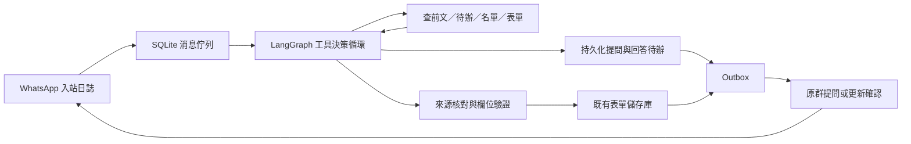

# 主日資料助理

**目前階段：不向群內發問。** `group_questions_enabled=false`，問題只留網站後台；測試及正式設定的周五催補提醒也暫時關閉。收集、明確資料寫入與請假成功回執可繼續。發送前 backend 與 bridge 都重查設定，已佇列的追問轉為 `held`；日後開啟發問也不會自動補發舊問題。只有操作者另行啟用才發新問題。

此助理連接三個 WhatsApp 資料來源群，整理資料到現有主日及同工表單。

| 資料來源 | 工作 |
| --- | --- |
| 達拉斯聖道教會 | 同工不能服事日期及本週奉獻；請假保存成功後在原群回覆「收到，已更新」並列明姓名和日期 |
| 主日讲道联络群 | 當周及未來主日的講員、講道題目、讀經經文 |
| 主日诗歌服侍交流群 | 領詩、主日詩歌及回應詩歌；沿用網站已預填領詩輪值，明確更正優先 |

三個群內明確相關的資料都可收集；主要分工決定例行缺項提問與提醒的負責群，具體消息的疑問仍在原群追問；不拒收其他群的明確補充。一般照片、旅行地名、聊天與冬令時提醒不是請假或主日安排，不因有附件就追問。

周五 **17:00 America/Chicago**，檢查接下來主日的崇拜準備欄位（含司會、領詩）。全部齊備就不提醒；有缺項按主要負責群分別提醒，每主日每群去重。講道缺項發講道群，詩歌與領詩缺項發詩歌群，司會缺項發教會群。未同步、待辦、識別失敗、未核對資料或同工安排衝突會暫緩提醒，原因顯示在管理頁面。設定可調整時間。

主日資料可由群內不同同工分次提供，每次只更新明確提到的欄位，其餘已收集內容保留。奉獻寫入既有 `donationAmount`，只記錄明確主日的奉獻總額，不收集個別捐獻者資料，也不自行換匯或推算。本教會已確認「本週／截至某日」的奉獻填目前準備的主日表單，例如10/23（周五）公布本週總額，填10/25主日；明確補報其他主日則按明確日期。只取明說總額，不把分項重加一次。奉獻不列入周五崇拜準備缺項。

## 執行架構

使用 **LangGraph + LangChain 的工具介面 + OpenAI 模型**，以一個工具決策 Agent 處理每則入站事件，不使用多 Agent 協調或通用電腦操作。



- 模型能選擇查前文、搜尋舊消息或名單、讀取當前表單／指定日期可安排狀態、更新、追問、取消待辦或略過。它不能執行任意 SQL、shell、網頁搜尋，或指定其他目的群。每輪只執行一個工具，單事件上限 8 次模型決策；LangGraph 的節點上限為 18（每輪含決策與工具節點，另留上限錯誤出口），不是 18 次模型決策。決策次數隨 checkpoint 保存，程序重啟不重置；達上限走既有錯誤／管理員求助流程。
- 掛載工具前，以精確白名單略過獨立的「謝謝／阿們／thanks／amen」及有限句尾標點、祈禱表情，保存 `processing_path=fast_path_ignore`，不呼叫模型、不發群消息。包含其他內容、引用、編輯、附件、同群未結束待辦、重試或已有提案時保留正常處理；「收到／好」不在白名單，避免吞掉確認回答。
- LangGraph 使用磁碟 SQLite checkpointer 保存每則消息的模型與工具步驟；中斷後接續原步驟，不以記憶體模擬恢復。明確要求重新處理時產生新執行版本，舊記錄保留。暫停收集期間不提交寫入，恢復後可接續。
- 等人回答是獨立的業務待辦，不讓圖或模型持續空轉。新消息帶入適用的未完成事項，模型判斷是回答、更正還是新事項。不同主日、不同同工不共用一條無限增長的對話；其他人的回答需明確引用提問才能接入原事項。
- 更新工具要求先讀取目標欄位，保存不可由模型自行偽造的讀取快照。寫入前和來源核對後再次比較；其他人期間改了同一欄位就退回模型重讀或追問，獨立欄位的更新不互相覆蓋。
- 明確更正可由模型在讀取後決定替換，提案記錄 `agent_decision` 的授權來源，不能標成人工批准。各欄位來源時間會提供給模型；晚到的舊消息不能覆蓋較新安排。
- 外出日期、奉獻金額及讀經分段另做一次獨立的語義來源核對，避免把「某月要外出」猜成整月、把近似金額／個人認獻／外幣推成主日總額，或移動經文分界。核對失敗會回到工具決策，由 Agent 追問；群提問停用時保留後台待辦。核對期間不持有表單寫入鎖。
- 讀經沿用原消息的書卷、章、節起訖、順序與段數，例如「創世記5:21-24；25-29；7:11-13，希伯來書11:5-7」是四段。已有手動分段時，普通通告不是取代授權；需來源明確更正，或連結待辦的回答確認，不能只由 Agent 的 `replace_existing` 旗標放行。來源核對帶入現值及其來源，拒絕結果也綁定這個快照；人工修正後重讀會重新核對，不沿用舊拒絕。
- 同一消息有獨立的明確欄位和不明部分時，先儲存明確欄位，再追問剩餘部分。每個部分操作有持久化 action key；重啟重播不重寫或重發已成功部分，只有待辦完成才結束整則事件。
- 發送確認由寫入工具產生固定格式並入佇列，模型不能用自由文字假稱成功。模型呼叫的暫時性連線／限流／伺服器錯誤有有限重試，失敗保留執行記錄。LangSmith 外部追蹤預設關閉；私有資料和執行檢查點保存在本機狀態目錄。

## 連接方式及目前邊界

`services/whatsapp-bridge` 使用 whatsapp-web.js 和本機已安裝的 Chrome。
它是非官方 WhatsApp Web 客戶端，存在平台變更導致斷線及帳號受限的風險；參見
[專案說明](https://wwebjs.dev/guide/)。接入既有群需先用選定帳號的手機掃碼，再在管理頁選定三個群 ID。群名稱只是預設提示，不會自動按相似群名發信。

首次同步最近 30 天、WhatsApp Web 可提供的消息；這些歷史消息先進待核對，不自動套用，也不向群內補發舊請假回覆。之後保存每群游標，定期補同步並接收新消息。即時消息優先於首次歷史核對，避免新登記被舊消息佇列延誤。讀取超過上限會顯示錯誤，不能把不完整同步當成已完成。Chrome 必須由一般使用者運行；不關閉 Chromium 沙箱。

首版處理文字。語音、圖片、附件及不清楚的內容會請群內同工以文字補充，不會假裝已讀懂。群撤回消息需要核對已收集資料，請用明確的新消息或既有表單更正。

## 設定和啟動

先依 [operations-runbook.md](operations-runbook.md) 準備環境。開發使用自己的 worktree 及 `scripts/dev.sh`，production 部署仍只有 `scripts/deploy.sh`。正式環境先以 `backend/.venv/bin/python scripts/install-sunday-assistant-agent.py` 準備共享密鑰、設定及 LaunchAgent（不載入服務、不啟用收集），再由唯一入口 `scripts/deploy.sh` 安裝橋接依賴並切換／核對常駐服務。以下是本機程式啟動方式。

1. 在 worktree 的 `services/whatsapp-bridge` 安裝獨立依賴：

   ```sh
   PUPPETEER_SKIP_DOWNLOAD=1 npm ci --omit=optional
   ```

   Python 需在該分支自己的環境安裝 `backend/requirements.txt`，包含固定版本的 LangGraph、SQLite checkpointer 及模型工具介面；勿修改其他背景任務共用的環境。

2. 建立 Git 以外、權限 `600` 的設定檔。backend、web 和助理需使用相同的 `SUNDAY_ASSISTANT_SECRET`。密鑰可以用 `python -c 'import secrets; print(secrets.token_urlsafe(32))'` 在操作者終端產生，勿提交或寫入日誌。

   ```dotenv
   DATA_BASE_DIR=/absolute/path/to/data
   FULL_ARTICLE_SERVICE_URL=http://127.0.0.1:9548
   SUNDAY_ASSISTANT_SECRET=<random-secret-at-least-24-characters>
   SUNDAY_WHATSAPP_STATE_DIR=/absolute/private/path/to/whatsapp-state
   SUNDAY_WHATSAPP_PORT=8766
   SUNDAY_WHATSAPP_BRIDGE_URL=http://127.0.0.1:8766
   SUNDAY_WHATSAPP_CHROME=/Applications/Google Chrome.app/Contents/MacOS/Google Chrome
   ```

   backend 要有既有的 `OPENAI_API_KEY`，模型沿用網站的 `OPENAI_GENERATION_MODEL`；可用 `SUNDAY_ASSISTANT_MODEL` 專門指定。此助理設定沒有預設 production 密鑰。

3. 使用與 `.python-version` 相符的 `backend/.venv` 啟動：

   ```sh
   backend/.venv/bin/python scripts/run-sunday-assistant.py --config /absolute/path/to/assistant.env
   ```

   Supervisor 同時管理 Node 橋接器和 Python worker，持有獨占工作階段鎖。任一退出就停止另一個，外部服務管理器可重新啟動整對程序。正式 LaunchAgent 的 WorkingDirectory 和 Python 路徑由 deploy 固定到實際 release，設定與 WhatsApp 狀態放在 release 之外；切換前停止舊 worker，回滾同步恢復對應版本。

4. 開啟 `/admin/sunday-assistant`。用手機 WhatsApp → 設定 → 連結裝置掃碼，讀取群名單、核對帳號與三個群，再保存群設定及啟用收集。

5. 第一輪保持「自動登記」關閉，核對更新預覽。將消息發送人 ID 對應到本人一位同工，以理解「我」；夫妻關係以 `households` 另存，已確認的中英文稱呼以 `worker_aliases` 對應既有同工主鍵。核對三個資料來源群後，開啟自動登記就會接收所選群不同成員的明確資料，並在需要時追問；不需逐位加入發送人白名單。舊設定中的 `trusted_senders` 保留相容，但不再是自動登記的門檻。開啟周五提醒前先確認群選擇和收集結果。

新增群接口只接受 local bearer 密鑰；瀏覽器經 NextAuth 管理員/editor 權限和同源檢查代理，不暴露密鑰，也不代理 bridge ingestion 接口。服務綁定 loopback。

## 聖詩匯入與當週演唱安排

- Agent 可查完整網站聖詩索引，不只查已匯入歌曲。明確編號的歌缺少目錄項或歌詞時，使用 `lookup_hymnal_entry`／`import_hymnal_song` 接續；不能要求人手工匯入其實已可核對的索引項。
- 匯入只使用網站索引與已支援的 fcccc.net 聖詩來源。索引未附歌詞 URL 時，可按該站固定編號路徑查找，但仍須獨立核對歌名、編號及完整歌詞，不能只因 URL 可下載就接受。任意歌詞網址、無索引或來源失敗需人工補來源或歌詞，不能從記憶創作。明確提供 YouTube 影片的詩歌另走影片播放流程，不需歌詞。
- 歌詞先按既有流程轉繁體，再由模型定位完整歌詞範圍及換行分段。程式比較來源與排版後的全部歌詞文字及順序（容許空白、標點及段首詩節序號的排版差異）；另一個核對步驟檢查是否漏掉整節／副歌、來源錯誤或混入網頁導覽。
- 匯入原文、範圍、來源 URL、來源及排版 SHA、依據消息與儲存狀態保存在私有 SQLite。準備完成後中斷可重用；寫入前重新核對目錄快照。已存在的非空歌詞一律保留，準備期間有人填好歌詞也不覆蓋；空白歌詞可補齊。目錄寫入與網站編輯共用資料鎖，網路與模型呼叫不持有寫入鎖。
- 兩首分別寫入 `hymn`、`responseHymn`。群內明確標籤優先；只有兩首且只列順序時，按使用者確認的慣例第一首主日詩歌、第二首回應詩歌。
- `hymnNotes`／`responseHymnNotes` 保存當週演唱說明，不改全站歌詞。可依明確「只唱一、二、四節」「最後一節重複一次」選取既有歌詞段落及重複末段；節次不存在、歌詞分段不符或重複次數未明則追問，不靜默忽略。網站可查看及修改說明，產生 PPT 時套用。

### YouTube 影片播放

- 明確對應某首歌的 YouTube URL 按當週、按歌曲欄位保存：`hymnYoutubeUrl`／`responseHymnYoutubeUrl`，不改全站詩歌目錄。保留原 URL 及時間參數，不以影片預覽的樂譜編號推斷網站聖詩編號。
- 影片歌曲可不在目錄，也不需要歌詞；Agent 不應匯入或索取歌詞。PPT 完整性檢查只對沒有影片連結的歌曲要求目錄及完整歌詞。
- PPT 使用原來的歌名與歌詞頁位置，將該首歌改成一頁「播放 YouTube 影片」的可點擊連結；完整 URL 同時放入講者備註。點擊開啟瀏覽器播放，不是嵌入影片或自動播放。其他歌曲仍照常產生歌詞。
- 網站表單可查看、修改或清除兩個播放連結。換歌時在同一筆受保護 Patch 清除舊歌的影片連結（若同時給新連結，以新連結為準）；只補同一首歌的 URL 不動其他欄位。無法判定歌曲、日期或連結歸屬時保留待釐清，群內發問仍遵守現有開關。

### 換歌時的局部更新

變更主日詩歌或回應詩歌時，只更新該歌曲及其依賴欄位。換成另一首且沒有明確提供新演唱說明，原歌的選節／重複說明會在同一筆受保護更新中清空；歌名未變則保留。若同時提供新說明，以新說明為準。衍生清空記錄原值、新值、來源消息及 `derived_from`，不改全站歌詞。

只改演唱說明時也要核對目標歌名的讀取快照；換歌清空說明時核對說明快照。有人期間更換歌曲或修改說明，會拒絕覆蓋並重讀，不把舊說明套到新歌。明確取消說明可傳 `null`，其他主日欄位不能用 `null` 清除。

### 隔離樣本重播

`scripts/simulate-sunday-form.py` 使用真實 Agent、模型與網站儲存庫重播私有 scenario；輸出必須是新目錄，拒絕 production 路徑。程式不啟動 WhatsApp、worker supervisor 或寄信程序，所有群回覆僅記錄在本機。scenario 包含原消息時間、匿名帳號對應、起始排班與預期欄位；實際消息與個人資料不提交 Git。

```sh
backend/.venv/bin/python scripts/simulate-sunday-form.py \
  --scenario /private/scenario.json --output /private/new-run \
  --model-config /private/model.env
```

每則消息保存狀態及逐欄位前後差異，最後檢查目標表單、指定保留欄位、重播去重、歌曲目錄不變和沒有外部群傳送。`report.json` 與 `current-forms.json` 位於輸出目錄；資料在 `data/`，可用該 worktree 的獨立 dev server 檢視。補充壓力測試必須與使用者原始樣本分開標示。

## 未來兩週骨架

- 以 America/Chicago 日期維持接下來兩個主日；週日當天的「未來兩週」是下週與下下週。未填的講道題目、經文、歌曲等留空，不補創世記1:1。網站表單允許先存骨架與未完成草稿，已輸入的部分經文仍須格式有效。
- 骨架必填只有講員、司會、領詩；其他欄位可在主日前補齊。保留網站已預填／人工安排。新缺項的司會依角色資格、過去輪值、可服事日期及同日其他工作分配；自動安排遇請假可重分，人工確認的安排保留並提示衝突。
- 領詩讀取網站已有預填資料；兩位輪值名單保存在 `worship_rotation`，新缺項以最近既有輪值為錨延續，群內明確安排優先。輪到者不能服事或沒有足夠前文時不猜第三人；講員也不從歷史自行排定。
- 缺少講員／領詩，或司會沒有可安排人選時，在主要負責群建立帶日期的持久化追問，每個日期／欄位不重複催問。排程來源標為 `origin=schedule`，不冒充群成員。同群任何同工可回答；兩個日期無法分辨才追問。表單手動補齊也會結束待辦。
- 網站後台顯示兩週骨架是否齊全。PPT的未來安排固定取本週之後第7、14天，不會因缺一列而跳到更後面的主日；這三項未齊時停止產生，避免把不完整名單當成已確認報告。缺少下下週資料不會阻止本週獨立的周五提醒。

## 身分及夫妻關係

管理頁「WhatsApp 身分核對」顯示三個來源群的成員、手機聯絡人／自設名稱、LID與電話帳號、已確認本人及待確認候選。橋接器每10分鐘重新核對群成員，也可手動重新核對。只有 WhatsApp 自身回傳、且包含查詢對象的一組 LID／電話 ID 才可連接帳號；跨裝置尾碼會正規化。名稱與已確認別名只產生候選，不自動當成身分。操作者選定本人並儲存後才生效，夫妻關係另存。身分補齊後，原先尚未向群發送、亦未寫入任何部分的身分待辦會重新評估；已寫入部分或已向群提問的事項不自動重播。

同一帳號的不同 ID 對應不同人，或同一電話先後連到不同 LID 時，保留證據並標示衝突，停止身分推定。顯示名稱、模型自報記憶、配偶關係不能蓋過衝突。帳號等價證據及群名冊保存在網站私有 SQLite，重啟保留；不在 Git 或瀏覽器暫存。群裡的疑問仍按現行設定只留後台，不確定的姓名由操作者向使用者核對。

- WhatsApp 發送人只對應一位本人；這是登記對象的識別，不建立網站帳號、不授予登入或管理權限。管理員設定優先於自報姓名記憶。
- 未知發送人可在群內自報姓名或回答身分問題；`remember_identity` 先驗證現有同工、同群同作者的消息、已確認別名及明確自我介紹，再將依據消息 ID 存到 SQLite `identities`。重啟後仍保留。提及配偶、顯示名稱或轉貼不等於本人；既有本人對應衝突時不自動改綁。
- 「我」只處理本人；「我們夫妻」才使用已確認的夫妻關係。舊多姓名映射只是家庭線索，不當成兩位本人。未知家庭關係需問清楚，不能因一起旅行而推斷夫妻。
- 英文名或常用稱呼以管理員確認的別名查詢；不憑姓氏猜人，也不因名單拼寫錯誤自動改掉原有主鍵。單字別名接受獨立稱呼及「於／在＋日期」等姓名後接日期的寫法，避免誤匹配普通詞中的字。
- 管理頁可新增／移除本人映射、夫妻關係及姓名別名，並顯示自我介紹記憶。修改後按「儲存設定」，寫入網站 `$DATA_BASE_DIR/sunday-assistant/assistant.sqlite3` 的設定；不是瀏覽器暫存。部署保留既有 `DATA_BASE_DIR`，不把對應放到會替換的 release 目錄。測試與正式站的設定各自獨立，不能把測試 outbox、表單或群 ID 一起複製；正式站只初始化管理員明確確認的映射，收集和提醒維持關閉，待接入驗收。

## 上線狀態核對

正式啟用需完成共享密鑰、橋接依賴與 LaunchAgent 的配置、發布及健康核對。安裝器保留自訂橋接埠，並同步 backend；本機正式 bridge 使用8769（8766已由其他服務使用）。deploy 另驗證帶密鑰的橋接器與啟動後的新 worker 心跳，只有載入 LaunchAgent 不算驗證通過。安裝器與 deploy 已提供此流程；發布 dry-run 只驗證前置條件，不能當成已建置或已連線。首次群歷史同步僅供核對，不自動寫入或補發舊回覆。正式收集與自動登記需明確啟用，群內追問及催補提醒仍保持關閉。

## 內部故障向網站管理員求助

`admin_group` 指定獨立的「网站管理员」群，`admin_help_enabled` 啟用。此群不納入三個資料來源群，故障通知與來源群提問、周五催補分開控制；開啟求助不會開啟來源群追問。管理頁可選群、查看事件及發送明確標示「上線測試，無需處理」的通知。

supervisor 內的獨立監測程序每10秒檢查，不依賴模型或 worker 的工作鎖。內部任務／worker 執行失敗立即求助；worker 五分鐘無進度、WhatsApp連線或同步持續兩分鐘異常、後台或執行資料庫持續一分鐘無法讀取、十分鐘內異常退出至少三次也會求助。正常啟動有寬限期；等待輸入、`waiting_reply`、一般 `review`、暫停收集不當成內部故障。

事件與求助 outbox 在私有 `admin-monitor.sqlite3` 中保存。同一持續故障只通知一次，條件解除後只回報一次；故障轉瞬恢復且尚未發送時取消舊通知。通知僅含事件編號、固定故障類型／數量和管理頁連結，不含來源消息、姓名、奉獻額、錯誤堆疊或密鑰。發送結果不明只查既有送達紀錄，不盲重發。

後台不可用時，bridge 只可使用最近24小時內由後台授權並保存的管理群設定，不能向其他群發送。WhatsApp 本身斷線時保留待發通知，恢復連線再送；這不是另一條離線通訊渠道，整台機器或 WhatsApp 都不可用時無法即時通知。部署的正常停止不算崩潰，監測故障也不會停止正常 worker。

## 恢復和核對

- 原消息先進 SQLite，再做模型識別；資料位於 `$DATA_BASE_DIR/sunday-assistant/assistant.sqlite3`。處理失敗保留錯誤和原消息，從後台重試。
- 處理程序採 OS 鎖，每次重啟恢復 `processing` 和 `applying`。網站的主日與同工寫入共用鎖，更新前重讀資料，只修改抽取的欄位；與預覽不同的人工修改會擋下。
- 更早的消息不能覆蓋更新消息；同時不同值需核對。抽取結果的 evidence 要逐字對回原消息，姓名和詩歌要對應既有名單。
- 新增外出區間時會合併日期，保留原有人工作業的其他日期。刪除日期或改寫既有崇拜內容會先讀取、核對來源及明確更正意圖；不清楚才追問。自己的消息以登入帳號對應姓名，其他發送人的裝置尾碼不影響姓名對應。
- 同一發送人更正先前已成功登記的外出，可引用同群前文沿用登記對象，不必重複兩人的姓名。模型指出前文消息 ID，程式驗證該消息屬於同一發送人且已套用該同工的外出；延長日期回覆完整的新區間。其他發送人、其他群或尚未套用的前文不能作為此依據。
- 安裝時會對固定版本的 `whatsapp-web.js` 套用 MsgKey 相容修正（上游 PR #201871），支援 WhatsApp Web 將 `_serialized` 改名為 `$1` 的版本。安裝腳本核對原檔 SHA；升級套件時若原檔不同會停止，需先檢查相容性。
- 自動登記開啟後，未確認的欄位或身份會保存待辦；允許群內發問才發到原群，否則問題留在後台並標記 `held`。提問以 `clarify:<對話ID>:<輪次提案ID>` 去重，並保存原消息、歷次回答及當前問題；首次歷史同步和預覽模式不發問。
- 回答後模型整合該件待辦的原文及回答，日期或姓名仍不清楚就只追問剩餘問題；齊全才寫表單、回覆已更新並結束舊待辦。只允許從該件待辦原文或回答取 evidence。本人可直接回答，其他群內同工需明確引用助理的提問才能接續；其他群或未指向提問的插話不會混入。
- 未解決的對話會跨程序重啟保存；同一個剩餘問題不因相同回答重發。取消尚未完成的登記會回覆取消，不更動既有表單資料。送達結果不明時沿用 outbox 的不重送規則。也可從後台略過待辦；含疑問的提案不能直接批准。
- 請假回覆在成功寫入後加入持久化 outbox；恢復未完更新不會先回報成功。確認後的請假也會發回覆。
- WhatsApp 工作階段、入站補送及已送記錄位於 `SUNDAY_WHATSAPP_STATE_DIR`，不進 Git。狀態目錄應限該使用者存取。
- 發送前保存 outbox，發送後保存遠端消息 ID。若連線在中間失去、無法確定成功，顯示「發送結果待確認」，只查 bridge 既有結果，不盲目重送。同一主日的提醒以日期去重。
- 備份 SQLite 使用其 backup API（勿只複製啟用 WAL 時的單一檔案）；WhatsApp 狀態備份應在 supervisor 停止後進行。

## 驗證

```sh
backend/.venv/bin/python -m pytest backend/tests/test_sunday_assistant.py backend/tests/test_sunday_assistant_dialogue.py backend/tests/test_sunday_worker.py backend/tests/test_sunday_scripture_readers.py
backend/.venv/bin/python -m pytest backend/tests/test_sunday_assistant_graph.py
RUN_SUNDAY_AGENT_MODEL_TESTS=1 backend/.venv/bin/python -m pytest backend/tests/test_sunday_assistant_model.py
cd services/whatsapp-bridge && npm test && npm run check
cd web && ./node_modules/.bin/tsc --noEmit
```

真實帳號掃碼、讀取三個指定群及真實回覆，是需在接入時另外核對的現場驗收；程序及模型測試使用合成資料，不發正式群消息。


本卡最後一輪驗證：165 項相關 Python 程序測試、30 項真實模型案例（完整 28 項及另行排程追問、禁止發問案例）及 11 項 Node 測試通過；前端型別檢查及私有 Python 環境依賴檢查通過。全庫文件檢查仍有另一專案原有的 `functional_spec.md:120` 錨點錯誤，本卡未改該檔。

### 本卡驗證範圍

| 情境 | 驗證方式 |
| --- | --- |
| 多人分次提供欄位、未來多週講員、編號詩歌 | 自動測試及真實模型；現場測試群驗證分次補充 |
| 有明確欄位也有疑問時先儲存明確部分 | 自動測試、真實模型、測試群實際表單及追問 |
| 月份不明、分次回答、更正、不重複姓名、取消 | 自動測試、真實模型；測試群追問等待期間重啟後繼續完成 |
| 同群兩項待辦，答案各自接續 | 測試群驗證詩歌及奉獻兩項獨立待辦 |
| 奉獻小數、零、近似值、外幣或個人認獻 | 自動測試及真實模型；現場奉獻小數寫入表單 |
| 讀取後人工修改、核對期間修改、中斷後恢復 | 自動測試，含部分提交後檢查點失敗重播 |
| 暫停／恢復、人工重試新執行、429有限重試、工具步數上限 | 自動測試 |
| 重複事件、不重發已成功回覆、發送結果不明 | Python及Node自動測試 |
| 消息編輯 A→B→A、編輯原始日期、缺少編輯依據 | Node及Python測試；現場消息編輯寫入 |
| 本人身分記憶、配偶非本人、別名及家庭範圍 | 程序工具及真實模型；現場先移除隔離設定的本人映射、自報姓名、重啟後用「我」登記；另驗證「我」只更新本人、「我們夫妻」兩人及中英文別名 |
| 網站映射設定保存 | 後台新增臨時別名、保存、重載讀回及移除還原；正式網站持久化區只保存已確認映射，未啟用助理 |
| 周五17:00缺項提醒，完整不發、重播不重發 | 模擬周五時鐘，經真實橋接器向測試群送達一次；未宣稱已觀察到真實周五排程 |

所有現場驗證只選三個測試群，寫入隔離資料副本。正式群、production、開機自動常駐及真實周五排程仍需接入部署驗收。

新增現場驗收：三個測試群的資料合併至同一主日；不能服事的講員先追問，收到改派回答後完成；缺少的第1首經由真實來源自動匯入、排版、核對、寫目錄及主日表單。三群提醒以模擬周五時鐘送出實際WhatsApp消息：講道缺題目／讀經只提醒講道測試群，缺主日詩歌只提醒詩歌測試群，已提供的回應歌不再催問；重播不重發。這不是觀察到真實周五的排程運行。

## 資料齊備後產生 PPT 與通知

`auto_generate_ppt=true` 時，已啟用收集及自動寫入、並設定獨立網站管理員群後，工作程序會檢查本週主日。講員、題目、讀經經文、兩首詩歌由群消息補齊；司會／領詩沿用既有可服事輪值。讀經缺項自動在具備讀經資格、可服事的同工中選人，優先避免同日多職與上週已讀經的人，再按近期次數與上次日期輪替。每段經文分配一位，跨 slide 的分配沿用既有 PPT 程式。人工明確指定的人選與順序保留。司琴可空白，奉獻 0 為有效值，未知金額不當成 0。

生成前須有兩首完整歌詞、有效讀經安排與未來兩週講員／司會／領詩骨架；有待處理消息、當週待核對事項、請假衝突或同步未完成時暫緩。經文來源沒有回傳內容時，自動流程不會以缺少讀經內容的 PPT 宣告完成。

成功檔案以主日、表單／歌詞／未來安排、模板與產生器版本保存，驗證 PPT 可讀後才送出「【主日PPT已準備好】」到管理員群，附登入後下載連結。這不會上傳或替換網站人工最終版 PPT。來源群追問／周五提醒可保持關閉；PPT 通知獨立控制且不能寄到來源群。更正會產生新版並取消未送出的舊通知；過時版本下載會提示等待新版。

相同版本不重複生成或通知；發送結果不確定時只查送件紀錄，不盲目重發。內部生成故障進入獨立管理員求助，後台有錯誤與「重新產生 PPT」按鈕；資料澄清造成的等待不當成系統故障。狀態、產物與 outbox 都持久化，程序重啟不丟失已成功結果。

## 歌詞換行與投影片分頁

歌詞中的單個換行表示同一張 slide 的下一行；空行表示下一張 slide。HTML 擷取保留 `<br>`、段落與詩節表格列，不用空格壓平儲存格，也不在相鄰行內標籤間插入空格。獨立編號欄併入詩節首行，避免產生只有編號的投影片。

來源已有連續編號、多行且分段的詩節時，Agent 由程式保留原行與空行，僅移除詩節編號及 Markdown 行尾空白；模型只選擇歌詞範圍，不能重新合併或拆開這些 slide。完整性核對仍需通過；不自動改寫既有已保存歌詞。PPT 依相同空行規則分頁。


### 司琴安排

明確的司琴安排寫入當週 `pianist`，按完整同工名單、相對日期、現有表單與請假資料核對；三群跨群收集開啟時均可提供，主要負責群為詩歌群。司琴仍非周五／PPT 必填項，沒有指定可留空；「可留空」不代表忽略已公布的安排。明確取消可清空該欄，普通詢問不產生安排。不同同姓同工不可互換，改動只 Patch 司琴欄，既有人工安排仍須明確更正或操作者核對。

## 講員郵件 PPT 收存

獨立的 Gmail 唯讀接收執行緒掃描已指定的個人郵箱，不能寄信、改標籤或標記已讀；慢郵箱及模型失敗不阻塞 WhatsApp。每次只掃描一頁、處理一封新郵件，逐頁先保存完整 message ID 再前進游標。範圍為最近 45 天帶 `.ppt`／`.pptx` 附件的收件（不含垃圾桶、垃圾郵件、草稿與寄件）。不開啟郵件內的網址，不把附件內容送給模型。

先以實際 From email 對照網站同工 email 或操作者已核對的寄件地址，再核對姓名；顯示名稱不是身分證據。模型以郵件時間、主旨、正文、附件名與網站日期／講員／題目判讀，另一次來源核對通過後才自動收存。主日崇拜流程、團契查經、舊版參考附件不作講道檔。未知寄件人、日期不明、多份版本或資料衝突留在後台；缺少的姓名對應／網站安排補上後可繼續，原判讀與核對結果按原始輸入保存。內部失敗走既有管理員求助監測，不冒充缺資料。

原始 PowerPoint 位元組直接複製到與主日 PPT 相同的 OneDrive 日期資料夾，檔名 `講道-YYYY-MM-DD-講員.pptx`（原生 `.ppt` 同樣保留）。各 SHA 原檔保存在日期資料夾外的 `歷史版本/月-日-年/講員PPT版本/`。兩個郵箱收到相同附件只保存一份；晚到舊版不退回目前版本；人工改過的檔案先保留並要求核對。模型和檔案下載在表單鎖之外，正式寫入前重讀寄件人與網站安排。收存不中斷／重寫主日表單或既有主日 PPT；本機寫入成功不表示 OneDrive 雲端已同步。

每週六 **22:00 America/Chicago** 尚未確認收到並收存當次講道 PPT，向**網站管理員群**發一次跟進通知；重啟不重複，附件到達後取消尚未送出的提醒。這是獨立開關 `saturday_followup`，不啟用已關閉的群內追問或周五缺項提醒。

### Gmail 私有設定與授權

`config/sunday_gmail.json`（或 `SUNDAY_GMAIL_CONFIG`）只列郵箱、核對人及私有 token 目錄；OAuth token 存在網站資料目錄之外，每郵箱一份，檔案權限 600。**既有 Drive／Docs 的 token.json 不變。** 即使是網站同工，也只有設定指定且本身有 editor 權限的核對人能讀取郵件附件紀錄／確認寄件身分；不授予新網站角色。

```sh
backend/.venv/bin/python scripts/configure-sunday-gmail.py \
  --config /absolute/data/config/sunday_gmail.json \
  --mailbox junyang168@gmail.com --mailbox jianwens@gmail.com \
  --reviewer junyang168@gmail.com --reviewer jianwens@gmail.com \
  --token-directory /absolute/private/sunday-gmail-tokens
backend/.venv/bin/python scripts/authorize-sunday-gmail.py \
  --config /absolute/data/config/sunday_gmail.json \
  --email junyang168@gmail.com --client-secret /absolute/private/client_secret.json
```

第二個郵箱需由其帳號另行 Google 同意。Google Cloud 須啟用 Gmail API，desktop OAuth client 使用 loopback callback。授權範圍僅 `gmail.readonly`，核對 profile email 完全相符後才啟用 token；若 Gmail API 尚未啟用，已取得的同意先存私有 pending token，啟用 API 後以同一命令加 `--verify-pending` 核對，不重複要求同意。授權頁安全提示由帳號持有人處理。可移除指定 reviewer 立即撤回後台存取；`enabled=false` 停止收件／提醒，`saturday_followup=false` 單獨停提醒。

持久化資料為 `$DATA_BASE_DIR/sunday-assistant/gmail/` 下的 SQLite、原檔 cache 和鎖；不進 Git，不在一般助理狀態 API 暴露私人郵件。網站 `/admin/sunday-assistant` 的 Gmail 區塊顯示連線、收存／版本、待核對及重試入口。

### SQLite 連線釋放

所有助理佇列、Gmail inbox 及管理員監測的 SQLite context 在提交／回滾後立即 close；Python 的 `with connection` 只處理交易，不能代替 close。LangGraph 自己的 SqliteSaver 另有 closing context。否則連線等待 cyclic GC 時可耗盡 macOS 背景程序的檔案描述符，連 checkpoint 都會報 `unable to open database file`。回歸測試在獨立子程序關閉 GC、限制 128 個描述符，連續跑 300 次佇列／監測／郵件讀寫，並驗證例外回滾及連線已關閉；不以提高系統上限掩蓋洩漏。發生內部錯誤的原消息仍保存來源、checkpoint 及已有寫入回執，恢復時重用既有請求，不能偽造成功或重發已成功回執。

## 群內查詢主日請假名單

在教會外出登記群可問「這週主日誰不能來？」「下週主日哪些同工請假？」「11月8日誰不能來？」。Agent 使用 `answer_sunday_absences`，由程式按原訊息的達拉斯時間解析一個明確主日，讀網站同工已保存的不能服事日期，產生固定格式回覆。編輯／延遲處理不改用現在日期；年份省略時對照原發送日期選最近有效日期。日期矛盾、多個日期、非主日或尚未支援的相對日期不猜測，按原有設定留後台澄清。

回覆列出日期與已登記不能服事的姓名，不披露個人聯絡資料、請假原因或無關日期；未登記請假不等於已確認出席。查詢只改消息處理狀態和持久化回覆，不修改同工或主日表單。資料以網站已保存內容為限，尚未完成的請假不假稱已登記。

只向發問的教會外出登記原群回覆，其他來源群及管理員群不自動提供名單；由 backend 與 bridge 在送出前重查目的群和啟用狀態。這是回應同工的明確查詢，與仍關閉的主動追問／周五提醒分開。首次歷史同步、撤回或無法核對編輯時間的事件不自動發送。

原消息 ID 對應一個 `absence-query:` 回執，重啟不重複。第一次送出前重讀網站名單，並等待 WhatsApp 同步及入站交付完成；已提交或結果不明的回覆保持原文，沿用橋接傳送日誌核對，不盲目重送。

## 雙週讀經團契

由 `fellowship_enabled` 單獨啟用，使用既有網站管理員群。這是管理群的團契收集流程，不開啟三個來源群的主動追問或周五催補。啟用時間 `fellowship_since` 和起始日期 `fellowship_start_date` 保存於設定；不補發啟用之前已錯過的主日詢問，也不把啟用前的管理群聊天當新安排。

- 每次已填主講／主題的查經結束後，預建下一次日期；預設相隔 14 天，網站已有下一次排程時優先沿用。日期由程式提供，不向管理員詢問，也不自動推進章節、主講或序號。
- 查經後的主日 **15:00 America/Chicago**，向管理群發一則詢問，列出表單除日期外五項：**主講、主題、系列、序號、來源連結**。已保存值一併列出，管理員可以分次補充或明確更正；序號／連結若無，須明確回覆「無」。學習回顧是查經後產生，不能替下一次捏造內容。
- 截止是詢問後緊接週四之前；該週四 **09:00** 仍有缺項或歧義，發一則只列缺項的提醒。例如 11/6 查經、11/8 15:00 詢問，11/12 09:00 催補，下一次預定 11/20；不是等到聚會前一天才開始追資料。中斷後補送會取消多餘的舊詢問，資料已補齊時取消未送出的提醒。

管理群事件使用同一個 LangGraph／SQLite checkpoint runner，但只掛載四個團契工具：讀取待辦、局部更新、具體澄清、略過。不能呼叫主日寫入工具。讀取時保存各欄快照，寫入前重新核對；不同管理員的獨立欄位可合併，同一欄位被改過則重讀。每個變更帶當前訊息逐字依據，另做來源核對；不從顯示名稱猜「我」，不把尚未確認的人選寫成確定安排。網站的學習回顧、自訂 email、其他欄位均保留。

`fellowship_cases` 保存跨訊息缺項、欄位確認及澄清；`fellowship_changes` 保存來源、原／後值和提交回執。檔案替換後中斷可依原核對結果恢復，已提交但回覆前中斷可補建原回執，不重寫表單。工具參數驗證錯誤會作為觀察回到 Agent 自我更正，仍受原有 8 次決策上限限制。

管理群 intake 和來源群名單分開：只接收啟用後管理群訊息，不把管理群加入三群身分稽核或主日欄位權限；一般助理狀態不列出管理群聊天原文。`fellowship:` 出站信封在 backend 和 bridge 各自檢查新鮮設定，只送專用管理群。每則詢問、催補、保存回覆以來源／日期去重，結果不明不盲目重送。

### 團契通知 email 接續

沿用既有 `fellowship_reminder_job.py`、通知名單、模板及 SMTP 設定。獨立背景執行緒每分鐘以該 release 的 Python 呼叫同一個 job 的 `--catch-up`，使用既有團契通知 LaunchAgent 的受保護 mail 環境，並核對與助理使用相同資料目錄；SMTP 不會阻塞 WhatsApp。原有每日排程保留。

主講、主題、系列及該待辦的選填確認尚缺時不寄。原排程時間後補齊，可接續寄送，到當次週五 19:30 開始前為止。手動寄信與排程共用 `notification/fellowship-delivery/` 的每日期寄送回執及跨程序鎖，並承認舊 `last_sent.json`；同次已寄不再自動重複。SMTP 明確尚未提交的連線／認證失敗最多重試三次；傳送中斷或結果不明保留回執、停止自動重寄，交由既有管理員內部故障監測求助，不能假稱全數已收信。手工 CLI `--force` 是既有明確重寄入口，不由背景 worker 使用。

管理頁「雙週讀經團契」顯示各欄、缺項、澄清和寄信狀態；原團契表單仍可人工編輯。啟用／停用收集由管理頁設定控制；原有團契每日提醒服務本身仍是獨立 LaunchAgent。部署不自行啟用收集設定，正式啟用需保存設定及 activation timestamp。


### OneDrive 主日播放檔

日期資料夾只保留目前使用的主日崇拜與講道 PPT。主日崇拜固定為 `聖道教會YYYY-MM-DD主日崇拜.pptx`：自動生成作為初稿，人工上傳的修訂版直接覆蓋同一播放檔；最終下載和 email 附件沿用此檔。自動產生後再次生成可更新初稿；人工上傳（即使位元組相同）或直接修改後，後續生成只保存可下載草稿，不覆蓋人工版。

舊稿與重新生成的草稿放在日期資料夾外的 `歷史版本/月-日-年/崇拜PPT版本/`，以內容 SHA 區分。舊的 `主日崇拜-YYYY-MM-DD-自動生成.pptx` 先驗證歸檔後移出日期資料夾。自動發布持有的 SHA 與人工優先狀態保存在網站私有執行資料；未追蹤的既有播放檔視為人工版，不能自行覆蓋。檔案複製失敗時保留完整舊檔，OneDrive 雲端同步另行驗證。
