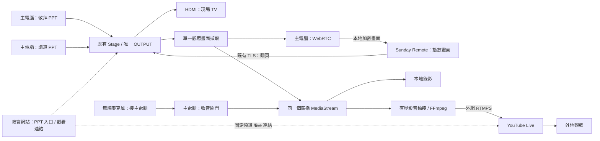

# Sunday Presenter Phase 2 設計：先用 Google Meet 穩定 PPT 與 Remote，再接 YouTube

> 狀態：設計草案 v5，以 iPad 為 Remote 主目標，依 owner 指示分三步上線，待原型驗證；不是已實作或已驗收的功能。
> 日期：2026-11-04。
> 追蹤：[主卡 #643](https://github.com/junyang168/smart-answer/issues/643)。
> 基線：Phase 1 v0.4.0、已合併的 [PR #611](https://github.com/junyang168/smart-answer/pull/611)，程式檢視基線 `2b93ae7007ca4de60d267062a2ff2e8007b6ee5d`。
> 當前進度：0.6.1 已完成 90 分 17 秒本機 PPT＋AudioPro／SSD 錄影；畫面、寫入及儲存正常，音軌兩處約 0.13 秒靜音尚待定位，未通過完全不中斷聲音驗收；Remote 畫面、翻頁、主機切換與全螢幕亦已有原型及本地測試。YouTube／排程尚未實作；未部署／發布網站下載。完整主日與各實體機仍待驗收。
> 原型證據與未測範圍見 [acceptance](../tools/sunday-presenter/acceptance.md)。

## 1. 要解決的問題與使用方式

主電腦已能保持敬拜、講道兩份 PowerPoint 原檔開啟，切換時保留頁面狀態，並用一個固定 OUTPUT 視窗供現場 TV 和分享使用。現在講員還需要 AirPlay 看畫面、Sunday Remote 翻頁、Google Meet 收音，操作分散；AirPlay 全屏會遮住 Remote。

Owner 於 2026-11-04 確認以下三步上線順序。**本主日只進第一步，第二步尚未成為現場操作要求。自動錄影必須可以獨立關閉，預設關閉。**

| 上線步驟 | 現場操作 | 驗證目標 |
| --- | --- | --- |
| 第一步：本主日維持現有崇拜流程 | 主 laptop 用 Sunday Presenter 切換兩份 PPT／OUTPUT；主 laptop 和講員 laptop 都加入 Google Meet，收音及講員操作沿用現有流程。另用一台裝置監看／測試 Remote 畫面傳輸，監看端不操作現場翻頁 | Presenter 切換、動畫、Meet 對外畫面與完整場穩定；旁路記錄 Remote 畫面延遲、掉線與恢復，不讓其成敗阻擋崇拜 |
| 第二步：講員正式使用 Remote 與無線麥克風 | 講員用 Remote 看 PPT／翻頁，使用現有無線麥克風；接收器接主 laptop，由主 laptop 的 Meet 選取收音。只有主 laptop 加入 Google Meet | 講員端畫面／按鍵、主電腦 Meet 實際聲畫、無線收音及整場穩定；講員 laptop 不加入 Meet 也能完成流程 |
| 第三步：接入 YouTube | 前兩步穩定後，才實作／測試固定 stream key 的 YouTube 路徑 | 獨立觀眾端收到真實聲畫，驗證開始／停止與故障恢復後再遷移 |

三步都不要求開啟 Presenter 本機錄影。現在只有明確選裝置、位置並按「開始錄影」才錄製；未選位置或未授權 Presenter 麥克風不能阻擋 PPT／Remote／Meet。需要本機副本時另行啟用並依自身結果驗收。第一步不改 Meet 收音，第二步才把無線麥克風接到主電腦 Meet；這不新增 Remote 網路音訊功能。

第一步監看裝置屬旁路測試，不取代講員原本的操作，也不發出翻頁命令。結束時依現有流程停止 Meet 分享／離開會議；若另開了本機錄影，再停止並儲存。此階段不啟動 YouTube 或定時推流，先前本機錄影測試也不能當作 Meet 或 Remote 整場成功的證據。

後續 YouTube 路徑仍保留固定 stream key／固定觀看入口的設計，待兩台目標 Mac、iPhone 熱點、整場 Meet 與 Remote 穩定性驗收後再實作。以下 YouTube、FFmpeg、廣播 workflow 與排程章節均為後續設計，不是目前安裝版已有功能。

**screenshare 指兩份 PPT 共用的 OUTPUT 播放畫面。** Remote 接收主電腦當前選中那份的即時畫面；不傳兩份 PPT 到 Remote 重新播放，也不維護第二套頁碼或動畫狀態。Command-1／2 的敬拜／講道切換仍由主電腦控制；兩端方向鍵作用於同一個目前播放頁面。背景 PPT 的計時動畫或自動翻頁是否繼續，沿用 Phase 1 的限制，不宣稱背景頁面已被暫停。

後續 YouTube 設計保留 owner 已確認的三項簡化：YouTube 使用可重用的固定 stream key，網站提供固定頻道觀看入口；收音使用 owner 現有、接在主電腦的無線麥克風；不收 PPT 內嵌音樂／影片聲音。Remote 麥克風傳輸延後，本版移除 Google OAuth、每週場次 API、網路音訊及 PPT 音訊擷取。

### 1.1 iPad 是目標裝置，Mac 是過渡

Owner 明確指定 iPad 才是 Sunday Remote 的主要目標；講員使用 Mac 是既有崇拜流程的限制。新增 [iPad pilot #652](https://github.com/junyang168/smart-answer/issues/652)，依賴 #643 的 Presenter 與 video 協議。第一版 iPad 提供 PPT 畫面、觸控翻頁、配對、全螢幕與前景恢復，預設只看畫面、停用翻頁，供第一步旁路監看；第二步才由講員啟用控制。Mac Remote 保留供目前流程過渡，不把另一台 Mac 當成未來講員的必要設備。

現有 WebRTC `remote.html/js/css` 與 `RemoteVideoView.swift` 共用；iPad 以 UIKit 實作版面與生命週期，重用既有 TLS／Bonjour／配對及翻頁協議。只接收 video，不移動 PPT／Office 登入到 iPad。App 進入非作用狀態即停止本機 viewer、取消請求並禁用按鍵；回到前景重新探索與協商，不承諾背景串流。詳細建置／安裝及證據界線見 [iPad 說明](../tools/sunday-presenter/ipad/README.md)。

2026-11-04 已安裝 Xcode，iOS 模擬器與未簽章真機架構建置通過；iPad 模擬器已驗證真實 PPT video、觸控雙向翻頁、只看模式、橫向全螢幕，以及重開 App／返回前景後保留配對並恢復影像。真機簽章、目標 iPadOS、實際 Wi-Fi／熱點與整場驗收仍待完成；模擬器成功不代表真機已通過。

### 1.2 長期願景：主日流程 PPT 自動化；現在建立 Foundation

Owner 確認：目前的 Presenter、iPad Remote、穩定畫面傳輸與人工翻頁，是整個系統的 **Foundation（基礎）**。當前先把這些能力與現有 Google Meet 崇拜流程測穩；以下願景只作方向記錄，不新增本輪實作、排程或驗收要求，也不改變上述三步上線順序。

長期目標是讓系統結合 **PPT 內容、主日崇拜日程，以及主持人與講員的現場語音**，理解崇拜正在進行的環節，協助主日流程 PPT 在適當時機切換與翻頁。日程提供流程脈絡，現場進度決定時機；不能只按預定時間機械翻頁。

兩份 PPT 的控制權明確分開：

| 範圍 | 長期方向 |
| --- | --- |
| 主日崇拜流程 PPT | 未來可依流程與現場內容自動切換／翻頁，例如宣召、讀經、報告與回應；歌詞跟隨須另行研究重唱、副歌與間奏 |
| 講道 PPT | 翻頁始終由講員自行控制，使用 iPad Remote；自動化不接管講道頁面。理解講員語音可作流程脈絡，不等於取得翻頁權 |

未來探索可從「旁路判斷目前應在何頁」開始，再到「提出下一頁建議、人工確認」，最後才評估指定主日環節的自動操作。這是探索方向，尚非承諾的實作方案；語音辨識、內容比對、模型、收音方式與處理位置都未選定。人工需能隨時暫停、接管及修正；進入講道時交回講員，恢復主日自動模式的交接方式另行設計。

Foundation 階段保留可靠的人工操作與明確的控制權，讓未來有可比較的實際流程與翻頁行為。現在不新增語音監聽、AI 自動翻頁或額外資料蒐集，也不以這個願景延後 iPad 真機及現場穩定性驗證。

## 2. 架構決定

| 決定 | 本設計的選擇 | 理由與驗證邊界 |
| --- | --- | --- |
| 播放來源 | 沿用 `Stage` 與唯一 OUTPUT | 保留既有 Office 登入、原檔、動畫及雙份切換；不重寫 PPT 播放器 |
| 主電腦與 Remote 間的媒體 | 本地 WebRTC，單向 video、一對一 | Remote 只看畫面；不協商 audio、不傳麥克風音訊 |
| 控制與配對 | 沿用 Bonjour、憑證釘選 TLS、Keychain 與 bearer token | 翻頁不依賴影音通道健康；既有配對不是任意瀏覽器可用的網站登入 |
| Presenter 媒體執行環境 | 獨立、可信任的本地 Electron renderer／session | 使用現有 Chromium WebRTC，權限不給 Office 頁面 |
| Remote 媒體執行環境 | iPad UIKit 為主；Mac AppKit 作過渡，兩者共用只載入內附接收程式的 `WKWebView` | 重用 WebRTC 與配對／翻頁協議；iPad 真機、觸控與背景恢復需獨立驗收 |
| 對外會議的兩步遷移 | 第一步主／講員 laptop 都加入 Meet、沿用現有收音；第二步只有主 laptop 加入，改接現有無線麥克風 | 第一步 Remote 僅旁路監看，第二步才供講員正式使用；均不要求本機錄影 |
| YouTube 出口（延後） | 主電腦本地橋接 → 內附 FFmpeg → 固定 stream key 的 RTMPS | 不使用 YouTube API／Google OAuth；Studio 預先設定 auto-start／auto-stop |
| 音訊來源 | 只有接在主電腦的指定無線麥克風 | 不擷取 Remote、PPT、內建麥克風或系統音效 |
| 本地錄影 | 選用、預設關閉，與會議／網路出口分開 | 關閉或失敗不阻擋 Meet、PPT、Remote；未來自動錄影也有獨立關閉選項 |
| 教會網站 | 既有 PPT 入口，加上固定頻道 `/live` 觀看連結 | 不寫每週場次／即時狀態；不承擔影音傳輸 |

這些是方案選擇，不是已量測的品質保證。API 依據是 [WebRTC 標準](https://www.w3.org/TR/webrtc/)、[Electron 擷取介面](https://www.electronjs.org/docs/latest/api/desktop-capturer)及 [WebKit 媒體介面說明](https://webkit.org/blog/11353/mediarecorder-api/)；實際可用格式、權限與效能在里程碑 M0 驗證。

### 2.1 資料流

第一步：OUTPUT → Meet 視窗分享 → 觀眾，主／講員 laptop 仍都在 Meet，收音沿用現有流程；Remote 在另一台裝置旁路監看。第二步：OUTPUT 同時供現場 TV、講員 Remote 與 Meet；主電腦無線麥克風 → Meet，只有主 laptop 在 Meet。本機錄影都是明確手動開始的選用分支。以下圖示是延後的 YouTube 路徑，REC 分支只在本機錄影已啟用時建立。

「同一個來源」指同一 OUTPUT 的同一條擷取 video track；WebRTC、錄影與推流可以各自編碼，不宣稱只有一次編碼，也不保證兩端逐毫秒同時顯示。

### 2.2 本地點對點的邊界

兩台 Mac 接同一個 Wi-Fi／iPhone 熱點。媒體走兩台 Mac 的 WebRTC 連線；信令也直接交給主電腦既有本地 TLS 服務。第一版 `iceServers: []`，不配置公網 STUN、TURN、SFU 或網站媒體中繼。

只接受目前本地連線介面的 host candidates，包括瀏覽器產生、可在該區域網路解析的 mDNS host candidate；不接受 relay／server-reflexive 候選或把未知遠端位址當作安全的區域網路位址。信令橋接須檢查候選格式、位址／介面及配對對象，並以 selected candidate pair 的實際統計確認路徑。mDNS、IPv6 與多介面行為都列入 M0；不能為了連通而放寬成任意外網路徑。

若熱點隔離用戶端，或允許 TLS 但阻擋 WebRTC 所需的本地連線，顯示實際失敗原因，改用已驗證可互通的區域網路；不自動引入雲端轉送。Office 原檔載入與 YouTube 仍使用網際網路，「點對點」不代表整場崇拜完全離線。

## 3. 哪些能力直接重用

| 現有程式／元件 | 重用部分 | 新增部分 |
| --- | --- | --- |
| `tools/sunday-presenter/stage.cjs` | 兩份 PPT、觀眾頁面確認、切換、失效後隱藏／靜音 | 發出媒體來源可用／失效事件，不改播放主導權 |
| `main.cjs`、`folder-wizard.js`、`website.cjs` | 目前週日檔案、Office session、單一 OUTPUT、快捷鍵 | 可信任媒體 session、工作流程及狀態顯示 |
| `remote.cjs`、`remote-identity.cjs` | TLS 裝置身份、一次性配對碼、token hash、翻頁序列與去重 | 協議能力協商與 video 信令；不新增遠端收音命令 |
| `native/RemoteApp.swift` | Bonjour、Keychain、憑證釘選、原生按鍵 | 大型畫面區、WebKit video 接收、播放／斷線狀態 |
| 瀏覽器內建 WebRTC | RTP 媒體、DTLS-SRTP、編碼協商、網路適應、接收統計 | 媒體 track 接線、應用狀態與故障處理 |
| Web Audio／MediaRecorder | 講員音訊閘門、MediaStream、帶容器與時間資訊的錄製輸出 | 有界跨程序橋接、檔案生命週期、錄影與推流隔離 |
| FFmpeg／ffprobe | H.264／AAC、RTMPS、檔案轉封裝與檢查 | 子程序控制、輸入橋接、復原與錯誤訊息 |
| YouTube Studio／固定 stream key | 現有 encoder 推流與 auto-start／auto-stop | 首次設定、Keychain 保存與固定觀看入口；不新增 API client |
| 既有安裝包與網站下載 | 不含個人資料的安裝包、版本與下載權限 | 新媒體檔案、FFmpeg、授權文字與平台驗證 |

不重新實作影音 codec、RTP、加密、重傳或壅塞演算法；不把範例中的寬鬆權限、第一個螢幕來源或任意憑證接受邏輯複製進產品。第三方 binary／library 須鎖版本、來源、checksum、授權及架構，隨安裝包保存必要 notices；不從未審核的 GitHub 範例下載執行檔。

本設計將 #643 原先「Swift ScreenCaptureKit 擷取＋AVAudioEngine 自訂音訊傳輸」改為內建 WebRTC 單向 video。Remote 網路麥克風、收音租期與跨電腦音訊恢復延後，不預建未使用的音訊協議。原生 API 只保留為已證明缺口的局部 adapter 候選。

## 4. 擷取兩份 PPT 的同一個觀眾畫面

### 4.1 來源選取與權限

主電腦先取得 OUTPUT 的原生媒體來源身份，再透過 `desktopCapturer`／`setDisplayMediaRequestHandler` 只准可信任媒體 renderer 擷取這一個 window。不得用視窗標題作唯一判斷，不得退回第一個可用視窗、整個螢幕或 private preparation。

使用明確的來源 handler，不啟用會繞過它的任意系統選擇器。Office 的 `persist:office` session 維持原有權限限制；只有內附媒體 renderer 的已驗證頂層 frame 可以請求顯示擷取。另由同一受信任媒體 session 在明確測試／開始操作時請求指定無線麥克風；Office 與 Remote 均拒絕麥克風，所有 session 拒絕攝影機。

[Electron 的 session API](https://www.electronjs.org/docs/latest/api/session)提供指定擷取來源與分開的權限 handler；這不證明它已正確擷取我們的 `WebContentsView` 組合。M0 必須測試真實 OUTPUT、遮擋、兩份切換、顯示器位置及視窗生命週期；缺少來源或權限時明確阻擋 ready。

### 4.2 播放狀態與擷取生命週期

- 兩份 PPT 切換沿用同一 OUTPUT、同一 video track；更新 Remote 的 deck 標示和翻頁 `binding`，不重新配對或為每次切換建立 PeerConnection。
- `Stage` 撤銷 ready、目前頁面導向登入／編輯頁、renderer 崩潰、OUTPUT 關閉／最小化或來源失效時，立即關閉內容與對外聲音閘門。向媒體分支送本地生成的「播放暫停」畫面，Remote 另顯示狀態，不傳最後一張截圖冒充即時播放。
- 失效不自動選另一份未確認的 PPT；操作者重新確認後，才恢復相同受控擷取來源。若原生 window 身份改變，重建 capture epoch 並重新驗證。
- 用影格接收計數與時間、WebRTC 接收統計及 native socket 健康訊號判斷是否持續接收；靜態投影片本身不應因像素未改變而被判斷斷線。

Remote 按鍵仍經 `remote.cjs` 排序，沿用 command id 去重與當下 binding 檢查。媒體 frame 接收不參與翻頁 ACK；翻頁成功也不等於 Remote 已看到新畫面。

## 5. Remote 的 WebRTC 與信令

### 5.1 保留 Swift 外殼

`RemoteApp` 增加可縮放／全屏的 PPT 畫面，保留原生方向鍵、上一頁／下一頁、當前簡報與畫面連線狀態。畫面取得焦點時也必須能翻頁；輸入配對碼等文字欄位時，不攔截正常編輯鍵。

WebKit 只執行安裝包內的 viewer 程式，不載入 OneDrive、Office、YouTube 或遠端任意 HTML。原生橋接負責已配對 TLS 信令，token 留在 Keychain／原生程式，不放進 URL、viewer HTML 或日誌。JS 橋接只接受指定 webview 的頂層本地文件、當前 session 與 allowlisted 訊息，禁止 navigation、popup 及所有麥克風／攝影機要求。Remote 不呼叫 `getUserMedia`，不新增麥克風 usage description 或權限提示。

第一個 spike 必須證明內附來源在目標 macOS 上可用 WebRTC video 接收及原生 JS bridge；不以關閉 TLS 檢查、放寬 ATS 或 `webSecurity` 解決。如果這條路在目標 Mac Air 不成立，再明示比較完整 Electron Remote 與原生 WebRTC framework；前者會增加包體與最低 OS 要求，後者增加 native build／維護成本，不默默替換發行方案。

現有 Remote 是 arm64／x86_64、最低 macOS 11；Presenter 是 Apple Silicon、macOS 13+。Phase 2 不把這些既有宣告當作新功能相容性證據。需先記錄兩台目標 Mac 的實際 OS／CPU，M0 通過後才宣告 Phase 2 支援矩陣。

### 5.2 協議版本與連線建立

既有 `/pair`、`/state`、`/key` 保留。`/state` 新增 `protocolVersion`、`capabilities`、`mediaSessionId`、`captureEpoch` 和獨立的 presentation／video 狀態；主電腦本地收音不經 Remote 協議。Phase 1 的 `live` 只代表有可翻頁觀眾頁面，不能拿來表示正在 YouTube 直播。

新增由原生 URLSession 使用的認證 JSON 信令操作：建立媒體 session、offer／answer、ICE candidates、狀態 ACK、停止 session。操作使用現有釘選 TLS，檢查 token、協議版本、裝置、session、epoch、序號與有效期；offer 單筆上限初定 256 KiB、candidate 8 KiB，另設總數、頻率與逾時上限。這些限額是原型起點，需用實際 SDP 驗證。

主電腦作固定協商發起方，避免雙方同時 offer。Remote 透過認證輪詢取得待處理訊息，再回傳 answer／candidate；初版不新增公開 WebSocket 或網站信令服務。獨立、短 timeout 的信令輪詢不阻塞 `/key`。重新連線產生新 media session；舊訊息及舊 ICE candidate 全部失效。

PeerConnection 只協商主電腦 send-only video、Remote receive-only video；不加 audio transceiver，不把主電腦無線麥克風 track 加入 PeerConnection。Remote 斷線不影響主電腦本地收音、錄影或推流。

SDP 中的 DTLS fingerprint 經既有受認證信令傳遞，WebRTC 自己處理媒體加密。不得把現有 HTTPS 憑證誤當成 RTP 加密已經啟用的證明。初版僅一台 Remote；不做跨地區講員、多人會議或公開配對。

版本不相容時說明需更新哪一端。舊版可保留 Phase 1 翻頁，但不宣稱支援 video 或 Phase 2 就緒。

## 6. 主電腦無線麥克風

### 6.1 本地裝置選擇與開始／停止

第一步保持原有 Meet 收音安排；第二步才由主電腦 Meet 選擇現有無線麥克風及控制靜音。Presenter 不需為 Meet 收音而開啟麥克風。以下是選用本機錄影與後續 YouTube 的 Presenter 收音契約。

Owner 已有無線麥克風，接收器接主電腦，作為錄影及 YouTube 唯一音訊輸入。準備時在主電腦明確選擇該裝置；首次 OS 麥克風授權在主電腦完成。以受信任媒體 renderer 的 `getUserMedia`、精確 `deviceId` 和 audio-only constraints 擷取，確認實際 track 裝置，不使用系統預設輸入自動替換。

另設「測試麥克風」，只顯示本地電平，完成即 stop track，不推流。平常準備狀態沒有開啟的錄音 track。後續「開始崇拜」只為已啟用的出口開啟所選裝置、確認 track 可用；錄影關閉時只推流，不建立錄影分支；講員此時安靜不被誤判故障，實際聲音以準備時講話測試確認。主電腦提供靜音／恢復；「結束」、退出或媒體 renderer 銷毀時關閉閘門並 stop track。

裝置拔除、權限撤回或 track ended 時顯示收音失敗並補靜音，不改用主電腦內建麥克風。重新插入後需確認裝置並明確恢復。無線接收器仍連線但發射端沒電／靜音不一定造成 track ended，需靠電平與實際試音辨識，不把存在的 track 當作已聽到講員。

Remote 不請求麥克風、不傳音訊、不控制收音；不需要音訊授權 heartbeat、租期、跨電腦時鐘對齊或網路音訊重連。Remote 失聯只影響講員看畫面／翻頁，現有主電腦收音繼續。

### 6.2 不擷取 PPT 或系統聲音

Owner 已確認不需要 PPT 內嵌影片／音樂的聲音。OUTPUT 只擷取 video，不請求 Office frame audio 或系統 loopback，不新增系統音訊擷取權限。錄影／推流的 audio track 只有選定的無線麥克風或靜音；Remote 只收到 video。既有 Stage 本地播放行為沿用 Phase 1。

### 6.3 同一主電腦上的聲畫

0.6.0 的實體 USB 直接 audio track 長測曾出現累積時長差（150 秒中短約 1.84 秒）。0.6.1 把精確選定的輸入經 48 kHz Web Audio MediaStreamDestination 正規化後交給錄影器；沒有接到喇叭。修正後相同 150 秒硬體測試時長差約 28 ms，真實 Office／SSD 229 秒重測差約 21 ms；實際安裝版 90 分 17 秒長測的聲畫時長差為 25.067 ms，完整解碼零錯誤；但解碼聲音在約 3:25、28:54 各有約 0.13 秒數位靜音，尚未定位來源，因此不能宣稱聲音完全不中斷。詳見 `tools/sunday-presenter/acceptance.md`。

主電腦把同一 OUTPUT 的 video track 與本地麥克風經閘門後的 audio track 組成廣播 MediaStream，供錄影及推流使用。兩台電腦之間不傳音訊，移除原 v1 的雙機音訊同步、漂移修正與恢復協議；仍以實體拍手／畫面標記檢查錄影和觀眾端聲畫，確認裝置、擷取與編碼延遲可接受。

Remote 不播放音訊。主電腦監聽僅接操作者選定的耳機，不自動更改整機預設輸出；用實際設備檢查回授與環境聲，不宣稱軟體能移除麥克風拾到的現場喇叭聲。

## 7. 錄影與 YouTube 推流橋接

本機錄影是獨立選項，預設關閉。現有 0.6.1 只有手動「開始錄影／停止並儲存」，沒有自動錄影或自動開始崇拜。將來若新增「開始崇拜時自動錄影」，必須提供明確且可保存的獨立開關，初始為關閉；開啟 app、播放 PPT、連上 Remote、加入 Meet 或開始 YouTube 都不得暗中啟用它。關閉時不建立 recorder／錄影檔、不檢查錄影磁碟作為會議就緒條件；所有出口都不需要 Presenter 收音時不開啟其 microphone track。錄影進行中關閉錄影時，先停止錄影分支的收音並正常完成當前片段；保留其他使用者仍需要的共用畫面／收音來源。未來 YouTube 已啟用時可繼續使用自己的收音分支。

### 7.1 本地廣播 MediaStream 到 FFmpeg 的橋接

本地錄影及推流直接使用主電腦廣播 MediaStream，不經 Remote 或 WebRTC 接收端。FFmpeg CLI 不直接吃瀏覽器 MediaStream，仍需產生可增量讀取、帶完整容器資訊的輸入橋接。

初版優先重用 `MediaRecorder`，以 `isTypeSupported` 加上實際持續錄製／解碼探測選定格式。原型基線可使用 Chromium 支援的 WebM；若採用 MP4，必須證明增量輸出可被 FFmpeg 即時讀取，不能等到 stop 才有可用檔案。不同來源的獨立 blobs 或任意中途 chunk 不是可直接重啟的完整影片。WebKit 對 MediaStream／MediaRecorder 的說明可作介面參考，但主電腦採用的是 pinned Electron 的實際支援結果。[WebKit 說明](https://webkit.org/blog/11353/mediarecorder-api/)

錄影與推流使用同一廣播 MediaStream 的獨立 recorder／接收佇列：

- 本地分支持續寫原始容器檔案，結束後以 FFmpeg 轉封裝或轉碼成可交付 MP4，寫暫存檔、以 ffprobe／實際播放確認後才原子更名；保留原始檔直到轉換成功。
- 網路分支的 MediaRecorder chunks 經受信任 IPC 送主程序，再寫 FFmpeg stdin。只接受目前 renderer／run、二進位資料及遞增序號；不接受 Office IPC。
- stdin 背壓只影響網路分支；時間／容量超限就停止該分支並明示重連，不暫停本地錄影或堆積舊畫面。
- 每次重新建立網路分支，建立新的 recorder 與 FFmpeg，使輸入從完整容器開頭開始；不從舊串流中間截一塊資料假裝恢復。
- 保留容器自己的時間資訊；不用 chunk 到達時間、固定假設幀率或日期時間重建媒體 timestamps。

兩個 recorder 加上 WebRTC 可能增加編碼、IPC 與記憶體成本。這是 M0／M2 的效能門檻，不承諾零複製或一次編碼；若不足，先比較可重用的 native／既有 muxer 橋接，再修訂設計，不在正式使用時無聲降級成截圖輪詢。

**0.6.0 本機子里程碑的實作調整：** 先不加入 FFmpeg 轉碼／推流依賴，使用 pinned Electron 已實測的 H.264／AAC fragmented MP4，直接增量寫入暫存檔，MediaRecorder 正常 stop、寫入完成及 fsync 後才更名為最終檔案。以 ffprobe／ffmpeg 對測試檔獨立解碼及 QuickTime 實播；程式本身不把每段檔案送完整離線解碼，這與將來正式交付前的完整驗證門檻分開記錄。

MP4 分段只能在關鍵幀輸出時 flush；實測只設 timeslice 不足以保證早期輸出。錄影分支因此同時設定 500 ms keyframe interval 和 timeslice，已驗證 stop 前增量檔案有可讀取的 audio／video packets，並設無輸出逾時。這是本機錄影橋接驗證，不代表已實作 RTMPS 推流。[Chromium MP4 分段依據](https://chromium.googlesource.com/chromium/src/+/357dfa363d81c1f5f77a77f4f04d56de3a70eec1%5E%21/)

ScreenCaptureKit 可能省略不變的 PPT 幀；直接把稀疏軌道交給 MP4 muxer 會讓畫面尾端時長短於音訊。0.6.0 保留一次 OUTPUT 擷取，Remote 使用原 track，錄影從同一 track 經 canvas 以 30 fps 取樣，維持靜止頁面的時間軸；沒有換成桌面擷取，也不以 chunk 到達時間重建 timestamps。這增加一條畫面重採樣分支，必須量測其效能；目前只有本地兩分鐘測試，不能推論整場或所有 Mac 的資源表現。

本機 UI 採選用、預設不啟動的「開始錄影／停止並儲存」，尚無完整崇拜 workflow、獨立試麥／靜音／恢復或排程。裝置列舉不打開錄音軌；只有明確開始才擷取選定 deviceId，裝置中斷則停止並完成目前片段，重新錄製需操作者再按開始。來源失效／進入準備也完成目前片段。磁碟或編碼失敗保留 partial 並明示失敗，不宣稱檔案已完成。

### 7.2 格式與有界資源

以下都是量測起點／驗收目標，不是已完成的效能實測：

| 項目 | 原型基線與要求 |
| --- | --- |
| PPT 擷取 | 單一來源，原型先 1280×720、30 fps；1080p profile 在兩台目標 Mac 上另驗證 |
| 本地視訊 | WebRTC 優先協商雙端支援的 H.264，VP8 為需明示記錄的相容候選；不靠手改 SDP 強塞 codec |
| 講員聲音 | 主電腦指定無線麥克風、本地 audio track；48 kHz 為處理起點，裝置實際 sample rate／channel 需測試，沒有 WebRTC Opus 上行 |
| Remote 網路 | 只有 video，bitrate 原型上限約 3 Mb/s，由 WebRTC 適應本地壅塞 |
| YouTube 出口 | H.264、AAC、RTMPS；720p30 起步，目標視訊約 3–4 Mb/s、AAC 128 kb/s；與固定 stream key 的 ingest profile 一致 |
| 推流排隊 | 原型上限 2 秒或 16 MiB，任一先到即重新建立該分支；不同 run 不沿用佇列 |
| 錄影排隊 | 上限 2 秒或 16 MiB；磁碟不能跟上時標示錄影失敗並關閉該分支，不無限制吃記憶體 |
| 網路／錄影 encoder | 優先驗證可用的 H.264／AAC 直接重封裝，否則 FFmpeg H.264 VideoToolbox；禁止未經效能驗證的默默軟體回退 |

實際 bitrate、queue、codec 和最低 OS 在原型報告固定下來後才進發行 profile。FFmpeg `pipe`、RTMPS 及逾時能力依其[官方協議文件](https://ffmpeg.org/ffmpeg-protocols.html)使用。兩個分支各有明確進度與錯誤；FFmpeg 程序存在不是正在直播的證據。

## 8. 固定 YouTube stream key 與網站

### 8.1 首次設定與範圍

Presenter 不使用 YouTube API、Google OAuth 或每週 broadcast 建立／綁定／transition。Owner 在 YouTube Studio 首次啟用教會頻道直播，建立可重用的 custom stream key，將 Studio 提供的 RTMPS server URL 及 key 輸入 Presenter；key 存主電腦 Keychain。這裡「固定」表示日常重用，並非不可撤銷：在 Studio reset key 後，Presenter 需更新保存值。官方說明見 [stream key、重用與 auto-start／auto-stop](https://support.google.com/youtube/answer/9854503?hl=en)。

在 Studio 預先設定通用標題、privacy、made-for-kids 等選項，啟用 auto-start／auto-stop；App 不管理或每週改動這些資料。正式固定觀看入口使用單一公開直播；工程測試另由 owner 設定明確授權的非公開場次／key，使用測試場次的直接觀看 URL，不覆用正式目的地作靜默測試。

YouTube 的 encoder 流程支援保存上次設定及 stream key，但 scheduled stream 與直接開播的操作不同。[官方 encoder 流程](https://support.google.com/youtube/answer/2907883?hl=en)不能代替教會頻道的實測：M2 必須驗證首次開始、停止後再次開始及隔週重用，不改 key、不按 Studio 的 Go Live／Reuse settings 等按鈕也能正常開播。若需要每次手動重開場次，便記錄未通過一鍵／定時驗收，修訂操作設計，不宣稱固定 key 已保證無人操作。

### 8.2 日常開始、停止與可確認的事實

1. 準備：檢查已保存的 RTMPS 目的地、Keychain key、encoder、Remote 畫面與主電腦無線麥克風；只有錄影啟用時才檢查錄影位置；不啟動 ingest，也不為測試連通而推送黑畫面。auto-start 開啟時，任何有效 ingest 都可能公開開播。
2. 開始：只在操作者按「開始崇拜」或本週已啟用的定時開始觸發後開啟指定無線麥克風並推流；只有獨立的自動錄影選項也已啟用才開始錄影。FFmpeg 有連線及持續寫出進度時顯示「正在推流／觀眾端待確認」；程序存在或 ingest 接受不等於觀眾已看到。
3. 觀看確認：提供「開啟觀看連結」。操作者由獨立接收裝置確認真實 PPT 與講員聲音後，可記錄當次 run 的觀眾確認時間。此為人工觀察，不是 API 回讀；重連、停止或新 run 後清除，不保證確認後一直正常。App 不抓取 YouTube 網頁推測 live 狀態。
4. 結束：先關講員聲音閘門並停止主電腦本地 microphone track，再停止推流、完成錄影。App 顯示「本地推流已停止／YouTube 結束待確認」，由 YouTube auto-stop 收尾，獨立觀看端確認後才記錄觀察結果；沒有 API complete 呼叫或遠端結束保證。

本機只保存 serviceDate（America/Chicago）、runId、非秘密目的地設定、推流／錄影進度與時間、人工觀看確認紀錄，不建立 broadcastId／streamId 管理。短暫斷網也可能觸發 YouTube auto-stop；重連只能證明重新推送資料，不能保證仍是同一觀看場次或自動再次開播。M2 必須測出實際行為；需要 Studio 操作時顯示原因，仍可保留本地錄影，不新增隱藏 API 或網頁按鈕自動化。

### 8.3 Keychain 與推流金鑰交付

不得把 stream key 放進網站、安裝包、Git、URL 分享、日誌、命令列／程序參數或 crash report。設定介面遮罩 key，另提供明確的更新／移除操作；驗證 server 為預期 YouTube RTMPS endpoint，不將金鑰送往任意輸入主機。

FFmpeg 的 argv 只帶非秘密的 RTMPS base endpoint；stream key 作為 `rtmp_playpath`，優先用 FFmpeg 的 `-/option` 從繼承的私有 fd／短命 0600 檔讀入，路徑本身不含 key。這是待驗證的具體交付方案：[FFmpeg option-from-file 語法](https://ffmpeg.org/ffmpeg.html#Options)與 [RTMP playpath 介面](https://ffmpeg.org/ffmpeg-protocols.html#rtmp)提供基礎。M2 需驗證選定 binary、fd 壽命、實際 YouTube ingest 及 process argv／stderr；若不支援，先修訂 adapter，不能用可見的含 key URL 作為正式回退。所有傳輸錯誤在呈現前移除 credential 與完整 ingest URL。

### 8.4 網站固定觀看入口

網站只提供設定一次的 `https://www.youtube.com/@教會實際handle/live` 觀看連結，由 owner 確認正確頻道；不需每週寫入 watch URL、場次資料或直播狀態。這是開啟 YouTube 的連結，不把該 URL 當 iframe embed URL。入口標示「前往 YouTube 觀看」，不自行宣稱正在直播。

固定 `/live` 入口在該頻道只有一場公開直播時需由獨立裝置實測；離線時不保證落到空白等待頁，非公開測試使用直接 URL。多場同時直播或自動週次回放索引不在本版範圍。網站不保存 stream key，也不傳送媒體；不新增每週 metadata 同步 API。

## 9. 工作流程、故障與定時開始

### 9.1 狀態不是一個 running 布林值

以 `runId` 管理每週會話，至少保存以下互相獨立的狀態：

- presentation：unprepared／ready／paused／failed。
- peer：disconnected／negotiating／receiving／degraded。
- microphone：closed／starting／receiving／muted／failed。
- recording：idle／starting／writing／finalizing／complete／failed。
- broadcast（本地推流）：idle／ready／starting／sending／reconnecting／stopping／stopped／failed。
- viewerVerification（人工觀察）：unknown／observed-live／end-unconfirmed／observed-ended，附 run 與觀察時間，不作即時健康判定。

「已就緒」只彙總已啟用功能的檢查。當前 Meet 路徑核對來源、Remote 實收及 Meet 觀眾端聲畫；Presenter 麥克風／錄影位置／encoder／stream key 不能成為其必要條件。後續才依啟用的錄影／YouTube 分支加入對應檢查，不表示已開麥或已直播。開始後還要核對錄影進度、音訊 samples 和推流進度／觀眾確認；任何未完成的事實不因另一項成功而被覆蓋。

| 事件 | 行為 |
| --- | --- |
| Remote 離線／重連 | 顯示畫面／控制故障，重新協商 video session；主電腦無線麥克風、PPT、錄影及推流繼續，無遠端收音恢復步驟 |
| 無線麥克風拔除／track ended | 本地補靜音、顯示故障；不改用內建麥克風，重新選定並明確恢復 |
| PPT 來源失效 | 送受控暫停畫面、關對外聲音；重新確認來源後才允許恢復，不抓桌面替代 |
| YouTube 網路故障 | 只重建網路分支，重試間隔起點 1／2／4／8 秒，上限 15 秒，最多五分鐘；錄影與本地點對點繼續 |
| 超過重試窗 | 顯示停止自動重試；保留錄影，需操作者明確重試；不管理或自動建立 YouTube 場次 |
| 推流恢復、YouTube 可能已 auto-stop | 清除觀眾確認，顯示重新推流／待確認；不保證同一場次已恢復，需獨立觀看端檢查 |
| 錄影磁碟失敗 | 明確標示錄影失敗與可保留片段；網站／PPT／直播可繼續，不冒充仍在備份 |
| 編碼／橋接崩潰 | 隔離受影響分支，顯示失敗；不為了恢復而切換到其他輸入裝置 |
| 主電腦 App 崩潰後重開 | 回讀本機 run 紀錄、先保持靜音並整理可恢復錄影；遠端狀態未知，不自動開麥或推流 |
| 重複開始／結束或遲到 ACK | 操作綁定 run 與序號，已完成動作返回已知結果；結束後的舊 ACK 不得重新開麥 |

### 9.2 星期日 10:00

定時是主電腦 App 的本週選項，首次需 owner 明確啟用及完成收音／廣播設定。使用 America/Chicago，包含 DST，不依電腦目前時區；同一 serviceDate 只有一次開始意圖。

10:00 僅在 App 已運行且全部當前就緒時執行。未就緒時顯示各項原因，不自動點 OS 權限視窗、跳過來源確認或事後無限制補開播。睡眠／暫停後錯過啟動窗口（原型起點五秒）就標記 missed，改由操作者開始。Phase 1 舊的 service settings 不被自動匯入，關閉 App 不代表另有排程器會替它啟動。

## 10. 新增模組與實作次序

| 模組位置（擬定） | 職責 |
| --- | --- |
| `media-session.cjs` | Peer session／權限／信令與生命週期；不處理 Office 登入 |
| `media/host.html`、`host.js`、`preload.cjs` | 單一擷取、RTCPeerConnection、受限 IPC、講員音訊閘門及 recorder |
| `native/RemoteMediaView.swift`、`media/remote.js` | 本地 WKWebView、原生信令橋接、video 接收與斷線狀態；不含 mic track |
| `broadcast-session.cjs` | 準備、開始、結束、run 狀態與定時意圖 |
| `broadcast-encoder.cjs` | 有界輸入、FFmpeg、重試、stderr 秘密遮罩及進度 |
| `recording.cjs` | 獨立寫入、容量檢查、收尾、ffprobe 與 MP4 交付 |
| `stream-settings.cjs`、Keychain adapter | RTMPS endpoint、固定 key 的保存／更新與遮罩；不新增 YouTube API client |
| 現有網站觀看入口 | 設定一次的頻道 `/live` 連結，不新增每週狀態同步 |

這是責任拆分，不要求先造通用工作流框架。先寫最小 adapter、受控狀態和可驗證原型，再把通過的路徑接入既有設定介面。

| 里程碑 | 完成條件 | 未通過時 |
| --- | --- | --- |
| M0：技術 spike | 目標 OS／CPU 記錄、唯一 OUTPUT 真實擷取、WKWebView WebRTC／權限、本地 candidates、可用 codec、連續容器橋接、僅講員聲音的路徑與基本效能均有量測 | 停在設計／adapter 修訂，不先建完整 YouTube 流程 |
| M1：本地雙機 | 真實兩份 PPT、切換／動畫／雙端翻頁，Remote 只接收畫面，配對撤銷、失聯／重連與熱點互通通過；無音訊協商或權限要求 | 不宣稱可取代 AirPlay 正式使用 |
| M2a：本主日旁路驗證 | 主／講員 laptop 都在 Meet，沿用既有崇拜與收音；Presenter 切換正常，另一裝置旁路觀察 Remote，完整場記錄掉線／恢復而不操作現場 | 保持現有 Meet 流程，不要求講員依賴 Remote |
| M2b：講員改用 Remote／無線麥克風 | 兩台目標 Mac 與 iPhone 熱點下，Meet 分享固定 OUTPUT 並接收主電腦無線麥克風；Remote 翻頁、動畫、全螢幕、斷線恢復與整場獨立觀眾端聲畫通過。本機錄影關閉、未授權 Presenter 麥克風或未選錄影位置時仍可完成流程 | 留在 Meet pilot，先修 Presenter／Remote；不開始 YouTube 實作 |
| M3：選用本機錄影（獨立，不阻擋 M4） | 手動開始／停止／儲存、關閉後資源釋放、指定裝置與故障隔離、完整場長聲畫驗收；錄影錯誤不拖停 Meet／Remote | 僅停用錄影，不阻擋已驗證的 Meet 路徑 |
| M4：YouTube 與日常流程（延後） | Meet／app 穩定後才實作：FFmpeg 橋接、固定 key 非公開授權測試、同 key 再開播、網站入口、觀眾確認與故障恢復；自動錄影關閉時仍可推流，且不寫檔。排程另測 DST／就緒條件 | 繼續 Meet，不啟用 YouTube／無人按鍵的定時開場；不要求同時遷移 |

YouTube 後續正式使用另需兩台目標實體 Mac、熱點、整場獨立觀看端、安裝與更新權限持續性的證據。錄影如啟用，需通過自身驗收；關閉時不能成為其他路徑的阻擋條件。

## 11. 驗收與證據

各項目標數值需先由原型確認可測，再固定為發行 profile；改變目標須留下原因，不能把未量測寫成通過。

| 驗證 | 方法與通過目標 |
| --- | --- |
| PPT 來源與私密畫面 | 真實 Office 檔、持續動畫、兩份各二十次切換；顯示／遮擋控制台、登入與 preparation、切換顯示器、最小化及 renderer 失效；Remote、錄影和觀眾端均無私密畫面 |
| 同一份播放狀態 | 兩端交錯翻頁、快速重複、切換時遲到命令、重連後舊 binding；不重複套用、不操作另一份未確認 PPT |
| 本地畫面延遲 | 以主電腦可見標記和 Remote 同框實拍量測，先以 720p30、端到端 p95 ≤300 ms 為目標；靜態字體可讀，不能用 YouTube 觀看延遲代替此量測 |
| 本地收音與停止 | 主電腦真實無線麥克風／耳機、發射端靜音／沒電、接收器拔除、權限拒絕、App 結束／崩潰與重開；結束目標一秒內關閘門及 track，不改接內建麥克風；Remote 從未要求麥克風權限 |
| 本地聲畫品質 | 真實拍手／標記，在起始與完整場結束檢查錄影及觀眾端；以偏差絕對值 ≤150 ms 為原型目標，記錄誤差；不建立雙機音訊時鐘／漂移協議 |
| 唯一音訊來源 | 測試 PPT 影片／音樂、主電腦通知、內建麥克風及無線麥克風拔除；數位管線只有指定無線麥克風或靜音，無 PPT／系統音訊或 Remote 音訊；實測耳機監聽與回授 |
| 有界資源 | 人為堵塞 stdin、慢磁碟、丟包與帶寬限制；排隊不超選定上限，移除故障後回到新 session，不播放舊 backlog；記錄 CPU／GPU／記憶體、frame drops、RTT、jitter 與 codec |
| 上傳中斷 | 在保留兩機本地連線下切斷上行，另測整個熱點失聯；驗證兩種情況下主電腦本地收音與錄影繼續、Remote 失聯狀態正確，不能把兩種故障混為一項通過 |
| 錄影關閉／Meet 路徑 | 未開錄影、未選位置或未授權 Presenter 麥克風仍可播放 PPT、使用 Remote 及 Meet；沒有 recorder 或新錄影檔。錄影中停止只收尾該分支；未來 YouTube 開始而自動錄影關閉時也不能寫檔 |
| 本地檔案（錄影啟用時） | 九十分鐘及完整場長可解碼、可播放、有完整時長與音訊；關 App／磁碟失敗後保留已可恢復片段；MP4 轉換失敗不刪原始檔 |
| 固定 key 與觀看 | 首次、停止後再開、隔週重用、短／長斷網、key reset／拒絕；Studio auto-start／auto-stop 與正式固定入口由獨立裝置實測，不操作網頁按鈕仍可重開才通過一鍵驗收；App 不把 sending 當已直播 |
| 套件與權限 | 在未安裝 Node／FFmpeg 的目標 Mac 執行；Remote 兩架構與實際 OS；首次授權、拒絕後恢復、重裝／升級、重啟、Keychain 與配對持續性均記錄 |

保留自動協議／狀態／故障測試、實際硬體與版本、選定 profile、量測原始資料及人工觀察。自動測試不能替代兩台實體 Mac、獨立觀眾端或一整場的實測；已有 Phase 1 Meet／AirPlay 成功也不自動成為 Phase 2 證據。

## 12. 發行與尚待驗證的事項

Phase 1 v0.4.0 維持已發布功能；0.5.1 為本地 PPT video pilot，未完成正式雙機驗收。Phase 2 使用新的版本及 pilot 標示，保留回退安裝包；依既有 immutable publisher 發布，不覆蓋同版本 bytes。媒體模組、FFmpeg 架構、code signing、notarization、授權 notices 與 executable checksum 納入安裝包檢查。不把 ad-hoc 簽章描述成 Developer ID／已公證；更新後麥克風、擷取與本機網路權限要重新實測。

實作前的未決事項以 M0／M2 解答，當前不請 owner 代替工程選型：

- 目標 Mac Air 的實際 OS／CPU 是否可用所選 WKWebView 媒體 bridge；最低支援 OS 不能靠 cross-compile 宣告。
- iPhone 熱點下的 Bonjour、mDNS ICE、UDP 互通、Remote 畫面延遲與長時間穩定性。
- Owner 現有無線麥克風接收器在主電腦的裝置身份、權限、音質、重插及發射端失聯行為。
- 目前 Electron 的 OUTPUT 來源擷取、WebContentsView 組合、僅 video 擷取與 permission 行為。
- MediaRecorder 格式、增量容器、雙 recorder／WebRTC 負載及 FFmpeg 真實橋接；未證明前不承諾 1080p 或零額外編碼。
- FFmpeg 私有 fd／option-from-file playpath 的實際交付、程序檢視與遮罩測試，以及適用 build。
- 教會 channel 的直播資格、固定 key、Studio auto-start／auto-stop、停止後與隔週再開播及固定 `/live` 入口的實際行為；首次 Studio 設定由 owner 完成，實際非公開測試及正式廣播另外依當次明確授權執行。

設計完成表示可按上述順序開始驗證，不表示 #643 實作、直播授權或正式使用驗收已完成。
