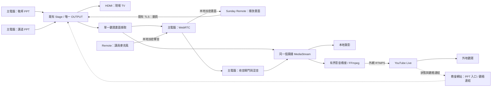

# Sunday Presenter Phase 2 設計：PPT 點對點傳輸、收音與 YouTube 直播

> 狀態：設計草案 v1，待原型驗證；不是已實作或已驗收的功能。
> 日期：2026-11-03。
> 追蹤：[主卡 #643](https://github.com/junyang168/smart-answer/issues/643)。
> 基線：Phase 1 v0.4.0、已合併的 [PR #611](https://github.com/junyang168/smart-answer/pull/611)，程式檢視基線 `2b93ae7007ca4de60d267062a2ff2e8007b6ee5d`。
> 本次交付限設計；不啟用麥克風、不建立直播、不發布安裝包。

## 1. 要解決的問題與使用方式

主電腦已能保持敬拜、講道兩份 PowerPoint 原檔開啟，切換時保留頁面狀態，並用一個固定 OUTPUT 視窗供現場 TV 和分享使用。現在講員還需要 AirPlay 看畫面、Sunday Remote 翻頁、Google Meet 收音，操作分散；AirPlay 全屏會遮住 Remote。

Phase 2 把這條流程整合為：

1. 主電腦仍載入原來兩份 PPT，操作者確認兩份觀眾播放頁面。
2. 講員開啟 Sunday Remote，自動連回已配對主電腦，在同一個視窗看目前 PPT、翻頁、查看麥克風狀態。
3. 操作者在主電腦按「準備主日」，查看畫面、收音裝置、錄影位置、YouTube 與網路是否就緒。
4. 按「開始崇拜」後，主電腦授權講員收音，開始本地錄影及 YouTube 直播；也可為本週啟用 America/Chicago 星期日 10:00 的定時開始。
5. 按「結束」後，立即停止對外音訊，停止推流、結束 YouTube 場次並完成錄影。

**screenshare 指兩份 PPT 共用的 OUTPUT 播放畫面。** Remote 接收主電腦當前選中那份的即時畫面；不傳兩份 PPT 到 Remote 重新播放，也不維護第二套頁碼或動畫狀態。Command-1／2 的敬拜／講道切換仍由主電腦控制；兩端方向鍵作用於同一個目前播放頁面。背景 PPT 的計時動畫或自動翻頁是否繼續，沿用 Phase 1 的限制，不宣稱背景頁面已被暫停。

## 2. 架構決定

| 決定 | 本設計的選擇 | 理由與驗證邊界 |
| --- | --- | --- |
| 播放來源 | 沿用 `Stage` 與唯一 OUTPUT | 保留既有 Office 登入、原檔、動畫及雙份切換；不重寫 PPT 播放器 |
| 主電腦與講員間的媒體 | 本地 WebRTC，雙向、一對一 | 重用編碼、加密、壅塞控制與接收緩衝；不自訂 H.264／PCM 網路協議 |
| 控制與配對 | 沿用 Bonjour、憑證釘選 TLS、Keychain 與 bearer token | 翻頁不依賴影音通道健康；既有配對不是任意瀏覽器可用的網站登入 |
| Presenter 媒體執行環境 | 獨立、可信任的本地 Electron renderer／session | 使用現有 Chromium WebRTC，權限不給 Office 頁面 |
| Remote 媒體執行環境 | 優先保留 Swift AppKit，新增只載入內附程式的 `WKWebView` | 重用系統 WebRTC，保留原生配對與按鍵；實際 OS、可信來源與權限相容性先做原型 |
| YouTube 出口 | 主電腦本地橋接 → 內附 FFmpeg → RTMPS | FFmpeg 負責成熟的封裝與編碼，不把 RTMPS 當成 WebRTC |
| 本地錄影 | 與網路出口分開的接收與寫入流程 | YouTube 壅塞、拒絕或斷網，不能拖停錄影或本地講員畫面 |
| 教會網站 | 既有 PPT 入口，加上直播連結／狀態 metadata | 不接收兩台 Mac 間的影音，也不承擔推流 |

這些是方案選擇，不是已量測的品質保證。API 依據是 [WebRTC 標準](https://www.w3.org/TR/webrtc/)、[Electron 擷取介面](https://www.electronjs.org/docs/latest/api/desktop-capturer)及 [WebKit 媒體介面說明](https://webkit.org/blog/11353/mediarecorder-api/)；實際可用格式、權限與效能在里程碑 M0 驗證。

### 2.1 資料流

「同一個來源」指同一 OUTPUT 的同一條擷取 video track；WebRTC、錄影與推流可以各自編碼，不宣稱只有一次編碼，也不保證兩端逐毫秒同時顯示。

### 2.2 本地點對點的邊界

兩台 Mac 接同一個 Wi-Fi／iPhone 熱點。媒體走兩台 Mac 的 WebRTC 連線；信令也直接交給主電腦既有本地 TLS 服務。第一版 `iceServers: []`，不配置公網 STUN、TURN、SFU 或網站媒體中繼。

只接受目前本地連線介面的 host candidates，包括瀏覽器產生、可在該區域網路解析的 mDNS host candidate；不接受 relay／server-reflexive 候選或把未知遠端位址當作安全的區域網路位址。信令橋接須檢查候選格式、位址／介面及配對對象，並以 selected candidate pair 的實際統計確認路徑。mDNS、IPv6 與多介面行為都列入 M0；不能為了連通而放寬成任意外網路徑。

若熱點隔離用戶端，或允許 TLS 但阻擋 WebRTC 所需的本地連線，顯示實際失敗原因，改用已驗證可互通的區域網路；不自動引入雲端轉送。Office 原檔載入與 YouTube 仍使用網際網路，「點對點」不代表整場崇拜完全離線。

## 3. 哪些能力直接重用

| 現有程式／元件 | 重用部分 | 新增部分 |
| --- | --- | --- |
| `tools/sunday-presenter/stage.cjs` | 兩份 PPT、觀眾頁面確認、切換、失效後隱藏／靜音 | 發出媒體來源可用／失效事件，不改播放主導權 |
| `main.cjs`、`folder-wizard.js`、`website.cjs` | 目前週日檔案、Office session、單一 OUTPUT、快捷鍵 | 可信任媒體 session、工作流程及狀態顯示 |
| `remote.cjs`、`remote-identity.cjs` | TLS 裝置身份、一次性配對碼、token hash、翻頁序列與去重 | 協議能力協商、媒體信令及主電腦收音命令 |
| `native/RemoteApp.swift` | Bonjour、Keychain、憑證釘選、原生按鍵 | 大型畫面區、WebKit 媒體橋接、收音／斷線狀態與停止收音 |
| 瀏覽器內建 WebRTC | RTP 媒體、DTLS-SRTP、編碼協商、網路適應、接收統計 | 媒體 track 接線、應用狀態與故障處理 |
| Web Audio／MediaRecorder | 混音、MediaStream、帶容器與時間資訊的錄製輸出 | 有界跨程序橋接、檔案生命週期、錄影與推流隔離 |
| FFmpeg／ffprobe | H.264／AAC、RTMPS、檔案轉封裝與檢查 | 子程序控制、輸入橋接、復原與錯誤訊息 |
| YouTube Live API | 建立、綁定、查詢與場次生命週期 | 本週場次紀錄、權限設定及接收狀態對照 |
| 既有安裝包與網站下載 | 不含個人資料的安裝包、版本與下載權限 | 新媒體檔案、FFmpeg、授權文字與平台驗證 |

不重新實作影音 codec、RTP、加密、重傳或壅塞演算法；不把範例中的寬鬆權限、第一個螢幕來源或任意憑證接受邏輯複製進產品。第三方 binary／library 須鎖版本、來源、checksum、授權及架構，隨安裝包保存必要 notices；不從未審核的 GitHub 範例下載執行檔。

本設計將 #643 原先「Swift ScreenCaptureKit 擷取＋AVAudioEngine 自訂音訊傳輸」調整為優先使用內建 WebRTC。原生 API 保留為已有明確缺口時的局部 adapter 候選，不同時實作兩套媒體傳輸。

## 4. 擷取兩份 PPT 的同一個觀眾畫面

### 4.1 來源選取與權限

主電腦先取得 OUTPUT 的原生媒體來源身份，再透過 `desktopCapturer`／`setDisplayMediaRequestHandler` 只准可信任媒體 renderer 擷取這一個 window。不得用視窗標題作唯一判斷，不得退回第一個可用視窗、整個螢幕或 private preparation。

使用明確的來源 handler，不啟用會繞過它的任意系統選擇器。Office 的 `persist:office` session 維持原有權限限制；只有內附媒體 renderer 的已驗證頂層 frame 可以請求顯示擷取。主電腦拒絕麥克風及攝影機擷取。

[Electron 的 session API](https://www.electronjs.org/docs/latest/api/session)提供指定擷取來源與分開的權限 handler；這不證明它已正確擷取我們的 `WebContentsView` 組合。M0 必須測試真實 OUTPUT、遮擋、兩份切換、顯示器位置及視窗生命週期；缺少來源或權限時明確阻擋 ready。

### 4.2 播放狀態與擷取生命週期

- 兩份 PPT 切換沿用同一 OUTPUT、同一 video track；更新 Remote 的 deck 標示和翻頁 `binding`，不重新配對或為每次切換建立 PeerConnection。
- `Stage` 撤銷 ready、目前頁面導向登入／編輯頁、renderer 崩潰、OUTPUT 關閉／最小化或來源失效時，立即關閉內容與對外聲音閘門。向媒體分支送本地生成的「播放暫停」畫面，Remote 另顯示狀態，不傳最後一張截圖冒充即時播放。
- 失效不自動選另一份未確認的 PPT；操作者重新確認後，才恢復相同受控擷取來源。若原生 window 身份改變，重建 capture epoch 並重新驗證。
- 用影格接收計數與時間、WebRTC 接收統計及 native socket 健康訊號判斷是否持續接收；靜態投影片本身不應因像素未改變而被判斷斷線。

Remote 按鍵仍經 `remote.cjs` 排序，沿用 command id 去重與當下 binding 檢查。媒體 frame 接收不參與翻頁 ACK；翻頁成功也不等於 Remote 已看到新畫面。

## 5. Remote 的 WebRTC 與信令

### 5.1 保留 Swift 外殼

`RemoteApp` 增加可縮放／全屏的 PPT 畫面，保留原生方向鍵、上一頁／下一頁、當前簡報與收音狀態。畫面取得焦點時也必須能翻頁；輸入配對碼等文字欄位時，不攔截正常編輯鍵。

WebKit 只執行安裝包內的 viewer 程式，不載入 OneDrive、Office、YouTube 或遠端任意 HTML。原生橋接負責已配對 TLS 信令，token 留在 Keychain／原生程式，不放進 URL、viewer HTML 或日誌。JS 橋接只接受指定 webview 的頂層本地文件、當前 session 與 allowlisted 訊息，禁止 navigation、popup 及未授權 origin 的錄音要求。

第一個 spike 必須證明內附來源在目標 macOS 上可用 WebRTC、麥克風權限及原生 JS bridge；不以關閉 TLS 檢查、放寬 ATS 或 `webSecurity` 解決。如果這條路在目標 Mac Air 不成立，再明示比較完整 Electron Remote 與原生 WebRTC framework；前者會增加包體與最低 OS 要求，後者增加 native build／維護成本，不默默替換發行方案。

現有 Remote 是 arm64／x86_64、最低 macOS 11；Presenter 是 Apple Silicon、macOS 13+。Phase 2 不把這些既有宣告當作新功能相容性證據。需先記錄兩台目標 Mac 的實際 OS／CPU，M0 通過後才宣告 Phase 2 支援矩陣。

### 5.2 協議版本與連線建立

既有 `/pair`、`/state`、`/key` 保留。`/state` 新增 `protocolVersion`、`capabilities`、`mediaSessionId`、`captureEpoch` 和獨立的 presentation／media／microphone 狀態。Phase 1 的 `live` 只代表有可翻頁觀眾頁面，不能拿來表示正在 YouTube 直播。

新增由原生 URLSession 使用的認證 JSON 信令操作：建立媒體 session、offer／answer、ICE candidates、狀態 ACK、停止 session。操作使用現有釘選 TLS，檢查 token、協議版本、裝置、session、epoch、序號與有效期；offer 單筆上限初定 256 KiB、candidate 8 KiB，另設總數、頻率與逾時上限。這些限額是原型起點，需用實際 SDP 驗證。

主電腦作固定協商發起方，避免雙方同時 offer。Remote 透過認證輪詢取得待處理訊息，再回傳 answer／candidate；初版不新增公開 WebSocket 或網站信令服務。獨立、短 timeout 的信令輪詢不阻塞 `/key`。重新連線產生新 media session；舊訊息、舊音訊授權及舊 ICE candidate 全部失效。

初始協商預留主電腦 send-only video／receive-only audio，以及 Remote 相對應的 transceivers。準備階段 Remote 的音訊 sender 沒有 microphone track；授權收音後才 `replaceTrack`，停止時解除 sender 並 stop 原始 track。能力探測與收到 audio transceiver 都不能被當作已收到有效麥克風樣本。

SDP 中的 DTLS fingerprint 經既有受認證信令傳遞，WebRTC 自己處理媒體加密。不得把現有 HTTPS 憑證誤當成 RTP 加密已經啟用的證明。初版僅一台 Remote；不做跨地區講員、多人會議或公開配對。

版本不相容時說明需更新哪一端。舊版可保留 Phase 1 翻頁，但不宣稱支援影音或 Phase 2 就緒。

## 6. 收音、混音與同步

### 6.1 主電腦控制、Remote 可隨時停止

準備時可列出裝置及權限，首次由講員完成 OS 麥克風授權。另設明確的本地「測試麥克風」操作，僅本地電平測試，完成即 stop track；不因完成配對而持續收音或傳回主電腦。正常準備狀態不送講員聲音。

「開始崇拜」產生綁定本次 run／media session 的收音授權，Remote 才開啟已選定裝置並回報實際 track／samples 狀態。裝置不存在、權限被撤銷時明確失敗，不改用其他麥克風，更不改用主電腦內建麥克風。

- 收音授權透過獨立控制 heartbeat 維持；初定每秒更新、五秒失效。斷線、授權失效、結束、退出及主電腦崩潰，Remote 都停止實際 microphone track。
- Remote 有明確「停止收音／靜音」操作，主電腦不能越過講員本地停止狀態強行開麥；恢復需要雙方狀態重新吻合。
- 即使 WebRTC 媒體仍連通，控制租期失效也關麥。原生 watchdog 監看 viewer；JS 未能及時停止時銷毀媒體 webview／session，不能只把畫面狀態改成靜音。
- 主電腦混音入口也驗證 run／mic grant，拒收失效 session 的 track。結束或異常時先關聲音閘門，再做網路與錄影收尾。

### 6.2 PPT 本身的聲音

正式 Phase 2 必須另驗證 PPT 內嵌影片／音訊。優先驗證只擷取當前 Office 播放 `webContents` 的音訊；切換時更換對應音訊來源，保持混音輸出 track 身份與時間軸穩定。

不要用全系統 loopback 混入通知聲、Meet 聲音或主電腦其他內容。[Electron session 文件](https://www.electronjs.org/docs/latest/api/session)提供指定 frame 的音訊擷取介面，但 macOS 的實際可用性、切換及權限必須實測。[Electron 另記錄 macOS 系統音訊的版本及權限差異](https://www.electronjs.org/docs/latest/api/desktop-capturer#caveats)，不能把拿到一條 audio track 當作已收音，必須驗證 track 狀態與樣本。

若無法隔離 PPT 音訊，該項驗收不通過，先記錄缺口與窄範圍原生 adapter 方案；不自動退回整機收音。講員麥克風的基本路徑可先做原型，但不能因此宣稱完整 Phase 2 已通過。

### 6.3 同步與監聽

WebRTC 處理線上的收送、編碼時鐘及接收 jitter；主電腦仍須把收到的麥克風和當前畫面放到一個本地混音／錄製時間軸，不能把兩台電腦的 wall clock 當成相同。

以主電腦的 monotonic clock／AudioContext 時間為本地觀測基準，記錄來源 video frame、麥克風到達／解碼、混音與錄製時間。斷線以靜音補缺口，不重播過期音訊；重連建立新的接收基準，必要的延遲修正保持有界。用實體拍手／畫面標記和錄影量測實際偏差，不能僅從 RTT 或「同一個 MediaStream」推斷同步已正確。

Remote 不回放自己的麥克風；講員端 PPT 音訊輸出預設靜音，避免喇叭聲被麥克風再次收錄。主電腦需要監聽時使用操作者確認的耳機，只在本地接出；不自動更改整機預設裝置。

## 7. 錄影與 YouTube 推流橋接

### 7.1 不省略 WebRTC 到 FFmpeg 的橋接

FFmpeg CLI 不直接接收這個瀏覽器 PeerConnection。主電腦先將同一 video track 與已過收音閘門的混音 track 組成廣播 MediaStream，再產生有完整容器資訊的串流輸入給 FFmpeg。

初版優先重用 `MediaRecorder`，以 `isTypeSupported` 加上實際持續錄製／解碼探測選定格式。原型基線可使用 Chromium 支援的 WebM；若採用 MP4，必須證明增量輸出可被 FFmpeg 即時讀取，不能等到 stop 才有可用檔案。不同來源的獨立 blobs 或任意中途 chunk 不是可直接重啟的完整影片。WebKit 對 MediaStream／MediaRecorder 的說明可作介面參考，但主電腦採用的是 pinned Electron 的實際支援結果。[WebKit 說明](https://webkit.org/blog/11353/mediarecorder-api/)

錄影與推流使用同一廣播 MediaStream 的獨立 recorder／接收佇列：

- 本地分支持續寫原始容器檔案，結束後以 FFmpeg 轉封裝或轉碼成可交付 MP4，寫暫存檔、以 ffprobe／實際播放確認後才原子更名；保留原始檔直到轉換成功。
- 網路分支的 MediaRecorder chunks 經受信任 IPC 送主程序，再寫 FFmpeg stdin。只接受目前 renderer／run、二進位資料及遞增序號；不接受 Office IPC。
- stdin 背壓只影響網路分支；時間／容量超限就停止該分支並明示重連，不暫停本地錄影或堆積舊畫面。
- 每次重新建立網路分支，建立新的 recorder 與 FFmpeg，使輸入從完整容器開頭開始；不從舊串流中間截一塊資料假裝恢復。
- 保留容器自己的時間資訊；不用 chunk 到達時間、固定假設幀率或兩台電腦的日期時間重建媒體 timestamps。

兩個 recorder 加上 WebRTC 可能增加編碼、IPC 與記憶體成本。這是 M0／M2 的效能門檻，不承諾零複製或一次編碼；若不足，先比較可重用的 native／既有 muxer 橋接，再修訂設計，不在正式使用時無聲降級成截圖輪詢。

### 7.2 格式與有界資源

以下都是量測起點／驗收目標，不是已完成的效能實測：

| 項目 | 原型基線與要求 |
| --- | --- |
| PPT 擷取 | 單一來源，原型先 1280×720、30 fps；1080p profile 在兩台目標 Mac 上另驗證 |
| 本地視訊 | WebRTC 優先協商雙端支援的 H.264，VP8 為需明示記錄的相容候選；不靠手改 SDP 強塞 codec |
| 講員聲音 | WebRTC Opus，speech mono、48 kHz 處理基準；裝置實際 sample rate 由引擎處理，測試原始裝置差異 |
| Remote 網路 | 視訊 bitrate 原型上限約 3 Mb/s、語音約 64 kb/s；由 WebRTC 適應本地壅塞 |
| YouTube 出口 | H.264、AAC、RTMPS；720p30 起步，目標視訊約 3–4 Mb/s、AAC 128 kb/s；與本週 YouTube stream profile 一致 |
| 推流排隊 | 原型上限 2 秒或 16 MiB，任一先到即重新建立該分支；不同 run 不沿用佇列 |
| 錄影排隊 | 上限 2 秒或 16 MiB；磁碟不能跟上時標示錄影失敗並關閉該分支，不無限制吃記憶體 |
| 網路／錄影 encoder | 優先驗證可用的 H.264／AAC 直接重封裝，否則 FFmpeg H.264 VideoToolbox；禁止未經效能驗證的默默軟體回退 |

實際 bitrate、queue、codec 和最低 OS 在原型報告固定下來後才進發行 profile。FFmpeg `pipe`、RTMPS 及逾時能力依其[官方協議文件](https://ffmpeg.org/ffmpeg-protocols.html)使用。兩個分支各有明確進度與錯誤；FFmpeg 程序存在不是正在直播的證據。

## 8. YouTube 與網站

主電腦以教會帳號作 installed-app OAuth 授權，使用系統瀏覽器、PKCE 與 desktop client 的 loopback redirect，並校驗 state／回調來源、一次性 code 及所需 YouTube scope。token、直播金鑰保存在主電腦 Keychain；重用官方 OAuth client library，遵循 [YouTube installed-app 流程](https://developers.google.com/youtube/data/live/guides/auth/installed-apps)及 [Google PKCE 建議](https://developers.google.com/identity/protocols/oauth2/resources/best-practices)。不得沿用網站 Google Docs token、把 client secret 當成安裝包內的秘密，或把 RTMPS stream key 印到 console、錯誤、命令列／程序參數及 crash report。

FFmpeg 的 argv 只帶非秘密的 RTMPS base endpoint；stream key 作為 `rtmp_playpath`，優先用 FFmpeg 的 `-/option` 從繼承的私有 fd／短命 0600 檔讀入，路徑本身不含 key。這是待驗證的具體交付方案：[FFmpeg option-from-file 語法](https://ffmpeg.org/ffmpeg.html#Options)與 [RTMP playpath 介面](https://ffmpeg.org/ffmpeg-protocols.html#rtmp)提供基礎。M2 需驗證選定 binary、fd 壽命、實際 YouTube ingest 及 process argv／stderr；若不支援，先修訂 adapter，不能用可見的含 key URL 作為正式回退。所有傳輸錯誤在呈現前移除 credential 與完整 ingest URL。

每週以 `serviceDate`（America/Chicago）及本機持久 run 記錄對應 `broadcastId`／`streamId`。先建立 planned 記錄，再進行 API 操作；若建立請求回應遺失，先查詢已建立場次並比對保存的標記／日期，無法唯一確認時顯示待確認，不重複建立或挑任意同名直播。API 沒有因此被假設具備客戶端 idempotency key。

1. 準備：讀取帳號／channel／直播資格，建立或找回本週 broadcast 與 stream、完成 bind，取得觀看連結；不在準備階段推送講員聲音。
2. 設定：visibility、made-for-kids 等場次設定由 owner 確認並保存，不由程式猜測；工程測試另用明確授權的非公開場次。
3. 開始：錄影可寫、Remote 音訊與畫面可用後啟動 ingest；廣播 auto-start／auto-stop 關閉，以明確流程控制，避免準備或重連意外開播／結束。
4. 驗證：讀到已綁定 stream 的接收狀態為 active，再要求場次轉為 live，回讀場次確實為 live 才顯示「YouTube 已直播」。首輪與完整場驗收另由獨立接收端確認聲畫。
5. 結束：先關對外音訊，停止推流並要求場次 complete，回讀實際狀態；YouTube 無法聯絡時顯示「本地已停止／遠端結束未確認」，保留待核實紀錄。

建立與狀態轉換依 [liveBroadcasts.insert](https://developers.google.com/youtube/data/live/reference/rest/v3/liveBroadcasts/insert)、[liveBroadcasts.transition](https://developers.google.com/youtube/data/live/reference/rest/v3/liveBroadcasts/transition)及 [liveStreams 狀態](https://developers.google.com/youtube/data/live/reference/rest/v3/liveStreams)實作；YouTube 控制與媒體接收是兩個需要分別核實的事實。

網站只保存 serviceDate、broadcastId、watch URL、可公開的狀態、最後確認時間及操作者身份；寫入沿用管理權限與校驗，URL 綁定正確的 YouTube 場次。網站不保存 stream key、OAuth token 或媒體內容。網路失聯時網站保留「最後於何時確認」而非無限期顯示現在仍直播；公開入口與管理錯誤分開。

## 9. 工作流程、故障與定時開始

### 9.1 狀態不是一個 running 布林值

以 `runId` 管理每週會話，至少保存以下互相獨立的狀態：

- presentation：unprepared／ready／paused／failed。
- peer：disconnected／negotiating／receiving／degraded。
- microphone：closed／starting／receiving／muted／failed。
- recording：idle／starting／writing／finalizing／complete／failed。
- broadcast：idle／preparing／starting／live／reconnecting／stopping／ended／unconfirmed。

「已就緒」是當前來源確認、peer 實際接收、麥克風權限／裝置測試、錄影位置、encoder／OAuth／YouTube 設定與連線等檢查的彙總，不表示已開麥或已直播。開始後還要核對錄影進度、音訊 samples 和 ingest 狀態；任何未完成的事實不因另一項成功而被覆蓋。

| 事件 | 行為 |
| --- | --- |
| Remote 離線／控制租期失效 | Remote 停麥，主電腦混音補靜音；顯示故障，PPT、本地錄影及現有 YouTube 畫面可繼續 |
| Remote 重連 | 重新協商 session，確認當次 run 仍授權收音且講員未本地停止，才恢復；不重播積壓資料 |
| PPT 來源失效 | 送受控暫停畫面、關對外聲音；重新確認來源後才允許恢復，不抓桌面替代 |
| YouTube 網路故障 | 只重建網路分支，重試間隔起點 1／2／4／8 秒，上限 15 秒，最多五分鐘；錄影與本地點對點繼續 |
| 超過重試窗 | 顯示停止自動重試；保留錄影，需操作者明確重試，不再自動建立新場次 |
| YouTube API 不可用、媒體仍可能到達 | 顯示最後確認時間／未確認，不從 API 錯誤推斷遠端已停播 |
| 錄影磁碟失敗 | 明確標示錄影失敗與可保留片段；網站／PPT／直播可繼續，不冒充仍在備份 |
| 編碼／橋接崩潰 | 隔離受影響分支，顯示失敗；不為了恢復而開啟主電腦麥克風 |
| 主電腦 App 崩潰後重開 | 回讀紀錄、先保持靜音，查詢舊場次並整理可恢復錄影；不自動開麥、開播或重複建立場次 |
| 重複開始／結束或遲到 ACK | 操作綁定 run 與序號，已完成動作返回已知結果；結束後的舊 ACK 不得重新開麥 |

### 9.2 星期日 10:00

定時是主電腦 App 的本週選項，首次需 owner 明確啟用及完成收音／廣播設定。使用 America/Chicago，包含 DST，不依電腦目前時區；同一 serviceDate 只有一次開始意圖。

10:00 僅在 App 已運行且全部當前就緒時執行。未就緒時顯示各項原因，不自動點 OS 權限視窗、跳過來源確認或事後無限制補開播。睡眠／暫停後錯過啟動窗口（原型起點五秒）就標記 missed，改由操作者開始。Phase 1 舊的 service settings 不被自動匯入，關閉 App 不代表另有排程器會替它啟動。

## 10. 新增模組與實作次序

| 模組位置（擬定） | 職責 |
| --- | --- |
| `media-session.cjs` | Peer session／權限／信令與生命週期；不處理 Office 登入 |
| `media/host.html`、`host.js`、`preload.cjs` | 單一擷取、RTCPeerConnection、受限 IPC、混音及 recorder |
| `native/RemoteMediaView.swift`、`media/remote.js` | 本地 WKWebView、原生信令橋接、畫面／mic track 與停止確認 |
| `broadcast-session.cjs` | 準備、開始、結束、run 狀態與定時意圖 |
| `broadcast-encoder.cjs` | 有界輸入、FFmpeg、重試、stderr 秘密遮罩及進度 |
| `recording.cjs` | 獨立寫入、容量檢查、收尾、ffprobe 與 MP4 交付 |
| `youtube.cjs`、Keychain adapter | OAuth、場次建立／綁定／回讀；不控制音訊設備 |
| 現有網站管理 API | 授權後保存觀看連結及已確認狀態，不代理串流 |

這是責任拆分，不要求先造通用工作流框架。先寫最小 adapter、受控狀態和可驗證原型，再把通過的路徑接入既有設定介面。

| 里程碑 | 完成條件 | 未通過時 |
| --- | --- | --- |
| M0：技術 spike | 目標 OS／CPU 記錄、唯一 OUTPUT 真實擷取、WKWebView WebRTC／權限、本地 candidates、可用 codec、連續容器橋接、受控 PPT 音訊與基本效能均有量測 | 停在設計／adapter 修訂，不先建完整 YouTube 流程 |
| M1：本地雙機 | 真實兩份 PPT、切換／動畫／雙端翻頁，Remote 畫面與麥克風，租期停止、配對撤銷、失聯／重連與熱點互通通過 | 不宣稱可取代 AirPlay 正式使用 |
| M2：本地錄影與推流 | 網路和錄影分支隔離，真實 FFmpeg 輸入與遮罩，錄影可播放、音畫偏差與負載量測，YouTube 非公開授權測試由獨立裝置收到 | 不宣稱已直播或可正式廣播 |
| M3：日常流程 | 本週場次重用、網站觀看入口、開始／結束回讀、DST／定時條件及故障恢復通過 | 不啟用無人按鍵的定時開場 |
| M4：正式使用 | 兩台目標實體 Mac、iPhone 熱點、完整一場時長、獨立觀眾端與錄影驗收；安裝包、授權與更新後權限持續性有證據 | 留在 pilot，Phase 1 持續可用 |

## 11. 驗收與證據

各項目標數值需先由原型確認可測，再固定為發行 profile；改變目標須留下原因，不能把未量測寫成通過。

| 驗證 | 方法與通過目標 |
| --- | --- |
| PPT 來源與私密畫面 | 真實 Office 檔、持續動畫、兩份各二十次切換；顯示／遮擋控制台、登入與 preparation、切換顯示器、最小化及 renderer 失效；Remote、錄影和觀眾端均無私密畫面 |
| 同一份播放狀態 | 兩端交錯翻頁、快速重複、切換時遲到命令、重連後舊 binding；不重複套用、不操作另一份未確認 PPT |
| 本地畫面延遲 | 以主電腦可見標記和 Remote 同框實拍量測，先以 720p30、端到端 p95 ≤300 ms 為目標；靜態字體可讀，不能用 YouTube 觀看延遲代替此量測 |
| 收音與停止 | 選定真實麥克風／耳機、拔除裝置、權限拒絕、主電腦結束、App 崩潰、TLS 失聯但媒體仍在；停止命令目標一秒內關實際 track，租期失效最遲五秒內停止；主電腦麥克風從未開啟 |
| 音畫同步與漂移 | 真實拍手／標記，在起始、三十分鐘、六十分鐘、至少九十分鐘及實際完整場長檢查；初定偏差絕對值 ≤150 ms、首尾變化 ≤50 ms；記錄測法誤差與觀眾端結果 |
| PPT 內嵌影音 | 兩份各播放影片／音樂並切換；只有目前一份進混音，無主電腦通知音，講員喇叭預設不形成回授 |
| 有界資源 | 人為堵塞 stdin、慢磁碟、丟包與帶寬限制；排隊不超選定上限，移除故障後回到新 session，不播放舊 backlog；記錄 CPU／GPU／記憶體、frame drops、RTT、jitter 與 codec |
| 上傳中斷 | 在保留兩機本地連線下切斷上行，另測整個熱點失聯；分別驗證錄影繼續／Remote 收音停止，不能把兩種故障混為一項通過 |
| 本地檔案 | 九十分鐘及完整場長可解碼、可播放、有完整時長與音訊；關 App／磁碟失敗後保留已可恢復片段；MP4 轉換失敗不刪原始檔 |
| YouTube 實際狀態 | 建立回應遺失、已綁定 stream、接收拒絕、live／complete 過渡與 API 失聯；每項狀態有回讀，獨立裝置確認真實聲畫 |
| 套件與權限 | 在未安裝 Node／FFmpeg 的目標 Mac 執行；Remote 兩架構與實際 OS；首次授權、拒絕後恢復、重裝／升級、重啟、Keychain 與配對持續性均記錄 |

保留自動協議／狀態／故障測試、實際硬體與版本、選定 profile、量測原始資料及人工觀察。自動測試不能替代兩台實體 Mac、獨立觀眾端或一整場的實測；已有 Phase 1 Meet／AirPlay 成功也不自動成為 Phase 2 證據。

## 12. 發行與尚待驗證的事項

Phase 1 v0.4.0 維持已發布功能。Phase 2 使用新的版本及 pilot 標示，保留回退安裝包；依既有 immutable publisher 發布，不覆蓋同版本 bytes。媒體模組、FFmpeg 架構、code signing、notarization、授權 notices 與 executable checksum 納入安裝包檢查。不把 ad-hoc 簽章描述成 Developer ID／已公證；更新後麥克風、擷取與本機網路權限要重新實測。

實作前的未決事項以 M0／M2 解答，當前不請 owner 代替工程選型：

- 目標 Mac Air 的實際 OS／CPU 是否可用所選 WKWebView 媒體 bridge；最低支援 OS 不能靠 cross-compile 宣告。
- iPhone 熱點下的 Bonjour、mDNS ICE、UDP 互通、聲畫延遲與長時間穩定性。
- 目前 Electron 的 OUTPUT 來源擷取、WebContentsView 組合、單一 PPT 音訊與 permission 行為。
- MediaRecorder 格式、增量容器、雙 recorder／WebRTC 負載及 FFmpeg 真實橋接；未證明前不承諾 1080p 或零額外編碼。
- FFmpeg 私有 fd／option-from-file playpath 的實際交付、程序檢視與遮罩測試，以及適用 build。
- 教會 channel 的直播資格、OAuth client 與場次設定，須由 owner 完成首次登入／必要選項；建立實際測試直播及正式廣播另外依當次明確授權執行。

設計完成表示可按上述順序開始驗證，不表示 #643 實作、直播授權或正式使用驗收已完成。
