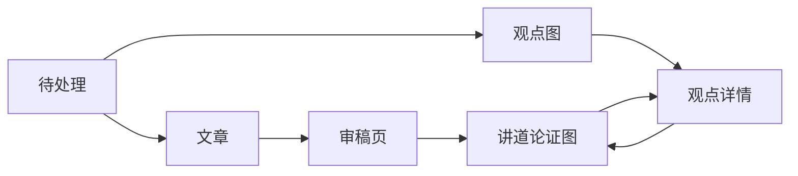

# 文库 admin 重新设计：方案

> **读者**：Solution architect、负责人
> **类型**：规范
> **状态**：当前（负责人 2026-10-25 批准；第十二节三项按建议定）
> **与代码对齐**：第一节的现状核对到 main 52bc2ac9（2026-10-25）；第三节以后核对到 #453 分支（2026-10-25），五期均已实作，与原设计不同处在各节注明
> **权威范围**：`/admin/wang` 下的页面分工、导航、两张知识图的画法与规矩、旧页面的去向，以及分阶段次序。数据怎么生产不归本文管：主张见 [Claim Management 2.0](../20-knowledge/claim_management_2_design.md)，观点见 [Canonical Viewpoint 设计](../20-knowledge/canonical_viewpoint_design.md)，文章见 [Draft-first 写作流程的可重复化](../30-authoring/draft_first_repeatable_pipeline_solution.md)。

**目标：同工打开文库 admin，第一眼看到哪些事在等人决定；要查教授讲过什么，从观点图点进去，一路查到讲道原话和录音。**

## 目录

- [一、为什么重做](#一为什么重做)
- [二、谁在用，做什么](#二谁在用做什么)
- [三、导航与页面](#三导航与页面)
- [四、待处理](#四待处理)
- [五、文章](#五文章)
- [六、观点图](#六观点图)
- [七、讲道论证图](#七讲道论证图)
- [八、两张图共同的规矩](#八两张图共同的规矩)
- [九、运行](#九运行)
- [十、旧页面的去向](#十旧页面的去向)
- [十一、后端要补的接口](#十一后端要补的接口)
- [十二、负责人已定](#十二负责人已定)
- [十三、分阶段实施](#十三分阶段实施)
- [十四、不在本文范围](#十四不在本文范围)

## 一、为什么重做

现有十一个页面做于 2026-08-16 到 09-23，只有观点详情页在 10-23 跟上过 CVP 2.0。此后主张、观点、文章三条线都换了做法，页面没有跟上。下面四条在 main 52bc2ac9 核对过。

1. **新流程的文章看不见进度。** 「写文章」总表和「马太进度」只读旧流程的文件（`wang_articles.py`、`matthew_exposition_progress.py` 里没有一处 `draft_first`），「人子」不在表里。一篇文章停在哪一步、等谁决定，只在运行目录的 `state.json` 里。
2. **审稿页看不到审了什么。** 「人子」能读、能展开每段出处、能发布；但审稿意见、作者申辩、双向核对表、负责人意见都不显示，出处有问题的段落只显示个数。新流程的出处套着旧流程的说明（`derived_source_binding` 不在前端类型里），页头还写「POC 内部审稿」。
3. **主张与观点的大部分数据没有接口。** 主张之间的 12,226 条关系、版本与替换、人工来源决定、Claim 与 CVP 管理的运行情况，都没有任何 HTTP 接口。「观点例外」读的是 CVP 1 的旧文件，CVP 2.0 里真正转人工的争议进不来。
4. **导航跟页面对不上。** 审稿页、观点例外、马太 16 试点不在菜单里；总览首页是讲道抽取的流水线表，不是同工要做的事。

## 二、谁在用，做什么

文库 admin 只对同工开放：进 `/admin` 要 `editor` 或 `admin` 角色（`web/src/app/admin/layout.tsx:17`）。其中**负责人**是 `WANG_PUBLICATION_OWNER_IDS` 里的人，发布和撤下只有他能按。

按 [Solution Architecture 第 5 节](./solution_architecture.md#5-运营谁在用同工做什么)，系统只在两处需要人：**两个模型谈不拢、规则又判不了时做裁决**；**一份成果发布前做终审**。其余时间同工来这里是**查**——教授讲过什么、凭什么、在哪篇讲道。

由此三条设计约束：

- **首页是待处理，不是流水线。** 等人决定的事放最前面；流水线状态是给排错用的。
- **页面上不出现内部编号、哈希和 JSON。** 同一节已有这条要求。编号只在「运行」里给工程排错用；同工看到的是观点的一句话、讲道的标题和日期。
- **只画记录在案的连接。** 知识层不能随意发挥：图上的每一条线都是数据里已有的关系，不画模型推测或按相似度算出来的线。

## 三、导航与页面

| 菜单 | 页面 | 给谁 | 做什么 |
| --- | --- | --- | --- |
| 待处理 | 首页 | 同工、负责人 | 三条线上等人决定的事，一处看完 |
| 文章 | 文章总表、审稿页 | 同工、负责人 | 每篇文章做到哪一步；终审与发布 |
| 观点图 | 观点图（带详情面板） | 同工 | 跨讲道的观点与它们之间的关系 |
| 讲道 | 讲道目录、讲道论证图 | 同工 | 一篇讲道里的主张与推理，原话与录音 |
| 运行 | 抽取总表、健康度、独立审计、管理运行、校准记录 | 工程 | 排错；同工平时不用进来 |

admin 一律用简体（见[第十二节](#十二负责人已定)）；读者站与成稿仍用繁体。

## 四、待处理

首页是一张清单，每一项写清楚**什么事、等谁、点进去在哪里处理**。来源有四种：

| 来源 | 什么时候出现 | 点进去 |
| --- | --- | --- |
| 文章停点 | `state.json` 的 `stopped` 是选材决定、CVP 缺口、校准不合、审稿没过或终审 | 该文章的进度页，或审稿页 |
| CVP 争议 | CVP 管理里某组的状态是 `human_required` | 争议页：两个判断、各自的原文依据 |
| 主张来源核实 | 暂不接入，见下 | — |
| 旧 CVP 例外 | CVP 1 留下的例外包还没处理完 | 现有例外页，清空后下线 |

**主张来源核实暂不接入。** 实作时查了数据：2026-10-25 有 5 次 Claim 管理运行以 `human_required` 暂停，但其中问的问题（如「但以理書第九章」是不是口误）负责人已在对话里答过，答案记在 `human_source_decisions`，运行本身没有续上。暂停状态因此说明不了「还在等人」，接进来会把答过的问题再列一遍。这些运行和人工来源决定都列在「运行」的管理运行页；等 Claim 管理在记下人工决定时同时结束对应运行，再接入待处理。

模型分歧、预算用完、工程失败**不进这张清单**——架构 D4 说它们只表示「没做完」，不是请人决定的理由；它们在「运行」里。

## 五、文章

### 5.1 文章总表

新旧流程的文章合在一张表：标题、经文或题目、目前在哪一步、停在哪里等谁、最近一次审稿结果、是否已发布。新流程的步骤直接取 `draft_first_essay` 的阶段名，翻成同工的话（定问题、选材、写稿、审稿、登记、终审）。马太进度的章节地图并进来，作为按经文筛选的一种视图。

### 5.2 文章进度页（新流程）

一篇文章的运行目录，以同工看得懂的样子显示：

- 读者问题、经文、这篇讲什么不讲什么（负责人原话）；
- 选材：每个候选是什么、为什么相关、建议、负责人的决定和理由；
- 每一轮审稿：未解决的问题引稿子原句；作者的申辩与裁定；负责人意见；
- 停在哪里、要谁定什么。

第一期只读：决定仍在与 Claude 的对话里做（`/topic-essay`），页面负责让同工看清楚。页面上不设决定按钮（[第十二节](#十二负责人已定)）。

### 5.3 审稿页

保留现有的读全文、逐段出处、录音播放和发布。补上：

- **核对表**：清单上每个观点落在哪一句，没写的为什么没写；审稿人同不同意。
- **审稿意见与申辩**：按轮次，未解决的放最前。
- **每段出处的依据**：这段出处是怎么来的——教授在哪篇讲道里读了这节经文、作者自查落在这句、审稿人查到这一处，或程序在原文里找到的。没有出处的段落标出来，不只给个数。
- **页头**按流程显示：新流程不再显示 Grounding、Program Audit 等旧阶段，「POC 内部审稿」去掉。

## 六、观点图

**一张图，点是观点，线是观点之间记录在案的关系。**

2026-10-25 的数据：724 个观点、188 条关系；有关系的 272 个观点分成 92 群，最大的一群 18 个，每个观点最多连 6 条线；另外 452 个观点没有任何关系。所以这不是一团毛线，而是许多小岛加一大片孤立的点——**整张图画得出来**。

画法：

- **小岛**按大小排开，每群一块；**孤立的观点**另列成网格，并标出个数。孤立就显示为孤立，不为了好看补线——这个数本身是知识层要补的功课（全局链接）。
- **关系按种类着色**：应用、延伸、具体化、推出、概括、限定各一色，**张力**用最醒目的颜色。
- **点的大小**表示这个观点出现在几篇讲道里。
- **搜索**：按观点的文字、经文（如「太 20:28」）或讲道标题找到观点，图上定位并选中。

**点中一个观点，右侧显示它的详情**，不离开图：

1. 观点的一句话和摘要；
2. **论证路线**：它在每篇讲道里怎么一步步推出来，一篇一条；
3. **链接的主张**：每条注明出自哪篇讲道；点一条，打开那篇讲道的论证图，这条主张高亮；
4. 与其他观点的关系，点一个跳过去；
5. 版本历史。

现有观点详情页的内容（来源、路线、关系与张力、历史与影响）搬进这个面板；独立的详情页保留一个网址，方便分享。

## 七、讲道论证图

**另一张图，范围是一篇讲道：点是这篇的主张，线是主张之间的推理关系。**

主张都在一篇讲道里，主张之间的 12,226 条关系有 10,974 条在同一篇内。每篇的主张数中位数 54 条、最多 204 条，一张图放得下。

- 左边是讲道原文，右边是论证图；点主张，原文滚到那一段，可以播放录音。
- 每条主张标出它属于哪个观点；点观点，回到观点图并选中它。
- 讲道目录（现在的「来源覆盖」）是这张图的入口：按圣经书卷或讲道主题找讲道。

**跨讲道只走观点。** 这张图不把两篇讲道的主张直接连起来；要看同一个观点在别的讲道怎么讲，回到观点图。

讲道目录沿用「来源覆盖」的目录。原「论证层」和「来源覆盖」两页是抽取诊断视图（显示 segment 编号、覆盖率、未抽取的句子），实作时保留为「运行」下的诊断页，讲道页链接过去，不再放进同工的菜单。

## 八、两张图共同的规矩

1. **只画数据里有的边。** 不画相似度、不画模型推测、不画编辑归纳的连接。
2. **退役和被替换的不画。** 版本历史在详情里看。
3. **点进去一定落到原话。** 任何一条主张都能一步到原文段落和录音时间。
4. **画图库**：现在项目里没有专门的画图库，两张图都是手写的 SVG。观点图要能缩放、拖动、分群排布，建议引入 Cytoscape.js（上千个点没有压力，分群布局现成）；讲道论证图用同一个库，交互一致。实作时再做一次小比较确认。

## 九、运行

给工程排错的页面集中到这里，同工的菜单里不放：

- 讲道抽取总表（现在的首页）、健康度、独立审计——原样搬过来；
- Claim 管理与 CVP 管理的运行：哪些在跑、哪些卡住、为什么；
- 写作的校准记录：每次审稿规则或模型变了以后，和负责人判定表对得上对不上。

这里可以显示编号和哈希。

## 十、旧页面的去向

| 现有页面 | 去向 |
| --- | --- |
| 总览 `/admin/wang`（抽取流水线表） | 搬进「运行」；首页改为待处理 |
| 健康视图、独立审计 | 搬进「运行」 |
| 写文章总表 | 改为[文章总表](#51-文章总表)，收进新流程 |
| 马太进度 | 并进文章总表，作为按经文的视图 |
| 审稿列表、审稿页 | 保留，补[第 5.3 节](#53-审稿页)的内容 |
| 论证层、来源覆盖 | 新建[讲道论证图](#七讲道论证图)；两页作为抽取诊断移到「运行」 |
| 观点主数据（列表）、观点详情 | 改为[观点图](#六观点图)与详情面板 |
| 中心结构 | 暂留原页（菜单归「观点图」），以后并进观点详情的「关系」 |
| 观点例外 | CVP 2.0 的争议接进待处理后，旧例外包清空即下线 |
| 马太 16 试点、召回分块诊断 | 下线（读单独配置的旧文件，CVP 1 时期） |
| 出版单元（`/admin/canonical-repository`） | 不在本方案范围，菜单里移到「运行」 |

## 十一、后端要补的接口

现在没有接口、页面要用的：

| 页面 | 要读的 | 现在在哪里 |
| --- | --- | --- |
| 待处理、文章进度 | 每篇文章的 `state.json`、选材候选与决定、每轮审稿结果、负责人意见 | `staging/essays/<review-id>/` 文件 |
| 审稿页 | 核对表、审稿意见、申辩、每段出处的 `basis` | 审稿目录文件；`basis` 已写进出处文件，审稿接口没有传出 |
| 待处理 | CVP 管理里 `human_required` 的组与争议 | `pipeline_runs` 的 `metadata` |
| 待处理 | 人工来源决定 | `human_source_decisions` 表 |
| 观点图 | 全部现行观点关系（不只单个观点的邻居） | `viewpoint_relations`，现只在单个观点详情里 |
| 讲道论证图 | 一篇讲道的主张关系 | `claim_relations`，现只用来算快照哈希 |
| 观点详情 | 主张的版本与替换 | `object_versions` |
| 运行 | Claim / CVP 管理运行、校准记录 | `pipeline_runs`、`draft-first-calibration/records.json` |

全部只读。写操作仍然只有发布和撤下。

## 十二、负责人已定

负责人 2026-10-25 按建议定下三项：

1. **文章停点不在页面上决定。** 决定写成文件后还要跑命令才会往下走，页面按了按钮也不会自己续上；页面只负责让同工看清楚，决定仍在与 Claude 的对话里做（`/topic-essay`）。
2. **admin 全用简体**，与近期的设计文档和审稿页一致；读者站与成稿仍用繁体。
3. **待处理不发通知**，只在首页显示。

## 十三、分阶段实施

五期都在 #453 下实作，不另开卡，按次序：

1. **导航与待处理**：新菜单；首页改为待处理（先接文章停点和旧 CVP 例外）；旧页面按[第十节](#十旧页面的去向)搬家，下线两个试点页。
2. **文章**：文章总表收进新流程；文章进度页；审稿页补核对表、意见与申辩、每段出处依据。「萬人的贖價」会是第一篇在这里走完的文章。
3. **观点图**：全部观点关系的接口；观点图与详情面板。
4. **讲道论证图**：一篇讲道的主张关系接口；论证层与来源覆盖合页；两张图互相跳转。
5. **运行与其余待处理来源**：CVP 争议接进待处理；管理运行、人工来源决定与校准记录页。主张来源核实暂不接入（见[第四节](#四待处理)）。

## 十四、不在本文范围

- 读者站（`/resources/wang-repository`）。
- 主张、观点、文章的生产流程和数据本身；补观点之间的全局链接是知识层的功课，图只负责如实显示。
- 出版单元（`/admin/canonical-repository`）的内容。
