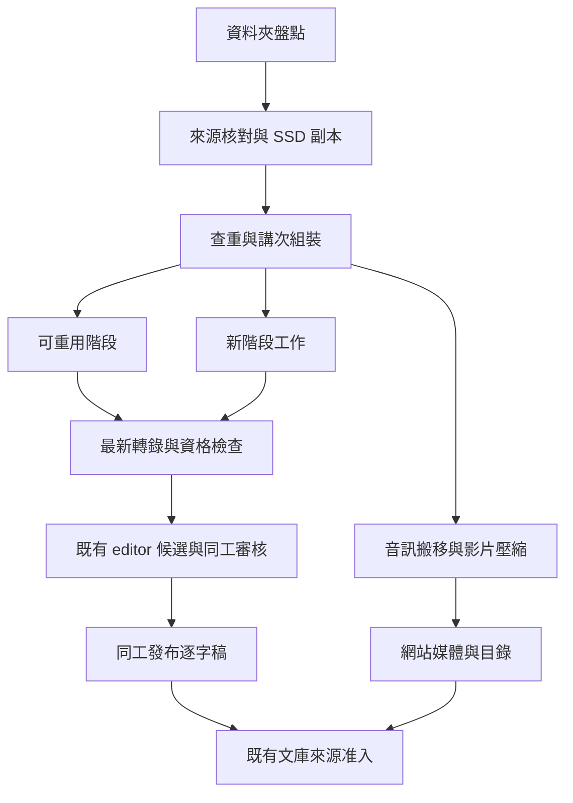

# 資料夾批次影音轉錄與下游接入設計

> **讀者**：Solution architect、Developer、神學編輯
> **類型**：規範
> **狀態**：提案；#685 的實作與驗收依據，批次入口尚未實作
> **與代碼對齊**：2026-11-06（現有接點核對到 `9caa823c`；新資料表、CLI 與排程均為本文件提案）
> **權威範圍**：資料夾匯入、查重、可續跑轉錄、媒體搬移與壓縮、網站和文庫交接；不取代人工校對、來源准入或 Claim／CVP 規則。

## 目錄

- [1 目標與邊界](#1-目標與邊界)
- [2 現有程式與待補項目](#2-現有程式與待補項目)
- [3 一次批次的流程](#3-一次批次的流程)
- [4 跨資料夾查重](#4-跨資料夾查重)
- [5 台帳與續跑契約](#5-台帳與續跑契約)
- [6 最新逐字稿流程](#6-最新逐字稿流程)
- [7 媒體搬移壓縮與網站發布](#7-媒體搬移壓縮與網站發布)
- [8 多 worker 與兩個 Sol 名額](#8-多-worker-與兩個-sol-名額)
- [9 磁碟與保存](#9-磁碟與保存)
- [10 網站編輯與文庫接入](#10-網站編輯與文庫接入)
- [11 操作入口與驗收](#11-操作入口與驗收)
- [12 設計自查](#12-設計自查)

## 1 目標與邊界

負責人提供一個本機或已掛載的資料夾，系統遞迴盤點其中的教授音訊與影片，完成查重、媒體準備、逐字稿候選與既有網站／文庫交接。再次提供同一資料夾、改名副本或已登記的另一種媒體版本，都應復用已完成的工作。

「檔案」不等於「講道」：一講可以由多個 MTS 相機分段構成，也可以同時有音訊、影片與壓縮播放版。不同場合重講同一主題，仍是不同講道。檔名、目錄日期、逐字稿相似度都不能單獨決定身份。

遵守[使命](../00-overview/project_mission_statement.md)及[架構](../00-overview/solution_architecture.md)：原聲、教授／聽眾、引用／主張、口述／投影片分開；不補答案、不改神學立場。一般批次不啟動既有講道的 Claim refresh，不覆寫人工稿。網站媒體可先準備上線；逐字稿仍由同工認領、審核、發布，文庫依來源准入接續。

## 2 現有程式與待補項目

| 現有接點 | 已有能力 | 本卡需補 |
| --- | --- | --- |
| [full_video_transcript](../../../backend/pipeline/full_video_transcript.py) | 單篇 audio/video、原始 sample 時鐘、slide、校字、最終對齊與時間資格檢查 | 資料夾派工、資源限額、分段來源與重用台帳 |
| [speaker batch](../../../backend/pipeline/transcript_speaker_batch.py) | 通讀音訊、逐段講員候選、保護已校對文字 | 納入新篇標準流程及同一版本鏈 |
| [slide assembly](../../../backend/pipeline/transcript_slide_assembly.py) | 投影片整理及段落位置 | 批次標準化調用、保存可重用的視覺資產 |
| [review import](../../../backend/pipeline/transcript_review_import.py)／[ReviewStore](../../../backend/api/sc_api/transcript_review.py) | 候選登記、CAS 衝突保護、認領、歷史、自存、發布 | 新篇目錄註冊、媒體引用及冪等交接 |
| [video handoff](../../../backend/pipeline/video_transcript_handoff.py) | 舊格式相容候選、非口述視覺綁定 | 發布後交接台帳；視覺來源仍需原有准入 |
| [ClaimModelCapacity](../../../backend/pipeline/claim_model_capacity.py) | 跨本機程序 slot、子程序繼承鎖、未知結果隔離 | 通用 Sol 呼叫接入，包括 API；不能原樣繼承 Claim 的 Opus 依賴 |
| [網站播放器](../../../web/src/app/components/sermons/SermonMediaPlayer.tsx)／[原聲定位](../../../backend/pipeline/original_audio_index.py) | 主要按 item 找 MP4／MP3，支援既有網站播放 | WAV／AAC 播放相容、可信 media metadata、統一解析，保留舊 URL |

舊站實體 `/opt/homebrew/var/www/church/reduce_video.sh` 對當前目錄的 `*.mp4` 執行 `scale=854:480`、`libx264`、`aac`，加 `-y` 寫入網站 `/web/video/` 對應目錄。它未明定 CRF／bitrate／preset／faststart，未保護比例，沒有輸出檢查或批次回執。其 SHA256 為 `1ae2a1311b9c106d3ebe2013e72d8637fa40de138bf3b5b73ec590e83612227b`。

另一支 `/opt/homebrew/var/www/church/processor_convert_video.py` 使用 MoviePy `write_videofile(..., codec='libx264')`，沒有指定縮圖，成功返回後就 `os.remove(input_file)`。舊 `processing_pipeline.py` 已註解停用這個 processor。不能把「程式存在」當作「目前批次正在壓縮」。這兩支舊程式只作行為參考，不直接執行其覆寫／刪檔流程。

## 3 一次批次的流程



| 階段 | 工作與通過條件 |
| --- | --- |
| 資料夾盤點 | 固定掃描清單；不跟隨越界符號連結；排除自身輸出、暫存、隱藏系統檔；副檔名與 ffprobe 共同辨識 |
| 來源核對與 SSD 副本 | 串流複製、兩端 hash／大小／來源版本核對；複製中變更的檔案不接續轉錄 |
| 查重與講次組裝 | 查全域台帳及舊站來源，建立 recording 與 asset 關係；問答保留、其他講員另列 |
| 可重用／新階段 | 只排尚未完成或輸入已變的階段；未知模型回覆先核對，不盲目重送 |
| 最新轉錄與資格檢查 | 依第 6 節；對齊不可靠的段落保留待核對狀態 |
| 音訊搬移與影片壓縮 | 依第 7 節；網站播放時間必須映回原聲 |
| editor 與網站 | 媒體、候選、目錄各有獨立回執；保留現有認領、角色及同工發布行為 |
| 文庫 | 只消費准入後的版本；軟刪除、口頭語及聽眾歸屬按既有契約處理 |

MTS 組裝先檢查編碼、拍攝資訊、PTS／聲音接續和缺段，再固定有序片段表。不能把同一目錄所有 MTS 按名字直接拼成一講；不同目錄的 `00001.MTS` 也不是同一檔。非零 PTS、聲音 gap／重疊有明示時間映射，未解不得靠字幕字數補時間。

## 4 跨資料夾查重

建立一次全域索引，而非每個 batch 自己存一份完成清單。先將既有 `sermon.json`、原始／人工／發布逐字稿、review 歷史、網站媒體和既有轉錄輸出納入映射；未知舊資料不自動標為已確認。舊站媒體掃描的 hash／指紋結果亦持久快取。

| 比對 | 判定與後續 |
| --- | --- |
| 相同原始 bytes SHA256 | 同一 asset；改名、搬家、跨資料夾不影響，不再轉錄 |
| 相同標準解碼音訊 SHA／sample 數 | 容器不同但聲音完全相同；復用口述轉錄。新增影片的 slide 仍另處理 |
| 系統已產生的壓縮版 | 以派生 manifest 直接回到 recording，不重新做 ASR |
| 未知壓縮／裁切版本 | 聲學指紋找候選，再做完整時間對照、涵蓋率和未匹配語音檢查；只比開頭、經文或文字不成立 |
| 同主題、不同場合 | 不合併。開頭禱告不同、聽眾不同或有新增段落時，檢查是否為不同錄音或延長版 |
| 僅命名／日期近似 | 列待核實，先不花錢重做 ASR，也不靜默跳過 |

`asset_id` 是檔案 hash；`recording_id` 是一次可追溯錄音事件的穩定 ID；`item` 是既有網站講道 ID。三者分開。未知錄音用內部 ID，不先由模型標題製造永久身份。已有 item 保留；新 item 只分配一次，之後改標題不改它。

對有 byte／標準音訊身份或已保存派生關係的來源，可以機械保證不重複執行。對沒有來源關係的舊壓縮／缺段錄音，不宣稱百分之百自動判同；未解項暫緩 ASR，以保守方式防止重複付費。查重及復用均記理由、目標 item、比較證據和已採用的來源版本。

## 5 台帳與續跑契約

使用既有 PostgreSQL 服務中的獨立 ingest schema；不把暫存批次進度塞進 `sermon.json`。所有 worker 共用它，以交易、唯一鍵及短暫行鎖派工，不能各用記憶體 queue 或各自 SQLite。

| 記錄 | 必要內容 |
| --- | --- |
| Batch | folder、掃描版本、操作者指令、policy、pipeline commit、費用／空間預算 |
| Asset／Recording | hash、位置、媒體資訊、講員候選、來源片段、舊站 item、查重與時間映射 |
| Task | recording、stage、輸入／實作／設定 SHA、狀態、worker 租約、輸出和錯誤 |
| ModelCall | 模型及 backend、提示／schema、確切 request hash、保留的原回覆、用量、發送／回覆狀態 |
| PublicationReceipt | 媒體、目錄、review 候選、正式逐字稿、文庫來源各自的版本、hash、操作 ID |

階段唯一鍵為 `(recording_id, stage, input_sha, stage_implementation_sha, profile_sha)`，以 DB 唯一限制在呼叫前搶佔。模型回覆也按 exact request hash 復用；不同模型／提示／輸入不能冒充同一回覆。改無關程式不使全片失效；按 stage 的實作與依賴鍵只重算受影響部分。

工作狀態為 `pending / running / waiting_capacity / interrupted / unknown_outcome / needs_resolution / failed / complete`。租約過期只代表 controller 失聯；另核對子程序、呼叫回執、輸出 hash，不能直接重發。檔案存在、PID 存在、HTTP 200 均不能單獨證明某階段完成。

付費服務不可能靠本機台帳宣稱「遠端 exactly once」：若服務已收件但本機沒收到結果，保留 `unknown_outcome`；僅在供應商有可核對的請求結果時接回，否則隔離等待處理。既有成功回覆不因重啟而再付費。

媒體安裝與 SQL 不能假裝是一個檔案系統交易：採 prepare → 驗證 → 原子安裝 → 寫回執 → 目錄可見。每一步均可重接；同一 item 有互斥與預期版本保護，同名不同 bytes 不覆寫。來源登記／Claim 更新仍走既有 ChangeSet，不以 ingest SQL 直接改文庫主資料。

## 6 最新逐字稿流程

沿用[目前整合流程](./video_transcript_integration_v1.md)，固定所用 commit／模型／詞表，不回到舊 Excel 批次或舊逐段轉錄。

1. 從已核對原片或明示組裝來源，保留靜音、聲道來源與 PTS，建立原始 sample 時鐘。語音解碼可用 16kHz mono；原始媒體不改聲音或速度。
2. `gpt-transcribe` 做原始 ASR，詞表提示包含教授姓名、Asbury、耶穌與已知原文字詞；提示不能代替原聲。原回覆保存，繁體轉換有前後 hash。
3. `gpt-6.1-sol` 做標點、分段及後續小標題／標題候選；標點步驟只允許可驗證的標點操作，不夾帶改字。小標題與摘要明示為編輯產物。
4. 有影片才跑 slide；判斷投影片內容變化，忽略游標與教授動作，無 slide 時空白。合併漸進顯示並在最相關段落前放完整狀態；原圖、OCR、diagram／SVG、出現時間分開保留。
5. 沿用現有 Gemini 音訊＋slide 提示校字；slide 只是提示，不以經文常識改原聲，也不再加入同一 ASR 重聽否決步驟。全聲音窗口標記教授／聽眾／未明，不能只找問號。
6. 清理非講道內容只形成可逆刪除候選；保留原始 ASR、修改依據及刪除範圍。問答、應用、論證需要的例子不因像口語就刪除。
7. 整合講員標記、校字、段落後，按最終可聽文字重新 forced alignment；標籤與 slide 不當作說出的字。復用現有 Qwen、contextual timing、段落聲學一致性與邊界修復；檢查跨窗口、上一段尾音、長片晚段及播放版時鐘。
8. 產生相容候選、原圖／OCR sidecar、逐段審核狀態與完整校驗報告。時間／內容待解不得偽造 confirmed；段落播放到本段結尾停止。

模型分工不混淆：ASR 是 `gpt-transcribe`，文字工作是 `gpt-6.1-sol`，原聲／slide 校字和講員候選沿用 Gemini。官方 [GPT-6.1 Sol 文件](https://developers.openai.com/api/docs/models/gpt-6.1-sol)列出 text／image 輸入，不能把它當作音訊轉錄模型。這是採用現有模型接點，不授權在設計階段發起批次模型呼叫。

## 7 媒體搬移壓縮與網站發布

網站媒體庫 `/opt/homebrew/var/www/church/web/video` 已連到 `/Volumes/Jun SSD/church-website-video`。必須以實際 realpath／device 驗證同碟，不能只看字串。不要把舊資料目錄 `data/video` 當成網站正式服務目錄。

| 類型 | 正式媒體處理 |
| --- | --- |
| 可播放 MP3 | 原 bytes 搬到正式庫，保留 hash；同碟用原子 rename，不重新編碼 |
| WAV／AAC 等原音訊 | 原 bytes 同樣搬入保存；對現有 MP3-only 消費端產生相容 MP3 播放版，不把 WAV 假改副檔名為 MP3 |
| 影片 | 從原始片產生 H.264／AAC MP4 播放版；原片保留在歸檔位置，OCR 與聲學依據優先用原片 |

「音訊直接 move」指不再留一份匯入副本；原始 bytes 不被相容播放版取代。跨磁碟用 copy → fsync → hash 核對 → 安裝，再移除已核對匯入副本。OneDrive 雲端檔不使用普通刪檔；其本機快取另走第 9 節。

壓縮延續舊站 H.264／AAC 格式，新增版本化 profile，初始試跑候選為 CRF 23、preset medium、AAC 96 kbps、yuv420p、faststart，不切靜音、不改播放速度。一般影片保留 480p 方案，但改成等比縮放、不放大原片；slide 字太小則採 720p 或保留必要原解析度。最終 profile 由試跑的畫面可讀性、容量和聲畫同步驗收固定，這裡不宣稱已校準。

轉碼前預約輸出空間；寫非公開暫存檔，完整解碼檢查、音軌存在、時長／原點／聲畫同步與多處音訊錨點核對後才原子安裝。只比總時長不足以證明沒有中途漂移。保存原片／拼接／播放版分段時間映射及 SHA；無法證明映射則不發布錯位媒體。已壓縮版本不套 profile 再壓一次。

媒體、目錄與逐字稿發布分三個回執。目錄只在媒體可用後可見，沿用既有權限與成員登入規則；發布到網站不等於擅改媒體公開權限。不得新增「未審核稿已發布」的虛假狀態。MIME／檔案選擇與 metadata.type 由共同 resolver 產生，現有 `/web/video/<item>.mp3|mp4` URL 保留，避免播放器、文庫原聲與引用音訊各猜一次副檔名。

ReviewStore 現有匯入會複製 `source.mp4`。本卡要以不可變媒體引用取代同碟重複大檔；舊候選仍相容，媒體 route 校驗 item、SHA、MIME、授權與 byte range。搬移後不得令 saved request 或來源證書的路徑斷裂；以穩定位置／別名及重綁回執處理。

## 8 多 worker 與兩個 Sol 名額

初始配置為 4 個 lecture worker；它們處理不同講道，不是四個各帶兩條 GPT。真正開始服務請求前，還要取得對應資源名額。

| 資源 | 初始上限／限制 |
| --- | --- |
| `gpt-6.1-sol` | 所有 batch、worker 及已接入的 API／subscription transport 合計最多 2 個實際在途請求；不可調高 |
| ASR `gpt-transcribe` | 初始 2，另受服務限流和費用預算，不混入 Sol 的兩個名額 |
| Gemini 音訊／視覺 | 初始 2，可因配額自動降速，未知回覆不重發 |
| MPS 對齊 | 1，避免 GPU 記憶體互搶 |
| 影片壓縮 | 1，限制 CPU／磁碟與暫存峰值 |
| 雲端下載／搬移 | 1，完成核對與快取釋放後才繼續下一大檔 |

一般工作用持久 queue 派工；Sol 採單一共用 admission service（呼叫准入服務），兩個 slot 以固定模型與帳戶／部署身份設定，不能放在 batch output 下。所有 Sol 接點，包括格式化、標題、視覺複核和結構修復，都須通過服務；不得在 worker 內各建 semaphore 或繞過 API client 直接呼叫。

借用現有 Claim capacity 的 transport 鎖、子程序繼承及未知回覆隔離做法，抽出通用接點；不能把 ingest 綁到「等 Opus 恢復」的 Claim 專用規則。若共用同帳戶其他工作的 Sol 容量，必須也接入同一准入服務或等其既有呼叫結束再接管；兩套各限兩個不算全域限額。未接入的外部客戶端無法由本批次控制，啟動檢查不能虛稱已約束它們。

名額從發送前保留到遠端完成／可核對失敗；本機超時、worker 死亡或租約到期不直接釋放未知遠端請求。服務回覆有不確定性時隔離該名額，核實原結果後恢復，不用 TTL 自動重發。CLI 子程序繼承保護鎖；API 有不可變 dispatch／response 回執。重試及結構修復也占相同名額並受原預算限制；禁止 SDK 自動隱藏重試。

僅等待名額不占對齊／壓縮資源；依固定取得順序，避免 worker 各持一半資源而互等。配額／費用上限觸發時只暫停相關模型階段，其他已授權的本機檢查可以繼續。通用 admission 改造需測試既有 Claim client，不能修改正在運作的外部 worker 或強行解鎖。

## 9 磁碟與保存

初始保留 SSD 80 GiB、內置碟 10 GiB，批次中間工作集最多 15 GiB；預約空間時把待下載雲端檔、原片／壓縮版並存、解碼窗口與 ffmpeg 暫存算進去，不能每個 worker 都看到同一份 free space 而各自批准。無法在上限內處理時縮小窗口／並行或明示暫緩，不偷偷突破預留。

OneDrive 依「複製到 SSD → 兩端核對 → 保存持久回執 → 釋放本機下載」處理。只能釋放已核對且沒有未同步修改的那個檔案，保留雲端項目；操作失敗或 Mac 鎖定需記為 `cache_release_pending`，不得假報清理成功。下載管理程序在釋放未解或空間不足時暫停新大檔。

永久保留原始影音的一個歸檔實體、hash／來源對照、原始模型回覆、文字修訂／軟刪除、時間證據、選用原圖及 OCR／SVG、最終稿、准入與發布回執。原始錄音已有可信雲端保存，但不能在缺乏可回取證明時刪掉唯一原片。

可重建的解碼窗口、未選影格、臨時壓縮檔分層回收。先檢查 active 任務、review／history／證書／migration 檔案引用，再決定何時刪；目前時鐘證書綁定的窗口與 migration witnesses 不因看似中間檔就刪除。結案後回收需產生清單與再生方法；不得把所有 AI 回覆和歷史備份套上單純「只留兩版」。

## 10 網站編輯與文庫接入

`sermon.json` 保留 item、type、講員、日期、系列、狀態及指向媒體／review 的必要 metadata；來源不明的日期不由模型填成確定日期。批次台帳／OCR 不塞入目錄。新增目錄與候選登記串行保護共享檔，講道內容寫入使用各自 item 鎖，不以全庫排他鎖阻塞不同講道。

只上影音而逐字稿尚未就緒時，網站詳情頁需能從目錄 metadata 與媒體回執顯示「逐字稿整理中」並正常播放，不能依賴不存在的 script 取標題，也不建立假空白稿。沿用既有目錄狀態定義，補的是可用內容判斷；`media_ready` 等批次階段狀態只在台帳內，不直接塞成現有程式不認識的 sermon status。

候選沿用 `metadata / script`、穩定 paragraph index、秒數 start／end 以及既有 sidecar。技術驗證完成只代表可以交給同工，不自動勾選內容已核對。同工在新 editor 認領、逐段聽看、Markdown 編輯、自動儲存、查歷史、發布，再取消認領。現有人工／發布稿匹配到相同 recording 時保留，需換新稿則走[三方合併與 Claim 搬遷](../20-knowledge/transcript_claim_migration_workflow.md)，不重新建同一來源。

文庫交接綁定正式發布 SHA，使用[口述投影](../../../backend/pipeline/transcript_publication_projection.py)、既有來源登記及抽取入口。軟刪除不進讀者文字、模型有效原文或證據；口頭提示只作語境。聽眾問題有角色標記，不自動當教授主張；教授引用角色與本人的立場亦須分清。

slide OCR／SVG 是獨立非口述候選，讀者可參考，不能因網站能顯示就直接當已批准視覺證據。沿用視覺來源准入並保存原圖到 OCR／重建的派生鏈；未批准的視覺不混進口述，已批准口述仍可獨立向下游推進。SourceDocument 登記、Claim 抽取／更新、CVP 維護各有自己的任務回執，不能把「逐字稿已匯入」報成「文庫全部更新」。

## 11 操作入口與驗收

擬新增一個可續跑入口，以下是目標介面，不是現在能執行的命令：

```text
media-batch plan --folder FOLDER --profile wang-sermon-v1
media-batch run --batch BATCH_ID --workers 4
media-batch status --batch BATCH_ID
media-batch resume --batch BATCH_ID
```

`plan` 產生按檔案／講次的對照表：新建、已完成跳過、階段復用、待核實、其他講員、錯誤；同時列出容量、預估呼叫量與預算需求。run 保存完成與未完成的兩種狀態，僅在所有必做階段及交接回執通過時標為相應完成，不用單一綠色標籤掩蓋未發表／未准入。

| 驗收案例 | 必須成立 |
| --- | --- |
| 同 folder 再跑、改名、跨 folder 同檔 | 零新增 ASR／文字模型呼叫，零重複 item／來源 |
| 音訊和同聲影片、已生成壓縮版 | 口述復用；缺少的視覺／播放版可單獨補，不重轉錄 |
| 同經文但不同場合、相似短句 | 不誤合併；身份未解前不花 ASR 費用 |
| 多 MTS、非零 PTS、缺段／重疊 | 正確講次與時間對照；不明處明示，不猜接 |
| 四 worker、兩 batch、API／CLI 混用 | 實際 Sol 在途峰值 <=2；包括修復／重試；其他資源也不超額 |
| kill controller／worker、遠端超時、回覆後寫盤前中斷 | 恢復原結果或隔離 unknown，不重複發送、不自行釋放未知 slot |
| 音訊搬移後程序中斷、轉碼失敗、同名不同 bytes | 原檔可追回、壞檔不公開、正常稿不覆寫 |
| Mac 鎖定、快取釋放失敗、磁碟預約競爭 | 如實暫緩，雲端原檔保留，完成數不虛報 |
| 一純音訊＋一 slide 影片真實試跑 | 網站 MIME／range、Safari／Chrome 可播；首段、接縫、中晚段的對齊與段尾停止均核對 |
| 同工編輯與發布後文庫取材 | 格式相容、歷史保留、刪除不可見、講員分明、引用原文與播放位置一致 |

實作順序為台帳與舊來源索引 → 安全媒體安裝／壓縮與時間映射 → 既有 pipeline adapter／全域 Sol admission → review／網站交接 → 一音訊一影片端到端 → 大批次。先證明可重跑及不重複，再擴大量；不能用整批付費來測試編排是否正確。

## 12 設計自查

| 容易遺漏的問題 | 本設計的處置 |
| --- | --- |
| 只憑檔名避免重複，改名就失效 | asset／recording 分離，byte／PCM／派生鏈與聲學比對分層 |
| 影片重複就跳過，遺漏新增 slide | 語音與視覺階段分開重用 |
| 音訊直接搬入但網站播不動 | 原 bytes 保留，WAV／AAC 另給 MP3 相容版；統一媒體解析 |
| 舊 480p 腳本把 slide 字壓糊 | 等比 profile 與可讀性試跑；OCR 用原片 |
| 壓縮後總長一樣但中途漂移 | 原點、PTS、解碼與多處聲學錨點共同驗證 |
| 標籤或校字後沿用舊時間 | 最終可聽文字綁定重對齊、contextual 邊界資格檢查 |
| 每 worker 限兩個但整批超額 | 發送前共用兩個 Sol slot，API／CLI／修復均接入 |
| 超時釋放名額，但遠端其實還在做 | unknown 隔離；不依 TTL 自行恢復，不承諾遠端 exactly once |
| 已上網站就被當成完成校對／視覺准入 | 媒體、review、發布、來源與 Claim 各自回執 |
| 清中間檔破壞已保存引用 | 引用檢查、穩定媒體位置、版本證書與回收清單 |

本稿是已核對接點的設計，不是批次能力、壓縮品質或零重複端到端測試已完成的聲明。剩餘工程與上述驗收均留在同一張 #685 卡及同一 PR 推進。
