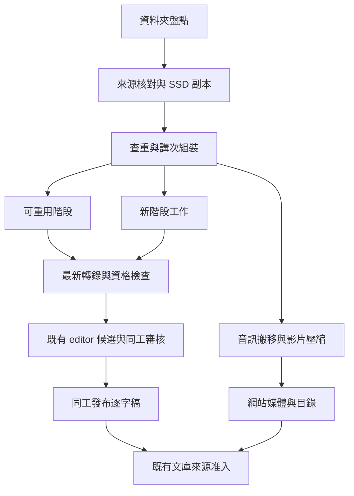

# 資料夾批次影音轉錄與下游接入設計

> **讀者**：Solution architect、Developer、神學編輯
> **類型**：規範
> **狀態**：當前目標規範；首版 CLI、持久佇列、進度 UI、媒體及候選交接已實作。第 12.1 節明列目前範圍與未完成項；程式與既有批次台帳已移交 production。
> **與代碼對齊**：2026-11-06（核對到 `8a3af43c`；第 3–11 節描述完整目標，不表示每項已實作；當前可執行入口以第 12.1 節為準）
> **權威範圍**：資料夾匯入、查重、可續跑轉錄、媒體搬移與壓縮、網站和文庫交接；不取代人工校對、來源准入或 Claim／CVP 規則。

## 目錄

- [1 目標與邊界](#1-目標與邊界)
  - [1.1 新批次設計與轉錄模組的邊界](#11-新批次設計與轉錄模組的邊界)
- [2 現有程式與待補項目](#2-現有程式與待補項目)
- [3 一次批次的流程](#3-一次批次的流程)
- [4 跨資料夾查重](#4-跨資料夾查重)
- [5 台帳與續跑契約](#5-台帳與續跑契約)
- [6 最新逐字稿流程](#6-最新逐字稿流程)
- [7 媒體搬移壓縮與網站發布](#7-媒體搬移壓縮與網站發布)
- [8 多 worker 與兩個 Sol 名額](#8-多-worker-與兩個-sol-名額)
- [9 磁碟與保存](#9-磁碟與保存)
- [10 網站編輯與文庫接入](#10-網站編輯與文庫接入)
- [11 批次進度 UI](#11-批次進度-ui)
- [12 操作入口與驗收](#12-操作入口與驗收)
  - [12.1 首版實作與操作](#121-首版實作與操作)
  - [12.2 完整目標的驗收](#122-完整目標的驗收)
- [13 設計自查](#13-設計自查)

## 1 目標與邊界

負責人提供一個本機或已掛載的資料夾，系統遞迴盤點其中的教授音訊與影片，完成查重、媒體準備、逐字稿候選與既有網站／文庫交接。再次提供同一資料夾、改名副本或已登記的另一種媒體版本，都應復用已完成的工作。

「檔案」不等於「講道」：一講可以由多個 MTS 相機分段構成，也可以同時有音訊、影片與壓縮播放版。不同場合重講同一主題，仍是不同講道。檔名、目錄日期、逐字稿相似度都不能單獨決定身份。

遵守[使命](../00-overview/project_mission_statement.md)及[架構](../00-overview/solution_architecture.md)：原聲、教授／聽眾、引用／主張、口述／投影片分開；不補答案、不改神學立場。一般批次不啟動既有講道的 Claim refresh，不覆寫人工稿。網站媒體可先準備上線；逐字稿仍由同工認領、審核、發布，文庫依來源准入接續。

### 1.1 新批次設計與轉錄模組的邊界

最新轉錄模組是本次剛完成的能力，不屬於兩年前的舊批次架構。保留其 ASR、標點分段、投影片、Gemini 校字、講員辨識、對齊及資格檢查；新設計重建的是外層資料夾匯入、持久任務、查重、資源排程、進度與網站交接，不重新發明已驗證的轉錄方法。

採用背景工作與可安全重試的通用原則：工作生命週期獨立於 UI、明確依賴、持久狀態、穩定操作 ID、可驗證輸出及集中資源限制。依據 [Microsoft 背景工作設計](https://learn.microsoft.com/en-us/azure/architecture/best-practices/background-jobs)與 [AWS 冪等重試設計](https://aws.amazon.com/builders-library/making-retries-safe-with-idempotent-APIs/)，落到本機與現有 PostgreSQL 的規模；這些原則不代表必須採用其雲端產品。

| 職責 | 本卡處理方式 |
| --- | --- |
| 批次編排 | 新 controller／Task 台帳決定何時、在哪個窗口執行，負責復原與資源，不處理轉錄文字 |
| 最新轉錄模組 | 接收已驗證媒體、固定設定與窗口，回傳候選／證書；按需補 progress callback、capacity hook 與輸入輸出檢查 |
| 媒體與模型 adapter | 統一來源下載、FFmpeg／模型呼叫的錯誤分類、回執與限額，不自行發布逐字稿 |
| 網站與文庫交接 | 沿用現有 editor、人工發布、來源准入及 migration 接點，批次頁只顯示真實交接結果 |

舊功能按行為與介面驗收，不按年齡全部推倒。轉錄模組只在證明批次必需的記憶體、非零 PTS、並行安全或觀測缺口時作有界調整；保存現有樣本與結果作回歸，不能以外層重構名義改模型分工、提示或時間規則。兩年前的 Excel／腳本串接不作新 controller 的設計模板，也不另造通用工作流框架。

## 2 現有程式與待補項目

| 現有接點 | 已有能力 | 本卡需補 |
| --- | --- | --- |
| [full_video_transcript](../../../backend/pipeline/full_video_transcript.py) | 單篇 audio/video、零起點媒體的 sample 時鐘、slide、校字、最終對齊與時間資格檢查 | 資料夾派工、資源限額、非零 PTS／分段來源與重用台帳 |
| [speaker batch](../../../backend/pipeline/transcript_speaker_batch.py) | 通讀音訊、逐段講員候選、保護已校對文字 | 納入新篇標準流程及同一版本鏈 |
| [slide assembly](../../../backend/pipeline/transcript_slide_assembly.py) | 投影片整理及段落位置 | 批次標準化調用、保存可重用的視覺資產 |
| [review import](../../../backend/pipeline/transcript_review_import.py)／[ReviewStore](../../../backend/api/sc_api/transcript_review.py) | 候選登記、CAS 衝突保護、認領、歷史、自存、發布 | 新篇目錄註冊、媒體引用及冪等交接 |
| [video handoff](../../../backend/pipeline/video_transcript_handoff.py) | 舊格式相容候選、非口述視覺綁定 | 發布後交接台帳；視覺來源仍需原有准入 |
| [ClaimModelCapacity](../../../backend/pipeline/claim_model_capacity.py) | 跨本機程序 slot、子程序繼承鎖、未知結果隔離 | 通用 Sol 呼叫接入，包括 API；不能原樣繼承 Claim 的 Opus 依賴 |
| [網站播放器](../../../web/src/app/components/sermons/SermonMediaPlayer.tsx)／[原聲定位](../../../backend/pipeline/original_audio_index.py) | 主要按 item 找 MP4／MP3，支援既有網站播放 | WAV／AAC 播放相容、可信 media metadata、統一解析，保留舊 URL |

既有 [Claim 維護進度頁](../../../web/src/app/admin/wang/claim-refresh/ClaimRefreshProgress.tsx)已有定時讀取、隱藏分頁暫停輪詢、資料過期提示及待辦呈現。本卡沿用這些 UI 模式，不複製 Claim 狀態機。批次模式已為全講 WAV 加 mmap 讀取及結構化進度；純音訊的 encoder 起點已有明示映射。非零影片起點與 MTS 有序組裝仍暫緩，不猜接。

舊站實體 `/opt/homebrew/var/www/church/reduce_video.sh` 對當前目錄的 `*.mp4` 執行 `scale=854:480`、`libx264`、`aac`，加 `-y` 寫入網站 `/web/video/` 對應目錄。它未明定 CRF／bitrate／preset／faststart，未保護比例，沒有輸出檢查或批次回執。其 SHA256 為 `1ae2a1311b9c106d3ebe2013e72d8637fa40de138bf3b5b73ec590e83612227b`。

另一支 `/opt/homebrew/var/www/church/processor_convert_video.py` 使用 MoviePy `write_videofile(..., codec='libx264')`，沒有指定縮圖，成功返回後就 `os.remove(input_file)`。舊 `processing_pipeline.py` 已註解停用這個 processor。不能把「程式存在」當作「目前批次正在壓縮」。這兩支舊程式只作行為參考，不直接執行其覆寫／刪檔流程。

## 3 一次批次的流程



| 階段 | 工作與通過條件 |
| --- | --- |
| 資料夾盤點 | 固定掃描清單；不跟隨越界符號連結；排除自身輸出、暫存、隱藏系統檔；副檔名與 ffprobe 共同辨識 |
| 來源核對與 SSD 副本 | 串流複製、兩端 hash／大小／來源版本核對；複製中變更的檔案不接續轉錄 |
| 查重與講次組裝 | 查全域台帳及舊站來源，建立 recording 與 asset 關係；問答保留、其他講員另列 |
| 可重用／新階段 | 只排尚未完成或輸入已變的階段；未知模型回覆先核對，不盲目重送 |
| 最新轉錄與資格檢查 | 依第 6 節；對齊不可靠的段落保留待核對狀態 |
| 音訊搬移與影片壓縮 | 依第 7 節；網站播放時間必須映回原聲 |
| editor 與網站 | 媒體、候選、目錄各有獨立回執；保留現有認領、角色及同工發布行為 |
| 文庫 | 只消費准入後的版本；軟刪除、口頭語及聽眾歸屬按既有契約處理 |

MTS 組裝先檢查編碼、拍攝資訊、PTS／聲音接續和缺段，再固定有序片段表。不能把同一目錄所有 MTS 按名字直接拼成一講；不同目錄的 `00001.MTS` 也不是同一檔。非零 PTS、聲音 gap／重疊有明示時間映射，未解不得靠字幕字數補時間。

## 4 跨資料夾查重

建立一次全域索引，而非每個 batch 自己存一份完成清單。首次建索引時將既有 `sermon.json`、原始／人工／發布逐字稿、review 歷史、網站媒體和既有轉錄輸出納入映射；未知舊資料不自動標為已確認。其後只處理新增或版本變更項，不在每次 plan／UI 查詢重讀全庫。檔案大小、mtime 與 file identity 只作快取失效提示，不能取代內容 hash 的身份證明。

| 比對 | 判定與後續 |
| --- | --- |
| 相同原始 bytes SHA256 | 同一 asset；改名、搬家、跨資料夾不影響，不再轉錄 |
| 相同標準解碼音訊 SHA／sample 數 | 容器不同但聲音完全相同；復用口述轉錄。新增影片的 slide 仍另處理 |
| 系統已產生的壓縮版 | 以派生 manifest 直接回到 recording，不重新做 ASR |
| 未知壓縮／裁切版本 | 聲學指紋找候選，再做完整時間對照、涵蓋率和未匹配語音檢查；只比開頭、經文或文字不成立 |
| 同主題、不同場合 | 不合併。開頭禱告不同、聽眾不同或有新增段落時，檢查是否為不同錄音或延長版 |
| 僅命名／日期近似 | 列待核實，先不花錢重做 ASR，也不靜默跳過 |

效率按層取得證據：已知來源版本／派生回執 → 複製時順便算 bytes hash → 必要時串流解碼一次，同時產生標準 PCM hash 與聲學指紋。PCM 規格固定 sample rate、聲道映射、樣本格式與解碼設定，結果綁定規格版本；指紋索引只召回時長／聲學相近的候選，再做全長驗證，不做全庫兩兩比較。檔名近似不能把無關新講永久擋住，客觀比對排除重複後即可繼續。未知壓縮版的自動判同須先用正反樣本校準，未通過驗收時留待核實。

`asset_id` 是檔案 hash；`recording_id` 是一次可追溯錄音事件的穩定 ID；`item` 是既有網站講道 ID。三者分開。未知錄音用內部 ID，不先由模型標題製造永久身份。已有 item 保留；新 item 只分配一次，之後改標題不改它。

對有 byte／標準音訊身份或已保存派生關係的來源，可以機械保證不重複執行。對沒有來源關係的舊壓縮／缺段錄音，不宣稱百分之百自動判同；未解項暫緩 ASR，以保守方式防止重複付費。查重及復用均記理由、目標 item、比較證據和已採用的來源版本。

## 5 台帳與續跑契約

第一版限單台掛載來源與 Jun SSD 的 Mac：一個由系統服務管理的 controller，最多四個子 worker；既有網站／API 讀寫同一份台帳。關閉瀏覽器或對話不會停止任務，網站重啟不自動重開模型呼叫。啟動固定程式版本、執行目錄與環境，活動版本不可被部署清理移除；重啟先復原台帳再派工。先不引入 Celery、Redis、另一個 Web 服務或跨主機 worker。

使用既有 PostgreSQL 服務中的獨立 ingest schema；不把暫存批次進度塞進 `sermon.json`。所有 worker 共用它，以交易、唯一鍵及短暫行鎖派工，不能各用記憶體 queue 或各自 SQLite。

| 記錄 | 必要內容 |
| --- | --- |
| Batch | folder、掃描版本、操作者指令、policy、pipeline commit、費用／空間預算 |
| Asset／Recording | hash、位置、媒體資訊、講員候選、來源片段、舊站 item、查重與時間映射 |
| Task | recording、stage、unit（全講／窗口／chunk／slide 批）、輸入／實作／設定 SHA、狀態、attempt、worker 租約、完成量與單位、最後心跳／進展、輸出和錯誤 |
| ModelCall | 模型及 backend、提示／schema、確切 request hash、保留的原回覆、用量、發送／回覆狀態 |
| PublicationReceipt | 媒體、目錄、review 候選、正式逐字稿、文庫來源各自的版本、hash、操作 ID |

階段唯一鍵為 `(recording_id, stage, unit_key, input_sha, stage_implementation_sha, profile_sha)`，以 DB 唯一限制在呼叫前搶佔。固定 task 的既有模型／profile 不因程式升級自動重跑；需要新版本時顯式建立受影響階段的工作。模型回覆也按 exact request hash 復用；不同模型／提示／輸入不能冒充同一回覆。改無關程式不使全片失效；按 stage 的實作與依賴鍵只重算受影響部分。

重用現有窗口及 saved-call 邊界，ASR 以 chunk、校字／對齊以窗口、slide 以批次保存結果；不將整個 `run` 子程序包成一個不可觀測任務。修正失敗窗口後只重跑依賴它的階段；跨窗拼接與全講檢查使用完整結果重新驗證，但不因此重發未受影響的 ASR。輸出放穩定的 recording／版本目錄，batch 只引用；底層舊快取若按路徑或「檔案存在」命中，adapter 必須核對輸入與輸出 hash 才採用。

Task 同時區分「已有預期輸出」與「輸出已驗證」。每次接管增加 attempt token，過期 worker 不可提交新進度／結果；產物先寫 attempt 專屬暫存位置，持有效 token 的程序才可原子安裝，不能讓舊 worker 覆寫共用檔；只有已核實沒有在途呼叫的工作可重派。每次模型呼叫先原子預留批次費用與呼叫預算，已花與在途預留都計入上限，不能讓四個 worker 各用一份完整預算。

同一 recording／輸入的 task 可被多個 batch 引用，另存 batch-task 關係；重複匯入不另派相同工作。暫停只取消該 batch 的新派工需求，其他活動 batch 仍需要的共用 task 可以繼續，已完成結果向所有引用者可見。

工作狀態為 `pending / running / waiting_capacity / interrupted / unknown_outcome / needs_resolution / failed / complete`。租約過期只代表 controller 失聯；另核對子程序、呼叫回執、輸出 hash，不能直接重發。檔案存在、PID 存在、HTTP 200 均不能單獨證明某階段完成。

付費服務不可能靠本機台帳宣稱「遠端 exactly once」：若服務已收件但本機沒收到結果，保留 `unknown_outcome`；僅在供應商有可核對的請求結果時接回，否則隔離等待處理。既有成功回覆不因重啟而再付費。

媒體安裝與 SQL 不能假裝是一個檔案系統交易：採 prepare → 驗證 → 原子安裝 → 寫回執 → 目錄可見。每一步均可重接；同一 item 有互斥與預期版本保護，同名不同 bytes 不覆寫。來源登記／Claim 更新仍走既有 ChangeSet，不以 ingest SQL 直接改文庫主資料。

## 6 最新逐字稿流程

沿用[目前整合流程](./video_transcript_integration_v1.md)，固定所用 commit／模型／詞表，不回到舊 Excel 批次或舊逐段轉錄。

1. 從已核對原片或明示組裝來源，保留靜音、聲道來源與 PTS，建立原始 sample 時鐘。語音解碼可用 16kHz mono；原始媒體不改聲音或速度。
2. `gpt-transcribe` 做原始 ASR，詞表提示包含教授姓名、Asbury、耶穌與已知原文字詞；提示不能代替原聲。原回覆保存，繁體轉換有前後 hash。
3. `gpt-6.1-sol` 做標點、分段及後續小標題／標題候選；標點步驟只允許可驗證的標點操作，不夾帶改字。小標題與摘要明示為編輯產物。
4. 有影片才跑 slide；判斷投影片內容變化，忽略游標與教授動作，無 slide 時空白。合併漸進顯示並在最相關段落前放完整狀態；原圖、OCR、diagram／SVG、出現時間分開保留。
5. 沿用現有 Gemini 音訊＋slide 提示校字；slide 只是提示，不以經文常識改原聲，也不再加入同一 ASR 重聽否決步驟。全聲音窗口標記教授／聽眾／未明，不能只找問號。
6. 清理非講道內容只形成可逆刪除候選；保留原始 ASR、修改依據及刪除範圍。問答、應用、論證需要的例子不因像口語就刪除。
7. 整合講員標記、校字、段落後，按最終可聽文字重新 forced alignment；標籤與 slide 不當作說出的字。復用現有 Qwen、contextual timing、段落聲學一致性與邊界修復；檢查跨窗口、上一段尾音、長片晚段及播放版時鐘。
8. 產生相容候選、原圖／OCR sidecar、逐段審核狀態與完整校驗報告。時間／內容待解不得偽造 confirmed；段落播放到本段結尾停止。

階段依賴保持簡單：來源核對後，ASR／標點、slide 處理及播放版準備可在各自資源限額內獨立推進；需要 slide 的校字等兩份材料齊備，最終對齊等講員與校字完成。第一版優先跨講填滿資源；只有輸出目錄已隔離的單講分支才並行，不能為速度造成同一檔案競寫。

模型分工不混淆：ASR 是 `gpt-transcribe`，文字工作是 `gpt-6.1-sol`，原聲／slide 校字和講員候選沿用 Gemini。官方 [GPT-6.1 Sol 文件](https://developers.openai.com/api/docs/models/gpt-6.1-sol)列出 text／image 輸入，不能把它當作音訊轉錄模型。這是採用現有模型接點，不授權在設計階段發起批次模型呼叫。

## 7 媒體搬移壓縮與網站發布

網站媒體庫 `/opt/homebrew/var/www/church/web/video` 已連到 `/Volumes/Jun SSD/church-website-video`。必須以實際 realpath／device 驗證同碟，不能只看字串。不要把舊資料目錄 `data/video` 當成網站正式服務目錄。

| 類型 | 正式媒體處理 |
| --- | --- |
| 可播放 MP3 | 原 bytes 搬到正式庫，保留 hash；同碟用原子 rename，不重新編碼 |
| WAV／AAC 等原音訊 | 原 bytes 同樣搬入保存；對現有 MP3-only 消費端產生相容 MP3 播放版，不把 WAV 假改副檔名為 MP3 |
| 影片 | 從原始片產生 H.264／AAC MP4 播放版；原片保留在歸檔位置，OCR 與聲學依據優先用原片 |

「音訊直接 move」指不再留一份匯入副本；原始 bytes 不被相容播放版取代。跨磁碟用 copy → fsync → hash 核對 → 安裝，再移除已核對匯入副本。OneDrive 雲端檔不使用普通刪檔；其本機快取另走第 9 節。

壓縮延續舊站 H.264／AAC 格式，新增版本化 profile，初始試跑候選為 CRF 23、preset medium、AAC 96 kbps、yuv420p、faststart，不切靜音、不改播放速度。一般影片保留 480p 方案，但改成等比縮放、不放大原片；slide 字太小則採 720p 或保留必要原解析度。最終 profile 由試跑的畫面可讀性、容量和聲畫同步驗收固定，這裡不宣稱已校準。

轉碼前預約輸出空間；寫非公開暫存檔，完整解碼檢查、音軌存在、時長／原點／聲畫同步與多處音訊錨點核對後才原子安裝。只比總時長不足以證明沒有中途漂移。保存原片／拼接／播放版分段時間映射及 SHA；無法證明映射則不發布錯位媒體。已壓縮版本不套 profile 再壓一次。

媒體、目錄與逐字稿發布分三個回執。目錄只在媒體可用後可見，沿用既有權限與成員登入規則；發布到網站不等於擅改媒體公開權限。不得新增「未審核稿已發布」的虛假狀態。MIME／檔案選擇與 metadata.type 由共同 resolver 產生，現有 `/web/video/<item>.mp3|mp4` URL 保留，避免播放器、文庫原聲與引用音訊各猜一次副檔名。

ReviewStore 現有匯入會複製 `source.mp4`。本卡要以不可變媒體引用取代同碟重複大檔；舊候選仍相容，媒體 route 校驗 item、SHA、MIME、授權與 byte range。搬移後不得令 saved request 或來源證書的路徑斷裂；以穩定位置／別名及重綁回執處理。

## 8 多 worker 與兩個 Sol 名額

初始配置為最多 4 個 worker；按可執行階段／窗口派工，可處理不同講道，不是四個各帶兩條 GPT。真正開始服務請求前，還要取得對應資源名額。

| 資源 | 初始上限／限制 |
| --- | --- |
| `gpt-6.1-sol` | 所有 batch、worker 及已接入的 API／subscription transport 合計最多 2 個實際在途請求；不可調高 |
| ASR `gpt-transcribe` | 初始 2，另受服務限流和費用預算，不混入 Sol 的兩個名額 |
| Gemini 音訊／視覺 | 初始 2，可因配額自動降速，未知回覆不重發 |
| MPS 對齊 | 1，避免 GPU 記憶體互搶 |
| 影片壓縮 | 1，限制 CPU／磁碟與暫存峰值 |
| 雲端下載／搬移 | 1，完成核對與快取釋放後才繼續下一大檔 |

一般工作用同一張 Task 表派工；Sol 採共用 Python capacity 模組及固定鎖／回執目錄，不另部署 admission 服務。所有 batch 共用總上限兩個 slot，帳戶／transport 身份記在回執，不能為每個帳戶另建兩個名額，也不能放在 batch output 下。所有 Sol 接點，包括格式化、標題、視覺複核和結構修復，都須通過此模組；不得在 worker 內各建 semaphore 或繞過 API client 直接呼叫。

借用現有 Claim capacity 的 transport 鎖、子程序繼承及未知回覆隔離做法，抽出通用接點；不能把 ingest 綁到「等 Opus 恢復」的 Claim 專用規則。若共用同帳戶其他工作的 Sol 容量，必須也接入同一容量池或等其既有呼叫結束再接管；兩套各限兩個不算全域限額。未接入的外部客戶端無法由本批次控制，啟動檢查不能虛稱已約束它們。

名額從發送前保留到遠端完成／可核對失敗；本機超時、worker 死亡或租約到期不直接釋放未知遠端請求。服務回覆有不確定性時隔離該名額，核實原結果後恢復，不用 TTL 自動重發。CLI 子程序繼承保護鎖；API 有不可變 dispatch／response 回執。重試及結構修復也占相同名額並受原預算限制；禁止 SDK 自動隱藏重試。

等待名額的 task 留在 queue，不占 worker 或對齊／壓縮資源；dispatcher 按資源空位及批次輪轉取可執行 task，避免四個 worker 全卡在 Sol。一次只持當前階段所需資源，完成後交還；同 recording 的可變輸出目錄不允許並行寫入。配額／費用上限觸發時只暫停相關模型階段，其他已授權的本機檢查可以繼續。通用 admission 改造需測試既有 Claim client，不能修改正在運作的外部 worker 或強行解鎖。

## 9 磁碟與保存

本機 source／cache／artifact 根目錄在啟動時固定，資料存持久目錄，不存部署 release 或 Git worktree。Jun SSD 未掛載或 volume identity 不符時停止派工，不能在內置碟建立同名 `/Volumes/Jun SSD` 目錄頂替。資料庫失聯時停止新 dispatch；已取得名額的呼叫可把回答寫入持久回執，連線恢復後核對入帳，不再發一次。

初始保留 SSD 80 GiB、內置碟 10 GiB，批次中間工作集最多 15 GiB（初始可調值，並非已量測最佳值）；預約空間時把待下載雲端檔、原片／壓縮版並存、解碼窗口與 ffmpeg 暫存算進去，不能每個 worker 都看到同一份 free space 而各自批准。無法在上限內處理時縮小窗口／並行或明示暫緩，不偷偷突破預留。排程另計 RAM：改為串流解碼／磁碟窗口或 mmap 讀取，不能四講同時將整片 PCM 及所有影格載入記憶體。已取得窗口的音訊可供 ASR、講員與對齊重用。

OneDrive 依「複製到 SSD → 兩端核對 → 保存持久回執 → 釋放本機下載」處理。只能釋放已核對且沒有未同步修改的那個檔案，保留雲端項目；操作失敗或 Mac 鎖定需記為 `cache_release_pending`，不得假報清理成功。下載管理程序在釋放未解或空間不足時暫停新大檔。

永久保留原始影音的一個歸檔實體、hash／來源對照、原始模型回覆、文字修訂／軟刪除、時間證據、選用原圖及 OCR／SVG、最終稿、准入與發布回執。原始錄音已有可信雲端保存，但不能在缺乏可回取證明時刪掉唯一原片。

可重建的解碼窗口、未選影格、臨時壓縮檔分層回收。先檢查 active 任務、review／history／證書／migration 檔案引用，再決定何時刪；目前時鐘證書綁定的窗口與 migration witnesses 不因看似中間檔就刪除。結案後回收需產生清單與再生方法；不得把所有 AI 回覆和歷史備份套上單純「只留兩版」。

## 10 網站編輯與文庫接入

`sermon.json` 保留 item、type、講員、日期、系列、狀態及指向媒體／review 的必要 metadata；來源不明的日期不由模型填成確定日期。批次台帳／OCR 不塞入目錄。新增目錄與候選登記串行保護共享檔，講道內容寫入使用各自 item 鎖，不以全庫排他鎖阻塞不同講道。

只上影音而逐字稿尚未就緒時，網站詳情頁需能從目錄 metadata 與媒體回執顯示「逐字稿整理中」並正常播放，不能依賴不存在的 script 取標題，也不建立假空白稿。沿用既有目錄狀態定義，補的是可用內容判斷；`media_ready` 等批次階段狀態只在台帳內，不直接塞成現有程式不認識的 sermon status。

候選沿用 `metadata / script`、穩定 paragraph index、秒數 start／end 以及既有 sidecar。技術驗證完成只代表可以交給同工，不自動勾選內容已核對。同工在新 editor 認領、逐段聽看、Markdown 編輯、自動儲存、查歷史、發布，再取消認領。現有人工／發布稿匹配到相同 recording 時保留，需換新稿則走[三方合併與 Claim 搬遷](../20-knowledge/transcript_claim_migration_workflow.md)，不重新建同一來源。

文庫交接綁定正式發布 SHA，使用[口述投影](../../../backend/pipeline/transcript_publication_projection.py)、既有來源登記及抽取入口。軟刪除不進讀者文字、模型有效原文或證據；口頭提示只作語境。聽眾問題有角色標記，不自動當教授主張；教授引用角色與本人的立場亦須分清。

slide OCR／SVG 是獨立非口述候選，讀者可參考，不能因網站能顯示就直接當已批准視覺證據。沿用視覺來源准入並保存原圖到 OCR／重建的派生鏈；未批准的視覺不混進口述，已批准口述仍可獨立向下游推進。SourceDocument 登記、Claim 抽取／更新、CVP 維護各有自己的任務回執，不能把「逐字稿已匯入」報成「文庫全部更新」。

## 11 批次進度 UI

### 11.1 頁面與範圍

當前主要入口是 Operation Dashboard：以來源資料夾的完整檔案清單為分母，包含尚未下載、待查重／排程、待組裝、講員待確認、排隊／執行中、失敗、已有逐字稿、重複副本及非影音。檔名、資料夾、已知講道標題、實際階段與等待原因均須可見；未知標題明示尚未辨識，不能讓 `audio-pilot` 等暫存名代替講道來源。診斷節錄須標出原講道與取樣範圍，不計為完整講道處理完成。

已實作的檔案總覽在 SQL 端先搜尋／篩選整個資料夾再分頁；檔案數與講次數分開。它讀取複製工作既有的清單／回執，不接管下載、不修改 OneDrive 或複製目錄。獨立同步程序每 15 秒將狀態寫入台帳；失敗時保留最後確認結果及錯誤，超過 45 秒未同步須明示過期。GET 僅讀取台帳。既有診斷批次／窗口明細保留在各自批次連結，主總覽優先選擇真實資料夾清單。

「已有逐字稿」由正規化原始檔名對照既有 item，再讀取實際非空逐字稿確認，標題來自既有目錄；只看目錄 `status` 或同名檔案不足。此分類不代表原始音訊已完成聲學判同。檔名匹配會阻擋未核實的重新轉錄；付費派工前仍按來源身份核對，不能把檔名匹配寫成 PCM／聲學證明。資料夾內相同 bytes hash 的副本另列，兩類不得混成一個沒有說明的重複數。

在既有 Admin 導覽新增「批次轉錄」，目標路徑 `/admin/media-batches`，點入 `/admin/media-batches/<batch_id>`；CLI 啟動後輸出同一詳情頁連結。桌面用表格，手機用逐講卡片。第一版只用一個總覽與一個批次詳情頁，詳情在頁內展開，不另造圖表儀表板或另一套 editor。

既有 admin、editor、beta_tester 角色均可查看與控制；beta_tester 與 editor 權限一致。前端及後端都檢查 session／角色，後端每次請求重新讀取現有角色設定，reader、reviewer、未註冊及未登入者不能存取。候選的「開啟校對」仍依原 editor 權限。worker 回執經既有 backend 讀取，不向瀏覽器開放 SSD、資料庫或 worker 埠。

第一個 UI 版本即提供實際進度；建立批次先用 CLI 指定伺服器已掛載資料夾。瀏覽器不能選取遠端 Mac 任意路徑；首版不做大量上傳或任意路徑檔案瀏覽器。日後若加建立入口，只能選已配置且服務端驗證的來源根目錄。

### 11.2 批次詳情與實際進度

頁面依下列順序呈現；範例數字只說明畫面，不是本次 Ruxin 的實測：

```text
批次轉錄 · Ruxin Share                 [暫停排程] [立即更新]
轉錄就緒 12 / 30 講 · 處理中 3 · 排隊 13 · 待處理 2
檔案 42 · 已辨識重複 8 · 非本批範圍 4
GPT Sol 使用 2 / 2 · 等待 1 · 待核實名額 0
SSD 可用／已預留 · 最後工作回報 · 最後頁面讀取

講次       階段       本階段進度       狀態／操作
講道 A     校字       4 / 6 窗口      處理中 · 展開
講道 B     對齊       2 / 5 窗口      等待 GPU
講道 C     已交 editor —              待同工校對 · 開啟校對
講道 D     查重       —               需確認講次 · 查看對照
```

- 頂部以講次為轉錄分母，另列原始檔案、重複及排除數。掃描／MTS 組裝未定時顯示「講次統計中」；排程前固定 scope version，後續確認合併或新增時明示計畫變更，不偷偷改分母。完全復用既有完成稿另計，不冒充本批新轉錄。
- 每講顯示來源檔名、講題／講員候選、時長、目前階段、完成單位、已用時間、最後進展、等待／錯誤原因；展開才顯示各階段、查重依據、重試次數與診斷。可按處理中、等待、失敗、待確認、轉錄就緒篩選，搜尋檔名／講題。
- 不以「階段 3/8」假裝時間完成 37.5%。複製顯示已寫入 bytes／總 bytes，寫完後顯示「hash 驗證中」，驗證通過才算檔案完成；壓縮用 ffmpeg 的輸出時間／來源時長，尚未驗證時即使編碼 100% 仍顯示「驗證中」；ASR 顯示已驗證 core 音訊時長，重疊 chunk 不重複計數；校字／對齊顯示已驗證窗口數；OCR 顯示已處理／已確認需處理的 slide 數。沒有可靠分母或模型呼叫進度時顯示「處理中，已等待…」，不用跳動的假百分比。
- 音訊的 slide 階段為「不適用」；影片經全長投影片偵測未發現 slide 則為「未偵測到投影片」。技術轉錄就緒、媒體可播放、同工校對、正式發布與文庫交接分開標記；批次不必等人工發布才結束，但缺少要求的媒體／候選回執只能標為部分完成。所選批次全部完成／復用／明示排除才可結案，失敗或待解不能算成功。
- 首版不給總 ETA；沒有歷史速度基線時估算容易誤導。顯示實際用量及可核對費用，subscription 或供應商未回報部分標「未提供」，不當作零費用。只列實際在途與保留待核實的 Sol 名額，不用執行中 task 數冒充模型呼叫數。

### 11.3 狀態來源與輕量刷新

CLI 與 UI 共用台帳查詢，不掃描大量輸出資料夾、不讀完整原回答，也不在 GET 裡觸發續跑／模型。提供批次摘要、分頁講次列表及單講詳情的 read API；按 batch、狀態與 recording 建必要索引，摘要與列表來自一致的資料快照並帶 `snapshot_revision`、`generated_at`。

adapter 在 stage／chunk 開始、驗證完成、等待與錯誤時寫結構化事件，更新 Task 摘要與單調增加的完成計數；心跳只更新時間，不每次新增歷史列。轉碼進度用 `ffmpeg -progress`，原 pipeline 可加 progress callback；不靠截取 stdout 中文句子判定成功。重試產生新 attempt，UI 顯示其所屬 input revision，不能把不同版本的完成量加總。

沿用既有進度頁的輪詢模式：可見且活動時每 5 秒，已停止／完成時每 30 秒，隱藏頁暫停，重新可見立即讀取；失敗退避、同時至多一個請求。第一版不用 WebSocket／SSE。後端分別回報 worker heartbeat、最近實際工作進展及資料取得時間；初始每 10 秒心跳、30 秒無回報標為「工作程序失聯，待核實」，只是顯示規則，不觸發重送或釋放鎖。模型慢但心跳正常時明示等待多久；API 讀取失敗則保留上次資料並標「狀態未更新」，不可繼續聲稱正在執行。

### 11.4 控制與錯誤處理

| 控制 | 明確行為 |
| --- | --- |
| 暫停排程 | 不再啟動該批新 task／模型呼叫；正在執行的工作完成並落盤，顯示「暫停中」直到排空，其他批次繼續 |
| 繼續 | 使用同一 batch、原 scope／預算／輸入；先核對中斷結果與資源，不另開重複批次 |
| 重試可恢復失敗 | 只重新排已證明可安全重試的失敗 unit，復用成功結果；不重跑整講，不增加原預算 |
| 查看需處理項 | 明示是容量／磁碟／程序錯誤，還是講次／講員／來源內容待確認；附原檔、音訊時間與候選對照，只把不能自主判定的內容交人 |
| 開啟校對／網站 | 回執存在且權限允許才可進入；不在批次頁新增發布逐字稿按鈕 |

UI 不提供「強制解鎖」「忽略 hash」或把未知呼叫當失敗重試的按鈕。尚無供應商結果的 unknown 留在待核實；排錯依具體 request 處理，不讓使用者盲按重試多付費。短暫可安全重試的服務拒絕依有界退避自動重試，不確定是否已執行的錯誤不套此規則。

控制走 authenticated POST，帶防重複操作 ID 及預期 batch revision，後端原子更新 desired state，再由 controller 執行；回應成功表示已收指令，畫面須等實際狀態改變。防 CSRF、角色核對與版本衝突沿用既有後台慣例。一般頁面只顯示相對檔名／可讀原因，詳細錯誤移除金鑰、token 與模型原始 payload。

## 12 操作入口與驗收

### 12.1 首版實作與操作

首版位於 [media_batch](../../../backend/pipeline/media_batch/__main__.py)，使用既有 PostgreSQL 中的獨立 `media_ingest` schema。以下命令在本卡 worktree 執行；來源、產物及網站目錄必須先指定到正確環境。試跑用獨立資料庫與資料根目錄，不能借 production 測試。

```bash
# 在環境設定 MEDIA_BATCH_DATABASE_URL；不得將連線密碼寫入操作紀錄。
backend/.venv/bin/python -m backend.pipeline.media_batch install

# 從既有複製回執建立完整 Operation Dashboard，不派轉錄或模型工作。
backend/.venv/bin/python -m backend.pipeline.media_batch inventory \
  --manifest INVENTORY_JSON --receipts VERIFIED_JSONL --title TITLE \
  --catalog-root EXISTING_DATA_ROOT --artifact-root ARTIFACT_ROOT \
  --media-root MEDIA_ROOT --review-root REVIEW_ROOT --capacity-root CAPACITY_ROOT
# 對輸出的 batch ID 執行 start，會只啟動清單同步，不啟動 ASR。

# 首次明示建立舊站索引。只讀既有稿件，不搬動或改寫人工稿。
backend/.venv/bin/python -m backend.pipeline.media_batch index-existing \
  --review-root REVIEW_ROOT --media-root MEDIA_ROOT

# plan 不呼叫模型；FOLDER 必須已完整下載，輸出不得放進來源資料夾。
backend/.venv/bin/python -m backend.pipeline.media_batch plan \
  --folder FOLDER --title TITLE --artifact-root ARTIFACT_ROOT \
  --media-root MEDIA_ROOT --review-root REVIEW_ROOT --capacity-root CAPACITY_ROOT \
  --aligner-python ALIGNER_VENV/bin/python --budget-usd BUDGET --max-calls MAX_CALLS

# macOS launchd 管理；關閉 terminal 或瀏覽器不會結束 controller。
backend/.venv/bin/python -m backend.pipeline.media_batch start --batch BATCH_ID --workers 4
backend/.venv/bin/python -m backend.pipeline.media_batch status --batch BATCH_ID

# 由已保存回覆補算費用，不呼叫模型、不改原預留台帳。
backend/.venv/bin/python -m backend.pipeline.media_batch reconcile-costs --batch BATCH_ID

# 與 UI 同一控制介面，REVISION 取最新 status，OPERATION_ID 每次指令固定。
backend/.venv/bin/python -m backend.pipeline.media_batch pause \
  --batch BATCH_ID --revision REVISION --operation OPERATION_ID
backend/.venv/bin/python -m backend.pipeline.media_batch resume \
  --batch BATCH_ID --revision REVISION --operation OPERATION_ID
```

`run` 是前台入口，`--drain` 在無可執行工作時退出；`start` 讓 controller 等待 UI 暫停／繼續／重試，全部工作完成後退出。若完成後另有失敗重試需求，須明示再次 `start`；UI 不會從 GET 偷啟程序。`reconcile` 只在舊工作沒有活躍租約鎖、且心跳過期時將其標為中斷或未知。`retry` 不能重發未知模型呼叫。`stop` 先暫停，待在途 task 排空才卸載本批 supervisor。

費用估算按已保存的 token／音訊時長及明示費率計算，不是供應商帳單。派工預算佔用為「已完成且有可信用量的保守費用估算＋在途／結果不明／缺少用量的完整預留」，同一批次短交易串行檢查；歷次預留及呼叫累計保留、不清零，避免將固定保守預留誤當已花費。獲明示授權後可用 `raise-budget --batch BATCH_ID --revision REVISION --operation OPERATION_ID --budget-usd NEW_CAP --reason AUTHORIZATION` 追加較高上限；控制台帳記錄授權理由、舊版本及新上限，來源設定與原呼叫次數上限不變。費率／用量缺失時顯示待彙整，不把未知費用顯示為零。

進度頁為 `/admin/media-batches` 及 `/admin/media-batches/<batch_id>`。頁面、代理 API 及後端均核對 admin／editor／beta_tester 身份；前後端共用既有簽名身份。Operation Dashboard 搜尋／篩選涵蓋完整檔案清單；舊診斷批次的講次篩選仍明示只作用於本頁。摘要與分頁列表由 SQL 一致快照產生，包含實際階段／窗口、心跳、錯誤、共用資源、磁碟、已保留費用上限；該金額不是供應商帳單。轉錄批次頁可暫停、繼續、重試可恢復失敗及開啟既有校對入口；關閉頁面不停止任務。

| 已實作範圍 | 實際行為 |
| --- | --- |
| 身份與防重 | bytes SHA、固定 16 kHz mono PCM 身份、舊站索引；同時長的舊壓縮版經逐秒全長聲學比對後才自動沿用；改名／搬家仍能接續排隊任務 |
| 續跑與版本 | PostgreSQL 唯一 task、短交易派工、attempt CAS、子程序繼承租約鎖；同一 recording 的可變工作目錄串行，跨講並行；speech 各窗口獨立 task，原模型回覆依 exact request 重用 |
| 版本界線 | 固定來源、詞表、實作及目的地的再次計畫共用 task。與本流程無關的 git commit 不使其失效；相關 stage 實作或目的地變更則建立新工作版本及隔離目錄，目前不做跨 pipeline 版本的自動產物移植 |
| 模型與資源 | 批次內所有實際 saved-call 共用 Sol 2、ASR 2、Gemini 2；MPS 1、壓縮 1；同一台帳強制相同 capacity 根目錄，累計原子保留預算。未接入的其他應用程序不在此全域承諾內 |
| 未知結果 | 本機檢查通過、實際發送前才保留預算；遠端結果不明時保留 request 與隔離 slot，不以超時自動重發 |
| 磁碟預約 | task 派到 worker 後、啟動子程序前，依實際 filesystem device 合併所需空間，短交易串行核算所有 batch／worker 的未釋放預約；整組磁碟一起准入或 rollback。空間不足留待排程，完成／失敗且租約已釋放才交還；`reconcile` 可回收完成後尚未釋放的孤立預約，活躍子程序不按 TTL 回收 |
| 影音 | 音訊 MP3 原 bytes 同碟 hardlink，避免重複大檔並保留來源路徑；WAV／AAC 另產相容 MP3。影片固定等比、不放大、最高 720p 的 H.264／AAC、CRF 23、medium、faststart；完整解碼、時長及多處音訊錨點驗證後安裝，不覆寫同名不同媒體 |
| 新轉錄模組 | ASR、標點分段、slide／OCR、Gemini 原聲校字、最終 forced alignment、contextual timing 及講員辨識；不使用舊 Excel 批次。不改動教授的內容立場 |
| 清理後時間 | 長篇現場交代被刪除後，若保留句仍錯配到舊起點，只從唯一匹配的原始聲學 token 提出新播放範圍，再經整段連續原聲驗證。不能由字數推算時間。過長的相鄰段落檢查轉交完整段落驗證，未通過仍禁止候選交接；舊時間與回覆保留 |
| 候選與網站 | 媒體驗證後登記目錄；未發布時公開 API 只投影媒體 metadata，不洩露草稿，也不造假空白 script。全新批次講道由 ReviewStore 準備未認領、未發布的草稿，完成後的連結直接打開新 editor，可查看及播放；修改前仍須人工認領。初始化只允許來源雜湊相符且沒有既有稿件的 INGEST 項目，重試保留人工修改和認領；既有講道仍維持明確採用流程。自存／歷史／發布由既有 editor 處理。採用時將精確來源綁定的自動排除還原成 `~~原文~~`，包含整段及段內軟刪除；時間證書仍綁定未刪除的閱讀文字。讀者 API 和文庫來源投影排除刪除線內容，編輯稿、來源及歷史保留；完全刪除段落被恢復後，須先處理其時間核對 |
| 講員與下游 | 講員標籤在採用候選時加入，精確驗證所有口述字元未改；原文與時間證書保留。已返回但未通過字元保全的講員分段保留為「說話者未明」，不猜身份、不重新轉錄；可能漏字報告以來源時間、證據雜湊及原始報告保留為段落旁的複核提示，不自動加入口述。提示與該段一起人工核對，所有段落未確認前仍不能發布。未完成／未知呼叫、段落缺失仍阻止候選交接。既有人工或發布稿不覆寫；不自動發布逐字稿、不更新 Claim、不繞過文庫來源准入 |

本機可用 [聲紋盤點工具](../../../backend/pipeline/media_batch/acoustic_inventory.py) 對完整來源建立 SHA 綁定的 Chromaprint 快取，召回改名、壓縮及部分截段候選，再以獨立原聲連續波形檢查確認可沿用的錄音。查重本身不呼叫轉錄模型。Chromaprint 原生函式庫是此盤點工具的可選本機依賴；不是轉錄模型。指紋或相同講題都不足以自動沿用；未召回匹配也不代表其他網站／離線資料從未轉錄。ADPCM／壓縮錄音的核對片段必須按解碼樣本裁切，不以快速 seek 的時間戳作證。實際查重結果及講次暫排以 SHA 綁定的私人對照表提供；Dashboard 只向既有 editor／beta tester／admin 開放報表，不公開本機路徑入口。

粗轉錄優先模式使用同一 PostgreSQL 台帳及 worker：先按凍結的對照表順序處理一般檔案，再處理有封包連續性證明的 MTS 組，最後處理待辨識講次的錄音機檔。只建立 `rough_prepare`、`rough_asr`、`rough_summary`，不建立對齊、投影片、媒體發布或稿件交接任務。ASR 仍用現有轉錄模組，傳輸及保留的快取為 16 kHz mono／64 kbps MP3；原始影音保留。粗稿保留區塊時間與重疊標記，不能當作已校對證據。內容概要綁定粗稿 SHA 與區塊 ID。

完成 ASR 後清理可重建的 PCM WAV，保留 master、窗口及音訊清單、MP3、完整請求與回答。完整 pipeline 只在來源及詞彙版本一致時匯入此快取，重新生成 PCM 並驗證每個原始 WAV SHA，沿用 MP3 傳輸和保存回答；輸入、快取或重建結果不同時拒絕自動重送。Dashboard 將「粗轉錄完成」與「已完成」分開，粗稿透過相同 editor／beta tester／admin 認證的私人端點查看。

尚未完成的完整目標不能當作首版能力：MTS 有序組裝、非零影片時鐘映射、任意裁切／變速來源的聲學候選召回、同音訊新增不同影片的視覺補件，均不自動採用不明來源。目前會阻擋已辨識的 MTS、非零影片起點、不同影片同聲音及其他講員候選。任意裁切的未知舊版尚不能完整識別，因此還不能宣稱整個 Ruxin corpus 絕無重複。

磁碟已有掛載／device 身份核對及跨 worker 預約。預設 SSD 保留 80 GiB、內置碟 10 GiB，同 device 的在途估計寫入預算 15 GiB；可由 `--ssd-reserve-gib`、`--internal-reserve-gib`、`--working-set-gib` 明示設定。單一工作超過預算時列明原因，不能靠重試偷偷擴大上限。worker 執行期間每次心跳也核對實際可用空間，低於下限則停止本機工作、保留原稿與未知模型狀態。UI 顯示可用及已預約 GiB。

此預約是**估計新增寫入的排程預算，不是 OS 硬 quota，也不是全部歷史快取總大小上限**；已寫出的永久檔仍由實際 free space 計入。估計可能保守而提早等待。自動回收、較大工作集的分窗影格保存仍未完成，不能宣稱任意輸出都被硬限制在 15 GiB。OneDrive 下載／快取釋放由獨立複製工作負責，批次不刪雲端檔、不刪尚被證書引用的原檔。仍須先盤點來源與可用容量，不能直接無人值守地啟動整庫。

### 12.2 完整目標的驗收

以下是完整系統仍須滿足的驗收表，不能將首版短片測試視作全表已通過。具體測試結果保存為獨立記錄／測試產物，不嵌入本規範。

| 驗收案例 | 必須成立 |
| --- | --- |
| 同 folder 再跑、改名、跨 folder 同檔 | 零新增 ASR／文字模型呼叫，零重複 item／來源 |
| 音訊和同聲影片、已生成壓縮版 | 口述復用；缺少的視覺／播放版可單獨補，不重轉錄 |
| 同經文但不同場合、相似短句 | 不誤合併；身份未解前不花 ASR 費用 |
| 多 MTS、非零 PTS、缺段／重疊 | 正確講次與時間對照；不明處明示，不猜接 |
| 四 worker、兩 batch、API／CLI 混用 | 實際 Sol 在途峰值 <=2；包括修復／重試；其他資源也不超額 |
| kill controller／worker、遠端超時、回覆後寫盤前中斷 | 恢復原結果或隔離 unknown，不重複發送、不自行釋放未知 slot |
| 音訊搬移後程序中斷、轉碼失敗、同名不同 bytes | 原檔可追回、壞檔不公開、正常稿不覆寫 |
| Mac 鎖定、快取釋放失敗、磁碟預約競爭 | 如實暫緩，雲端原檔保留，完成數不虛報 |
| UI 更新、重新載入、手機、暫停／繼續、重複點擊 | 同一台帳／批次；關頁不停止；手機可查停因與進 editor；暫停不截斷在途，重複操作無重複派工 |
| UI 斷線、worker 失聯、未知模型結果、重試 | 顯示舊資料與待核實；不假報執行／成功，不放掉未知名額，不重算已完成單位 |
| 未授權 GET／POST、預算競爭、SSD 拔除 | 拒絕存取；原子預留不超額；不誤寫內置碟；GET 不啟動任何工作 |
| 單窗口失敗／依賴變更、再次 plan | 僅重跑必要單位，未改 ASR 零新呼叫；不重掃全庫歷史，不沿用錯版快取 |
| 一純音訊＋一 slide 影片真實試跑 | 網站 MIME／range、Safari／Chrome 可播；首段、接縫、中晚段的對齊與段尾停止均核對 |
| 同工編輯與發布後文庫取材 | 格式相容、歷史保留、刪除不可見、講員分明、引用原文與播放位置一致 |

實作順序為台帳／舊來源索引及可顯示真實進度的 UI 骨架 → 安全媒體安裝／壓縮與時間映射 → 既有 pipeline adapter／共用 Sol capacity 及窗口事件 → review／網站交接與 UI 控制 → 一音訊一影片端到端 → 大批次。先證明可重跑及不重複，再擴大量；不能用整批付費來測試編排是否正確。

## 13 設計自查

| 容易遺漏的問題 | 本設計的處置 |
| --- | --- |
| 多造服務與重型排程框架 | 單機 controller＋worker、既有 PostgreSQL／Web，共用 capacity 模組；不新增 broker 或常駐 admission 網路服務 |
| 說能續跑，實際失敗重做整講 | window／chunk／slide 批唯一鍵與原回答復用，受影響依賴才重驗 |
| 把非零 PTS、低記憶體當成現有能力 | 明列 prepare 現在的拒絕／整講載入限制，實作後才驗收宣稱支援 |
| UI 看似即時，資料卻已過期 | 心跳、實際進展、API 讀取時間分開；失聯與斷線明示 |
| 完成率把檔案、講次、校對混在一起 | 固定 scope 分母、實際單位、分開轉錄／媒體／發布／文庫狀態 |
| 只憑檔名避免重複，改名就失效 | asset／recording 分離，byte／PCM／派生鏈與聲學比對分層 |
| 影片重複就跳過，遺漏新增 slide | 語音與視覺階段分開重用 |
| 音訊直接搬入但網站播不動 | 原 bytes 保留，WAV／AAC 另給 MP3 相容版；統一媒體解析 |
| 舊 480p 腳本把 slide 字壓糊 | 等比 profile 與可讀性試跑；OCR 用原片 |
| 壓縮後總長一樣但中途漂移 | 原點、PTS、解碼與多處聲學錨點共同驗證 |
| 標籤或校字後沿用舊時間 | 最終可聽文字綁定重對齊、contextual 邊界資格檢查 |
| 每 worker 限兩個但整批超額 | 發送前共用兩個 Sol slot，API／CLI／修復均接入 |
| 超時釋放名額，但遠端其實還在做 | unknown 隔離；不依 TTL 自行恢復，不承諾遠端 exactly once |
| 已上網站就被當成完成校對／視覺准入 | 媒體、review、發布、來源與 Claim 各自回執 |
| 清中間檔破壞已保存引用 | 引用檢查、穩定媒體位置、版本證書與回收清單 |

首版實作邊界以第 12.1 節為準，完整目標的剩餘工程與驗收仍在同一張 #685 卡及同一 PR 推進；未完成項不得以 UI「已完成」取代來源核實、人工發布或文庫准入。
