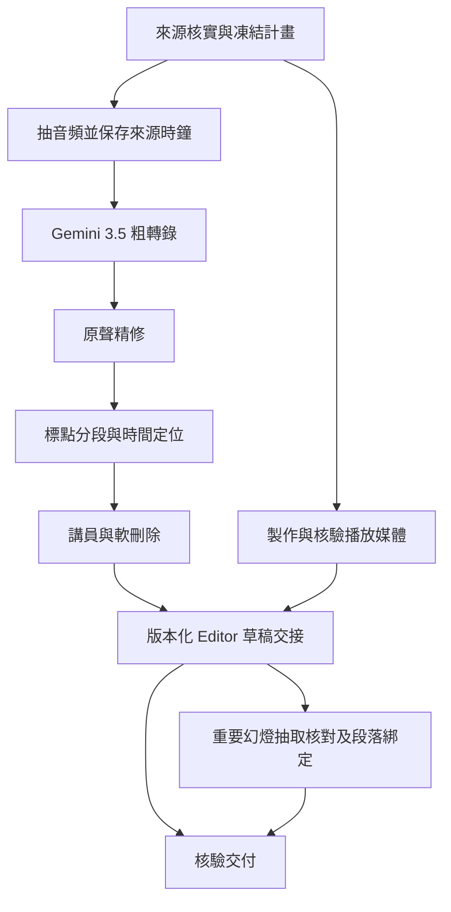

# Gemini 影音處理統一入口設計

> **讀者**：Developer、Solution architect
> **類型**：規範
> **狀態**：設計草案，待負責人確認；尚未實作或啟用，舊任務尚未遷移
> **與代碼對齊**：2026-11-27，盤點基線 `3dd39d36`；下列接口與退役策略為目標設計，並非已存在能力
> **權威範圍**：#886 的入口、階段串聯、批次、播放媒體、Editor 交付及舊管線退役；不重定轉錄模型的內容品質規則

## 目錄

- [1 目的與邊界](#1-目的與邊界)
- [2 已確認的現況](#2-已確認的現況)
- [3 一個計畫接口](#3-一個計畫接口)
- [4 階段及依賴](#4-階段及依賴)
- [5 媒體與來源時鐘](#5-媒體與來源時鐘)
- [6 新版 Editor 交接](#6-新版-editor-交接)
- [7 版本、批次與恢復](#7-版本批次與恢復)
- [8 退役與責任拆分](#8-退役與責任拆分)
- [9 Eval](#9-eval)
- [10 實施順序與交付](#10-實施順序與交付)
- [11 後台系列監控 UI](#11-後台系列監控-ui)

## 1 目的與邊界

所有新轉錄只走 Gemini 3.5 Transcribe 粗轉錄及目前滿意的精修、分段、對齊、講員、軟刪除流程。單檔與多檔共用現有 `media_batch` 台帳、worker、資源限額和進度頁；不新建排程系統。總入口負責串聯既有能力，不重新調整模型、提示、切窗或內容判斷。

遵守[使命](../00-overview/project_mission_statement.md)和[架構](../00-overview/solution_architecture.md)：保留教授實際說的內容，編輯標記不冒充原話，未知內容不補答。技術交付、同工校對、公開發布、知識來源准入分開。此卡不發布逐字稿、不執行 Claim／CVP、不部署。

最早 Excel／Processor 與後來 GPT ASR 管線退役的是執行能力，不是資料。原影片、音訊、粗稿、人工稿、模型原回答、原時間結果及費用記錄均保留。#859 的品質評測和提示改造另按自己的 Eval 進行，不能混入本卡。

## 2 已確認的現況

| 能力 | 現有實作 | 整合缺口 |
|---|---|---|
| 批次、來源與播放媒體 | `media_batch` 的 planner、store、worker、runtime、stages.media | 階段表仍指向舊 `full_video_transcript`；尚無新版階段適配 |
| Gemini 轉錄與精修 | `transcript_gemini_proofreading`、`transcript_gemini_audio` | 可直接接 MP4，內部抽 16 kHz 單聲道音頻；結果是新版 `layout.json` |
| 時間定位 | 新版 timing 用 Gemini 原始詞時間及必要聲學回退 | 不能沿用舊格式的合格證明，也不能只因有 start/end 就標合格 |
| Editor | `ReviewStore.register_candidate/import_candidate` | 目前要求舊 `full_transcript.json`、reading layout 和時間核驗資料；不能直接接新版 layout |
| 重要投影片 | `editor_slide_runner`（#881／PR #882） | 需要已存在的 Editor 草稿；分類仍 import 舊總管線，須先拆出共用能力 |
| 共用資源與費用 | `media_batch.runtime`、calls 台帳 | 新版 ASR、saved_response 及所有實際文字／視覺呼叫須納入，不能只限制外層 worker |

舊[資料夾批次設計](folder_media_transcription_design.md)記錄了目前外層能力；本草案確認前不宣稱它已被替換。舊[視訊接入說明](video_transcript_integration_v1.md)亦不可當作新版已接通的證據。

## 3 一個計畫接口

保留 `python -m backend.pipeline.media_batch`，擴展 `plan`；`start/status/pause/resume/retry/stop` 沿用現有控制方式。以下是目標接口，尚不能直接執行：

```bash
backend/.venv/bin/python -m backend.pipeline.media_batch plan \
  --manifest jobs.json --pipeline gemini-transcript-v1 \
  --artifact-root ARTIFACTS --media-root MEDIA --review-root REVIEW \
  --capacity-root CAPACITY --aligner-python ALIGNER \
  --budget-usd CAP --max-calls CALLS
backend/.venv/bin/python -m backend.pipeline.media_batch start --batch BATCH_ID
backend/.venv/bin/python -m backend.pipeline.media_batch status --batch BATCH_ID
```

`--manifest` 和既有 `--folder` 二選一，都編譯成同一份凍結工作清單。manifest 每項明列來源檔、預期來源 SHA、既有 item（若有）、要求的交付及目的地；單篇是一項清單。folder 模式先盤點和查重再凍結，不能在執行期間繼續掃出新檔。plan 不呼叫模型、不安裝媒體、不改正文；已有台帳及計畫沿用，不因改名另建錄音。

交付可選完整 Editor 圖文草稿、Gemini 粗稿、只補播放媒體、只補幻燈。新轉錄預設完整圖文草稿；粗稿模式明示未校對，沒有對齊／Editor 完成宣告。明列交付目的避免因省略參數而靜默跳過幻燈。音訊在凍結計畫時將幻燈列為不適用。

同一 item 的已有人工稿或發布稿預設只讀。補幻燈沿用版本化插入，補媒體不能改正文；重轉錄候選須另存，不在背景採用。既有 metadata-only item（如本次第一講）可接入，但不能要求改成 `INGEST-` ID；允許初次交接的條件是精確來源綁定、空稿基線及既有權限，不是 ID 前綴。

manifest 的最小格式如下（SHA 與路徑是佔位值，schema 名稱為本卡目標契約）：

```json
{
  "schema_version": "gemini-media-jobs.v1",
  "jobs": [{
    "source": "/mounted/original/lecture.mp4",
    "source_sha256": "<verified-64-hex-sha256>",
    "item": "<existing-catalog-item>",
    "deliverables": ["editor_draft", "playback", "slides"],
    "adoption": "initialize_empty_draft"
  }]
}
```

`initialize_empty_draft` 適用於新建 item，也適用於已登記但只有 metadata 的 item；是否可初始化由第 6 節的精確空稿與權限條件決定，不由 item 是否已存在決定。要求完整 Editor 圖文交付時，plan 對可初始化的空稿選此模式，預覽明示將建立草稿，再由同一工作自動繼續幻燈。不能初始化的既有稿只允許補件或另存候選，不自動替換。

`register_candidate` 僅登記另一份候選，不代表 Editor 已可用；其交付名稱是 `candidate`，不能同時承諾 `editor_draft` 或依賴新稿的 slides。若使用者選擇只登記候選，plan 明確裁減交付；若仍要求整套自動處理則拒絕不相容的組合。slides-only 必須帶已有 Editor 的 expected_version；media-only 不寫正文，但須有媒體安裝及映射更新權限。互斥的粗稿與 Editor 交付組合由 plan 拒絕，音訊要求 slides 則明列不適用。每項結果回傳穩定 recording／item 身份、計畫版本、要求的交付、各階段狀態與回執；路徑僅由受權 CLI 讀取，HTTP 用已登記 asset ID 解析來源。

HTTP 寫入接口和 CLI 呼叫同一 plan/control service，沿用現有簽名身份、角色、operation ID 與 revision；不以用戶提供的 actor 欄當身份。網頁只選已登記媒體，不提供任意伺服器路徑。GET 不啟動或恢復工作。

## 4 階段及依賴



| 階段 | 輸入與輸出 | 成功條件 |
|---|---|---|
| 來源核實 | 原檔、SHA、probe、既有 metadata／稿件 → 凍結計畫 | 身份不重複；來源、目的地與版本明確；非零影片起點或分段來源無既有映射時阻擋，不能猜接 |
| audio | 原來源 → 初始根窗口音頻及來源秒數、SHA 清單 | 保持新版解碼參數、切窗及重疊；不刪靜音、不壓縮時間；根窗口就緒不代表所有自適應子窗口已知 |
| transcribe | 根窗口與自適應子窗口 → 原回答、詞時間與說話者、coverage 及終端窗口樹 | 保留現行依回答二分的行為；所有實際採用的終端窗口均有已驗證結果，沒有未決分支 |
| flash | 原聲＋粗稿 → 精修及待核漏句 | 維持凍結版本的現行行為；不補入投影片文字 |
| timing | 精修＋原詞時間 → 分段及定位證據 | 文字只依既有標點／分段契約改動；時間來源、方法及疑點明示 |
| speakers／repetitions／layout | 已定位段落 → 講員、軟刪除及完整 layout | 不再呼叫舊 speaker batch 做第二次辨識；每段原文和標記可回溯 |
| media | 原來源 → 播放副本及核驗回執 | 原檔保留；副本解碼、時長及聲學時間對應通過 |
| editor | layout＋時間證據＋媒體 → 版本化草稿及回執 | 新版專用適配通過，來源／基線未變，權限與認領規則成立 |
| slides | 原視頻＋精確 Editor 快照 → 原圖、SVG、獨立覆核、附件 | 沿用既有 runner 的原圖及段落檢查；實際寫入符合快照版本 |
| delivery | 計畫要求＋所有回執 → 完成報告 | 要求的交付均核驗，不以啟動成功或僅產生檔案宣告完成 |

audio 將目前 `transcript_gemini_audio.extract` 的行為封裝為可恢復產物，先產現行每 180 秒的根窗口，前後各保留最多 2 秒來源重疊。transcribe 消費相同 bytes，依原回答按下一段規則建立子窗口；根清單是凍結的輸入範圍，終端窗口清單不是事先固定的。不得借串聯工程改成舊十五分鐘 master 流程或新的停頓切分。Flash 的抽音亦保留原邊界。

現行自適應規則保持不變：核心窗口長於 60 秒，且選入詞數小於核心秒數的 0.75 倍或最大詞間／首尾間隙超過 40 秒時，取核心中點等分並遞迴；180 秒根窗口可能產生 90 秒及 45 秒子窗口。每個節點保存來源 SHA、根序號、完整父子 ID、核心及含重疊的來源起止、抽音參數／SHA、父回答 SHA、觸發規則和版本。子窗口仍從原來源抽取，不能從父窗口再切而改變解碼輸入。

父回答不足只代表需要分支，不改成 unknown 或遺失回答。先在鎖及短交易內以穩定 node ID 登記二分決定與兩個子節點，再逐個確保音頻就緒、預留調用、保存回答；子節點是 transcribe 任務內的可恢復工作單位，不反向重開已完成的 audio 任務。父回答和子節點已完成結果全部保存。組裝只按原順序取採用的終端節點並沿用原詞中點歸屬規則，不把父回答與子回答重複拼接。任何分支缺音頻、結果未知或機械驗證失敗，不能完成 transcribe。

重啟從保存的父回答、二分決定及子節點狀態接續；父回答有效時不重送父呼叫，已完成子回答亦不重送。每個實際父／子呼叫各占一次原批次預算與相應資源名額，二分不增加預算上限；不足則保存窗口樹並等待資源處置，不清零或換 root。拆分登記後到任一子音頻／回答保存之間的崩潰均須可恢復。

media 與轉錄可獨立派工，但同錄音工作區目前由 worker 串行保護。先保持這個保護，不為並行改寫共享檔案。壓縮不是 ASR 或 OCR 的上游依賴。純音訊仍經相同轉錄路徑，播放副本依既有相容性策略產生。

## 5 媒體與來源時鐘

復用 `stages.media` 的編碼和核驗能力，但替換它目前「目標存在且無本任務回執即拒絕」的安裝決策。新編影片等比、不放大、最高 720p，H.264／AAC、CRF 23、medium、faststart；音訊按既有策略保留 MP3 原 bytes 或產相容播放版。既有媒體是否可沿用以實際 codec、尺寸、可解碼／seek、faststart 和來源時鐘核驗為據，不要求反推出它原本的 CRF。

plan 分別核實原來源檔與既有播放檔，凍結兩者 SHA、現有媒體映射及預期目的地版本；預覽列以下三種 disposition。plan 只輸出決策，不產安裝回執。

| 決策 | 何時採用 | 執行及成功回執 |
|---|---|---|
| `reuse_verified` | 已登記播放檔，或精確 item 對應的既有同名檔，通過身份、相容性和第 5 節時鐘核驗 | 不重編碼、不改檔案；執行時重查 SHA／映射前像，記錄來源與播放兩個 SHA、實際核驗、`origin=verified_existing` 的沿用回執；不冒充本次壓縮生成 |
| `create_versioned` | 尚無播放檔，或原檔／舊播放檔需壓縮或不符合播放規格 | 在媒體根目錄內依 item 與生成輸入版本產生獨立版本路徑，臨時編碼、核驗後原子安裝；保留全部舊 bytes，以 CAS 更新播放映射並保存前後像／操作回執 |
| `conflict` | 既有檔來源或 item 不明、已綁到另一講、身份無法核實、新產物時鐘核驗失敗、計畫後檔案／映射漂移，或版本目的檔已有不同 bytes | 停止該媒體交付並列具體衝突；不覆寫、不強制登記，也不單憑同名／時長／幾處聲學相似就認定身份 |

原來源正好位於歷史 `<media_root>/<item>.mp4` 時，若符合播放要求可核驗沿用；若需壓縮，寫入例如 `<media_root>/playback/<item>/<input-version>/playback.mp4`，永不就地覆蓋原片。新版本路徑即使已存在，也只能依已準備回執與 SHA 接續或核驗沿用，不能無條件覆寫。媒體安裝與映射交接持久記錄 intent／receipt，使安裝後映射更新前的中斷可以安全接續。

媒體登記明確分開 `source_asset_id/source_sha256` 與 `playback_asset_id/playback_sha256`，播放映射按 item 指向新資產。Editor 候選仍綁原來源供轉錄／OCR 與核驗，播放器透過既有受權媒體解析層讀 playback 映射，保留 MIME、Range 及身份檢查；無新映射時才用歷史檔名解析。這需要同時適配讀取端，不能只把新檔寫在子目錄就宣稱已可播放。幻燈 runner 核對的是原片 SHA，不得以壓縮副本 SHA 取代。

以原來源時間為共同座標，保存原 SHA、容器起點、串流起點及抽音命令；每個音頻片段保存原片起止和 SHA。字幕、幻燈切換與取圖時間不可混用，媒體壓縮也不能改段落秒數。原影片沒有已驗證的零起點或明示映射時，先報具體阻礙，不讓 ffmpeg 的隱式 rebasing 冒充映射。

播放副本沿用完整解碼、時長差及首／中／晚段聲學錨點檢查，保存實際 lag 與 correlation。既有標準為時長差不超過 0.3 秒，聲學錨點 lag 不超過 50ms 且 correlation 至少 0.65；這些是播放副本核驗標準，不代表逐字時間精度。超出時停止安裝，不改數字放行；若需要另一種映射，另有可核實證據才能接入。

## 6 新版 Editor 交接

新增明確的 Gemini 候選 schema，內容直接來自 layout；保留每段原文、原講員輪次、軟刪除、原片秒數、時間定位方法和待核漏句。適配只生成機械欄位與資產引用，逐段比對文字／標記／時間相等，記錄前後 SHA。不得先拼出假的舊 full_transcript 或 qualified certificate 以通過舊 importer。

`ReviewStore` 以候選版本分派驗證：舊來源沿用原 gate；新來源驗證新版完整輸入與時間證據。無法確認的時間、漏句或講員保留為明示待核項；可供校對但不能冒充合格時間或解除發布限制。缺少必要產物、未知呼叫或來源不符則拒絕交接。適配驗收須包含「缺時間欄位不能被預設為 qualified」及未決項確實阻止發布的反例。

候選登記、採用、附件插入均經既有鎖、版本比對、操作日誌與回執。`initialize_empty_draft` 可用於本批次新 item 或既有 metadata-only item，須同時滿足：

1. item、來源資產及 SHA 精確綁定，metadata 版本與凍結計畫相符；只認已核實映射，不以標題／URL 相似推定。
2. plan 已盤點 `script/script_patched/script_review/script_published`、review context、修訂歷史和既有候選／操作回執。所有正文缺失或只是可證明未編輯的機器空模板，沒有發布稿、非空舊粗稿、人工修訂或另一份已採用來源。每項缺失也以 expected-missing 綁定；不能只查 `script_review` 一個檔。
3. 執行身份有既有逐講初始化／寫權；認領存在時須符合原 actor／epoch，不偷改 owner、不自動接管他人認領。明列的 plan adoption 已授權本次空稿初始化，不再要求使用者手動採用一次。
4. 寫入時持同一 workflow lock，重新核對上述完整前像、權限及 epoch，以固定 operation ID 執行既有 recoverable journal。任何前像變動拒絕初始化，保留候選供後續既有採用流程，不覆蓋。

此操作透過一次可恢復的多檔 journal 建立 script_review、context、來源／媒體綁定和未決項，只有 committed 回執及完整回讀後才對下游宣告可用。保存候選登記及採用的回執，將實際 Editor version 傳給 slides 階段並自動繼續，不停在「候選已登記」。重試先完成 prepared 操作恢復，或讀回並驗證既有成功回執，再保留後續人工修改；不重新初始化或為了符合原前像刪掉新稿。metadata-only 初始化、候選登記、幻燈插入各自有穩定回執，不能只看檔案存在當作成功。

非空稿仍沿用認領人明確採用與衝突保護。僅登記候選的工作在 candidate 交付完成後結束，不顯示為 Editor／圖文交付完成，也不啟動需要該候選已採用的幻燈工作。

Editor 可先供人校對，幻燈階段對它取快照；公開發布仍依全部校對門檻。幻燈期間文字或時間改變時，保留抽圖與 OCR／原圖核對結果，拒絕過期綁定；以新段落快照重新計畫受影響的綁定呼叫，計入原預算，不重轉錄。此時不能標整講圖文交付完成。

## 7 版本、批次與恢復

每批凍結 pipeline release、階段實作 SHA、模型及提示、配置、來源 SHA、目的地、要求的交付、費用及次數上限。每階段完成回執綁定確切依賴及產物 SHA。無關 git commit 不使所有結果失效；上游變更只重新計畫受影響的下游，不原地改寫舊 task 或 checkpoint。

階段回執共用 envelope：`schema_version`、`recording`、`item`、`pipeline_release`、`stage`、`input_sha256`、`dependencies`（上游回執 SHA）、`artifacts`（相對路徑／schema／SHA）、`call_ids`、`outcome`。領域產物仍保留原 schema，不讓外層強迫模型抄出這些機械欄位。outcome 的 complete 只證明該階段契約成立；內容待核、時間待核及 fidelity 暫留另列，完成總結按要求的交付逐項計算。

新版的 `transcribe/flash/timing/speakers/repetitions/layout` 可分階段派工，但沿用目前先前輸出計算 input_sha 的契約；新增內部單階段接點，既有 standalone CLI 改委派同一實作。暫停只阻止下一次派工，在途工作安全收尾。觀察者讀進度與真實鎖／租約，不以 metadata 的 processing 或排程 ACTIVE 推斷正在轉錄。

重送前先查保存 request、response 和調用台帳。已保存且驗證相符的回答離線復用；request 已存在而結果未知，保留占用與預算，不自動新建目錄重送。新版 ASR 的 upload／request／response／delete 分別記錄，清理失敗不得抹掉已保存成功回答或使轉錄重送。這是執行記錄修復，不更動轉錄內容。

多檔可同時推進，共用現有 ASR、Gemini、Sol、MPS 及轉碼限額；每次真實模型呼叫（包括修復與附件綁定）都取得相應 slot 並持久預留費用與次數。外層 workers 數量不能替代這一點。單篇失敗不終止其他篇，unknown_outcome 保持隔離；容量等待與失敗分開。

報告每講列要求、完成、待核、不適用、失敗、未知，以及實際產物／Editor 連結。影片沒偵測到幻燈須有全長檢測回執；音訊則是無視覺來源。重要幻燈被 fidelity 暫留時列為部分交付及理由，不把它當成沒有重要幻燈。技術交付完整與內容待核可同時存在，不能稱人工已確認。

## 8 退役與責任拆分

| 對象 | 目標處置 |
|---|---|
| 倉庫外 church 的 processing_pipeline、Processor 及其排程 | 盤點實際啟動方式和活躍進程後停用生產啟動；不在本卡直接執行它們、不刪來源或 Excel 歷史 |
| GPT full_video_transcript、transcript_audio_pilot 的生成 CLI | 拆出仍用到的能力後，生成入口拒絕新呼叫並指向總入口；唯讀歷史與共用工具仍可用 |
| media_batch 舊 full 與 rough 派工 | 禁止新建、resume/retry 自動調用退役引擎；新版不得默認沿用舊時間或粗稿當新輸入 |
| 既有 GPT 任務、粗稿及預算 | 原意圖、版本、結果、費用不變；保存為可讀歷史，另記 retirement disposition，不把未完成改成 complete |
| 新版 standalone CLI | 可保留診斷相容接口，但委派相同 Gemini 階段、容量與回執，不能另生一套模型流程 |

來源查重、probe、音頻讀寫、切窗、hash／JSON 保存、幻燈分類、共用文字模型傳輸各有獨立模組。生成器不再成為新流程的公共工具庫；特別移出 `editor_slide_runner` 對 `full_video_transcript.classify_slides` 的依賴，以及新版對舊 cleanup_generate 的依賴。以已保存輸入輸出等價驗證搬移，不先大改算法。

舊 worker 的停用須核實 worker lease、OS 進程鎖、SQL checkpoint、保存 request／raw outcome，並確認管理者可控。活躍呼叫不粗暴終止；先阻止新派工，讓在途結果保存，再凍結舊路徑。未知結果不得假稱已排空。只有清楚綁定的舊任務處置與新版來源重新計畫能產生新工作，不能原地換引擎沿用身份或重置舊預算。

退役判定以顯式 pipeline release／引擎身份及已盤點的歷史配置為據，不能只檢查最新 CLI 的預設值。plan、start／resume／retry、worker claim 和 stage 子程序進入生成前都核對同一持久退役記錄；缺少可辨識版本的舊任務先留只讀待盤點，不猜為 Gemini。沿用既有 task 狀態欄，退役原因另記 disposition，不偽造一個正常成功。實作時須確認舊二進位與外部排程的實際控制方式；新程式內加 guard 不能獨自證明老進程已停止。

部署新入口與停用生產排程屬後續運維，依[operations runbook](../../operations-runbook.md)另行執行；本設計交付不代表已退役。舊粗稿 read API 與歷史進度頁保持可讀。回滾程式不能重新啟動被凍結的舊任務，退役狀態須由持久資料保護。

## 9 Eval

本次負責人指定「人工驗收」，並明確要求應由工程方測試的項目不能交給負責人。工程測試由實作者自主完成，全部必要檢查通過後才交負責人看可操作的 UI 與實際結果；人工驗收不替代測試，也不要求負責人逐檔比 SHA、查 SQL、重現故障或替模型建立逐字標準答案。

本卡不建立新的模型品質評分器，不以另行簽署內容 Key 作為純工程串聯的前置。相同保存輸入的機械等價驗證、確定性預期結果及故障反例仍須實作並執行；未做的測試不得寫成已通過。本決定限本卡串聯與交付驗收，不更動 #859 的模型調整規則。

### 9.1 Criteria

1. 對保存結果做機械適配及等價回放時，口述文字、講員、軟刪除、段落順序及時間全部相等，新增模型呼叫數為零；這個零呼叫要求不套到實際新片轉錄。
2. 一項及多項清單使用同一 plan／stage 邏輯；來源身份無重複，人工稿／認領／發布稿無非目標改動。
3. 媒體通過第 5 節檢查，原 bytes 不變；時間異常、來源漂移或待核資格不被包裝成通過。
4. 完成階段重試不再次調模型、安裝媒體、插入附件或建立歷史；未知呼叫不重送。
5. 單講失敗隔離，共用名額與預算不超出，暫停／恢復保留原任務及計畫。
6. 要求的交付全有可驗證回執；幻燈暫留、無投影片及不適用各有準確狀態。
7. 退役入口及舊任務續跑無法再觸發生成；舊粗稿、原回答及費用仍可讀。
8. 後台按系列展示全部未完成講道，包括零任務、缺來源及只有舊粗稿者；系列身份、名稱、成員和次序與既有系列頁一致。搜尋／篩選涵蓋完整目錄，跨批次只計一次講道，不把校對或發布狀態當作 pipeline 完成證據。
9. 已登記空稿能一次完成初始化、幻燈及總交付；非空稿或初始化前像漂移時拒絕自動採用，成功後重試保留人工修改。
10. 既有媒體在有／無舊回執及來源／播放同路徑時均可按第 5 節準確決策；沿用不重編碼，獨立副本可經播放器定位，所有原檔不變。
11. 自適應 ASR 的父子切窗、實際音頻輸入、回答採用順序與原規則相等；任一子分支中斷／未知均不重送已完成呼叫，不漏字或重複拼接。
12. 同講多批次／來源切換／補件時只依目前明確要求的計畫及證據判定狀態；索引寫入及重建可恢復，舊任務時間更新不改變目前完成結論。

### 9.2 Key：工程預期結果與人工樣本

工程測試的答案由凍結的來源、既有實作行為和本設計契約推導，寫成具體預期結果與反例，不由模型自評。UI 用同版 `sermon_series.json`／`sermon.json`、來源／交付索引和隔離 SQL fixture，列出預期的系列身份、名稱、順序、成員及逐講狀態。這些答案由實作者核實、測試並附報告，不等負責人逐條代建。

既有 Gemini 保存結果用於工程等價檢查，不再要求負責人簽成內容品質 Key。已讀取的候選為 2017 NYSC（六）第四講 `lecture-4-timing-rerun-v1`：來源音訊 SHA `4d7e666ab2eddc19a259bc1441db776d449d2d4ae1720cebbca2cd73cddfcdb3`，layout SHA `8be233f6e7553b7df018d85697b485be3fd78d5dee3ba37df7b9a9f7eb51417a`。其 run.json 帶 refinement_recovery，實作者須追清保存的 request／raw、原程式與恢復產物，選定可證明來源的支援版本；不能把 #859 未提交實驗直接混入。不一致屬工程調查，不能轉成要求負責人選 commit 或放棄測試。

自適應 ASR 先以確定性案例測 180→90→45 秒父子窗口的決定、輸入、恢復和組裝，再核對可用的真實保存案例。缺真實案例時如實揭示，不能宣稱真實回放已通過，也不要求負責人替工程方補窗口測試。幻燈沿用 #881 保存案例驗證接入、版本、附件及處理結果，並保留原參照的審核狀態；工程回放不升格內容批准。

實際整講驗收用本會話指定的 2022 NYSC（九）第一堂：既有 item 不變，來源 YouTube `CPajzELScJU`，本機原片 8664.502857 秒、640×360。實作者先核實本機 SHA、metadata、來源身份及調用預算，再跑單講完整流程，不拿整批付費來測派工。完成後供負責人從後台查看稿件、播放及幻燈，不要求人工製作該講逐字標準答案。

### 9.3 Grading：由工程方執行及報告

每次測試綁定實作 commit、來源／fixture 版本和配置。報告逐項的預期、實際、通過／失敗及證據路徑；未執行、被阻擋、跳過、人工尚未驗收分開列出。不得只報「測試通過」而省略必測但未跑的項目。

| 工程方必測範圍 | 案例與通過條件 |
|---|---|
| 文字與時間適配 | 保存輸入適配前後文字、講員、軟刪除、順序與時間零差異；回放零新增模型呼叫；未決時間／漏句不能被當成已核實 |
| 空稿交接 | metadata-only item 一次走到可用 Editor 及幻燈；plan 後新增非空稿／人工修訂／他人認領要衝突；首次成功後人工修改再 retry，正文和歷史不變；candidate-only 不冒充 Editor 完成 |
| 媒體與播放器 | 合法既有播放檔有／無回執均可核驗沿用，零重編碼；來源與舊播放同路徑需壓縮時另存，原檔 SHA 不變；核對時長與首／中／晚段聲學 lag／correlation；實際瀏覽器驗證 MIME、Range、seek、播放映射及音畫／字幕時間對應 |
| 媒體故障 | 壓縮失敗、安裝後映射前中斷可恢復；同名異講、版本目標不同 bytes、來源／映射漂移拒絕覆寫；音訊、影片及非零起點不被猜接 |
| 動態子窗口 | 父決定保存後、首子完成後、另一子結果未知時重啟，完成呼叫不重送；終端詞序／覆蓋／輸入 SHA 等價；不重複拼接；未知分支隔離，預算不足不換 root |
| 多檔批次與資源 | 至少一成功、一可恢復失敗、一受保護稿，同時驗證單篇失敗隔離；暫停／續跑／重複開始／兩 controller 共用名額，沒有超額、預算清零或重複任務 |
| Editor 與幻燈 | 真實採用及附件回執可回讀，來源 SHA 和文件版本準確；過期快照拒絕插入，人工修改保留；原圖／SVG 核對與暫留披露；無幻燈、純音訊及缺產物各有正確結果 |
| 全目錄分組與狀態 | 零 task、舊粗稿、缺來源、無系列、多系列、跨批次都可見且正確計數；系列成員／名稱／順序一致；搜尋及分頁涵蓋全庫，漏項、多收、重複、錯組、錯序、狀態誤報均為零 |
| 當前計畫與同步 | 舊來源 complete 不蓋過目前 pending；補幻燈失敗不重轉錄；過期結果晚到不改 head；人工改稿使相應綁定失效；索引同步前崩潰可恢復，待同步不顯示完成，snapshot 改變時摘要與清單一致重載 |
| 權限與讀取 | 頁面、代理、後端未授權均拒絕；原認領／epoch 保留；GET、開頁、搜尋及輪詢零派工／模型／正文寫入，診斷及本機路徑不公開 |
| 退役 | 舊 CLI、plan、resume/retry、worker 及子程序不能再調退役生成器；未知舊呼叫不重送；粗稿、回答、費用仍可讀，活躍舊工作不假稱已排空 |

數字報告至少含文字／時間差異、UI 命中／遺漏／多收／重複／錯組／錯序、非目標檔案變更、未知或已完成呼叫重送、資源在途峰值、費用預留、播放錨點和耗時。等價及保護項零差異／零違規；技術交付和內容品質分開，不把程序通過冒充負責人已接受內容。

工程測試在隔離資料與 SQL 環境執行，使用 `backend/.venv`。實作者執行必要的單元、回放、批次整合及實際瀏覽器測試；前端跑 `tsc --noEmit`，文檔跑 `check-docs`。對測試能發現的缺陷自主修復並重驗，不能把缺陷清單交給負責人代測。只跑 typecheck 或 unit tests 不等於 UI／整講端到端已通過。

### 9.4 負責人的人工驗收

工程方完成上節必要檢查並交付可操作環境後，提供對應本卡版本的 URL、單講實際結果、工程報告及仍存在的限制；不用負責人找日誌、查 SQL 或猜是哪個 worktree。

負責人檢視三項使用效果：按熟悉系列能否找到全部待處理講道；能否看懂目前進度、異常和下一步；打開本次第一講能否順暢閱讀、播放和查看對應幻燈。由負責人記錄接受／需修正及具體項目，不要求另簽模型 Key、操作故障注入或逐字打分。

人工指出問題後，實作者先分類並修復：工程缺陷補相應反例及測試，不重新要求負責人重做工程驗證；內容／模型行為若確需調整，另遵守 #859 的品質改造範圍。人工未驗收時保持「待人工驗收」，不能以自測結果代替人工接受；人工接受也不能掩蓋未完成或失敗的工程檢查。

## 10 實施順序與交付

1. 依第 9 節執行本次工程自測＋負責人人工驗收的分工；實作者核實並固定支援的滿意版程式及輸入輸出，不等待另簽內容 Key。
2. 搬移共用工具與補等價回放，先解除新舊生成器依賴。
3. 接新版逐階段執行、容量／費用、版本化產物，並實作第 11 節的全目錄系列監控 UI 及共用狀態查詢；保留舊任務只讀能力。
4. 接媒體、Gemini 專用 Editor 候選、身份／時間／人工保護，再串幻燈及完成核驗。
5. 實作者在隔離資料驗證恢復、交付、全目錄 UI 和退役反例，核查保存證據後實跑本次一講；工程檢查通過才提供人工驗收環境與報告。
6. 同一 #886 分支完成實作與驗收後提交完整 PR；生產切換和舊排程停用依運維程序安排，不在設計稿合併時宣稱卡已完成。

設計確認前不修改現行模型流程、不遷移生產任務、不發起新轉錄。設計文件可以先以 draft PR 供審閱，但 #886 保持未完成，該 PR 不應在僅含設計時合併關卡。

## 11 後台系列監控 UI

### 11.1 範圍與分組來源

負責人要求後台可視化監控整套 pipeline，全部未處理講道都在此頁，分組與 `/resources/series` 相同。主入口沿用 `/admin/media-batches`，預設顯示「按系列」，既有批次檢視和 `/admin/media-batches/<batch>` 保留為鑽取詳情。不能要求先建立批次才看得到一講。

2026-11-27 已核對 `SeriesBrowser`：系列列表經 `/api/sc_api/sermon_series` 讀取，其成員及順序來自 `config/sermon_series.json`，顯示名稱由 `seriesName` 決定（保留既有 ID，必要時顯示更正年份的 title）。後台共用這份分組及顯示規則，不按磁碟資料夾、batch ID、日期或模型猜測重分組；`MyWork` 為個人校對工作，不作 pipeline 分組。

由完整 `config/sermon.json` 與系列成員取聯集，再關聯來源索引、稿件／交付回執及 SQL 工作。系列成員若缺 metadata 仍顯示「目錄資料待修復」，不能沿用現有 reader 的略過行為而漏掉。無系列講道另列「未分組」，新來源尚無講道身份者另列「待配對來源」，不擅自歸系列。多系列成員照既有分組顯示，總覽按 item 去重，各系列按自己的成員計數；跨批次／多來源版本也是同一講詳情，不在列表重複一講。

### 11.2 未處理的判定

預設列出所有尚未滿足要求交付的講道，並保留「全部」篩選以查看已完成。待處理不是 metadata 的 processing，也不是「不在 complete tasks 裡」；必須看來源、實際稿件、要求的交付和當前版本回執。

| 畫面狀態 | 依據與呈現 |
|---|---|
| 尚未排程 | 來源已核實，但沒有現行 pipeline 工作；不因零 task 而消失 |
| 缺來源／待核來源 | metadata 有 item／URL，沒有已核實可讀媒體，或來源索引失效；保留講道及具體原因 |
| 僅有舊粗稿 | 保存 GPT／其他舊粗稿，尚無現行合格交付；可查看舊稿，仍待處理 |
| 排隊／處理中／等待容量／暫停 | SQL 任務、有效租約及實際工作證據；processing 標記本身不代表 live |
| 失敗／中斷／結果待核／失聯 | 對應現有任務和呼叫狀態，列具體阻礙；不能顯示持續運行的動畫 |
| 部分交付 | 稿件、播放媒體或幻燈尚缺要求項，含重要幻燈 fidelity 暫留 |
| 已有人工稿 | 保護既有編輯／發布稿，明列是否仍缺媒體或幻燈；不能因沒有 Gemini 回執就安排全部重轉錄 |
| 技術交付完成 | 所要求產物均有有效回執；另顯示內容待核／編輯中／已發布，不把它們混成 pipeline 進度 |
| 狀態待核實 | 索引、台帳或來源不可讀／版本不一致；仍可見，不能當作缺稿或成功 |

歷史人工完成稿缺少新回執時，以唯讀盤點建立「既有產物」證據，顯示可核實的已有內容和欠缺項，不回寫為 Gemini 成功或補造模型審核。沒有明確交付計畫者採本卡完整圖文目標計算待辦，但保護人工稿，讓缺件只產生補件工作。

### 11.3 畫面與操作

畫面草圖如下；數字僅為佔位，實作必須來自服務端完整查詢結果：

```text
影音處理                       最後同步／狀態是否過期
待處理 N  處理中 N  待排程 N  有問題 N  已交付 N
[搜尋講道／系列] [狀態] [來源] [全部／待處理] [按系列／按批次]

▾ 2022年 NYSC 專題：馬太福音釋經（九）    待處理 N／總數 N
  第一堂   尚未排程     音訊 → 粗稿 → 精修 → 對齊 → Editor → 幻燈
  第二堂   已有人工稿   播放媒體 ✓   幻燈待補    [開啟 Editor]

▾ 其他既有系列（名稱、成員及次序與系列頁一致）
▾ 未分組
▾ 待配對來源（不能與講道總數混算）
```

每講顯示名稱／來源、技術狀態、各階段完成／等待／異常、可量測進度、最近進展、阻礙和 Editor／原稿／診斷連結；展開顯示相關批次、來源版本、各階段起止／耗時、已處理片段數、費用／預留和附件暫留原因。壓縮單列支線，不假裝和粗轉錄共用一個完成百分比。

進度條只顯示真實分母，例如已完成整棵子樹的根窗口 12/49、壓縮 430/8664 秒、已確定候選的幻燈 8/20；沒有已知分母則顯示階段及等待原因。ASR 根窗口只有在所有採用的終端分支成功後才計完成，父回答觸發二分不算完成根窗口。子呼叫另顯示「已完成／目前已發現」並標註總數仍可能增加，不能把初始根數當總呼叫數或把父子時長重複相加。系列層的完成比以講道交付數表示，不將階段數等權平均冒充時間預估。上方計數和系列標籤可點擊篩選，搜尋覆蓋整個目錄而非當頁已載入資料；清單分頁或按系列懶載入不能改變總計數。

沿用既有輪詢、隱藏頁暫停更新、錯誤保留上次資料及過期提示。整頁開啟不派工。選擇一講或系列中的多講後，先顯示計畫預覽：待生成／沿用／補件／阻擋、媒體目的地與預算，再按「開始處理」派工。暫停／恢復／安全重試沿用原控制服務；unknown_outcome 不出現通用重試可繞過隔離。已退役任務只可查看，另計畫新版工作，不原地切換引擎。

### 11.4 查詢與權限

新增共用的講道 pipeline 投影 service，供 UI、CLI 與批次詳情讀取；將目錄身份／分組、來源可用性、技術交付和人工校對／發布四種資訊分欄回傳。目標 read API 為 `/api/sc_api/media_batches/sermons`，回傳總覽計數、系列摘要及分頁成員，支援 series、search、state 及來源條件；先註冊靜態路由，避免被 `/{batch}` 路由攔截。

不直接重用現行 `get_sermon_series()` 的完整模型，因它還逐講補 Claim／論證進度，pipeline 頁不應為了系列名稱去觸發這些無關讀取。抽出共用系列身份及名稱規則，使用已維護的來源／產物索引和 SQL 聚合查詢；不逐行讀全部原回答、不在 GET 全磁碟掃描或呼叫模型。零 task 的講道由目錄左連接保留。來源盤點作為獨立明示同步工作，GET 只讀版本化結果，過期時如實提示。

SQL 部分用一致快照；檔案目錄及索引保存來源 hash／revision，查詢開始及結束核對版本。回傳 `snapshot_revision`、`generated_at` 和索引同步時間；讀取途中版本漂移則重取或明示待核，不混拼兩版計數。統計與分頁使用第 11.5 節同一狀態判定。翻頁帶前一頁的 snapshot_revision，版本不同則回覆可辨識的 snapshot_changed，UI 重載摘要及清單，不在舊總數下拼入新一頁。

這是受權後台，頁面、代理與後端均維持既有 admin／editor／beta_tester 權限及簽名身份，並逐講套用既有認領及寫權。部署時是否縮限特定管理動作沿用現有角色規則，不因前端按鈕隱藏而視為授權。私有來源路徑與診斷不出現在公開系列頁；公開／同工系列頁的分組資料不因這個 UI 而被改寫。

### 11.5 當前工作及狀態的確定規則

在現有 `media_ingest` schema 增補按 item 維護的 current head（當前來源、要求與版本），而不是從 task 的 updated_at 推測。head 保存 `revision`、已核實 `source_asset_id/source_sha256`、Editor 來源／文件版本、要求的各交付以及每項綁定的 plan／artifact。計畫和工作仍存既有 batches／tasks／controls，head 只是其當前關聯，不另建調度器。沒有已接受計畫的 item 仍由目錄投影產生預設待辦，不為顯示而寫 head。

1. plan／預覽不替換 head。按「開始處理」接受計畫時，在同一短 transaction 以 expected head revision 綁定實際要求及工作；首次接受可 expected-missing。重複開始依 operation ID 讀原回執。不同來源的計畫須明確顯示是切換來源，不能因另一 batch 較新就自動切換。
2. 完整轉錄計畫綁定一個來源版本及其要求；補媒體／幻燈只更新相應交付的要求或工作引用，保留已有稿件與其他合格交付。相同依賴的重複 batch 共用同一工作；同 item／同交付／同來源不允許兩個相互競爭的當前寫入計畫。取消或失敗不能靜默移除原要求來把缺件變成完成。
3. 改變原來源後，只有與新依賴精確相符的交付仍有效；舊來源結果轉為歷史顯示。只補幻燈則以原片 SHA＋目前 Editor 文字／時間版本判定依賴，不失效不相關的粗稿或播放媒體。人工改稿／改時間後失效相關綁定，不能丟棄人工稿或自動重轉錄。
4. 每項要求分為 verified_complete、not_applicable、pending、running、blocked、unknown；完成須有有效的當前依賴及交付回執，沿用產物可用已核驗 existing 回執，不要求補跑 Gemini。候選登記只滿足 candidate，不能滿足 editor_draft。來源索引或產物版本不明時顯示 unknown，不能以較舊 complete task 兜底。

每講主標籤按下列優先序選一個；展開仍顯示全部支線，不因主標籤是異常就隱藏另一條正在運行的支線。只考慮 head 要求關聯的工作，歷史／已被取代工作不參與判定：

| 優先序 | 主標籤及條件 |
|---|---|
| 1 | 狀態待核實：依賴索引尚未同步、讀取不完整或來源版本不明；來源已確認遺失則另列缺來源，而非 unknown |
| 2 | 呼叫結果待核：任一必要工作有 unknown_outcome，保留費用與隔離 |
| 3 | 有問題：必要工作有失敗、來源衝突、過期 Editor 綁定、確定缺來源或 fidelity 暫留，標明具體支線 |
| 4 | 失聯／中斷：需要的 running 工作失去有效租約／進程證據，或已確認中斷；不推斷仍 live |
| 5 | 處理中：至少一條必要支線有實際 live 工作 |
| 6 | 已暫停／等待容量／排隊：仍有未滿足要求，依 controller desired、資源等待、可派工 task 次序顯示；無在途工作才顯示已暫停 |
| 7 | 技術交付完成：所有要求都有有效完成回執或明確不適用，無未決技術支線；內容待核／人工校對／發布另欄顯示 |
| 8 | 部分交付／僅舊粗稿／尚未排程：無上述工作狀態且仍有缺件，依已存在產物細分，保留零 task 講道 |

全庫「待處理」包含所有未達技術交付完成者，總計按 item 去重；「處理中」是有 live 必要支線的獨立計數，可與「有問題」重疊，UI 明示這些篩選計數不可相加當作全庫總數。系列摘要與搜尋篩選調同一 projection 函數，不各自解釋狀態。

### 11.6 索引的寫入及恢復

索引只保存服務端可核實的身份、來源／產物版本、交付回執與其同步位置，不另複製全文或模型回答。以下寫入點必須更新或使其失效：

| 寫入事件 | 投影更新 |
|---|---|
| 接受／取消計畫、控制操作、來源切換 | 在既有 SQL transaction 更新 head revision、交付要求及工作引用；取消保留缺件 |
| worker claim／進度／完成／失敗／未知 | 同一 SQL 寫入更新 task 及投影 revision；只有來源及 plan 依賴仍相符的完成回執可滿足 head，過期晚到結果只留歷史 |
| 媒體安裝、候選採用、附件匯入 | 先完成原有 recoverable 檔案操作並保存回執，再將回執 SHA 登記到 SQL 產物索引；未同步期間相關交付為待同步，不假稱 complete |
| 人工改稿、改時間、發布或修訂回復 | 從 ReviewStore 操作日誌記錄文件版本變更，增量同步，保留稿件可用性但使依賴舊文件版本的附件綁定失效 |
| 目錄／系列修正、來源盤點、歷史產物核實 | 明示同步工作按目錄及資產版本更新投影；無身份資料保留待配對，不按檔名猜補 |

跨檔案及 SQL 不假裝是一個 transaction。檔案 writer 的已提交操作日誌／回執是可恢復的同步來源；保存 durable 的待同步記錄和每 item 已同步操作位置。writer 若無法寫出可恢復同步證據，不能靜默宣告更新完成；既有 journal 提交後 SQL 同步失敗則保留待同步。重啟 reconciliation 從未同步操作增量登記，依 operation ID／receipt SHA 去重；不重做模型或重新採用候選。查詢可看小型 item 版本標記確認索引是否落後，但不掃全文、歷史或模型回答。

首次建索引由明示盤點工作完成，之後依事件增量更新；已有 writer 尚未接上同步契約的資料域必須標示未同步覆蓋範圍，不能宣稱全庫即時正確。沒有受控 writer 的外部檔案改動，由下一次明示盤點偵測並失效相應證據；UI 持續顯示索引時間和來源可用性最後核驗時間，不能把上次核實冒充目前磁碟已重新核實。檢查點、head 及索引恢復測試通過後才能用本投影支援完成統計。
