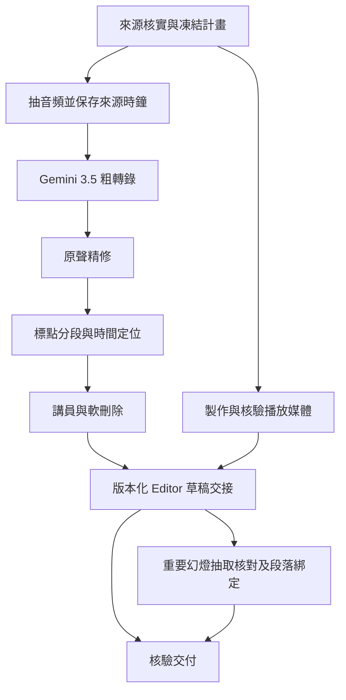

# Gemini 影音處理統一入口設計

> **讀者**：Developer、Solution architect
> **類型**：規範
> **狀態**：設計草案，待負責人確認；尚未實作或啟用，舊任務尚未遷移
> **與代碼對齊**：2026-11-27，盤點基線 `3dd39d36`；下列接口與退役策略為目標設計，並非已存在能力
> **權威範圍**：#886 的入口、階段串聯、批次、播放媒體、Editor 交付及舊管線退役；不重定轉錄模型的內容品質規則

## 目錄

- [1 目的與邊界](#1-目的與邊界)
- [2 已確認的現況](#2-已確認的現況)
- [3 一個計畫接口](#3-一個計畫接口)
- [4 階段及依賴](#4-階段及依賴)
- [5 媒體與來源時鐘](#5-媒體與來源時鐘)
- [6 新版 Editor 交接](#6-新版-editor-交接)
- [7 版本、批次與恢復](#7-版本批次與恢復)
- [8 退役與責任拆分](#8-退役與責任拆分)
- [9 Eval](#9-eval)
- [10 實施順序與交付](#10-實施順序與交付)
- [11 後台系列監控 UI](#11-後台系列監控-ui)

## 1 目的與邊界

所有新轉錄只走 Gemini 3.5 Transcribe 粗轉錄及目前滿意的精修、分段、對齊、講員、軟刪除流程。單檔與多檔共用現有 `media_batch` 台帳、worker、資源限額和進度頁；不新建排程系統。總入口負責串聯既有能力，不重新調整模型、提示、切窗或內容判斷。

遵守[使命](../00-overview/project_mission_statement.md)和[架構](../00-overview/solution_architecture.md)：保留教授實際說的內容，編輯標記不冒充原話，未知內容不補答。技術交付、同工校對、公開發布、知識來源准入分開。此卡不發布逐字稿、不執行 Claim／CVP、不部署。

最早 Excel／Processor 與後來 GPT ASR 管線退役的是執行能力，不是資料。原影片、音訊、粗稿、人工稿、模型原回答、原時間結果及費用記錄均保留。#859 的品質評測和提示改造另按自己的 Eval 進行，不能混入本卡。

## 2 已確認的現況

| 能力 | 現有實作 | 整合缺口 |
|---|---|---|
| 批次、來源與播放媒體 | `media_batch` 的 planner、store、worker、runtime、stages.media | 階段表仍指向舊 `full_video_transcript`；尚無新版階段適配 |
| Gemini 轉錄與精修 | `transcript_gemini_proofreading`、`transcript_gemini_audio` | 可直接接 MP4，內部抽 16 kHz 單聲道音頻；結果是新版 `layout.json` |
| 時間定位 | 新版 timing 用 Gemini 原始詞時間及必要聲學回退 | 不能沿用舊格式的合格證明，也不能只因有 start/end 就標合格 |
| Editor | `ReviewStore.register_candidate/import_candidate` | 目前要求舊 `full_transcript.json`、reading layout 和時間核驗資料；不能直接接新版 layout |
| 重要投影片 | `editor_slide_runner`（#881／PR #882） | 需要已存在的 Editor 草稿；分類仍 import 舊總管線，須先拆出共用能力 |
| 共用資源與費用 | `media_batch.runtime`、calls 台帳 | 新版 ASR、saved_response 及所有實際文字／視覺呼叫須納入，不能只限制外層 worker |

舊[資料夾批次設計](folder_media_transcription_design.md)記錄了目前外層能力；本草案確認前不宣稱它已被替換。舊[視訊接入說明](video_transcript_integration_v1.md)亦不可當作新版已接通的證據。

## 3 一個計畫接口

保留 `python -m backend.pipeline.media_batch`，擴展 `plan`；`start/status/pause/resume/retry/stop` 沿用現有控制方式。以下是目標接口，尚不能直接執行：

```bash
backend/.venv/bin/python -m backend.pipeline.media_batch plan \
  --manifest jobs.json --pipeline gemini-transcript-v1 \
  --artifact-root ARTIFACTS --media-root MEDIA --review-root REVIEW \
  --capacity-root CAPACITY --aligner-python ALIGNER \
  --budget-usd CAP --max-calls CALLS
backend/.venv/bin/python -m backend.pipeline.media_batch start --batch BATCH_ID
backend/.venv/bin/python -m backend.pipeline.media_batch status --batch BATCH_ID
```

`--manifest` 和既有 `--folder` 二選一，都編譯成同一份凍結工作清單。manifest 每項明列來源檔、預期來源 SHA、既有 item（若有）、要求的交付及目的地；單篇是一項清單。folder 模式先盤點和查重再凍結，不能在執行期間繼續掃出新檔。plan 不呼叫模型、不安裝媒體、不改正文；已有台帳及計畫沿用，不因改名另建錄音。

交付可選完整 Editor 圖文草稿、Gemini 粗稿、只補播放媒體、只補幻燈。新轉錄預設完整圖文草稿；粗稿模式明示未校對，沒有對齊／Editor 完成宣告。明列交付目的避免因省略參數而靜默跳過幻燈。音訊在凍結計畫時將幻燈列為不適用。

同一 item 的已有人工稿或發布稿預設只讀。補幻燈沿用版本化插入，補媒體不能改正文；重轉錄候選須另存，不在背景採用。既有 metadata-only item（如本次第一講）可接入，但不能要求改成 `INGEST-` ID；允許初次交接的條件是精確來源綁定、空稿基線及既有權限，不是 ID 前綴。

manifest 的最小格式如下（SHA 與路徑是佔位值，schema 名稱為本卡目標契約）：

```json
{
  "schema_version": "gemini-media-jobs.v1",
  "jobs": [{
    "source": "/mounted/original/lecture.mp4",
    "source_sha256": "<verified-64-hex-sha256>",
    "item": "<existing-catalog-item>",
    "deliverables": ["editor_draft", "playback", "slides"],
    "adoption": "register_candidate"
  }]
}
```

已有 item 的預設 adoption 為 `register_candidate`；僅明確計畫的新建空稿可選 `initialize_new_draft`。slides-only 必須帶已有 Editor 的 expected_version；media-only 不需 Editor 寫權但仍核驗目的地媒體身份。互斥的粗稿與 Editor 交付組合由 plan 拒絕，音訊要求 slides 則明列不適用。每項結果回傳穩定 recording／item 身份、計畫版本、要求的交付、各階段狀態與回執；路徑僅由受權 CLI 讀取，HTTP 用已登記 asset ID 解析來源。

HTTP 寫入接口和 CLI 呼叫同一 plan/control service，沿用現有簽名身份、角色、operation ID 與 revision；不以用戶提供的 actor 欄當身份。網頁只選已登記媒體，不提供任意伺服器路徑。GET 不啟動或恢復工作。

## 4 階段及依賴



| 階段 | 輸入與輸出 | 成功條件 |
|---|---|---|
| 來源核實 | 原檔、SHA、probe、既有 metadata／稿件 → 凍結計畫 | 身份不重複；來源、目的地與版本明確；非零影片起點或分段來源無既有映射時阻擋，不能猜接 |
| audio | 原來源 → 現行切窗的音頻及來源秒數、SHA 清單 | 保持新版解碼參數、切窗及重疊；不刪靜音、不壓縮時間、不增加第二套切窗 |
| transcribe | 音頻 → 原回答、詞時間與說話者、coverage | 實際回答完整且來源相符；疑點原樣留存 |
| flash | 原聲＋粗稿 → 精修及待核漏句 | 維持凍結版本的現行行為；不補入投影片文字 |
| timing | 精修＋原詞時間 → 分段及定位證據 | 文字只依既有標點／分段契約改動；時間來源、方法及疑點明示 |
| speakers／repetitions／layout | 已定位段落 → 講員、軟刪除及完整 layout | 不再呼叫舊 speaker batch 做第二次辨識；每段原文和標記可回溯 |
| media | 原來源 → 播放副本及核驗回執 | 原檔保留；副本解碼、時長及聲學時間對應通過 |
| editor | layout＋時間證據＋媒體 → 版本化草稿及回執 | 新版專用適配通過，來源／基線未變，權限與認領規則成立 |
| slides | 原視頻＋精確 Editor 快照 → 原圖、SVG、獨立覆核、附件 | 沿用既有 runner 的原圖及段落檢查；實際寫入符合快照版本 |
| delivery | 計畫要求＋所有回執 → 完成報告 | 要求的交付均核驗，不以啟動成功或僅產生檔案宣告完成 |

audio 首先把目前 `transcript_gemini_audio.extract` 的行為封裝為可恢復產物，transcribe 消費相同 bytes 和同一份切窗清單。不得借串聯工程改成舊十五分鐘 master 流程或新的停頓切分，造成模型實際輸入改變。Flash 的抽音亦保留原邊界。

media 與轉錄可獨立派工，但同錄音工作區目前由 worker 串行保護。先保持這個保護，不為並行改寫共享檔案。壓縮不是 ASR 或 OCR 的上游依賴。純音訊仍經相同轉錄路徑，播放副本依既有相容性策略產生。

## 5 媒體與來源時鐘

復用 `stages.media`：影片等比、不放大、最高 720p，H.264／AAC、CRF 23、medium、faststart；音訊按既有策略保留 MP3 原 bytes 或產相容播放版。不同 bytes 的同名目的檔拒絕覆寫。

以原來源時間為共同座標，保存原 SHA、容器起點、串流起點及抽音命令；每個音頻片段保存原片起止和 SHA。字幕、幻燈切換與取圖時間不可混用，媒體壓縮也不能改段落秒數。原影片沒有已驗證的零起點或明示映射時，先報具體阻礙，不讓 ffmpeg 的隱式 rebasing 冒充映射。

播放副本沿用完整解碼、時長差及首／中／晚段聲學錨點檢查，保存實際 lag 與 correlation。既有標準為時長差不超過 0.3 秒，聲學錨點 lag 不超過 50ms 且 correlation 至少 0.65；這些是播放副本核驗標準，不代表逐字時間精度。超出時停止安裝，不改數字放行；若需要另一種映射，另有可核實證據才能接入。

## 6 新版 Editor 交接

新增明確的 Gemini 候選 schema，內容直接來自 layout；保留每段原文、原講員輪次、軟刪除、原片秒數、時間定位方法和待核漏句。適配只生成機械欄位與資產引用，逐段比對文字／標記／時間相等，記錄前後 SHA。不得先拼出假的舊 full_transcript 或 qualified certificate 以通過舊 importer。

`ReviewStore` 以候選版本分派驗證：舊來源沿用原 gate；新來源驗證新版完整輸入與時間證據。無法確認的時間、漏句或講員保留為明示待核項；可供校對但不能冒充合格時間或解除發布限制。缺少必要產物、未知呼叫或來源不符則拒絕交接。適配驗收須包含「缺時間欄位不能被預設為 qualified」及未決項確實阻止發布的反例。

候選登記、採用、附件插入均經既有鎖、版本比對、操作日誌與回執。已有講道沿用既有權限及明確採用；本批次新建且空白的講道才可按已授權計畫初始化。首次交接保存精確前像，成功重試讀回收據，不因其後人工修改而再覆寫。

Editor 可先供人校對，幻燈階段對它取快照；公開發布仍依全部校對門檻。幻燈期間文字或時間改變時，保留抽圖與 OCR／原圖核對結果，拒絕過期綁定；以新段落快照重新計畫受影響的綁定呼叫，計入原預算，不重轉錄。此時不能標整講圖文交付完成。

## 7 版本、批次與恢復

每批凍結 pipeline release、階段實作 SHA、模型及提示、配置、來源 SHA、目的地、要求的交付、費用及次數上限。每階段完成回執綁定確切依賴及產物 SHA。無關 git commit 不使所有結果失效；上游變更只重新計畫受影響的下游，不原地改寫舊 task 或 checkpoint。

階段回執共用 envelope：`schema_version`、`recording`、`item`、`pipeline_release`、`stage`、`input_sha256`、`dependencies`（上游回執 SHA）、`artifacts`（相對路徑／schema／SHA）、`call_ids`、`outcome`。領域產物仍保留原 schema，不讓外層強迫模型抄出這些機械欄位。outcome 的 complete 只證明該階段契約成立；內容待核、時間待核及 fidelity 暫留另列，完成總結按要求的交付逐項計算。

新版的 `transcribe/flash/timing/speakers/repetitions/layout` 可分階段派工，但沿用目前先前輸出計算 input_sha 的契約；新增內部單階段接點，既有 standalone CLI 改委派同一實作。暫停只阻止下一次派工，在途工作安全收尾。觀察者讀進度與真實鎖／租約，不以 metadata 的 processing 或排程 ACTIVE 推斷正在轉錄。

重送前先查保存 request、response 和調用台帳。已保存且驗證相符的回答離線復用；request 已存在而結果未知，保留占用與預算，不自動新建目錄重送。新版 ASR 的 upload／request／response／delete 分別記錄，清理失敗不得抹掉已保存成功回答或使轉錄重送。這是執行記錄修復，不更動轉錄內容。

多檔可同時推進，共用現有 ASR、Gemini、Sol、MPS 及轉碼限額；每次真實模型呼叫（包括修復與附件綁定）都取得相應 slot 並持久預留費用與次數。外層 workers 數量不能替代這一點。單篇失敗不終止其他篇，unknown_outcome 保持隔離；容量等待與失敗分開。

報告每講列要求、完成、待核、不適用、失敗、未知，以及實際產物／Editor 連結。影片沒偵測到幻燈須有全長檢測回執；音訊則是無視覺來源。重要幻燈被 fidelity 暫留時列為部分交付及理由，不把它當成沒有重要幻燈。技術交付完整與內容待核可同時存在，不能稱人工已確認。

## 8 退役與責任拆分

| 對象 | 目標處置 |
|---|---|
| 倉庫外 church 的 processing_pipeline、Processor 及其排程 | 盤點實際啟動方式和活躍進程後停用生產啟動；不在本卡直接執行它們、不刪來源或 Excel 歷史 |
| GPT full_video_transcript、transcript_audio_pilot 的生成 CLI | 拆出仍用到的能力後，生成入口拒絕新呼叫並指向總入口；唯讀歷史與共用工具仍可用 |
| media_batch 舊 full 與 rough 派工 | 禁止新建、resume/retry 自動調用退役引擎；新版不得默認沿用舊時間或粗稿當新輸入 |
| 既有 GPT 任務、粗稿及預算 | 原意圖、版本、結果、費用不變；保存為可讀歷史，另記 retirement disposition，不把未完成改成 complete |
| 新版 standalone CLI | 可保留診斷相容接口，但委派相同 Gemini 階段、容量與回執，不能另生一套模型流程 |

來源查重、probe、音頻讀寫、切窗、hash／JSON 保存、幻燈分類、共用文字模型傳輸各有獨立模組。生成器不再成為新流程的公共工具庫；特別移出 `editor_slide_runner` 對 `full_video_transcript.classify_slides` 的依賴，以及新版對舊 cleanup_generate 的依賴。以已保存輸入輸出等價驗證搬移，不先大改算法。

舊 worker 的停用須核實 worker lease、OS 進程鎖、SQL checkpoint、保存 request／raw outcome，並確認管理者可控。活躍呼叫不粗暴終止；先阻止新派工，讓在途結果保存，再凍結舊路徑。未知結果不得假稱已排空。只有清楚綁定的舊任務處置與新版來源重新計畫能產生新工作，不能原地換引擎沿用身份或重置舊預算。

退役判定以顯式 pipeline release／引擎身份及已盤點的歷史配置為據，不能只檢查最新 CLI 的預設值。plan、start／resume／retry、worker claim 和 stage 子程序進入生成前都核對同一持久退役記錄；缺少可辨識版本的舊任務先留只讀待盤點，不猜為 Gemini。沿用既有 task 狀態欄，退役原因另記 disposition，不偽造一個正常成功。實作時須確認舊二進位與外部排程的實際控制方式；新程式內加 guard 不能獨自證明老進程已停止。

部署新入口與停用生產排程屬後續運維，依[operations runbook](../../operations-runbook.md)另行執行；本設計交付不代表已退役。舊粗稿 read API 與歷史進度頁保持可讀。回滾程式不能重新啟動被凍結的舊任務，退役狀態須由持久資料保護。

## 9 Eval

### 9.1 Criteria

1. 相同保存輸入的口述文字、講員、軟刪除、段落順序及時間適配後全部相等，模型呼叫數為零。
2. 一項及多項清單使用同一 plan／stage 邏輯；來源身份無重複，人工稿／認領／發布稿無非目標改動。
3. 媒體通過第 5 節檢查，原 bytes 不變；時間異常、來源漂移或待核資格不被包裝成通過。
4. 完成階段重試不再次調模型、安裝媒體、插入附件或建立歷史；未知呼叫不重送。
5. 單講失敗隔離，共用名額與預算不超出，暫停／恢復保留原任務及計畫。
6. 要求的交付全有可驗證回執；幻燈暫留、無投影片及不適用各有準確狀態。
7. 退役入口及舊任務續跑無法再觸發生成；舊粗稿、原回答及費用仍可讀。
8. 後台按系列展示全部未完成講道，包括零任務、缺來源及只有舊粗稿者；系列身份、名稱、成員和次序與既有系列頁一致。搜尋／篩選涵蓋完整目錄，跨批次只計一次講道，不把校對或發布狀態當作 pipeline 完成證據。

### 9.2 Key

Key 是負責人確認的保存輸出，不由本卡重寫後自行評為通過。候選為 2017 NYSC（六）第四講的 `lecture-4-timing-rerun-v1`，來源音訊 SHA 為 `4d7e666ab2eddc19a259bc1441db776d449d2d4ae1720cebbca2cd73cddfcdb3`，layout 檔案 SHA 為 `8be233f6e7553b7df018d85697b485be3fd78d5dee3ba37df7b9a9f7eb51417a`。2026-11-27 已唯讀核對實際檔案。

該候選 run.json 帶 refinement_recovery，綁定短窗精修及其他恢復產物，與當前 main 的可用參數不同。實作前須追清原模型與程式、保存 request／raw 及恢復來源，凍結確切支持的版本；不能把 #859 未提交的實驗或歷史分支直接稱為負責人已批准的最新版。候選未簽核，不是正式品質 Key；目前允許唯讀盤點與離線適配工作，沒有授權借它重跑品質模型。

幻燈回放可用既有 #881 保存案例與位置參照，但參照本身的草案／核准狀態必須保留，不能因工程回放而升格。[幻燈 Eval](slide_extraction_eval_v1.md)繼續規範文字、圖形、顏色及段落忠實度。

首個新片端到端案例為本會話指定的 2022 NYSC（九）第一堂，item 沿用完整既有 ID，來源 YouTube `CPajzELScJU`，本機原 MP4 為 8664.502857 秒、640×360（唯讀 ffprobe 所得）。實跑前綁定原片 SHA 及當時 metadata，對照 #884 的來源身份，不由來源 URL 證明本機 bytes 相同。它用於工程交付驗收，不自動成為內容正確性的 Key。

UI 的工程 Key 取同一時點的 `config/sermon_series.json`、`config/sermon.json`、已核驗來源索引、稿件／交付索引及 SQL 狀態快照，凍結各自版本。逐系列列出預期成員／次序／名稱與待處理清單。加入零任務、舊粗稿、缺來源、同講多批次、無系列、來源狀態不明及已人工完成稿的固定反例。此為可機械推導的目錄／狀態答案，不讓內容模型自己生成或評分；任何需判斷轉錄正確性的項目仍用已簽署內容 Key。

### 9.3 Grading

每輪記錄固定來源／程式／配置／Key 版本，報告：比較段數、文字差異數、講員差異數、軟刪除差異數、時間差異數、缺漏／多收產物數、錯綁／重複附件數、非目標檔案變更數、未知呼叫重送數、實際調用／費用預留、每資源同時在途峰值、播放核驗各錨點與總耗時。工程等價、保護與重送項要求零差異／零違規；內容品質仍依其獨立 Key 評分，不以工程通過冒充。

UI 額外報告：目錄講道總數／待處理數、預期未處理清單的命中／遺漏／多收／重複數、系列錯組／錯序數、狀態誤報數、失聯誤報為運行數；以上差異及違規要求為零。分頁前後系列及全庫計數必須一致，讀取故障不得把 unknown 投影為未處理或完成。角色未授權、GET 產生派工／模型副作用均須有反例。

離線案例包含音訊、影片、同來源改名、已有人工稿、metadata-only item、無投影片、重要幻燈暫留、過期 Editor 快照、來源漂移、音頻非零起點、壓縮失敗、已有同名不同 bytes、成功後清理失敗、未知模型結果、中途取消與程序重啟。多檔批次以至少一成功、一可恢復失敗、一受保護稿驗證隔離，並測兩個 controller 共用名額。

先以 `backend/.venv` 跑必要單元／回放／批次整合測試，不對 production SQL 做測試寫入；前端改動跑 tsc，文檔跑 check-docs。新片模型實跑在設計及 Key 確認後，以明列預算的一講開始；不拿整批付費測調度。模型步驟如需改動，回到 #859 的 Eval 契約。

## 10 實施順序與交付

1. 本草案與候選 Key 供負責人確認；精確凍結滿意版程式及輸入輸出。
2. 搬移共用工具與補等價回放，先解除新舊生成器依賴。
3. 接新版逐階段執行、容量／費用、版本化產物，並實作第 11 節的全目錄系列監控 UI 及共用狀態查詢；保留舊任務只讀能力。
4. 接媒體、Gemini 專用 Editor 候選、身份／時間／人工保護，再串幻燈及完成核驗。
5. 在隔離資料驗證恢復、交付和退役反例；核查保存證據後實跑本次一講。
6. 同一 #886 分支完成實作與驗收後提交完整 PR；生產切換和舊排程停用依運維程序安排，不在設計稿合併時宣稱卡已完成。

設計確認前不修改現行模型流程、不遷移生產任務、不發起新轉錄。設計文件可以先以 draft PR 供審閱，但 #886 保持未完成，該 PR 不應在僅含設計時合併關卡。

## 11 後台系列監控 UI

### 11.1 範圍與分組來源

負責人要求後台可視化監控整套 pipeline，全部未處理講道都在此頁，分組與 `/resources/series` 相同。主入口沿用 `/admin/media-batches`，預設顯示「按系列」，既有批次檢視和 `/admin/media-batches/<batch>` 保留為鑽取詳情。不能要求先建立批次才看得到一講。

2026-11-27 已核對 `SeriesBrowser`：系列列表經 `/api/sc_api/sermon_series` 讀取，其成員及順序來自 `config/sermon_series.json`，顯示名稱由 `seriesName` 決定（保留既有 ID，必要時顯示更正年份的 title）。後台共用這份分組及顯示規則，不按磁碟資料夾、batch ID、日期或模型猜測重分組；`MyWork` 為個人校對工作，不作 pipeline 分組。

由完整 `config/sermon.json` 與系列成員取聯集，再關聯來源索引、稿件／交付回執及 SQL 工作。系列成員若缺 metadata 仍顯示「目錄資料待修復」，不能沿用現有 reader 的略過行為而漏掉。無系列講道另列「未分組」，新來源尚無講道身份者另列「待配對來源」，不擅自歸系列。多系列成員照既有分組顯示，總覽按 item 去重，各系列按自己的成員計數；跨批次／多來源版本也是同一講詳情，不在列表重複一講。

### 11.2 未處理的判定

預設列出所有尚未滿足要求交付的講道，並保留「全部」篩選以查看已完成。待處理不是 metadata 的 processing，也不是「不在 complete tasks 裡」；必須看來源、實際稿件、要求的交付和當前版本回執。

| 畫面狀態 | 依據與呈現 |
|---|---|
| 尚未排程 | 來源已核實，但沒有現行 pipeline 工作；不因零 task 而消失 |
| 缺來源／待核來源 | metadata 有 item／URL，沒有已核實可讀媒體，或來源索引失效；保留講道及具體原因 |
| 僅有舊粗稿 | 保存 GPT／其他舊粗稿，尚無現行合格交付；可查看舊稿，仍待處理 |
| 排隊／處理中／等待容量／暫停 | SQL 任務、有效租約及實際工作證據；processing 標記本身不代表 live |
| 失敗／中斷／結果待核／失聯 | 對應現有任務和呼叫狀態，列具體阻礙；不能顯示持續運行的動畫 |
| 部分交付 | 稿件、播放媒體或幻燈尚缺要求項，含重要幻燈 fidelity 暫留 |
| 已有人工稿 | 保護既有編輯／發布稿，明列是否仍缺媒體或幻燈；不能因沒有 Gemini 回執就安排全部重轉錄 |
| 技術交付完成 | 所要求產物均有有效回執；另顯示內容待核／編輯中／已發布，不把它們混成 pipeline 進度 |
| 狀態待核實 | 索引、台帳或來源不可讀／版本不一致；仍可見，不能當作缺稿或成功 |

歷史人工完成稿缺少新回執時，以唯讀盤點建立「既有產物」證據，顯示可核實的已有內容和欠缺項，不回寫為 Gemini 成功或補造模型審核。沒有明確交付計畫者採本卡完整圖文目標計算待辦，但保護人工稿，讓缺件只產生補件工作。

### 11.3 畫面與操作

畫面草圖如下；數字僅為佔位，實作必須來自服務端完整查詢結果：

```text
影音處理                       最後同步／狀態是否過期
待處理 N  處理中 N  待排程 N  有問題 N  已交付 N
[搜尋講道／系列] [狀態] [來源] [全部／待處理] [按系列／按批次]

▾ 2022年 NYSC 專題：馬太福音釋經（九）    待處理 N／總數 N
  第一堂   尚未排程     音訊 → 粗稿 → 精修 → 對齊 → Editor → 幻燈
  第二堂   已有人工稿   播放媒體 ✓   幻燈待補    [開啟 Editor]

▾ 其他既有系列（名稱、成員及次序與系列頁一致）
▾ 未分組
▾ 待配對來源（不能與講道總數混算）
```

每講顯示名稱／來源、技術狀態、各階段完成／等待／異常、可量測進度、最近進展、阻礙和 Editor／原稿／診斷連結；展開顯示相關批次、來源版本、各階段起止／耗時、已處理片段數、費用／預留和附件暫留原因。壓縮單列支線，不假裝和粗轉錄共用一個完成百分比。

進度條只顯示真實分母，例如音頻片段 12/49、壓縮 430/8664 秒、幻燈 8/20；沒有已知分母則顯示階段及等待原因。系列層的完成比以講道交付數表示，不將階段數等權平均冒充時間預估。上方計數和系列標籤可點擊篩選，搜尋覆蓋整個目錄而非當頁已載入資料；清單分頁或按系列懶載入不能改變總計數。

沿用既有輪詢、隱藏頁暫停更新、錯誤保留上次資料及過期提示。整頁開啟不派工。選擇一講或系列中的多講後，先顯示計畫預覽：待生成／沿用／補件／阻擋、媒體目的地與預算，再按「開始處理」派工。暫停／恢復／安全重試沿用原控制服務；unknown_outcome 不出現通用重試可繞過隔離。已退役任務只可查看，另計畫新版工作，不原地切換引擎。

### 11.4 查詢與權限

新增共用的講道 pipeline 投影 service，供 UI、CLI 與批次詳情讀取；將目錄身份／分組、來源可用性、技術交付和人工校對／發布四種資訊分欄回傳。目標 read API 為 `/api/sc_api/media_batches/sermons`，回傳總覽計數、系列摘要及分頁成員，支援 series、search、state 及來源條件；先註冊靜態路由，避免被 `/{batch}` 路由攔截。

不直接重用現行 `get_sermon_series()` 的完整模型，因它還逐講補 Claim／論證進度，pipeline 頁不應為了系列名稱去觸發這些無關讀取。抽出共用系列身份及名稱規則，使用已維護的來源／產物索引和 SQL 聚合查詢；不逐行讀全部原回答、不在 GET 全磁碟掃描或呼叫模型。零 task 的講道由目錄左連接保留。來源盤點作為獨立明示同步工作，GET 只讀版本化結果，過期時如實提示。

SQL 部分用一致快照；檔案目錄及索引保存來源 hash／revision，查詢開始及結束核對版本。回傳 `snapshot_revision`、`generated_at` 和索引同步時間；讀取途中版本漂移則重取或明示待核，不混拼兩版計數。統計與分頁使用同一狀態判定；批次歷史不可用「最後更新的 task」覆蓋有不同來源版本的當前工作。

這是受權後台，頁面、代理與後端均維持既有 admin／editor／beta_tester 權限及簽名身份，並逐講套用既有認領及寫權。部署時是否縮限特定管理動作沿用現有角色規則，不因前端按鈕隱藏而視為授權。私有來源路徑與診斷不出現在公開系列頁；公開／同工系列頁的分組資料不因這個 UI 而被改寫。
