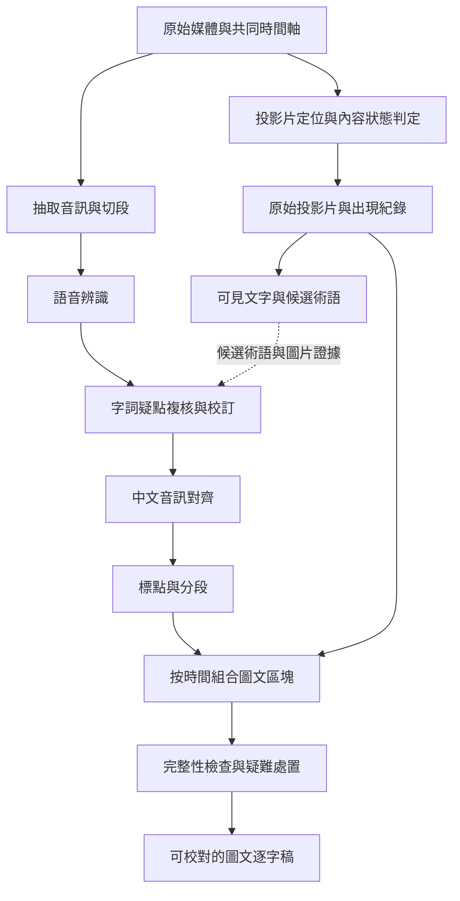

# 錄像轉錄與投影片時間軸流程 v1

> **讀者**：Solution architect、Developer、負責校對的同工。
> **類型**：流程。
> **狀態**：當前。
> **與代碼對齊**：未核對；這是待實作的設計草案，既有接點另列於第 10 節。
> **權威範圍**：來源轉錄層的流程、資料契約與試作驗收；不授權覆寫正式逐字稿、更新知識庫、出版或部署。

把教授的錄像轉成有標點、有段落、有時間戳，並自動嵌入原始投影片的繁體中文逐字稿。口述中的英文、希臘文、希伯來文保留；音訊對齊只要求中文。換頁、同頁逐步顯示與返回先前投影片都需要保存。

本流程遵循 [Project Mission Statement](../00-overview/project_mission_statement.md) 與 [Solution Architecture](../00-overview/solution_architecture.md)。逐字稿保存教授實際說過的內容；投影片、OCR 與編輯校訂分開署明。時間相近不能證明某張投影片支持某項主張。這是文章與問答的來源基礎設施，不擴展 Phase 1 的產品範圍。

## 目錄

- [1 流程與技術選擇](#1-流程與技術選擇)
- [2 原始媒體與共同時間軸](#2-原始媒體與共同時間軸)
- [3 投影片定位與換頁判定](#3-投影片定位與換頁判定)
- [4 投影片原圖與視覺文字](#4-投影片原圖與視覺文字)
- [5 語音轉錄與字詞校訂](#5-語音轉錄與字詞校訂)
- [6 中文對齊與標點分段](#6-中文對齊與標點分段)
- [7 圖文組合與資料契約](#7-圖文組合與資料契約)
- [8 檢查 狀態與續跑](#8-檢查-狀態與續跑)
- [9 試驗與驗收](#9-試驗與驗收)
- [10 既有系統接點與實作次序](#10-既有系統接點與實作次序)

## 1 流程與技術選擇

音訊與影像各自處理，只有來源詞彙及最後的圖文組合需要交會。所有產物綁定原始媒體與直接依賴版本；某一段重做，不使其他講道或無關階段失效。

圖中的抽取、辨識、校訂、對齊、格式化分別見第 2、5、6 節；投影片定位、原圖與 OCR 見第 3、4 節；組合、檢查及草稿見第 7、8 節。

| 工作 | 第一輪候選配置 | 選擇與限制 |
| --- | --- | --- |
| 媒體處理 | FFmpeg／ffprobe、Silero VAD | VAD 辨識有無語音，只用來安排切段與找疑點，不刪除時間 |
| 主轉錄 ASR（語音辨識） | `gpt-transcribe` | 提供語言、講道背景與詞彙提示；不假定具備原生字詞時間戳 |
| 對照轉錄 | `gemini-3.5-transcribe` | 使用 `verbatim`；有時間戳及無時間戳模式分開試驗，不使用會刪改口述的 `smart` |
| 中文對齊 | `Qwen3-ForcedAligner-0.6B` | 每次音訊不超過五分鐘；繁體適配與混讀句子的可靠度須實測 |
| 畫面分類與 OCR | OpenCV、`gemini-3.8-flash` | 本地掃描產生候選，視覺模型判讀前後內容與版面 |
| 困難視覺判定 | `gemini-4-argon` | 限定疑難片段；同廠商升級不算獨立品質審核 |
| 標點與段落 | `gpt-6.1-sol` | 只輸出位置與格式操作，程式組裝文字 |

這些是試驗配置，不表示已量得最佳品質。模型能力、相容限制與查證日期另存於 [模型能力查證記錄](./video_transcription_capabilities_20261027.md)。實作時鎖定能取得的明確模型與套件版本，保存實際回應所報模型；服務別名不得冒充永不變動的模型快照。

## 2 原始媒體與共同時間軸

### 2.1 來源登錄

以 `media_sha256` 識別原始檔案位元組，另存 `media_id`、來源講道、實際檔案位置、來源權限及媒體資訊。原始錄像不可由管線覆寫。影片、抽取圖片、預覽與 OCR 至少繼承原始媒體的讀取限制；擷取圖片不自動變成公開資產。

ffprobe 記錄音／影軌、起始時間、時間基準、片長、影像尺寸及旋轉資訊。聲道先檢查品質，再選取或混音；保留原始音軌，辨識用副本起始採 16 kHz、單聲道、PCM WAV。

### 2.2 時間換算

共同時間是原始錄像播放起點後的非負整數毫秒。影格保存原始 presentation timestamp（PTS，顯示時間）、time base（PTS 單位）及原始軌道起點，再換算共同時間。抽幀圖片與時間從同一解碼紀錄取得，不把兩次獨立抽取的陣列用位置硬配。

可變幀率影片不能以「影格編號／宣告 FPS」當時間。音軌與影軌的起始偏移也須納入；輸出字幕及前端 seek（定位播放）使用共同時間。音訊的局部時間經取樣位置及切段起點換算後才回到影片時間，不能套固定二十分鐘偏移。

### 2.3 切段與保留時間

試跑採每段 2–4 分鐘，於附近停頓切開，前後約 2 秒重疊，連同重疊與邊界調整的總長須小於對齊工具上限。VAD 不剪除內部靜音。每段記錄來源取樣起止、共同時間起止、抽取命令與音訊 SHA。

跨段接縫只消除同一音訊區間的重複轉錄。以文字相同為唯一依據會刪掉教授刻意重複的話，所以必須同時比對時間、接縫上下文與對齊位置；無法決定時保留接縫疑點。

## 3 投影片定位與換頁判定

### 3.1 定位與追蹤

先辨認全螢幕、PowerPoint 編輯模式、人物並列、投影幕實拍及投影片不可見等版面。視覺模型返回主投影片四角與使用的原始影格 ID；四角以套用旋轉後影像的正規化座標表示，程式驗證在圖內、四邊不交叉且面積合理。

OpenCV 追蹤投影片區域。實拍畫面可用四角做 perspective transform（透視校正）；比較前先對正畫面，減少攝影機位移造成的誤判。畫面配準失敗、鏡頭變動或版面切換時重新定位，不沿用不可信的框。仍無法定位時保存原影格與技術疑點，不憑藍色背景強行確認。

### 3.2 候選產生

先以約 2 FPS（每秒兩張）的低解析度投影片裁切圖掃描；比較文字筆畫、邊緣、顏色及局部區塊。至少同時比較前一影格與上一個已確認的穩定狀態，捕捉逐步新增的累積變化。語意相似度只作輔助：否定詞、原文字尾及箭頭的小改動也可能需要保存。

版面邊框、工具列及固定人物視窗先排除。移動物體不能只因範圍小而全部遮掉，否則會漏掉教授新增的底線或標記。游標及雷射筆的判定須參考前後位置與是否持續留在內容中；無法分辨的局部變化保留為候選。

### 3.3 有界的換頁狀態機

狀態機是程式用來追蹤「目前頁面是否確定、是否正在變動」的有限狀態集合。

| 狀態 | 進入原因 | 下一步 |
| --- | --- | --- |
| `unlocalized` | 尚未找到可靠投影片區域 | 定位或重新定位 |
| `stable` | 已確認一個持續顯示的內容狀態 | 掃描後續影格並與此狀態比較 |
| `candidate` | 發現內容變化 | 保存變化前後影格，局部提高採樣率 |
| `transition` | 動畫、過場或遮擋仍在持續 | 保留候選與區間，不立即輸出新頁 |
| `not_visible` | 人物、黑畫面或投影片離開畫面 | 結束可見區間；再次可見時重新確認 |
| `unresolved` | 現有畫面不能證明變化種類 | 保存局部短片與原因，進入第 8 節的疑難處置 |

候選附近改用約 8–10 FPS；初始穩定等待設定 0.5–1 秒，皆須依第 9 節調參。短暫內容也保存為事件，不因未滿穩定等待就當作沒有出現。

模型收到上一穩定圖、過渡影格、下一穩定圖及標明各自 ID 的局部差異圖。回應必須選用提供過的影格 ID，返回事件種類及可見改動；時間由程式讀影格紀錄，不採用模型自行估計的秒數。

無法由程式與原圖確認的視覺內容疑點，用另一家模型讀原始前後影格作來源複核；初始可用 GPT-6.1 Sol 判讀 Gemini 提案。Gemini 4 Argon 只作同廠商的困難分析，不以此標記獨立通過。格式模型及視覺複核分開保存請求、角色與範圍。

| 事件種類 | 處置 |
| --- | --- |
| `new_slide` | 建立新頁及第一個內容狀態 |
| `build` | 同頁新增／移除文字或圖形，建立新版本 |
| `emphasis` | 關鍵字顏色、箭頭、底線等持續強調，建立新版本 |
| `return` | 回到已知頁面／版本，另記一次出現 |
| `cursor_or_occlusion` | 保留判定證據；不建立新頁 |
| `layout_change` | 重新定位，確認內容相同後延續既有頁面 |
| `uncertain` | 保留未決；不得自行降級為游標 |

`new_slide` 與 `build` 的頁面歸組拿不準時，可以先保存為不同狀態並標記關係未決；不得為了歸組而丟掉圖片或時間。對 `return` 的判定同時使用圖像與可見內容，不能只用 OCR 相同就合併圖表。

### 3.4 時間邊界與漏頁檢查

保存「最後確定舊狀態」到「最早確定新狀態」的變化區間。需要單一顯示時間時用最早確定新狀態的時間，並連同區間披露誤差。投影片被遮住後重新出現，只能宣稱觀察到的時間；不能推斷隱藏期間的真正換頁時刻。

另從完整低解析度掃描索引建立候選之外的覆核樣本，包括長時間未換頁、低差異及版面切換區間。按有界的固定時間窗檢視相鄰採樣圖列，再對疑點回看較密影格。這能找出候選偵測器的盲點；抽樣沒有發現漏頁，仍不能證明整講零遺漏。保留測試集以人工逐段標注衡量真正的漏頁率。

Gemini 的影片模式可協助局部檢查，但一般影片採樣或 agentic navigation（模型自行挑時間看影片）不作為完整換頁清單的唯一依據；快速狀態可能未被看到。

## 4 投影片原圖與視覺文字

每個已觀察狀態從其可見區間挑選清晰、完整且遮擋最少的原影格。保存原影格、裁切圖、原始 PTS、共同時間、裁切四角、透視轉換及各檔案 SHA。清晰度評分是選圖依據，不代表 OCR 或內容正確。

`capture_ms` 是選圖時刻，`visible_from_ms`／`visible_to_ms` 是觀察到的狀態可見區間，兩者不可互換。逐步顯示完成後的圖片不能配到第一行剛出現的時間。原始畫面與衍生裁切圖都可回看；不生成被遮住或解析度不足的字。

OCR（從圖片辨識文字）先讀原解析度裁切圖，再對密集原文小字作區域放大辨識。返回可見文字區塊、位置、閱讀次序及無法辨識區域；表格、箭頭和圖示的位置另外保存。視覺說明與逐字 OCR 分開，生成的圖意描述不得當作畫面上的字。

OCR 失敗仍保存圖片。畫面有希臘文或希伯來文時，保留重音、呼吸符、母音點符與閱讀方向；用 Unicode NFC（等價字元的標準組合形式）作必要比對，但保留原始位元組與對應，不用 NFKC 或剝除點符來宣稱原文相同。

## 5 語音轉錄與字詞校訂

### 5.1 轉錄

先讀音訊生成口述初稿，保存原始供應商回應、實際模型、設定、輸入音訊 SHA 與局部時間範圍。提示描述中文講道、可能夾雜英文與聖經原文，要求保留重複、口誤、自我修正及不確定處，不翻譯、不摘要、不以聖經通行譯本補寫。

詞彙提示只取本講相關項目。投影片 OCR 可提供帶來源的候選詞，不能作為已經說出的文字。初稿不依賴完整投影片流程完成；必要時只對有疑點的音訊範圍加入相應圖片或候選詞複核。

### 5.2 校訂與複核

切段接縫矛盾、有語音而無文字、異常重複、疑似不合理字速、否定詞／經文數字疑點與外文拼法不穩定，都可觸發局部複核。這些是候選訊號，不是錯誤定論；VAD 與對齊也不能保證辨識完整。

校訂以明確文字範圍產生 `TextCorrection`：原版本、原範圍、原字詞、建議字詞、音訊區間、可用圖片、理由與來源。另一家模型直接讀同一原音訊及必要圖片作獨立判讀，不以提議模型的自評當證據。同一家視覺模型的升級不是獨立判讀。

初始流程允許一次有界修正。呼叫次數、費用上限及可讀音訊範圍在試驗設定中先固定；不得換 job ID 重置預算。分歧先檢查輸入漏段、座標、音訊偏移及版本問題，修復工程問題後依原授權恢復；只有原始材料仍無法確認的字詞或說話歸屬，才形成具體人工問題。額度或傳輸問題屬技術未完成，不偽裝成內容裁決。

通過校訂建立新的 `SpeechRevision`；舊辨識稿、被拒絕的修改及回應均保留。更正後的版本才進對齊，之後修改字詞須使受影響對齊及格式化結果失效。

### 5.3 繁體與外文

繁體顯示轉換獨立記錄映射及詞典版本，來源辨識字串保留。專有詞與原文字串不得因通用繁簡轉換而丟失。

「聽不清」等編輯提示保存為獨立註記及音訊範圍，閱讀時顯示，不計入教授口述字串。聽眾提問與教授口述不能因時間相鄰就歸成同一說話人；無法確認歸屬時保留未知及原音訊。

教授只說音譯、圖片只顯示拼法、實際口述詞形與畫面不同時，分開保存聽到的文字與畫面文字。無法確認的原文詞形標疑，不能從神學上下文補成確定拼法。

## 6 中文對齊與標點分段

### 6.1 中文對齊

對齊輸入綁定 `SpeechRevision` 與音訊 SHA。每次不超過五分鐘；必要正規化只作用於有映射的對齊副本。先驗證中文字符與模型輸入的映射能完整回到原稿，才採用返回的時間。

檢查時間遞增、起止合理、未超出區間、有無大量零長度／極端長度字詞及跨接縫漂移。失敗可在原預算內縮小音訊範圍重試；仍失敗記為粗粒度或未決，不任意攤分秒數冒充實測。

英文、希臘文與希伯來文只要求跟隨所在短句，不要求各字有時間。`timing_precision` 以 `word`、`phrase` 或 `unresolved` 明示；外文子範圍可以沒有字級時間，不刪除它們來讓對齊通過。

### 6.2 以操作表示標點與分段

對固定文字版本建立可回溯的文字單位清單；每個單位包含原始範圍和字串。格式模型只返回標點插入／替換位置、句界和段落邊界，不返回可自由改寫的全文。

位置以綁定版本的 Unicode code point（碼點）半開區間表示，邊界不得切開 grapheme cluster（一個可見字及其附加符號）。格式操作必須通過標點白名單，英文縮寫及原文點符作為詞內內容保護。既有 ASR 標點的移除或替換也須列為明確格式操作，不能先把所有符號剝掉再聲稱文字相同。

例如固定來源文字 `我們今天來看這段經文` 有十個碼點，操作 `{"start":10,"end":10,"insert":"。"}` 只在末尾插入句號，段落範圍仍是原版本的 `[0,10)`。每項操作另帶父文字 SHA；操作不可重疊、不可刪改非標點內容，插入標點後的偏移不能拿來解讀後續原始範圍。

程式按操作重建全文，證明所有內容單位恰好按原順序出現一次。段落邊界參考語意、停頓與換頁，但不因換圖把句子截成半句。格式結果不能修正字詞；發現字詞疑點返回第 5 節，產生新版本並重跑必要下游。

## 7 圖文組合與資料契約

### 7.1 版本與核心資料

下表是待實作的資料契約，不表示資料表或 API 已存在。每種產物都附 `schema_version`、`media_id`、`media_sha256`、直接輸入 SHA、產物 SHA 及產生設定；每次有不同輸入或輸出都建立不同版本，ID 不挪作新的語義。

| 物件 | 必要資料與用途 |
| --- | --- |
| `MediaManifest` | 原始來源、權限、軌道、PTS 換算、片長與原檔 SHA |
| `AudioChunk` | 來源取樣起止、共同時間起止、音訊 SHA 及切段參數 |
| `SpeechRevision` | 原始回應引用、內容字串、文字單位 ID 與範圍、父版本、已採用校訂與繁體映射 |
| `TextCorrection` | 精確父版本／範圍、原文、改文、音訊證據、複核結果與處置 |
| `TextTiming` | 文字版本、文字範圍、起止毫秒、時間精度、對齊模型與輸入 SHA |
| `FormatPlan` | 文字版本、格式操作、句界、段落範圍及內容不變檢查結果 |
| `SlideAsset` | 原影格與裁切圖路徑／SHA、PTS、截圖毫秒、座標／轉換、選圖指標 |
| `SlideState` | 內容狀態 ID、候選頁面歸組、版本關係、原圖引用、可見文字及獨立視覺說明 |
| `SlideOccurrence` | 狀態 ID、每次出現的可見區間、邊界不確定區間、選圖引用與判定證據 |
| `ChangeDecision` | 候選前後影格、事件分類、處置、模型／程式判定及保留的未決理由 |
| `DocumentBlock` | `speech`／`slide` 類型、文字範圍或 occurrence 引用、呈現順序、時間配對理由 |
| `RunResult` | 各階段輸入／輸出、呼叫狀態、成本、程序檢查、複核範圍及未決項目 |

圖片資產、內容狀態與出現紀錄是不同身份。同一圖片可重用於多次已證實相同狀態的出現，但不能把後期新增的內容配到較早版本。OCR 修改不改變圖片身份；內容關係重新判定需產生新的決定版本。

### 7.2 插圖位置

文字段落由同一 `SpeechRevision` 的連續單位範圍構成；程序確認段落無漏無重。投影片按共同時間匹配相交的短句，放在開始出現附近的自然句界，保留實際出現時間與呈現邊界間的差距。無句級可靠時間時，採段落旁顯示或標記定位待核，不宣稱已精確插入句中。

同頁逐步顯示按狀態次序組合；返回舊頁允許再次顯示。圖片有放大與回看原錄像入口。`not_visible` 區間不得延續成「錄像仍顯示上一張」，閱讀模式如保留上一圖，須明示只是參考圖片。

`DocumentBlock` 是可重建的閱讀投影，不把 OCR、圖意描述或圖片 Markdown 塞入教授口述字串。圖文配對只記錄時間關係，不自動生成 Claim 或證據支持關係。下游文字抽取只讀 `speech`；使用視覺來源時，另綁原圖 SHA、可見區域與媒體位置。

## 8 檢查 狀態與續跑

### 8.1 不同結果分開記錄

| 結果 | 能宣稱什麼 | 不能宣稱什麼 |
| --- | --- | --- |
| `program_verified` | 結構、引用、時間範圍及格式不變量通過 | 沒有漏聽、文字意思正確或全片零漏頁 |
| `ai_reviewed` | 指定模型對綁定來源與範圍已判讀 | 人工批准或未覆核範圍也正確 |
| `human_reviewed` | 人已對明確綁定內容作了判斷 | 不同版本或不同範圍沿用此結論 |
| `needs_source_decision` | 完整原件仍不足以決定的具體字詞／歸屬問題 | 工程錯誤或呼叫額度問題 |
| `technical_incomplete` | 缺檔、版本漂移、傳輸或程序尚未完成 | 內容已通過或需要神學裁決 |

程序逐項檢查音訊切段結果、來源 SHA、接縫處置、格式前後內容一致、時間合法、圖片可回原影格、候選處置無漏，以及無來源的口述／OCR 混入。候選處置完整與全片無漏頁是不同指標。

抽樣品質覆核直接聽原錄音、看原影格，並記錄抽樣方法與範圍。內容校訂與投影片疑點依本流程作有界複核；不移植文章、Claim 或 CVP 的歷史模型預算及審核政策。新轉錄草稿的程序通過，不改變既有來源准入、知識抽取或出版門檻。

### 8.2 續跑與成本

初期用既有 PostgreSQL 保存任務、階段及產物索引，原檔、圖片與原始回應保存在檔案系統；試作 CLI（命令列入口）可先保存相同契約的獨立檔案，不接正式資料寫入。復用既有執行紀錄與模型適配能力，不先另造工作流服務。

每階段以「直接輸入 SHA、明確模型／套件版本、提示詞 SHA、參數」尋址。模型呼叫在資料庫交易外；先保存原始回應與驗證結果，短交易只登記完成事實及產物。檔案用暫存寫入再原子替換，失敗不留下看似完成的檔案。

每段辨識完成便持久化。更新格式規則只使格式及圖文組合失效；更新字詞使相關對齊、格式與組合失效；替換同狀態的清晰圖片只使該圖片引用及視覺產物失效。依賴失敗即停止該下游，不以舊產物繼續冒充新結果。

呼叫狀態至少區分未開始、已送出、成功、確定失敗與結果未定。timeout 不代表供應商未執行；先核對可取得的請求／回應，不盲目付費重送。限定重試、併發與總費用；原始任務預算跨恢復保持。模型不能保證可用時記技術未完成，保留已成功結果。

按 1,000 篇來源規劃時，量測每講的片長、圖片／模型產物容量與 P95（95% 樣本不超過的值），分開估原錄像、抽取圖、版本歷史及備份。正常重跑僅讀受影響講道／階段，不掃全庫或遞迴重建全部歷史證明。

## 9 試驗與驗收

### 9.1 試驗資料與比較路線

先選六段各約十分鐘的代表錄像，至少涵蓋編輯／播放模式切換、實拍投影幕、游標／人物遮擋、逐步顯示、圖表／顏色強調、外文混讀。三段調參、三段保留盲測；來自同講或高度相同內容的片段不得跨兩組。另選一整講驗證長時間漂移、續跑與圖文閱讀。

先人工標出完整內容狀態變更、可見區間與原圖，再產生候選；標注不能只從偵測器找到的候選開始。每個標注綁媒體 SHA；不明確的邊界用區間標注。模型／參數調整不回頭修改保留答案。

語音比較 A：`gpt-transcribe` 加候選術語，之後 Qwen 對齊。比較 B：Gemini `verbatim` 加原生時間戳，不提供不相容的自訂詞彙。另以無時間戳的 Gemini `verbatim` 複核疑難音訊；輸出各自保留，不能把 A 的文字與 B 的時間未經映射拼成好看的分數。

### 9.2 指標與目標

下列是第一輪擬定門檻，不是已取得的成績；小樣本只用來決定試作，不外推全庫品質。測試須列分母、個別類型及失敗例，不能只報平均。

| 指標 | 定義與起始目標 |
| --- | --- |
| 格式內容不變 | 對固定校訂版本，格式操作後每個內容單位按原順序恰好一次；必須 100% |
| 換頁／版本召回率 | 人工標注中找到的狀態事件／全部狀態事件；持續至少兩秒的事件目標 ≥99% |
| 換頁／版本精確率 | 確實有狀態變化的候選／被確認的候選；目標 ≥95% |
| 短暫與不可見狀態 | 不足兩秒、遮擋及不可見另列分母與未決，不從總量藏掉 |
| 換頁邊界 | 與明確人工邊界比對，目標 P95 誤差 ≤0.5 秒；原件不明確者只比較區間相容性 |
| 中文短句邊界 | 抽樣與原音訊比對，目標 P95 誤差 ≤1 秒；未對齊比例另報 |
| 轉錄品質 | 同一正規化政策下中文字錯誤率 CER，另列否定詞、經文數字與外文詞形；原始與繁體呈現分別計算 |
| 插圖品質 | 對應短句及版本是否正確、有無提前顯示未出現內容、圖片是否清晰完整 |
| 運行與人工成本 | 每小時錄像的費用、處理時間、未決數與人工校對分鐘；比較舊流程基線 |

狀態事件用一對一匹配計分，避免同一真實換頁被多個候選重複算命中。匹配容許誤差及區間重疊政策在測試前凍結，誤檢、漏檢、分類錯誤與時間偏移分開報。99% 召回率無法由很少的事件證明，報告必須保留樣本數及統計不確定性。

### 9.3 必測反例

反例包含：全程同頁但游標移動、只新增否定詞、同頁新增箭頭、顏色改變而 OCR 相同、相同字但圖表不同、返回舊頁、版面切換但內容相同、快速過頁、文字被遮住、純圖頁、OCR 拒答、可變幀率與音影起點不同、重複口述、跨段漏字、原文點符、對齊零長度、格式模型改字、模型回應截斷、原檔改版及中途斷線。

驗收須從原始媒體一直走到圖文草稿，並重啟程序從保存狀態接續；輸出不重複、未決不消失、未變依賴不重呼叫。單個換頁演算法或局部單元測試通過，不能宣稱端到端完成。

## 10 既有系統接點與實作次序

既有接點依本次閱讀列出，尚未宣稱與全套設計逐條對齊：

| 接點 | 實作時的處理 |
| --- | --- |
| 舊 `church/audio_transcriber.py`、`processor_correct_transcribe.py` | 在倉庫外；作比較基線，初期不直接修改或批次覆寫其輸出 |
| 舊 `screen_detector` 與 `church/slide_detector.py` | 只有部分偵測／OCR 能力；用已保存原圖與結果研究誤檢，不沿用藍底或 OCR 成功作保留條件 |
| `backend/api/sc_api/router.py` 的投影片資產讀取 | 可作圖片／時間 metadata 的相容投影；新增版本／出現紀錄須保留完整 sidecar（與主資料分開儲存的附屬檔） |
| `SurmonEditor.tsx` 的手動插圖 | 保留既有操作；新閱讀投影自動組合，不能把圖片寫入教授口述字串 |
| `SermonDetailView.tsx` 的全文 Markdown 組裝 | 後續改讀帶類型的區塊，保留文字範圍與圖像來源；尚未實作 |
| `original_audio_index.py` 的同步 slide | 是依知識資料產生的閱讀內容，不能當作教授原始投影片；兩種來源須明確分開 |
| `source_projection.py` 與來源更新流程 | 原始視覺證據保持獨立來源身份；既有來源校訂的影響傳遞沿用 [來源更新流程](../20-knowledge/source_reconciliation_workflow_v1.md) |

按以下順序開實作卡，前一項交付可量測結果再決定後續配置：

1. 換頁試作：媒體時間軸、版面定位、狀態候選、局部視覺判定與圖片／出現清單；附原圖縮覽及人工標注比較。優先回答最大的換頁問題。
2. 音訊試作：同一批片段比較兩條轉錄／對齊路線，保存疑難字詞、接縫及時間品質；依結果固定模型配置。
3. 圖文草稿：位置式格式操作、內容不變檢查、獨立區塊組合與單講端到端預覽；驗證續跑及每小時成本。
4. 既有系統整合：以確認後的資料契約接閱讀與校對頁；正式來源寫入另走其原有版本、權限及來源更新門檻。

本設計的交付範圍到流程與試作契約。模型查證不等於帳號已能呼叫，預覽不等於正式來源准入，設計合併也不代表已處理錄像或部署。
