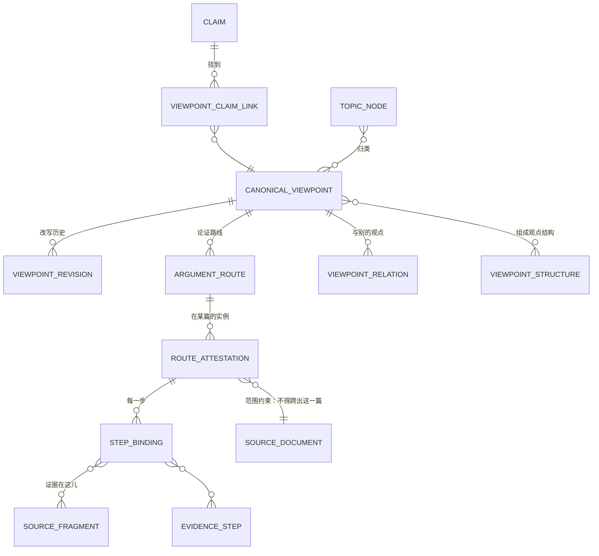
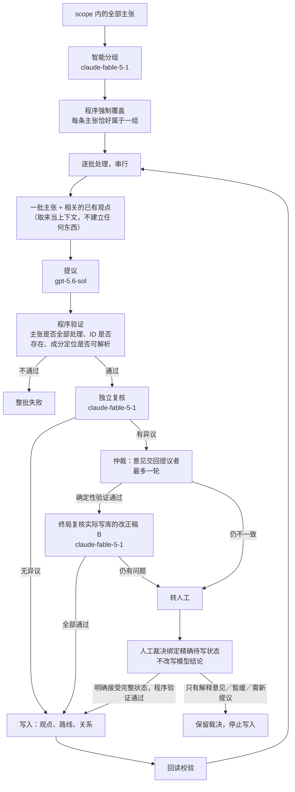
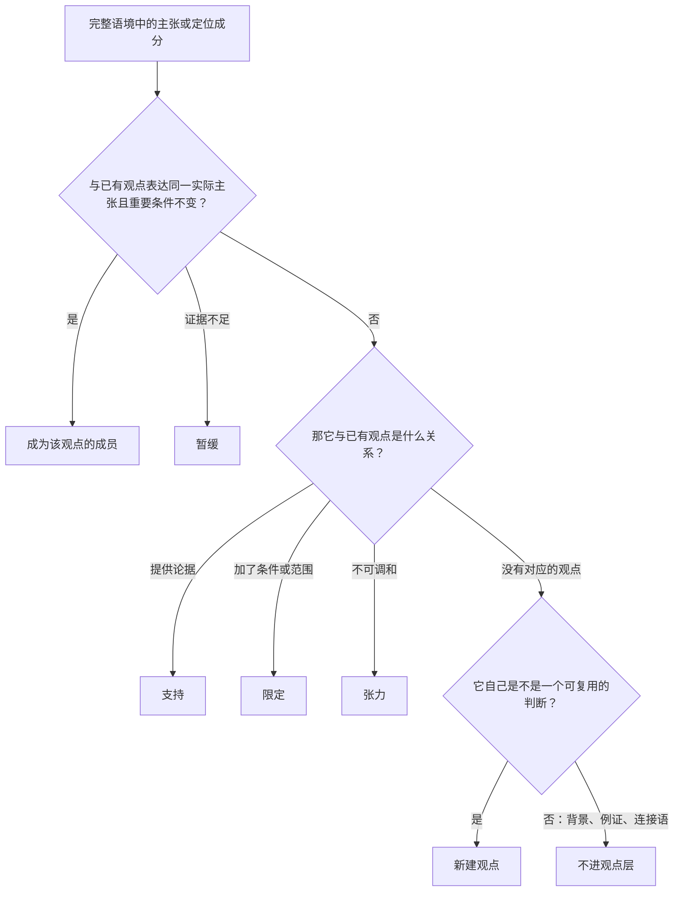
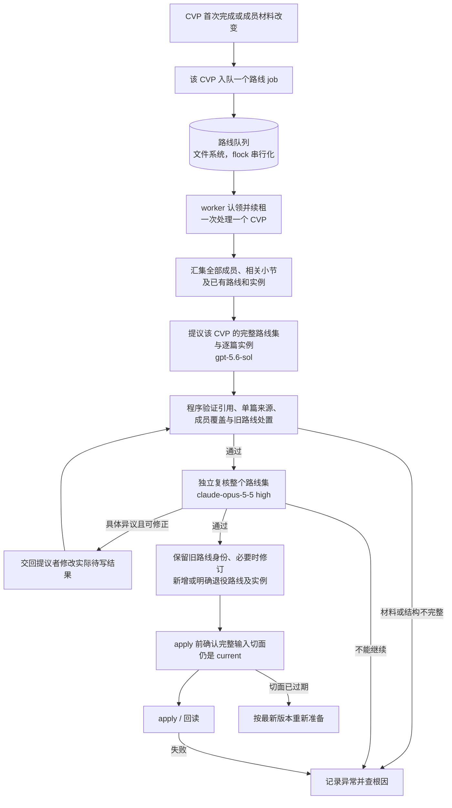

# CanonicalViewpoint 设计

## 目标

> **观点记录「教授对某件事的看法」本身，跨讲道，并说清楚这个看法由哪些主张支撑、他用过哪几条论证路线。**

它是[知识库](../00-overview/solution_architecture.md#3-架构总览)三个 component 里管「观点」的那一个。单篇之内的判断由 [Claim](./claim_design.md) 承担。

本文定義觀點身份與知識模型。實際生產的正常路徑、special cases、現行 #357 模型政策、人工出口和恢復接點，集中見 [Claims → CVP 現行完整流程](./cvp_production_process_v1.md)；已實作的 SQL 交易／changelog 與恢復入口另見 [CVP 交易與恢復設計 v2](./cvp_transaction_workflow_v2.md)。

## 术语

本文用到的词，凡是这个项目里已经在用的就照用；下面七个是本文新引入的，先定义再使用。已有的词(论证路线、反方立场、真值条件、推理骨架)不在此列。

| 本文的说法 | 定义 | 代码里 |
| --- | --- | --- |
| **scope（一轮的范围）** | 「这一轮要处理哪些主张」——一份**冻结的**主张清单，带名字、覆盖的经文段落、取来当上下文的已有观点，以及明确排除的部分。真实例子：`matt16-full`（190 条主张）、`matt16-13-18-rock-poc`（31 条）。清单的哈希用来确认后续每一步做的还是当初定的那一批 | `scope-packet.json` |
| **partition（执行分区）** | 全库冻结主张在进入智能分组前，按容量分配的一次执行归属。每条可处理主张恰好有一个主分区；其他分区只能把它当只读上下文。归属不代表两条主张是同一个观点 | `wang_cvp_partition_manifest_v1` |
| **观点修订** | 一个观点在某一时刻的表述与适用范围。改写会产生新修订，旧的保留并注明由谁取代 | `viewpoint_revisions` |
| **成员连接** | 把一条主张挂到一个观点上的记录，并说明是哪一种关系 | `viewpoint_claim_links` |
| **路线实例** | 某一条论证路线在**某一篇讲道里实际出现的那一次**，带该篇的证据步骤 | `argument_route_attestations` |
| **成分定位** | 当一条主张里只有一部分与观点等价时，指出是哪一段的结构化位置 | `component_locator` |
| **观点结构** | 一组观点围绕一个中心怎样组织 | `viewpoint_structures` |

### 目录

| 节 | |
| --- | --- |
| [术语](#术语) | 本文新引入的七个词 |
| [1. 观点是什么](#1-观点是什么) | 一个真实例子，以及它不是什么 |
| [2. 数据模型](#2-数据模型) | 图，以及每个对象的白话解释 |
| [3. 观点怎样产生](#3-观点怎样产生) | 流水线的图，人在哪一步出现 |
| [4. 怎样判断两条主张是同一个观点](#4-怎样判断两条主张是同一个观点) | 这一层最难的判断 |
| [5. 论证路线](#5-论证路线) | 同一个结论，他用过几种讲法 |
| [6. 观点之间的关系](#6-观点之间的关系) | 为什么不是一棵树 |
| [7. 审核与公开资格](#7-审核与公开资格) | 六种状态各管一件事 |
| [8. 不变量](#8-不变量) | 机器可查的规则 |
| [9. 谁读观点](#9-谁读观点) | 文章、问答怎样取用 |
| [10. 明确不做](#10-明确不做) | |
| [11. 来源改变后的观点更新](#11-来源改变后的观点更新) | 新版本批准与完整影响证明 |

## 1. 观点是什么

**一个观点是教授对某件事的一个看法，和他在哪一篇讲的无关。**

同一个看法在五篇讲道里讲过，就是 **1 个观点 + 5 条主张**。观点回答「他怎么看」，主张回答「他在这一篇里怎么说的」。

库里的真实例子：

```
CV-e3366d7c10f42b26ff15
  「馬太福音16:18的磐石不是彼得本人，教會也不是建立在彼得本人身上」
  11 条主张 · 出现在 6 篇来源 · 2 条论证路线
     2016 NYSC 專題：馬太福音釋經（四）1 / 2 / 3 / 4
     S 220206
     notes_manuscript:16章釋經
```

**「他反复讲过这件事」因此成为可以陈述、可以核对的事实**——六篇列得出来，十一条主张各自指回原话。

**它不是什么：**

| | |
| --- | --- |
| 不是教授的原话 | 观点的文字是编辑归一化的表述，记录里明确标着 `not_a_direct_quote`。原话在主张的来源片段里 |
| 不是主题 | 「因信成义」是主题，「教授认为成义不是宣告式的称义」是观点。主题是分类，观点是判断 |
| 不是别人的立场 | 教授引用或反驳的外部说法存成独立的反方立场，不能混进他自己的观点 |
| 不是一棵树上的节点 | 见[第 6 节](#6-观点之间的关系) |

## 2. 数据模型



图里有两个框不属于本层，是它连接的另外两个 component（定义见 [Claim 设计](./claim_design.md)）：

| 对象 | 它是什么 | 代码里 |
| --- | --- | --- |
| **来源文档** | 一份来源的**全部**——整篇讲道或整份母本，一份一条记录。正文在系统之外的文件里，库里只有标题、类型、文件路径和整份文件的内容哈希 | `source_documents` |
| **主张** | 教授在**某一篇**里提出的一个判断，连同他引的经文和推到结论的步骤 | `claims` |
| **来源片段** | 来源文档里的**一部分**——被引用到的那段逐字文字，带段落编号和录音起止时间 | `source_fragments` |
| **证据步骤** | 从经文或观察走到结论的一步 | `evidence_steps` |

本层自己的对象：

| 对象 | 它是什么 | 代码里 |
| --- | --- | --- |
| **观点** | 教授的一个看法。只有身份和状态，文字在修订里 | `canonical_viewpoints` |
| **观点修订** | 这个看法当前的表述与适用范围。改写会产生新修订，旧的保留 | `viewpoint_revisions` |
| **成员连接** | 把一条主张挂到一个观点上，并说明是哪一种关系 | `viewpoint_claim_links` |
| **论证路线** | 到达这个结论的一种讲法。同一个观点可以有几条 | `argument_routes` |
| **路线实例** | 这条讲法在某一篇里实际出现的那一次 | `argument_route_attestations` |
| **步骤绑定** | 实例里的每一步，指向支撑它的来源片段与证据步骤。**它不是独立的表**，是路线实例记录里的内嵌数组 | `argument_route_attestations.step_bindings[]` |
| **观点关系** | 两个观点之间：支持、限定、特化、延伸、张力、后期修正 | `viewpoint_relations` |
| **观点结构** | 一组观点围绕一个中心怎样组织 | `viewpoint_structures` |
| **主题** | 分类与导航用的主题身份，不是观点的父节点 | `topic_nodes` |

**为什么身份和文字分开存。** 观点记录只有 ID 和状态；它的文字在修订里。教授的看法被重新表述时，产生新修订、旧修订保留并注明由谁取代——这样「这句话是什么时候改的、原来怎么写的」永远答得出来。

**证据在片段上，来源文档只是范围约束。** 来源文档那条记录里没有正文（见上表），所以实例并不「从文档取证据」——每一步的证据在 `step_bindings` 指向的来源片段与证据步骤上。`source_id` 与 `source_revision_sha256` 起两个作用：声明这次论证不得跨出哪一篇，以及在那一篇被改动时能查出哪些实例失效。

**为什么范围要绑死单篇。** 不能把不同讲道的证据步骤拼成一条完整论证——那会造出教授从没讲过的推理。同一篇之内取邻近主张的一步则不算编造，代码里对此有明确判断：「A step from a sibling Claim in the same sermon is the professor's own reasoning; only another sermon is fabrication.」

实测支持这条判断：现有 35 条实例中，步骤的段落跨度最大 24、录音时间跨度最大 15 分钟，超过一半跨度为 0，没有一条在讲座两头捞证据。**但这是小样本，且只覆盖太 16 章。** 一份系列讲座可长达 79 分钟、615 个片段，语料铺开后同一份文档里的题目跨度会变大，这条假设需要重新验证——届时按来源类型分别定阈值，比一刀切合理。

## 3. 观点怎样产生

这是 [Solution Architecture D4](../00-overview/solution_architecture.md#d4最小化人工提议--复核--仲裁--转人工) 四步在这一层的落地。

**观点会随新讲道持续丰富，范围修订是正常 CVP management，不是逐例 exception。** 新 Claim 可能为同一核心判断增加经文依据或另一种论证。程序读取该观点全部当前成员与支持材料，判断命题是否仍是教授同一意思，再提议最小新修订并独立复核。原 Claim、各篇论证及旧 CVR 保留，不把不同讲道拼成教授未说过的一条综合论证。

观点修订的 `scope.scripture_scope` 表示命题的经文适用限定，不能充当「目前在哪些经文讲过」的覆盖列表；覆盖从来源、Claim 经文与连接另行取得。一般判断不因最初来自某段经文就永远只适用于该段。修订经文范围仍须确认教授没有真实的对象、条件或时期限定；不能仅凭不同经文都出现同一个词扩大身份。

有界 scope policy 目前只允许同一核心、完整 proposition signature、归属及人群／历史限定不变时，修订经文范围并复核必要连接和关系的版本引用。每个相关 Claim 的自身正文、现有完整成员和关系作用交 GPT／Opus，至多一轮纠正；改核心、改变关系语义、解除 hold 或未消解教导张力不在该权内。提交与受影响组复验沿用[共同 SQL 流程](./cvp_transaction_workflow_v2.md)，不逐例增加执行器。



### 全库执行分区

先从全库 Claim manifest 编译全库 scope packet，完成来源清账与审计后冻结，再生成内容寻址的 partition manifest。每个分区由 manifest 指定的 Claim ID 编译自己的 scope packet 和本地 freeze，然后进入智能分组。分母包含冻结清单内每条 Claim：可处理者恰好有一个主分区，未能处理者进入带理由的 disposition ledger。`S 230205` 本轮暂时排除时，来源本身也要留下明确的排除记录；没有 Claim 行不等于来源已处理。

分区只决定执行容量与顺序，不判断观点身份。经文引用不能自动成为马太释经核心；只有 Claim 本身对该经文作释经、且这一用途已经审核，才能进入相应 passage 分区。其余内容可以按实际 Claim 文本发现的可修订词项或来源组织，不预设教授的神学分类。多经文、多主题 Claim 仍只有一个主归属；跨分区引用是带修订哈希的只读上下文，不产生第二次身份裁定。

在已审核的「释经／其他」角色之上，「其他」可按负责人批准、可修订的主题路由进一步划分为神学各类别、生活应用和剩余其他。这些名称是编辑执行归属，不是教授自己的神学体系；分类按 Claim 主要回答的问题，不能靠关键词、讲道标题或引用经文。主题提议和独立复核不一致时保留带理由的路由留置，不靠默认塞入「其他」掩盖分歧；符合剩余类别的材料则明确归入「其他」。同一条 Claim 恰好一个主归属。

支持关系不强制改变 Claim 的分区。所有相关 current 关系及其审核状态原样保留，跨分区关系作为只读上下文；`candidate` 关系不是已批准的支持事实，更不能传递权威归属。后续观点生成可以把神学／应用 CVP 连接到已核实的 supporting 释经 CVP。主题分区超出请求容量时须明确记录待处理，不得随机切片或把临时批次冒充新的语义分区。分类模型的阅读批次与最终 partition 分开：批次只供逐条判定，归属清单在全库汇合后生成。

每个分区的 grouping 请求按实际送给 client 的 prompt、schema 与 Claim payload 的 UTF-8 序列化字节数检查。目标值、硬上限和单分区 Claim 数量上限来自版本化 partition policy；超限时确定性拆分，并保留原路由与拆分记录。预览可以报告尚未清账的 Claim，但不能授权模型调用；最终 manifest 必须与当前数据库指纹、来源清账、独立审计、CVP policy 和代码版本绑定。runner 在模型调用之前核对分区主归属、scope packet 和本地 freeze。

全库共用一个 Registry。分区按顺序处理，后续分区读取当时最新的 Registry；写入由同一把全局锁串行保护。全部分区完成后，还要审查跨分区重复观点并核对全库 disposition，不能凭每个分区各自完成就宣布全库完成。

### 分组

每个完整分区内部仍做智能分组。这一步由模型做（默认 `claude-fable-5-1`），但**它的结果在覆盖率上不被信任**：程序随后强制每条主张恰好属于一组，并逐条记录修补——

| 情况 | 程序怎么办 |
| --- | --- |
| 一条主张被放进两组 | 留在第一组 |
| 一条主张漏了 | 放进 `zz_ungrouped_residual`，照样处理 |
| 出现 scope 之外的 ID | 丢弃 |

**分组只决定「哪些主张一起看」，不决定任何身份。** 同一组不代表同一个观点，不同组也不妨碍它们后来被判为同一个观点。

**批次串行。** 第 N+1 批必须看得见第 N 批已经写入的观点，否则同一个观点会在两批里各建一个。所以上图末尾回到「逐批处理」，而不是并行铺开。

**Canary 不凭印象手挑。** 完整 scope 的 grouping 冻结并通过 exact-once 后，程序才生成一份绑定 freeze、scope packet 与 grouping SHA 的选择 artifact。候选组必须完整、不属于 residual、在批次上限以内，并至少有两条 Claim、两个来源；程序选最小的合格组，平手时取 scope 中最早出现的组。Claim 是否可用由上游 freeze 负责，不再用「已有／未有观点链接」或「多证据」间接猜测难度。若没有合格组，canary 入口关闭；不能另算或手改 grouping。

### 其余各步

1. **不做候选配对，也不做分块。** 取材只是把相关的已有观点拿来给提议模型看，它**不能建立任何成员、关系或观点**。身份一律由提议与复核在整批材料上判定。
2. **整批失败，不放行一半。** 一条验证不过，整批不写。宁可重跑，不可写进半套。
3. **最多一轮改正。** 不设第二轮。CanonicalViewpoint 或 ArgumentRoute 若发生改正，同一独立 reviewer 角色必须再审核一次实际可能写库的 B；这次只准通过或转人工，不再产生 C。
4. **写完要回读。** 从库里读回来逐条比对，不一致就是失败。

**人工出口不是另一轮模型审核。** `viewpoint_human_review.py` 将终局生产分歧或单次受控修订的拒绝保存为不可变 handoff，绑定待写材料及原始审核；受控修订另绑定物理来源与写前 Registry 指纹，普通批次保留原有 freeze 的来源准入门槛。原模型结论原样保留。人工回答分为解释意见（`interpretation`）、接受精确待写状态（`accept_exact_postimage`）、授权新修订（`authorize_revision`）和暂缓（`defer`）。解释意见、授权新修订及暂缓均不批准现有状态；授权新修订也不批准尚未生成的新内容。解释裁决与执行许可分开保存，不能从一句「相容」推导出退役或改关系的权限。

所有异议都被明确接受且精确材料与当前 Registry 指纹仍匹配时，受控修订执行器可消费 `human_exception_review` 许可，复用已绑定模型回答，不再调用模型重审同一裁决。新记录使用 `human_approved`／`human_editor`，详细决定放在现有 provenance 的 `review_artifact_sha256` 所指 artifact，不增加 Registry schema 字段，也不伪造 `dual_model_consensus`。写入前仍通过原有结构、依赖、备份和 dry-run 门槛；全局锁下跨 root 一次消费，已有 apply-intent／receipt 不重放。写后严格回读及独立审计完成之前，不能推进下一组。普通批次的 handoff 只提供裁决入口，不自行绕过 batch writer 的审核门槛。

## 4. 怎样判断两条主张是同一个观点

这是这一层最难、也最容易出错的判断。

**判据是教授自身语境中的实际主张，不是措辞一致。** 真值条件指在该语境中影响主张意思的重要条件，不是把短摘要当成跨所有想象情形的逻辑公式。先读完整 Claim、定位成分、实际 CVP 和自己绑定的原文，再判断是否表达同一个主张。措辞、语态、详略、明确省略及同一判断的正反表达可以不同；共同主题、结论相容、单向推出或共享经文都不足以证明等价。

对象、人群、经文与时间范围、必要／充分条件、否定、因果、模态和归属必须保留。双向反事实只是查找实质差异的辅助，拒绝须指出来源语境中的承重差异和具体误读；不能靠抽象边缘反例拒绝同义表达，也不能以「意思差不多」放过真实限定。自身上下文可消解指代、口语省略及明确的正反边界，不能借其他 Claim、未绑定来源或原文另一项独立结论补当前主张。字段之间实质矛盾或证据不足保留未决。

递给模型的问题是这样分岔的：



**只有「等价」才算成员。** 支持、延伸、限定、应用、张力都不算——它们是关系，不是身份。这条防的是**为了让一个观点显得反复出现，把相关材料都算成它的成员**。

| 连接类型 | 含义 | 算成员 |
| --- | --- | --- |
| `equivalent_full` | 完整主张在自身语境中与观点同义，承重条件不变 | 是 |
| `equivalent_component` | 主张里某个明确成分与观点等价，必须能定位到那一段 | 是 |
| `supports` | 提供具体理由、证据、例证或有论证作用的背景；不要求单条独自证明或完整复述目标 | 否 |
| `extends` | 保留核心但加了会改变真值条件的内容 | 否 |
| `qualifies` | 加条件、范围或防误解的边界 | 否 |
| `applies` | 用到具体对象或行动上 | 否 |
| `tension_evidence` | 为未解决的张力提供材料 | 否 |
| `superseding_evidence` | 为后期明确修正提供材料 | 否 |

**成分定位必须是结构化的**，不能只凭模型说「这条里包含同一个观点」。定位工具不要求成分脱离全文独立成句；共享语境只用于解释成分，不因此成为成员。定不稳就保留未决，**不得硬塞成成员，也不得自动改成 `extends` 或 `supports`**；每种关系都要有自己的依据，正文或定位修订另经授权与审核。

支持须说明哪句话以什么论证作用支持目标哪一部分，不能只是相关或相容，不能把局部依据冒充完整证明。批准给出原文对应依据，拒绝给出实质差异或缺失作用；完整 CVP 的所有实质内容仍须有来源。生成、整合、复核、纠正、审计、内容过滤补充与原文仲裁使用同一版本的简短语义规则，不把本文全文交给 runtime 模型。历史规则、缓存和裁决保留；改变规则创建新身份，不借旧审核批准新请求。

**一条完整主张最多属于一个观点**(以 `equivalent_full` 计)。复合主张可以有多个成分各属不同观点，但每个成分要有互不冒充的定位。

同一 Claim 對同一 CVP 可以保留兩種不同作用：`equivalent_component` 記錄結論，`supports` 記錄教授給出的理由。程序要求它們綁定同一當前 Claim 版本及 CVR、成分精確且字元區間不重疊、各有可用的自身 EvidenceStep／SourceFragment、已有批准；完整主張成員不能與局部支持重疊。區間不重疊只證明定位不同，論據是否真的支持目標仍由正常獨立审核與原文審計判斷。不能靠不同 `link_type` 放過重複或缺證據。

統計分開報告唯一 Claim 數、連接數和唯一等價成員 Claim 數；同一 Claim 的結論和理由不計成兩條 Claim，`supports` 不計為第二次成員資格。新模型调用使用版本化 `wang_cvp_component_roles_v1` 短規則，舊 prompt／原始回答保留且按原身份驗證，不追認為新規則审核。

## 5. 论证路线

CVP 的依据包括**圣经观察与推理路线**。教授明确指出的经文用词、冠词、语法、译文或经文对比，即使没有独立推理桥梁，也应保存他怎样使用这个观察支持观点。它不自动成为 ArgumentRoute，也不因教授未逐次核验全部用例而消失。纯断言及其同义重复不能凭空生成观察；记录支持存在与实际范围，不替教授判定观点真假或补足证明。

观察使用已有 EvidenceStep 和原文片段，由 `viewpoint_observation_supports` 保存经过审核的 CVP 关联：观察摘要、支持目标及作用、支持范围、同篇 Claim／Evidence／片段配对、程序生成的 Claim 与来源版本，以及末轮审核绑定。各来源分别留记录；摘要是编辑归纳，原话从片段读取。`no_route` 仅说明没有推导路线，可与非空的 `observation_supports` 同时存在。既有 Observation 或 Evidence 不复制成另一套来源事实。

现行 v8 policy 在原来逐 CVP 的 GPT 提议、Opus 完整复核与有界修正、单次 SQL 提交／回读中同时维护两类依据。观察、明确无观察的来源、旧观察退役都有独立审核目标，逐项覆盖；不为观察另加终审。全部当前正向连接及已有观察涉及的来源须交代有无观察；旧记录保留或明确退役，不静默丢失。已有推理路线仍按 v5 的推理要求审阅，不把直接观察伪装成路线，不恢复已撤回的 v6／v7 判准或历史记录。

提议、修改与审核共用观察／桥梁判准：观察实际存在而支持作用被夸大时，修正作用和范围，不因此删除真实观察；属于另一命题的材料不能仅凭邻近关系转作本观点依据。桥梁须有来源实际连接证据与结论的解释，不能由经文引述或结论复述冒充；同一片段实际包含两种作用时可以分别绑定，不能仅凭片段重复就判缺桥梁。后续完整审核同时读取精简的历轮逐项决定、异议与提案员处理记录。若更改旧验收条件、推翻旧通过或要求补回按旧意见删除的内容，须在现有理由字段解释旧判断为何改变及当前证据依据。历史不代替当前完整审核，也不冻结错误判断。

材料保留全部有效连接的 Claim、Evidence 及相关完整原文小节。额外结构化 Claim 只在这些证据实际引用的段落内作一次来源内扩展，不把一个过大的小标题下整篇讲道的所有 Claim 展开，也不递归扩展。它们只读，不自动成为 CVP 成员。不可绑定的可选上下文 Claim 明确披露 ID、版本和原因；有效连接或既有观察所需材料缺失仍阻止运行。候选观察的实际作用由模型及审核判断，不见到相关单词就自动建立支持关系。

文章、问答的共享 projection 和观点详情同时提供观察依据与路线；没有路线时仍呈现观察及其原话。观察关联及其实际 Claim／Evidence／片段纳入版本依赖。上游材料变化后旧记录及批准保留，读取端标为待维护、不能作为当前已核依据使用；新写入或重审时必须核当前版本。Claim 与 CVP statement 不由此过程修改。

同一个结论，教授在不同讲道可能用不同的讲法。每一种讲法是一条**论证路线**。

**路线的身份不是「引了同一节经文」。** 两篇都引加拉太书，一篇从 `παιδαγωγός` 的历史职能论证阶段性，另一篇从「后裔」单数和期限论证——**这是两条路线**，不是一条。判断依据是推理骨架：前提、推理步骤、结论是否实质等价。

**多条路线不互相吞并。** 各自维护自己的实例、完整度、经文投影和适用时段。所以文章和问答可以说「结论相同，但教授在不同讲道用了三条路线」，而不是把所有证据步骤摊平成一条虚构的超长论证。

同一 CVP 的几个 Claim 若有实质相同的承重前提、推理桥梁和结论，应归为一条路线；各篇选用的经文、解释、例证与详略留在各自的实例中。引用的圣经证据不能因合并骨架而丢失：实例必须说明经文怎样支撑相应步骤。若某处经文的释经本身构成不同的关键前提或推理方法，应另立路线；不能仅因引用经文不同就拆分，也不能仅因结论相同就合并。同一来源的多个 Claim 可以共同构成一个实例；不同来源的证据不得拼成一篇未曾出现的完整论证。

**路线输入以 CVP 为单位收齐材料，不以先前处理 Claim 的分组为边界。** 对每个待整理的当前 CVP，读取它的全部有效 Claim 连接，保留成员、支持、限定等不同作用；逐条取得指定版本的 Claim、EvidenceStep、原文片段及片段所在小标题下的原文小节。同一小节中提供推理桥梁的其他 Claim 可作来源内上下文，但不能因此自动变成该 CVP 的成员，也不能代替实际说出结论的 Claim。小标题只用来定位读取范围，不改变 Claim 或 CVP 的内容；没有小标题时按相关段落取材，不把整篇原文补进 packet。

模型必须看见上述完整成员范围，才能跨来源比较推理骨架，并判断各篇有哪些路线实例；来源资格、版本或原文缺失时，记录待处理，不能把遗漏伪装成「这篇没有论证」。每个工作单元只处理一个 CVP，并保留它的完整成员材料；任何实例只准使用同一篇来源的证据。构建 packet 时去重重复原文，只取相关小节，不按来源切开独立判断。**单个 CVP 的 packet 仍超限时如何处理：TBD。** 先测量真实个案，再决定办法；不能为缩包丢掉成员或破坏跨来源比较。

旧成员的某些 Evidence 若已明确标为 `withheld_missing_anchor`，且确无原文片段、锚点为 missing、归属该 Claim，沿现有不可用证据契约处理：保留 Claim、全部可用证据和停用记录的当前版本，在提议与审核材料中明确披露停用 ID 及不可绑定状态，不把无锚点文字作为论据。未明确停用的缺失、错误归属或不一致锚点仍阻止组包；整条 Claim 没有可定位来源也仍须处理上游。该接入不改变论证路线、完整度或审核判准，停用证据不能用于补齐步骤。

**中间推理与结论归属分别取证。** Claim–CVP 连接选择的证据用于说明该成分怎样连接观点，不是整条 Claim 中间论据的上限。新输入以 `claim_owned_intermediate_registry_selected_conclusion_v1` 显式绑定规则：非结论步骤可通过所列 component 引用其所属 Claim 的全部来源版本已绑定、未停用的实际 EvidenceStep／SourceFragment 配对；结论步骤仍限于所列 component 的连接所选证据，终端仍须有指向当前 CVP revision 的有效正向连接。不扩大成分的 statement spans，不改变成员身份，不因证据可用就假定它构成推理。`valid_for_identity_review` 是另一身份审核契约的标记，不能代替这里的来源资格；已有路线材料中的合格 `eligible_candidate` 继续使用。跨来源、错误 Claim 归属、停用或无锚点证据均不可绑定。GPT 与 Opus 读取相同的规则和配对，程序按步骤用途检查；历史输入不补写该规则。

**连接的判定理由也须交给论证层。** 新任务读取当前连接及其批准记录；早期 CVP 2.0 只在决定中写了通用说明时，从该连接实际提交的版本历史定位原任务，校验完整批准及精确后像，再读取成分的具体判定理由。不得凭一篇有完整推理，就把 `supports`／`qualifies` 自动提升为等价成员；也不得以“上游通过”代替本轮论证审核。只有具体来源、命题或范围问题才要求身份复核。理由与决定版本随材料绑定；旧任务保留原输入。

因漏传上述理由而停在连接复核的任务，接续须保留原 proposal、全部真实调用、历轮意见和已用修改次数。程序核实当前材料只补入批准理由，或仅新增该异常明确指向的既有 Claim 连接及配套摘要后，在原工作单元预留有界接续：只有理由变化时复用最后 proposal 复核；恢复成员时使用原剩余修改次数，再完整复核。没有剩余次数不能启动修改，不重跑初次提议，不改写旧意见，也不因工程修复把未通过内容写入。

### 路线怎样产生

**路线是独立的一条流水线**，不在观点那一批里。当前 CVP 首次完成，或其有效连接、所连 Claim、相关来源发生修订后，为这个 CVP 入队一个路线 job；不同 worker 可以分别认领不同 CVP。job 读取当前 CVP 的全部成员范围及其相关小节，同时读取该 CVP 已有路线和实例，形成绑定版本的输入切面。输入切面不是旧的 Claim 执行分组；提交前必须确认 CVP、成员、来源、已有路线及实例仍是读取时的版本。切面已过期就按当前内容重新准备，不能拿旧材料写库。

现有论证层更新也走这条提议／完整复核／多轮修改／提交链，输入另带已有观察支持，不设另一更新流程。新 CVP 2.0 更新模式的两阶段交接见[主控设计第 8.9 节](./claim_cvp_management_2_design.md#89-现有-cvp-与论证层的更新模式)：即使 CVP statement 保留不变，底层 Claim／论据变动仍须核对路线、实例和观察的当前有效性，不能仅以 CVP 写集决定是否入队。

完整集合是审核对象，不是每轮模型输出要求。首次更新调用使用 `wang_route_proposal_changes_v1`，基于已有路线、实例和观察的未批准草稿，只输出实际 edits；程序保留旧文字与证据，不能唯一确定的当前引用须由模型明确修正，不能猜测。后续修改使用 `wang_route_correction_changes_v1`，另报告逐项异议处理；修改只给变化的顶层字段。程序沿用 CVP／Claim 的增量展开方式，原样保留省略的记录和字段，补齐版本绑定，再对合成的完整提案做原有校验与 Opus 完整审核。撤去提案条目不等于退役数据库记录，旧记录退役须显式提出。模型原答与展开结果分别保存并绑定基线／审核。已发出或已有保存输入的旧调用保持原完整输出契约，不追写、不重跑，不因格式变更增加轮次。

新契约的程序校验失败在原阶段修正 edits，通过后才进入完整审核；技术修正与 Opus 语义修改分别记账，跨阶段共用现有策略修正额度，恢复时不重置。重复无进展、额度耗尽及未知调用状态停止；语义 rebutted／deferred 不转成技术重试。完整保存每个失败回答、修正请求和有效展开，恢复时只核验缓存，不补发未知调用。冻结的旧任务仍按原计数规则执行。

观察的提案标签不是数据库 ID。新修改及审核材料提供程序编译的 `local_observation_key` → 实际观察 ID 对照；内容变化会生成新 ID，即使标签沿用旧 ID，也不得误判新旧记录同时保留与退役冲突。旧观察不可原地改写，新记录与旧记录处置分别审核；旧调用保持原输入，不追写该对照。

新增量流程中，提议者接受部分意见、对其他意见提供有据反驳时，若候选已有实际修改、完整校验通过且没有 deferred 项，将修改及逐项反驳一并交回 Opus 完整复核。反驳本身不构成批准，不得把旧异议自动改为 pass；无变化、重复候选、未决材料或耗尽轮次仍按原规则停止。

已批准退役或合并的旧身份沿现有依赖影响流程结清原论证层的当前使用资格，不送入只接受 active CVP 的普通路线 worker。合并后存续身份按最终成员核对；旧完整实例不能仅凭路线 ID 相同就沿用为新结论的完整支持。替代成员、跨 CVP 改挂及零有效成员的更新分支同见主控设计第 8.9 节。



**中间隔着一个队列。** CVP 首次完成或相关材料改变后，不直接开跑路线，而是**入队**；worker 自己来领。这带来三件事：

| | |
| --- | --- |
| **单点认领** | 每个 CVP 各有一个 job，worker 一次只认领一个；不同 worker 可并行处理不同 CVP，不合并成多 CVP packet |
| **崩溃可恢复** | 认领有有效期，运行中续租；中断后租约到期可重新领走。输入与 job 记录保持不可变，恢复时仍须校验当前版本 |
| **边界** | 一个工作单元只绑定一个 CVP 的当前版本、完整成员及相关来源、已有路线和模型 policy；Claim 当初属于哪一执行分组不限制路线输入 |

路线审核与观点身份审核分开：

1. **完整路线集是审核范围。** 审核者必须能比较该 CVP 的所有新旧骨架与逐篇实例，检查重复路线、错误合并、遗漏的承重经文及其解释。不能让固定数量的目标分批遮住其他路线；若整个审核 packet 超限，处理方式与单 CVP packet 一样暂为 TBD。
2. **逐篇覆盖是分母。** 每个持有该观点成员 Claim 的来源，须有完整或部分实例，或由审核者确认只陈述结论、没有可绑定的论证；材料不足则明确待处理。提议者漏填不能让该来源消失，局部没有路线也不能冒充全库没有路线。若没有任何单篇讲出完整骨架，不得把几篇的残缺步骤拼成一篇完整论证。
3. **增量维护保留身份。** 对已有路线逐一判断保留、修订、退役或暂缓；骨架实质相同就保留路线 ID，必要时产生新 revision。既有实例也须逐一核对，不能因新增来源而静默遗留过期实例，也不能把所有路线删掉重建。
4. **一个 CVP 的路线集一起审核、一起写入。** 合并或拆分有异议时，不能先写入该 CVP 的其他路线，否则留下自相矛盾的中间状态。失败只暂缓这个 CVP 的路线集，不回滚已批准的 CVP 身份，也不阻塞其他 CVP 的路线任务。

論證路線由 GPT 提議、Opus 獨立復核；有具體異議時可在同一任務內依版本化 policy 有界多輪修正，原始任務目標與未解異議不得因重提而消失。每輪審核綁定當輪待寫結果的 SHA；最後一輪若通過，該審核就是寫入依據，不另加形式上的終審。無實質進展、材料不全或版本漂移時先查工程與來源，不靠反覆重問取得通過。骨架是編輯歸納，不標成教授原話；每個實例步驟須有可查的 Claim、EvidenceStep 與原文綁定。新運行的模型 policy 為 `backend/pipeline/policies/wang_route_resolution_policy_v8.json`，加入獨立的觀察支持項；v5 原契約和 v1 至 v4 保留供歷史 artifact 重放與審計。

写后读回比较实际 schema 展开后的完整记录，包含导入器添加的默认字段，不能因缺省值的表示差异误报，也不能忽略有内容的差异。若事务已经提交，先按原 job 的材料、packet、末轮批准、精确写集和 SQL history 恢复读回；同时核当前 CVP／成员／来源版本、路线与实例集合。不得因该事务改变了路线基准就另建 job、重跑模型或再次 apply；原批准或当前状态不能核实时保留未完成。恢复可精确指定已有 job，不能借恢复重试别的未决任务。

若旧首轮审核因把连接所选证据误当成中间论据上限而暂缓，可在精确原 job 内接续：先验证原模型回答、全部输入及版本未变，证明变化仅为上述取证契约，并固定保存父材料、旧判定、工程修复与原剩余修正预算。沿用原 proposal 及全部异议交 GPT 修改，再让 Opus 独立审核整套实际结果；原 defer 不改成通过，不重新调用首轮 proposal，不取得新预算。普通语义拒绝、无关暂缓、unknown 调用、已消费其他修正或来源漂移不得进入此修复分支。

**實作狀態：**v5 worker 從當前 CVP 的全部有效連接及其來源小節建立輸入，加入現有路線與實例；每輪審核看整套新舊路線，具體異議可多輪更正，最後一次通過直接成為寫入依據。舊路線須保留、修訂或明確退役；未留在新集合的舊實例在同一 ChangeSet 撤下。提交前核對完整材料，SQL 提交再鎖定其 Registry 版本與成員、路線、實例集合。新提案、復核和更正使用獨立 v2 響應 schema，不改舊 v1 artifact 的 SHA。CVP2 完成後入隊，Claim 或來源另有修改時可用 v5 入隊命令指定受影響的 CVP；這類上游修改的自動入隊接線仍待補。舊 #357 worker 保留供歷史 artifact，舊 `no_attested_route_in_this_evidence_scope` 不得提升為全庫結論。新入口 v8 增加獨立觀察支持項，推理路線仍使用 v5 的原判準；明確指定 v5 可續跑原有任務。v6／v7 的放寬路線規則已撤回，檔案只保留供歷史 artifact 查證，不作新任務入口；不得將那些歷史結果重新標為 v5 審核。Claim 及其 CVP 連接的問題須回到相應管理流程處理，不為補救上游問題而放寬論證層。

**实例分完整与部分。** 一篇里把这条路线的必需步骤都讲全了，是完整实例；缺步骤或有含糊的，只能记部分实例。**部分实例不计入「这条路线反复出现」的次数。**

## 6. 观点之间的关系

**观点不是一棵树，不设父节点。** 一个较具体的观点可能同时：特化一个较广的观点、限定另一个观点、应用到某个具体伦理问题、归入多个主题、与另一时期的材料形成张力。

单父树装不下这些，硬装就会丢掉其中几条。所以关系是**有类型的图**:支持、限定、特化、延伸、蕴含、张力、后期修正。「支持」是教授以一个观点作为另一个观点的理由（「因为……所以」）而不足以单独推出它；能单独推出才是蕴含。2026-10-25 #456 加入：「人子」试跑中十几处教授亲口连起来的论证，因为没有这一类型而记不下来。

界面可以从这张图生成树状的阅读视图，但**那是可重建的导航，不是身份依据**。

主题(`topic_nodes`)负责分类与层级导航，它**不是观点的父节点**——两个观点属于同一主题，不构成合并它们的理由。

## 7. 审核与公开资格

**不要用一个 `status` 同时表示进度、审核、身份状态和可见性。** 六种状态各管一件事：

| 状态 | 管什么 | 值 |
| --- | --- | --- |
| 生成状态 | 这一轮跑完了没有 | `generated / validated / failed` |
| 审核状态 | 谁认可了 | `candidate / ai_consensus / system_approved / human_approved / rejected` |
| 批准依据 | 凭什么认可的 | `deterministic / dual_model_consensus / owner_scoped_independent_terminal_review / human_exception_review` |
| 身份状态 | 这个观点还是不是它自己 | `active / redirected / split / merged / retired` |
| 可见性 | 谁能看到 | `internal / active_snapshot_eligible / public` |
| 依赖状态 | 用了它的产品还有效吗 | `current / invalidated / withdrawn / rebuilt` |

**`system_approved` 不等于同工看过。** 它表示系统按该版本契约批准；正常观点解析依靠两个模型一致且属于低风险，界面上不得显示成人工批准。批准依据这一栏就是用来防止这种混淆的。

另有明确受控来源修订的 `owner_scoped_independent_terminal_review`：GPT 只提议／纠正，Opus 对精确完整后像独立终审；必须绑定该版本契约、真实 Opus 回答与单次应用证明，不假称双模型共识，也不把 owner 的执行授权称为内容批准。不能只凭状态或政策名称放行。

当前实际状态(2026-08-25):32 条修订全部是 `system_approved` / `internal`——**没有一条对外**。

## 8. 不变量

机器可查，不依赖判断力：

1. 所有 ID 唯一；`current_revision_id` 必须属于同一个观点。
2. 引用的主张、证据步骤、来源、关系必须都能解析；**指定版本的主张不存在时，不得自动改指最新版本**。
3. 建立、合并、拆分或退役一个观点，**不得删除或修改来源主张**。
4. 每个成员连接保留主张 ID、指定版本、出现位置与身份判定记录。
5. 一条完整主张最多一个 `equivalent_full` 成员资格；复合主张的每个成分定位必须稳定且互不冒充。
6. 一条路线只有一个结论观点。
7. 路线实例的主张、证据步骤、来源片段必须来自**同一篇**指定版本的来源；跨来源拼接直接失败。
8. 完整实例必须覆盖该路线声明的全部必需步骤；缺失或含糊只能记部分实例。
9. 结论相同不足以证明两条路线是同一条。
10. 观点修订里不得内嵌成员、路线、关系或覆盖数组——它们是各自独立的记录。
11. 同样的输入必须编译出同样的结果：语义修订、覆盖范围与编译器版本相同时，产出的内容哈希必须一致。
12. correction 后写库的 effective proposal SHA 必须与终局复核绑定的 proposal SHA 相同；初审 A 的批准不得为 B 背书，终局复核任一维度非 `pass` 时不得按模型共识产生 ChangeSet。人工例外只按第 3 节的精确状态许可另行批准，不改写原终局结果，不豁免机械门槛。
13. 每条被路线结论引用的观点，其 scope 内可 attesting 成员来源必须 exact-once 落在 `attestation` 或经独立 reviewer 确认的无路线 disposition；缺席与重复都失败。
14. ArgumentRoute correction 后写库的 effective proposal SHA 必须与终局复核绑定的 proposal SHA 相同；终局复核有任一非 `pass`，该 effective proposal 不得产生 ChangeSet。
15. source eligibility attestation 若依据 `withdrawn` 或 `auto_applied` 裁定，row 与顶层 artifact hash 必须覆盖 exact adjudication SHA、状态以及适用时的 overrides SHA；不含这些字段的 legacy hash 只兼容无需仲裁的旧 `pass` 行。
16. 全库 partition manifest 的主归属必须覆盖每条可处理 Claim 恰好一次；缺失、重复、外来 ID、修订漂移、请求超限或未说明的剩余项均不得进入模型。只读跨分区上下文不得成为第二个主归属。

## 9. 谁读观点

**消费端可以直接读 Registry。** 观点、修订、路线实例上都带着审核状态、可见性和身份状态，消费端按这几个字段自己过滤即可。

早先的设计要求所有消费端只读编译好的投影、不得直接读 Registry。**这一条已删除。** 投影是便利与性能手段，不是准入闸门；门在记录自己的状态字段上。

| 谁 | 取什么 |
| --- | --- |
| 文章 | 编排计划指定用哪些观点与路线；正文每个实质段落要能映射回其中一条 |
| 问答 | 答案按观点组织，并带上该观点在不同讲道里的**限定与扩展**——遗漏限定是[最坏的失误](../00-overview/solution_architecture.md#d2不用-rag) |
| 界面 | 只读浏览已编译的身份、路线、关系、覆盖与历史 |

三者都要能顺着成员主张回到教授原话。**观点的文字不得成为唯一可见的来源。**

## 10. 明确不做

- 不建立一棵「王教授思想唯一层级树」;
- 不用观点替代主题，也不因两个观点同属一个主题就合并；
- 不用编辑归一化的文字替代教授逐字原话；
- 不把外部立场复用为教授自己的观点；
- 不因为成分重复、向量相似或共享经文就自动合并；
- 不把不同来源的证据步骤拼成一条虚构的完整论证；
- 不把出现次数当作重要性。

## 11. 来源改变后的观点更新

新 CVP 2.0 接收上游已通过当前资格的 Claim 后，按[主控设计第 8.9 节](./claim_cvp_management_2_design.md#89-现有-cvp-与论证层的更新模式)执行现有 CVP 更新：输入现有观点、全部当前相关 Claim／连接、论据及原文小节，不要求完整 Claim 新旧 diff；GPT 提议更新结果后，复用生成流程的校验、Opus 完整审核、多轮修改和提交回读。保持观点身份与旧历史，允许审核后不修改；随后维护受影响论证层，分别披露两阶段完成情况。更新模式已实现并完成[首条真实试点](../90-ops/cvp_update_474_first_pilot_validation_20261027.md)，尚未全量验收；不据此改变已冻结任务。

以下来源修订任务继续按各自原契约执行，完整组独立审计等历史完成条件保留；不将其逐操作门槛附加给上述新模式。

按[来源修订 → Claim → CVP 更新流程](./source_reconciliation_workflow_v1.md)，先检查改变来源的全部 consumer，再检查目标 CVP 所有其他成员及其完整来源。编辑推论与教授直说分开；逐字引用成立仍须核对主体、归属、范围、模态、必要／充分条件及上下文。

来源修改不必导致 CVP 核心命题改变。可保留核心命题而更新 Claim 版本、连接及证据绑定；partial supports 必须指出具体作用，不能要求 Claim 复述整个 CVP，也不能把它不支持的部分凑成等价。确有获准的核心意思变化，创建新 CVR 并保留旧 CVR／supersedes 链，不自动合并、拆分或退役身份。

终审批准后的 fresh provenance 明确单一 Opus 实际依据；连接绑定最终 Claim SHA、当前 CVR 和精确 locator，不能沿用旧 decision 冒充新批准。原子应用后失效相关产品依赖，但本流程不生成路线／文章或发布。完整受影响组独立审计与准确 flags 是完成门槛，SQL 成功不是完成。

通用来源版本证明只读还原冻结成员的历史 pins；未来执行仍须核验当前知识与新来源批准。旧硬编码修订包不自动升级为通用证明；缺少、歧义、冲突或 human hold 均停止。

## 待定

**复杂论证体系可能需要扩展。** 当前模型是「观点 + 论证路线 + 观点关系」。多层嵌套的论证、几个观点联合才成立的结论、有条件才成立的结论，现有对象是否够用，尚未论证。本文不擅自扩展模型，记录为公开问题。

## 关于本文档

> **读者**:Solution architect、Developer。同工不需要读本文；同工要知道的在 [Solution Architecture](../00-overview/solution_architecture.md)。
> **类型**:规范
> **状态**:当前。取代 `canonical_viewpoint_design.md`。
> **来源更新代码对齐**:第 11 节与受控终审依据于 2026-10-06 核对到 `eacc753`、`c5bc74a`、`1bcb34f` 及离线回归；新入口未作真实模型／SQL 端到端实跑，不追认旧包。其余数字与旧规则的原核对范围保持。
> **与代码对齐**:第 4 节语境语义规则于 2026-10-05 核对到 `config/wang_cvp_contextual_semantics_v2.md`、`viewpoint_semantic_contract.py`、新版本角色模板及 `scripts/audit-library.py`；身份归并未决出口核对到 v2 response，重复仲裁保护核对到 `viewpoint_adjudication_history.py`。新规则目前只完成离线回归，尚非真实模型校准或生产通过。第 3 节人工交接与受控修订续跑保持 2026-10-04 对 `viewpoint_human_review.py`、`viewpoint_audit_link_repair.py`、`viewpoint_batch_resolution_runner.py` 及对应回归测试的核对；其余未核对。第 1、7 节的数字仍取自 2026-08-25 的 PostgreSQL 快照；partition 实施以 #395 的验证记录为准。
> **权威范围**:观点、论证路线、观点关系的语义、身份判定与消费边界。
> **更新输出代码对齐**:2026-10-27（#474），第 3 节的首次增量提议、技术修正及缓存核验对齐 `viewpoint_route_correction_changes.py`、`viewpoint_route_validation_repair.py` 和普通队列隔离集成测试；该输出变更尚未用于其余真实 CVP，不扩大历史实跑结论。
> **范围管理代码对齐**:第 3 节常规 scope enrichment 于 2026-10-09 核对本次 `cvp_scope_management.py`、共享 SQL action 与隔离交易测试；真实模型／组验收另存，不用离线结果追认新内容。
> **路線與觀察代碼對齊**:2026-10-23，v5 已完成本輪六個 CVP 的真實模型、SQL 提交與回讀；舊 #357 worker 仍僅供歷史任務。v8 在 `CV-22b94fdd041005a381f6` 實跑：GPT 提議及兩輪修改、Opus 三輪完整復核，末輪 13 項全數通過；以 `KCS-74028852f3cc003cde1c` 新增六篇來源的 12 條觀察，沒有新建推理路線或恢復舊路線／兩個舊實例。333 條原輸入 pin 未變，末輪批准 SHA 與當前綁定核對通過；另驗證已提交結果零模型／零內容寫入的回讀恢復。提議請求 511,639 bytes，三輪復核最大 539,740 bytes；352 項相關回歸及前端型別檢查通過。正式記錄為 `staging/cvp-management-436/new-judgements-16-20261023-v1/observation-supports-v8-20261023/pilot-readback.json`。本輪獨立品質審計未執行，未合併、未部署；v6／v7 歷史判定沒有重新標為 v8 批准。
