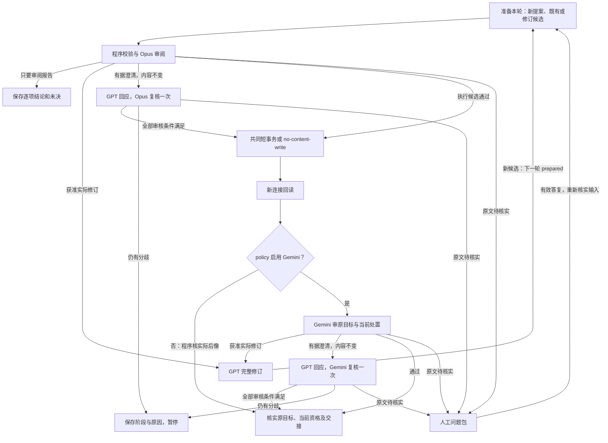

# Claim Management 2.0 operations 与生命周期设计

> **读者**：流程负责人、Solution architect、Developer。
> **类型**：规范。
> **状态**：当前规范；普通双目标联合 Update 已完成有界真实审阅与回读验收；常规联合策略容量为 2，旧策略保持原契约。
> **与代码对齐**：2026-10-16，模型输出简化已核对到当前实现与隔离测试（未做新协议真实模型验收）；普通联合 Update 核对到 `45acd7e`；第 10.1 节通用上下文资格保留核对到 `66e04e8`。常规联合 v2 policy 容量为 2；旧策略及未声明容量的缺省值仍为 1。真实样本已验证共同 retain、共同修改 Claim／Evidence／关系及程序回读；晚项回滚和丢失回复路径由隔离反例验证。实际结果见实施检查点。
> **权威范围**：#435 的 operations、完整生命周期、审核与多轮出口、当前可用资格和 Claim 域交接；不授予模型调用、正式内容修改或旧预算重开权限。

Claim Management 的目标是让新建和既有 Claim 都忠于教授的完整自身来源，保留证据、论证和限定，并通过同一套管理流程持续审阅和更新。Create 从 GPT 候选开始；既有 Claim 直接作为候选进入 Review。Verify 是审阅中的核实，Cleanup 是 Update 的用途。

当前新 action 暂停 Gemini 终审，默认采用 [Opus-only policy](../../../backend/pipeline/policies/wang_claim_management_opus_only_v2.json)：`independent_audit=false`、Gemini 调用预算为 0。Opus 内容审阅、版本／来源校验、事务、真实写集、回读和原始目标核实保留；结果明确为 `opus_and_program_readback`，不标成独立终审通过。本文的 Gemini 分支只适用于明确启用独立终审的 policy；既有已绑定任务和完成记录不改变。

普通双目标联合 Update 新任务可显式选择 [joint Update v3 policy](../../../backend/pipeline/policies/wang_claim_management_joint_update_v3.json)，容量为 2，采用简化输出契约与 Opus＋程序回读。[v2 policy](../../../backend/pipeline/policies/wang_claim_management_joint_update_v2.json) 保留原模型输出契约，不升级已绑定任务。单条及其他 operations 的默认 policy、旧联合 v1 policy 和已绑定任务保持原样；缺省容量仍为 1。选用联合 policy 不代替具体目标、字段权限和必做清单的精确授权。

Review 就是审阅，作为独立业务 operation 保留。Update 内含审阅、必要修正与独立审计，不需要另发 Review 请求。Create、Retire、Restore、Split、Merge 同样内含审核；这些操作共用现有执行机制。Read 只读取，不触发模型或内容事务。

本域归 [#435](https://github.com/junyang168/smart-answer/issues/435)，共同协调归 [#357](https://github.com/junyang168/smart-answer/issues/357)，下游观点与连接管理归 [#436](https://github.com/junyang168/smart-answer/issues/436)。

遵守 [Project Mission Statement](../00-overview/project_mission_statement.md)、[Solution Architecture](../00-overview/solution_architecture.md)、[Claim 设计](./claim_design.md) 和 [CanonicalViewpoint 设计](./canonical_viewpoint_design.md)。

## 目录

| 节 | 内容 |
| --- | --- |
| [1](#1-目标与共同不变量) | 目标与共同不变量 |
| [2](#2-统一对象与执行模型) | 统一对象与执行模型 |
| [3](#3-现有执行基础与扩展边界) | 现有执行基础与扩展边界 |
| [4](#4-operations-定义) | operations 定义 |
| [5](#5-材料身份与原始任务目标) | 材料、身份与原始任务目标 |
| [6](#6-共同生命周期与恢复) | 共同生命周期与恢复 |
| [7](#7-审阅独立审计与澄清) | 审阅、独立审计与澄清 |
| [8](#8-多轮出口与预算) | 多轮出口与预算 |
| [9](#9-人工核实与来源修订) | 人工核实与来源修订 |
| [10](#10-审核有效性与下游交接) | 审核有效性与下游交接 |
| [11](#11-批处理与验收) | 批处理与验收 |
| [12](#12-实施与阶段交付) | 实施与阶段交付 |

## 1 目标与共同不变量

| 目标 | 不变量 |
| --- | --- |
| 忠实 | 完整自身来源支持每条判断和推理；不添加教导，不漏承重限定，不裁定神学对错 |
| 对象明确 | 稳定身份、内容版本、审核结论、有效状态和下游完成分别记录 |
| 权限明确 | 操作、对象及字段范围在执行前绑定；模型发现问题不扩大写权限 |
| 审核当前内容 | 旧 pass 不批准新内容，原始模型回答不覆盖 |
| 原子提交 | 一个联合变更的内容、history、实际写集、确定性影响和进度同事务生效 |
| 有界恢复 | 轮次共用原 action 预算；unknown 不重发，已提交不重复写入 |
| 最小必要人工 | 工程问题自主处理，只有完整来源仍不能决定的实质疑点转人工 |
| 完整完成 | 每轮通过须支持原始任务目标；Claim 可用、来源覆盖和 CVP 完成分别报告 |

## 2 统一对象与执行模型

| 对象或术语 | 含义 |
| --- | --- |
| Claim／Occurrence | 某份来源中的判断／该判断的一次出现和锚点，稳定 ID 与记录版本分开 |
| Evidence | 观察、经文或推理步骤，含来源、支持资格与 Claim owners |
| 单篇关系／反方节点 | 同源内容的支持、限定、反驳关系；反方立场独立保存 |
| action | 一次获准任务，保存原始目标、权限、policy、总预算、问题和最终结果 |
| 执行单元 | action 中必须共同处置的目标及依赖；一轮至多提交一个联合 ChangeSet，是内容事务边界 |
| 联合 Update | 一个执行单元以多条既有 Claim 为目标，统一审核各自判断及共享修改；不合并 Claim 身份 |
| 批次 | 一份有原始清单的工作安排，可包含一个或多个获准 action；不是新 operation，也不是整批事务 |
| 计划可写范围 | 调用前按对象／字段权限和创建许可计算的可能写入上界；不等于实际 delta |
| 轮次 | 一个执行单元的一份精确候选及其审核、提交、回读和审计进度 |
| 候选 | 完整后像、逐对象处置、实际 delta 与替代映射；既有记录可以原样进入 |
| finding | 有持续身份的问题，带目标、来源、类别、依据、接受条件与各轮处置 |
| read pins | 对象版本、新对象不存在及必要依赖集合的约束，用于写前与完成时复验 |
| ChangeSet | 现有正式写入与版本历史机制，一个联合变更的完整写集 |
| Claim-ready | 当前对象有仍有效且足以支持使用的审核结果；由现有记录派生，不建资格库 |

Claim 域管理 Claim、Evidence、occurrences、必要来源片段、单篇关系和反方节点。原件校订由负责人完成。跨讲身份、ArgumentRoute 与 CVP 连接语义归 #436；Claim 域只登记影响，不代其批准内容。

operation 表达用户要做什么；执行阶段与对象处置表达系统怎样完成它。所有内容写入共用 retain（保留）、update（新记录版本）、create（新对象）、retire（退役）、restore（重新生效）和替代映射，编译到既有 ChangeSet；每个 operation 只增加其必要审核要求。

## 3 现有执行基础与扩展边界

### 3.1 已有基础

main 的 `PostgresKnowledgeStore.apply_plan()` 已使用 PostgreSQL transaction 和事务级写锁。

主控阶段的 [共同 SQL 入口](https://github.com/junyang168/smart-answer/blob/9eeb64d22397c1f7ca03dc4344051e71f11d514e/backend/pipeline/cvp_sql_flow.py) 与 [store](https://github.com/junyang168/smart-answer/blob/9eeb64d22397c1f7ca03dc4344051e71f11d514e/backend/api/canonical_repository/postgres_store.py) 扩展了以下能力；实施基线须包含这些能力，不能仅因 main 已有 transaction 就视为等同。

| 已有机制 | 本设计的使用方式 |
| --- | --- |
| 同一 store、短事务与写锁 | 内容操作编译到共同 ChangeSet，不另建事务框架；Read 和只要报告的 Review 不产生内容写集 |
| read pins、完整依赖与写前校验 | 包含修改对象、共享 owners 和必要只读依赖；漂移时拒绝提交 |
| 实际写集、RETURNING、后像与 history／edges／review_events 核对 | 验证实际发生的全部修改及确定性副作用，任一晚项失败全部 rollback |
| 依赖失效及 affected runs 更新 | 随内容提交登记影响并使受影响运行回到待审计状态 |
| pipeline_runs 的 prepared／reviewed／applied／audited | 保存 action、阶段和结果，completion 文件仅供展示 |
| 原调用 intent、raw、输出位置及跨 root 身份 | 扩展同一预算的轮次，不另建调用账本 |
| 已提交身份优先与新连接回读 | lost reply 后查实际 ChangeSet，接续回读与审计，不重复 apply |
| no-content-write 分支 | 正确既有 Claim 可完成审核，不制造内容 revision 或空业务写集 |

共同交易与恢复依据是主控的 [CVP 交易與恢復設計 v2](https://github.com/junyang168/smart-answer/blob/9eeb64d22397c1f7ca03dc4344051e71f11d514e/docs/wang-knowledge-platform/20-knowledge/cvp_transaction_workflow_v2.md)。[PR #428](https://github.com/junyang168/smart-answer/pull/428) 是交付定位，不是本文对合并或生产验收的替代声明。

### 3.2 本次需要扩展的责任

新增责任集中在现有契约内：operations 的权限与对象映射、有序多轮候选及 findings、各 operation 的完整独立审计问题、Claim-ready 与已存在失效／completion 的对应。复用 SQL 进度、审核记录和 artifact 引用，不建另一套状态数据库或独立证明框架。

沿用单一使用者、受控维护入口和来源不被外部并发修改的运行前提。普通联合 Update 每个 action 只有一个单元，独立组组成批次中的不同 action；其他 operation 保持原有单元契约。不同 action 的有界并行须有原许可，并按第 11.2 节检查交叉写入影响。模型请求重叠不表示数据库同时提交，短事务仍使用共同写锁。本文不新增常驻调度器或不受控并发，也不从多目标参数推导并行写入许可。

### 3.3 多目标入口与已验收能力的边界

| 已核对的代码事实 | 能力与验收边界 |
| --- | --- |
| 普通多目标 Update 的新建 action 须选择版本化联合 policy；缺省容量 1，拒绝原因保存在原 action | 超容量、创建许可、未归属维护项和隐藏 Claim 写权限在模型调用前拒绝；不倒改已绑定旧任务 |
| preflight 与准备共用 read_claim_context，保留完整 pins；按选中目标间的 W／R 冲突取传递分组 | 共读来源本身不合组；只在授权目标内分组，每个许可及必做项明确归属，不自动加入其他 owner |
| 联合 action 固定一个单元，原授权的 required_maintenance_keys 进入 original_goal | 全部目标、必做项和新旧共享影响闭包共同审阅、共同提交；漏处置、漏审阅或当前回读不成立都不能完成 |
| 新 policy 的模型 schema 和 prompt 要求 affected_write_keys；旧输出 schema 与缺省序列化保持原样 | 只读 owner 因实际写入失去支持时阻断该写入；双方确认无关的已判定异议继续保留 context |
| 共同 ChangeSet、晚项回滚、已提交回复丢失恢复、零重复模型调用及双方当前资格已有隔离反例 | 合成模型回复只验证契约和路由；有界真实共同 retain／回读已验收，不声称真实内容修改、晚项回滚或失败后恢复也已实跑 |

普通联合 Update 的每组建立一个 action、一个单元；独立组建立不同 action。已有多单元任务按原保存事实读取，新版不增加多单元调度、创建、部分提交后重组或预算迁移。预检输出是分组与权限归属建议，不改写授权、不准备 action、不执行模型或内容写入。受控批次据该结果绑定各 action，并在批后重新读取当前资格；既有完成事实与当前是否可用分别报告。实施结果见[实施检查点](./claim_management_2_implementation_checkpoint_20261013.md)。

## 4 operations 定义

### 4.1 操作、审核要求与完成

本表是各 operation 的唯一差异定义。内容操作的“完成”均须满足第 6–10 节共同规则。

| Operation | 输入与处置 | 必须核查 | 完成结果 |
| --- | --- | --- | --- |
| Read | 指定当前／历史对象，只读取 | 版本、来源、当前可用性、退役／替代及缺失披露 | 返回可追溯材料；不触发模型或内容写入 |
| Review | 既有或新候选；只审阅，不自动修改 | 完整自身正文、归属、限定、Evidence、单篇关系与请求指定的处置 | 逐项报告，保留未决；要求确认当前可用性时继续独立审计或复用有效审核 |
| Create | 指定来源范围；create 必要 Claim、Evidence 与关系 | 自身来源、归属、非重复判断、限定、论证、绑定与支持资格 | 新对象 Claim-ready；来源覆盖另计 |
| Update | 指定既有对象；retain 或 update，内含审阅 | 同一来源判断、修改依据、完整后像；共享 owners 与关系两端的支持仍成立 | 当前对象 Claim-ready；正确对象可原样保留 |
| Retire | retire 对象，保留历史 | 历史前像、退役理由、原教导处置与消费者影响；不要求错误旧 Claim 为真 | 退役合理、影响已登记；不产生旧对象 Claim-ready |
| Restore | restore 退役对象，形成新生效版本 | 退役原因已消解、当前来源成立、完整内容合格、无重复有效替代 | 当前对象 Claim-ready；不复活旧 pass 或旧消费者 |
| Split | create 多个对象、retire 原对象及映射 | 原始对象与全部最终对象间的判断、限定、位置、Evidence／关系无遗漏、无增加 | 最终对象均就绪，旧对象退役，映射与交接完整 |
| Merge | create 新对象、retire 全部旧对象及映射 | 同源同判断确属重复，全部有效材料保留，无虚构综合 | 新对象就绪，旧对象退役，映射与交接完整 |

Split／Merge 产生新 ID。跨讲同看法交 CVP，不 Merge 成单一 Claim；不提供正常内容物理 Delete。来源覆盖任务中遗漏教导的处置见第 11 节。

### 4.2 权限与提交边界

Update 可在获准范围内联合修正 Claim 表述／归属／类型／经文／限定、occurrences、Evidence 表述／绑定／owner／资格和单篇关系。Evidence 补入不批准扩大 Claim；解绑保存理由；最后一个支持 Evidence 被撤回时，Claim 不可继续就绪。反方改标签不能成为教授立场的支持证据。

程序在准备候选时固定执行单元：必须协调修改才能保持语义及引用一致的写项共同提交，不能丢掉失败写项后提交其余部分。Split／Merge 的新旧对象与映射必属同一单元。只读共享 owners、关系两端和必要来源进入 read pins 与审核范围，不因被读取而进入写集。

只有同一单元同一轮的实际修改共同提交，不承诺整批或跨轮原子性。普通联合 Update 以第 11.2 节形成的一组目标建立一个 action、一个单元；独立组建立不同 action，不能在 action 内拆成多个子任务来假定全部通过。其他 operation 仍按各自契约形成单元。仅把 worker 改为串行不足以避免后面的修改使前面的审核失效；也不能因共读一份来源就自动把全篇变成一个事务。

原许可内的修订和补偿自动推进，无须每轮另发 Review 请求；确需范围外修改时记录准确需要并暂停相关单元。初始许可明确恢复操作及对象范围，模板不会自动授予 Restore、Retire 或新建权限。整代重新抽取与局部维护分别授权。

## 5 材料、身份与原始任务目标

### 5.1 共同材料

| 材料 | 必须绑定 |
| --- | --- |
| 请求与目标 | 原始目的、目标清单／来源范围、允许操作和字段、所需结果、policy 与预算 |
| 对象与来源 | 完整前像、有效状态、审核与必要历史、完整自身正文及物理版本；其他来源明示为上下文 |
| 候选与依赖 | 完整后像、逐对象处置、delta、替代映射、全部必要 owners／关系／消费者；区分只读与可写 |
| 问题与证据 | 旧 findings 的解决／持续／重开、新发现、回应及来源核实记录 |
| 执行与验收 | 调用身份、原始回答、完整写集、影响登记、原始与当前目标对应、审核要求 |

材料缺口先作工程处理；不能让模型在残缺包上判断原文有错。人工核实记录是有来源绑定的新证据，不能当作批准结论。

### 5.2 原始目标持续有效

首次 prepared 固定 action 原始目标、必要前像和第 4.1 节规定的审核问题，各执行单元明确承接哪些原目标。后续轮次使用实际 current 作写入前像，但不替换原始目标。替代映射、补偿和新发现追加对应对象与审核义务，不能删除旧义务或用新对象数替换原目标数。

每轮 Opus 和 Gemini 都核该单元的原始目标、必要历史与当前完整处置。Opus 收到累计未决；Gemini 按第 7.1 节先独立判断、再对账累计未决。结构操作后续改用 Update／Retire 时，仍审其原始 Split／Merge 的完整映射与内容保留；不能只审最后一次操作。旧记录错误或反方成分须有审核过的纠正／退役／反方处置，不强行保留为教授主张。

单元完成由程序核对所有原目标与追加义务均有精确当前版本的有效审核、没有阻断本单元的未决、映射及交接完整；已判定无关的只读问题按第 7.2 节保留，不冒充已解决。最后一轮正常 Gemini 审计覆盖该单元原始操作要求与本轮处置；无变化部分按第 10 节复用仍有效的结果，不额外增加一次“任务终审”。action 汇总完成时再次核实所有原目标与各单元的当前有效性；后续提交使已完成单元失效时，经同一依赖机制恢复待审计，不能只统计旧 audited。局部完成可以保留，不能冒充整批完成。

### 5.3 对象与问题身份

同一来源判断的误抽措辞、否定或遗漏限定可 Update，由位置和完整语境证明仍在修正同一判断；另一判断另行 Create；没有对应判断则 Retire；边界变化才 Split／Merge。

finding 身份按原 action、目标判断／成分、问题类别与来源依据固定，各轮版本另绑；不按模型理由文字或当轮 SHA 改名。Split／Merge 的映射承接旧问题和预算，无法确定对应时暂停核实。每个候选／回应有独立请求身份，累计仍归原 action。

历史跨来源 Claim 可 Review：分别展开每份完整自身来源，逐来源判断，不拼成某一份的论证。已有审核按第 10 节判断是否仍有效；需要修改为单来源记录时，按原许可 Split 并保留映射，没有权限则报告待迁移。来源别名由来源管理确认，不由 Claim 模型自行合并。

## 6 共同生命周期与恢复

### 6.1 共用审核与执行路径

Read 按读取契约返回。Review 只要求报告时，Opus 审阅后保存逐项结论和未决即可完成，不修改 Claim／Evidence，也不自动开展修订。Opus 明示为实质异议、且经程序核验完整材料、引文与版本的 finding，按第 10.2 节原子登记问题与受影响资格；未经核实的提示只留在报告，不据此撤销有效结果。要求独立核实或确认当前可用性的 Review，沿执行路径使用 no-content-write，不因操作名称省略缺少的审核。

所有内容操作沿提交后核实路径：准备 → Opus 审阅与必要修正 → 共同短事务 → 新连接回读 → 原始目标与当前资格核实。policy 启用 Gemini 时，回读后追加其独立内容审计；暂停时由程序核对实际 SQL 完整后像与获准计划，不安排第二个内容模型。模型和人工等待始终在数据库事务之外。

Claim action 不以每次整库备份或外接 SSD 可用作为前置条件。原子 transaction、精确版本／来源校验、实际写集验证、ChangeSet／版本历史和独立回读承担业务修改的保护；提交后发现的内容问题由获准修订或恢复处理，不把已提交事实冒充事务撤销。整库备份属于数据库运维的灾难恢复职责，与单条 Claim 操作分开。

| 节点 | 职责 |
| --- | --- |
| 准备 | GPT 提议新对象；既有对象直接作候选，保留真实 provenance；固定本轮版本与原目标 |
| 程序校验与 Opus 审阅 | 校验材料和权限；审完整候选、处置与影响，正确内容允许保留 |
| GPT 完整修订 | 依具体 findings 修正完整后像，按原 action 预算重新审核 |
| 澄清复核 | 程序核引文、问题与版本绑定，只回原审核角色；详见第 7 节 |
| 报告／暂停 | 保存原答、未决及范围；暂停另保存 checkpoint、原因和恢复条件 |
| 共同短事务 | 校验 read pins，提交完整联合写集或已有 no-content-write 核实 |
| 新连接回读 | 确认实际提交；回复丢失先查事实，不再 apply |
| policy 启用 Gemini？ | 按原 action 的绑定配置选择终审路径，不运行中切换或重开预算 |
| Gemini 审计 | 独立读原件、当前与必要历史，审核原始操作要求和当前完整处置 |
| 人工问题包 | 准确来源疑点转人工；来源返回路径见第 9 节 |
| 完成核实 | 验证第 5.2 节原目标和第 10 节资格／交接；Claim 完成不替代 CVP 完成 |

### 6.2 每轮进度与恢复

Opus 或 Gemini 要求实际修订时，新完整候选均进入下一轮 prepared；原未提交轮次也保留其审阅及问题记录。每个执行单元的每轮在现有 pipeline_runs 中使用独立运行身份，关联同一原 action 和前轮。下表 checkpoint 只表示该轮；原 action 汇总目标、当前各单元轮次、总预算及结果，不用一枚循环 checkpoint 代替所有轮次。运行 metadata、原始回答与调用记录沿用现有机制；多目标单元及范围变化的验收边界见第 3.3、11 节。

| checkpoint | 已成立事实与恢复入口 |
| --- | --- |
| prepared | 本轮输入和权限已绑定；从校验／审阅继续，不重复未知调用 |
| reviewed | 精确候选已获 Opus 通过；提交前仍核 current 和 read pins |
| applied | ChangeSet 已提交或 no-content-write 已确认；从回读／独立审计继续，不再 apply |
| audited | 本轮规定审计和当前核实已完成；不等于整个 action 或 CVP group 完成 |

一次失败不抹掉 applied。审计拒绝保存原答与未决，checkpoint 保留 applied；需要实际修订时另建下一轮 prepared，前轮不回退。恢复按该单元最新一轮身份和它的实际提交事实定位；原 action 的旧已提交记录仍可解析，不能因看到任意旧 applied 就跳过新一轮提交。

提交后拒绝可能否定操作本身。补偿按实际 current 生成获准新候选与 ChangeSet，继续满足原始目标；不自动回灌旧快照。没有所需补偿权限时暂停，保存已提交事实与当前不可用原因。

## 7 审阅、独立审计与澄清

### 7.1 角色与输入

GPT 6.1 Sol high 订阅负责提案、修订和回应；Opus 5.5 high 订阅负责审阅完整候选；Gemini 负责独立终审。新的 [Argon policy](../../../backend/pipeline/policies/wang_claim_management_argon_v1.json) 精确绑定 `gemini-4-argon`，既有 Flash policy 仍绑定 `gemini-3.8-flash`，不得改变已启动 action 的模型或重开其预算。policy 绑定精确模型 ID、backend、effort、prompt 与 schema，角色名称不代替执行配置。

当前默认 Opus-only policy 不预留或调用 Gemini；其内容结论来自 Opus，完成资格同时绑定实际 SQL 后像、当前依赖和程序回读，`independent_audit_complete=false`。重新启用需为新任务明确选择 Argon policy，不改写已有任务的审核类型。

Opus 读取候选及 delta，以来源判断，不沿用 GPT 自评或旧批准。Gemini 使用自己的读取路径直接核物理原件、实际当前与必要历史、完整操作处置及理由、原始目标、已绑定来源核实记录和必要依赖；首次判断不由 GPT／Opus 的 pass 引导。先保存首次独立判断，再对账旧问题和异议回应。

复用已有 layers 1／2／3，扩展现有独立 Claim 审计以覆盖第 4.1 节要求，不另建审计器。零对象、少项、重复项、抽样、被删减原文或默认 active-only 查询不能满足完整终审。新对象、退役旧对象、所有受影响共享 owners 和必要关系均进入相应审核范围。

### 7.2 findings 与 Opus 指令

完整存档包含各对象结论、旧问题解决／持续／重开和全部新发现；不要求模型逐项抄写程序已知的身份或机械结果。finding 带精确版本、typed 类别、来源引用、疑点、已查语境、接受条件或具体人工问题；程序核分母、逐字引文和版本，原答不改写。

新联合 Update 的 `claim_changes_v1` 输出契约区分模型决定与程序展开：

| 项目 | 模型输出 | 程序职责 |
| --- | --- | --- |
| GPT 修订 | 仅实际修改的对象、改动字段、理由及引文；新疑点与所有旧异议的逐项判定 | 从精确冻结 before 保留未列对象／字段，合成完整候选；校验全部权限、来源、依赖、共享影响与完整后像 |
| Opus 审阅 | 明确完成整个范围／全部问题并批准无异议对象的声明；全部新异议和每条旧异议的处置 | 将明确声明与异议展开为完整逐对象结论，绑定实际候选 SHA 和全部检查项；有异议对象保持拒绝 |
| 身份及来源机械字段 | 修改项的 record_key，以及判断所需的来源位置和逐字引文 | 记录内部 ID、未变字段、派生 SHA、固定 Update 身份、逐对象 retain 清单由程序负责，不让模型重复计算或抄写 |

完整输入与审阅范围保持：原文、所有候选／只读对象、共享 owners、必做维护及上下文仍提供。省略修改项只代表“不改”，不代表“审核通过”；Opus 必须显式作出完整审阅及无异议记录的批准声明，不能缺省、抽样或只看 delta。任何新／持续异议仍经过原有影响与阻断判定；所有传入异议仍须 GPT 逐项回应。该契约只用于既有对象的联合 Update；Create、来源影响 Review、Retire、Restore、Split／Merge 和旧绑定契约保持原样，不能静默改变旧 schema 或把旧 raw 套入新输出协议消除失败；可验证机械纠正走第 8.1 节的正式归档恢复。

完整审阅范围与当前任务的阻断范围分开。普通内容 finding 用 `affected_target_keys` 明确哪些本轮目标／新建 Claim 受影响，并用 `impact_reason` 说明主张、归属、承重证据或实际修改如何受影响。

所有审计异议，包括无影响的只读上下文问题，均交 GPT 逐项根据完整原稿判定；成立则在授权内修改，不成立则引用原文反驳，原稿仍无法判定才保留人工问题。`affected_target_keys=[]` 只说明不应强改当前 Claim，不免除异议处置。目标自身、实际写入对象和明确授权维护对象的问题仍阻断相应维护。`affected_target_keys` 描述 Claim 目标影响；Evidence／Observation 的问题即使不影响 Claim，也必须阻断对该对象的写入，不能把空 Claim 影响列表误判成模型契约错误。

旧报告没有影响字段时保持原来的保守阻断语义，不重新解释旧结论。直接被拒的只读 Claim 在精确当前版本上保留正式异议，不能继续显示为合格；既有完成记录保持历史事实；新流程在所有本轮异议交 GPT 判定并复核前不能宣布操作完成。 GPT 已逐项判定、且 Opus 复核确认不影响当前目标、实际写集或明确授权维护对象的只读问题，保留为 context_findings／待人工，不再作为当前操作的阻断；不得因此改成 resolved 或给该只读 Claim 授予资格。新异议、未经 GPT 判定、双方对影响范围有分歧及实际依赖问题继续阻断。

新版联合 Update policy 的 finding 及 GPT／Opus 对未解决问题的处置，还必须给出 `affected_write_keys`：本候选中实际受该问题影响的写入对象 ID，范围只能来自候选实际写集；与既有 `affected_target_keys` 及 `impact_reason` 共同表达影响，不增加审核角色。缺字段、越界 ID、缺说明或双方影响范围未达一致时不放行。此字段须由模型对当前完整候选作出，程序核身份与范围；不从理由文本猜测，不替旧 raw 补字段，也不宣称程序能独自判断语义因果。

例如本轮写 E，导致只读 owner C 失去支持：即使 A、B 不受影响、finding.target_key 是 C，也须记录 `affected_write_keys=["evidence_steps/E"]` 并阻断这笔写入。另一个原来就有的 C 章号疑点若与本次修改无关，两类影响均为空，在 GPT 判定及 Opus 复核后继续保留 context。不能按“是 owner”一律阻断，也不能按“不是本轮目标”一律放行。对实际共享写入的新旧影响闭包内被拒的 owner，审阅必须明确核对其异议与该写入的关系；只读 C 不因此获得新资格。

该联合策略的必要字段、候选／审阅验证与写入门槛须同时接通后才能启用。旧 policy 和旧单条资格仍按其原契约消费，不用缺少新字段来重审历史，也不借旧回答绕过新联合门槛。

证据依赖须求完整闭包：新加载的 Evidence／Observation 仍要查其入向关系和共享 owners，不能只对最初 Claim 查一遍。CVP 带入的其他成员保留为事务上下文，不成为内容闭包的新根。Create 与来源影响 Review 保留来源覆盖分母。需要修未授权对象时，GPT 仍须先判定该异议和所需修正，再报告具体权限缺口并绑定后续授权；禁止越权写入，也不能往正确 Claim 添加独立命题来迁就错关系。

> 审完整自身原文、完整候选与操作处置，主动报告提议者未发现的问题，不只审修改片段。
>
> 原文清楚、记录有错时，给具体修订接受条件。原文疑点先查说话者、反方引述、对象、时间、条件、否定和模态；完整语境仍不能决定时，提出可核实的人工问题。
>
> 材料、schema 和版本问题归工程；不裁定神学、不自动校订原文、不创造调和解释、不删教导来通过。正确内容允许保留。

### 7.3 实际修订与有据澄清

GPT 对每个未决 finding 返回恰好一个有原文引用的 `finding_resolutions`，判定为实际修正／有据否决已解决，或问题仍未解决。缺项、重复项、无效引文不能进入复核。GPT 有据否决时允许原样候选进入一次澄清复核，计入原修订与调用预算；Opus 仍坚持被 GPT 否决的疑点时记录分歧，不自动转人工。新发现留在待判定队列；预算不足则暂停，不丢弃异议。

实际修订须有具体未决、接受条件、可执行方向、来源、权限与剩余预算。程序核真实 delta，Opus 判断是否解决问题；问题数量下降不代表进展，新发现不丢弃。

澄清保留完整候选，只指出审核误引、漏读的精确原文或误用既定标准；不能只说不同意或引用另一模型 pass。同一候选／来源／稳定问题最多一次，计入原角色调用与 action 预算，只由原审核角色处置。保存原拒绝、回应和复核原答，不能改写旧 raw。

程序先核候选、来源、依赖及问题绑定一致；内容或审核依据变化须重新准备并审核。Gemini 澄清不重走 Opus、内容提交或另一轮完整初审。只有该阶段全部问题已处置、全部条件满足，才能推进；消解一个 finding 不等于全部通过。

无有效回应或复核仍有分歧时先暂停并作根因检查，不自动转入改写，也不反复问到同意。若后来已有来源支持的实际修正方案，按第 8 节核查恢复条件后走正常修订；不能把未解决的语义分歧靠换措辞隐藏。Gemini 的原异议必须由 Gemini 消解，最终绑定首次判断与有效处置并披露历史分歧。

## 8 多轮出口与预算

### 8.1 结果与暂停原因

结果统一为完成或暂停未完成；暂停原因独立记录，业务结论与 checkpoint 不互相代替。Read 按读取契约完成。新 policy 的 Review 同样先把审计异议交 GPT 判定，内容保持只读；未解决或超预算则暂停，不把报告已产生说成操作完成。执行维护和资格确认按下表结案。

| 结果／原因 | 条件与接续 |
| --- | --- |
| 完成 | 原目标与追加义务均满足；当前版本审核、问题处置、映射和交接完整，所有原目标项完成 |
| 必要人工 | 排除工程与漏包后，完整原文仍不能决定转录／归属／实质冲突；保存问题包，按第 9 节接回 |
| 工程／资源 | schema、漂移、hold、缺审核、unknown、quota 或提交状态不明；修好后按 checkpoint 接续，不盲重发或降级 |
| 权限不足 | 必要操作或范围超出许可；不扩大写集，后续许可按既有授权机制绑定且保留旧账 |
| 无进展 | 重复／振荡或澄清后仍有分歧；先根因检查，只有出现有效推进路径才可恢复 |
| 预算耗尽 | 预绑定上限不足以覆盖下一轮全部规定步骤，含独立审计与完成核实；准备时阻止推进，提交前复验，不主动提交已知缺终审预算的候选；不能换 root／finder／父任务重开 |

恢复同一 action 须有明确原因消解、有效输入、原权限和原预算；语义分歧仍在且没有来源支持的具体修正方向时保持暂停；出现该方向时按第 7.3 节从正常修订恢复，保留原异议及暂停记录。来源版本改变、范围改变或原预算不可继续时，后续 action 必须另有明确授权，关联原目标、未决与已提交事实，不隐藏失败。模型分歧和预算耗尽不单独成为内容人审理由。

负责人明确追加模型调用许可后，可以为答复未定的 Update 建立唯一关联接续：授权绑定原 action 的精确 metadata、原目标／来源／字段权限、追加调用和修订上限；同一次新预算不能再次分叉。未知 GPT 的原预留、intent 和已消耗事实保持，不能改成失败、取消或未调用；已返回 raw 或退出记录须先走原结果核实，不能借追加许可丢弃。完整当前对象须与原冻结范围精确相同，保留已有候选和全部异议，直接从 GPT 修订起步，不重复已完成的 Opus 初审。新调用可选择已实现的精简输出契约，旧 raw 保持原解释。旧计划中未使用的调用明确取消并登记转移；新 budget 是负责人新授予的资源，不声称旧预算恢复。普通继续、工程修改或换目录不产生这种权限。 同一负责人追加许可也可精确绑定两种后续：预算耗尽但仍有末轮异议时，保留未提交候选并将全部异议交回 GPT；已完成对象因后续共享输入改变而失效时，保留历史完成与写集，以精确绑定的当前完整 SQL 后像重新审阅，不重放旧候选。两者均保留原目标、来源、字段权限、已消耗调用及唯一接续关系，并绑定当前完整事务对象 SHA；后者可额外绑定同来源已完成 action 的 metadata，导入其全部末轮异议，但不能导入其资格。不得通过此入口丢弃未知调用、改变原 Claim 或声称负责人已作内容判断。 若分歧仅来自尚未提交的可选周边修改，且保存异议明确不影响原目标或必做项，负责人授权的后继可收紧为零写权限，以当前 SQL 重新确认原目标。它必须恢复那些只在未提交候选中被判为已解决的异议，将全部异议再交 GPT／Opus 判定；不得重放被拒写项、丢弃实际目标阻断、跨越来源或当前输入变化。零写权限由程序强制执行，不凭提示词承诺。

已返回但因记录处置清单覆盖不完整而拒收的初始 Update 提案，只有在原 raw、调用意图、prompt、冻结输入与确切拒收原因均可验证时，才能通过正式关联续跑移交剩余预算。该次生成照计，部分候选不接纳，原异议全部保留。正常候选仍走原 checkpoint；语义错误、缺来源或 unknown 不能借此重新生成。

长任务通过 `backend.pipeline.claim_management_batch --detach` 独立运行，manifest 只绑定已有 request 与原 action root，不授予新权限或预算。控制器与子任务共同持有执行锁；同批最多两个 action 并行，读写相交则串行。一组暂停或异常后，其余无冲突工作仍可推进；批次结束重新查询所有目标的当前资格，不以历史完成数替代。

共用调用层在发出调用前保存精确输入意图，CLI 输出直接写入持久文件，退出码、错误类别与输出哈希单独落盘。完整成功退出记录且输入／可执行文件／输出均一致时，可以恢复同一次返回，不能再生成；缺退出记录、失败退出或输出漂移继续视为不确定或失败，不重发。状态查询核对实际执行锁，旧 `running` 或旧 PID 不证明仍在运行。恢复命令使用同一 manifest、action root 与原调用账本。

已返回的旧 Update 提案若仅有保留说明的机械抄写错误，可在同一 action、同一 round 下正式恢复：原答、输入、prompt、policy 和调用账本保持，逐项保存纠正与原失败状态。保留的 SourceFragment 错 ID 只接受完整自身来源、段落、逐字引文在整个冻结范围内唯一匹配，并恢复完整恰好一次的处置；不猜相似后缀，不纠正实际写入或其他语义引用。保留说明引文的繁简抄写只接受长度相同、繁转简和简转繁均一致、且在指定当前原文段落中唯一定位的原句；不接受增删词、标点改写、同形歧义或异议／修改依据的自动改写。

恢复前核对完整物理来源、事务 pins、原 raw 与预留身份、精确 SQL checkpoint、未接纳候选及原剩余复核额度；程序纠正后重新跑全部候选与异议校验。派生候选及其证明与旧原答分别归档，原 GPT 模型输入须完全相同；仅恢复已返回答复，不补造 unknown。独立 Opus 仍审完整纠正候选，使用原未消耗的复核额度，拒绝仍按原预算暂停，不增加 GPT 调用或更换输出契约。

### 8.2 一个预算和进展判断

首次调用前 policy 固定最大修订轮次、各角色调用上限和请求／输出资源界限；有合计资源上限也同时绑定，缺值不执行。独立审计预算计入 Gemini 的角色上限，澄清计入原角色上限并受第 7.3 节每问题一次的限制，不另开账本。所有单元和轮次共用原 action 总量，准备下一轮前按已有 intent／预留机制覆盖全部规定调用及资源，提交前复核独立审计的预留仍有效，不能只预算 GPT。预留不保证 provider 可用；quota 或 unknown 仍按原 checkpoint 暂停，不盲重发。

调用预留、unknown 和总量核对复用已有 ledger。首次候选不计修订次数，后像实际变化才占用一个新修订轮次并建立新运行身份；澄清不占修订轮次但计角色调用。内容指纹忽略纯 mechanical provenance，A→A 不算修订，A→B→A 触发振荡检查；合法澄清另存类型。根因检查核材料、版本、权限与审核标准，不自动增加模型仲裁。已有效完成部分不因其他项预算耗尽被取消，缺审部分也不因此获准。旧一轮 policy、raw、预算和 campaign 均不重开。

## 9 人工核实与来源修订

### 9.1 人工核实的返回

Opus 或 Gemini 可主动提出原文疑点。程序先核完整材料、引文、版本与位置；工程问题修复后恢复。问题包包含原答、精确对象／来源版本、原文位置／录音区间、上下文、检查结果、可能解释、一个具体确认问题及已知影响。

| 人工返回 | 接回方式 |
| --- | --- |
| 确认字面原文无误，核实归属／说话者等 | 保存可追溯核实记录与录音／笔记依据，绑定原来源位置；审核者读取该新增证据 |
| 确认逐字稿文字错误或需校订 | 负责人修订原件并产生新来源版本，再绑定后续 action；不能以备注替代源文校订或绕过逐字锚点匹配 |
| 解释或接受候选 | 明示人的判断；没有原件证据仍保留来源未决，不冒充教授原话 |
| 无法确认／暂缓 | 保留未完成与依赖，不生成确定内容 |
| 授权新操作 | 单独登记执行许可，不等于内容审核通过 |

答复后重新核来源、依赖、权限与预算；按第 8 节恢复或建立有授权的后续 action。需要修订时仍走 Opus 与完整独立审计。模型不能无视绑定证据，也不能只凭“人批准了”给 pass；原拒绝、人答复和新判断分别保存。

核实记录必须绑定原 action、具体未决问题及逐字引文、物理来源 SHA 和负责人的准确答复；不把答复写成内容批准。来源文字未变、全部原对象版本未变且原 Update 尚未提交时，可以依据该新证据和原有维护授权建立唯一关联的有界后续 action。新任务只安排一次 GPT 提议与一次 Opus 复核，启用独立审计时再预留一次 Gemini；保留旧预算、调用、拒绝及暂停事实，不给旧 action 补额度。模型同时读取已保存的上一轮候选与人工证据，保留已正确修正的内容，但重新核查答案关联等尚未获确认的判断。相同问题的同一人工答复只能消费一次，后续 action 不得分叉、扩大权限、改变来源或借旧审核批准新稿；需要更多修改时明确保留未完成。

普通联合 Update 的上述人工返回路径只覆盖同一个尚未内容提交的联合单元：后续 action 保留全部目标、必做维护对象、权限及明确的旧单元映射，必须读取已保存候选；候选缺失不得以 None 相等代替核实。不能只接回其中一条 Claim 或重分组来消解共同修改义务。已发生内容提交后再有人工问题，保留实际版本和不可用原因，依第 6.2 节使用确已实现／验收的修订路径；当前人工接续不能表达时记为工程未完成，不重放旧预算。本轮不扩展多单元部分提交后的人工接续。

### 9.2 原文只改一段或几段

来源维护产生一次可核实的版本交接：完整新旧原件及 SHA、完整段落差异、段落对应表、绑定旧版本的依赖清单。Claim Management 消费这份交接，不再制作第二份对应表，也不增加 operation。新来源版本注册行与依赖影响登记在同一短 DB transaction 内成立；物理原件仍按第 10.2 节的文件版本边界核实。旧审核与历史内容保留；当前是否可用由第 10.1 节派生，不增加“待确认”状态字段。

依赖清单按实际旧来源绑定和反向依赖取得，覆盖 SourceFragments、Evidence、Claims、关系及下游消费者，也包括自身属于别的来源而使用了该来源 Evidence 的 owner。改动段落的直接引用是必须维护／检查的最小集合。来源内其余 Claims 和上述间接 owners 仍须进入语境影响审阅：新增段落可能补充、限定、否定或改变未改引文所支持的判断，不能因没有锚点或引文未改而排除。

段落编号只表示版本内位置。插入、删除、移动、拆合与重复文本必须显式对应；不能按同一 `S` 编号或第一次文本匹配猜新锚点。来源维护仅对已证明唯一对应、逐字引文及位置正确的项提出机械绑定迁移。凡存储字段实际改变，仍由共同 ChangeSet 升 storage revision、写 history；不另造“语义 revision”，也不伪造新批准。第 10.1 节的机械复用证明须覆盖迁移前后完整后像，单凭 migration 标签不获资格。Claim payload 完全未变的项保持原 revision。

**语境影响审阅就是一个 Review action。** 其版本化 policy 固定“新旧来源变化是否影响已有判断和审核依据”的问题范围，原 action 绑定完整 Claim 分母、新旧来源、差异、当前对象／依赖和可复用的旧审核。资源限制时划分执行单元，各单元共用第 8 节的原总预算；批间来源变化时停止，后续 action 另有授权并关联旧未决。模型读取完整新旧自身原文及每项 Claim 与证据，不抽样、不只读 diff。

该 Review 走已有 prepared → Opus → no-content-write → 新连接回读 → 独立 Gemini 的路径；Gemini 自己读新旧原件和实际 DB。这里的通过表示**影响结论可信**，不表示所有目标 Claim 内容合格。报告同时保留逐项影响结论、具体 findings 和维护方向；需要修改的项不因报告完成变成 Claim-ready。澄清、分歧、人工与预算出口仍用第 7–9 节。它不是第 4.1 节通常的全内容资格确认；policy 能力及实际已答问题必须明确区分，不能拿影响审阅充当缺失的完整内容审核。

| 逐项影响结论 | 接回既有流程 |
| --- | --- |
| 判断与审核依据不受变化影响 | 在既有审核记录中保存来源适用性复核事件，绑定原有效审核、当前对象／依赖、新旧来源及本次 Review／Gemini 结果 |
| 内容、锚点、Evidence 或关系需要维护 | 保存具体 finding 和接受条件；按明确许可进入 Update、Retire、Restore、Split 或 Merge，继续正常多轮审核 |
| 完整来源仍无法确定原文或归属 | 按第 9.1 节保存人工问题包；未决项继续受保护 |

无影响结论与当前资格分别判断。只有先前完整审核存在、问题范围足够且对象／依赖未发生未解释漂移时，适用性复核才能让旧审核覆盖新来源版本；缺审核、已有未决或 hold 的项继续保留这些事实。复核事件使用现有 review_events／pipeline_runs 及共同证明消费边界，不新建状态库、不递归重建历史链。机械绑定迁移有真实新 revision 时，复核引用精确迁移证明而非要求 revision 字面相等；Claim 内容确实修改则走正常维护审核。复用后的证明直接绑定必要当前依赖和实际审核，下一次消费不回放整条版本链。

Review 中发现新增或此前遗漏的教导，按第 11.1 节登记来源覆盖义务：许可内 Create，范围外保存后续处置。影响报告完成、目标 Claims 当前维护完成、来源覆盖完成和下游完成仍分别核实。未处置的维护、人工或覆盖义务使来源修订保持部分完成；CVP 和文章按第 10.3 节继续受保护。

这样，完整新旧来源负责判断，差异与依赖负责定位，实际必要对象负责写入。确认无影响的 Claim 不重走生成流程，也不通过改业务内容制造新资格。现有段落维护实现提供机械绑定迁移；这里的 Review policy、来源适用性事件及当前消费仍须共同接通并验收后启用。

## 10 审核有效性与下游交接

### 10.1 当前可用与审核复用

Claim-ready 是下游使用当前合格 Claim 的共同派生判断；至少要求完整当前对象、Evidence、来源和必要单篇关系有适用的有效审核，没有未处置实质 finding、hold 或依赖漂移，写入／无变化核实及影响登记成立。不另建“历史资格”和“2.0 资格”。

`review_status` 记录审核结论，`maturity` 记录治理／出版阶段，二者保留既有含义，不单独作为当前可用的开关。`approved` 不自动证明独立审计已完成，`candidate` 也不替代检查实际审核记录；新流程完成须按既有字段语义同步适用结论，不留下字段与审核事实矛盾。治理或可见性限制仍须满足，Claim-ready 不授权发布。

审核记录绑定精确对象／来源／依赖、规则版本、已覆盖的第 4.1 节问题与范围。覆盖能力由版本化 policy 固定声明，以程序匹配，不让运行模型自称覆盖。旧版本按明确已知能力映射；记录缺失或覆盖不明不能推定已经审核。人工结论保留真实身份与依据，不自动等同模型独立终审。

新流程上线或一般代码变化不触发全库重审。内容、来源、依赖和适用问题范围仍有效且无未决时复用；超出原审核范围或绑定不一致时，只重审受影响单元的完整必要问题，不新建“补一个问题”的审计器。纯机械 metadata 改动由程序证明内容、语义和引用不变，再决定是否复用；不能仅凭字段标签绕过审核。

已完成完整目标 Update 的 Opus＋程序回读资格，遇到只读关联 Claim 的锚点删除时，可通过有界程序核实保留：关联 Claim 自己必须已完成新的完整 Update，Opus 无未决且审核范围覆盖原范围；原目标及原写集、来源文件、Evidence、关系和其他依赖必须精确不变，唯一变化只能是关联 Claim 原有锚点的部分删除。锚点替换、重排、删光或 occurrence 其他字段变化不适用；新关系、人工 hold 或后续正式异议也不能放行。缺少原完整目标审核的旁观 Claim 不会因此获得资格。其他类型变化继续要求适用审核，不按“只读”或版本号笼统忽略。

**完整读取范围与资格论据分开核实。** 完整 read pins 继续用于事务、当前版本和依赖范围校验，不因拆出论据集合而减少模型材料或 SQL 保护。一般上下文修正可保留原已完成完整目标 Update 的资格，但不能只凭 Claim 没改或旁观 verdict=approved。程序从前后完整对象中分别计算论据：目标自己的 Evidence、片段、反方 Position、遗漏正向链接但 produced_claim_ids 指向它的 Evidence，以及所有上游关系的前提；所有与论据相连的关系记录也必须保持。supports／contextualizes 按指向目标的方向追溯前提，其他或未知方向保守地双向扩展。不能把下游消费者的其他独立论据递归当成本 Claim 的前提。前后论据取并集，新增／移入的论据不能漏掉。

通用保留路径要求：原完整目标审核确实存在；原目标及原实际写集、物理来源与上述论据精确不变；完整对象集合不增不减；上下文变化的历史 payload／revision／SHA 可核。新关联 Update 必须完成 Opus＋程序回读，既有固定 policy 的问题能力覆盖原目标且 raw 实际回答完整，原内容分母中的每项都有明确审阅结论，原目标及原实际写项必须明确通过，原目标及论据保持 retain，没有影响原目标／原写集的未决、当前 hold 或后续正式目标异议。周边拒绝不能单独让整个包失效，也不能只因对象未改就忽略新异议。既有 Opus 契约已要求对只读对象按完整自身原文逐项判断，程序消费这份完整结果，不另加审核模型、调用、声称能力或模型输出字段。依据或范围不满足时仍保留失效，真正受影响的 Claim 走正常维护；没有原完整目标审核的旁观项不能获资格。

对仍未解决的周边异议，程序逐项核实：只有原完整目标审核已明确判为不影响原目标及写入，且本次原异议内容、逐字引文、处置状态与处置理由精确保持，才能沿用该影响结论；比较不使用模糊文本或只按对象／问题 ID 匹配。异议对象不得进入本次变化集或原保护集。新增或变化的异议必须位于原论据之外，而且新审阅的正式目标范围明确包含全部原目标，并明确说明不影响目标和写入；对另一组目标的空影响列表不能证明对原目标也无影响。reopened、缺字段、原影响未明确、拒绝对象缺具体异议均拒绝复用。所有异议及对象拒绝保持原样；这些例外不产生旁观资格，也不批准问题对象。证据不足保留待确认，不为取得资格重置调用预算。

程序将适用性证明原子记录在现有 review_events 与原 pipeline_runs 中，直接绑定原审核、新关联审核及当前完整依赖；不改写原审阅、旧 pins 或失效历史，不制造模型／人工批准。后续资格查询和 action 完成核实消费同一份证明，并继续检查文件、当前对象、依赖范围和未决；不递归回放历史。锚点删除沿用 v1 证明；一般无异议上下文保留使用 v2；符合上述异议范围核实的保留使用 v3，并登记每项沿用异议的精确签名和依据。两者直接绑定最新完整关联审阅、未变论据集合、上下文差异及当前完整 pins，后续继续修改时替换当前直接证明并保留历史事件，不串接证明链。新关联 Update 完成时在同一事务内自动尝试保留已有目标资格，历史案例可显式调用同一入口；登记失败不得留下部分恢复，也不重发模型调用。

### 10.2 失效与事务

内容修改、来源／依赖变化、证据损坏、确认的规则缺陷或当前实质 finding，使相关审核失效或不足，记录准确范围和原因；新内容不借旧 pass，无关有效结果继续保留。初步未核实提示与正式异议分开，工程请求失败不自动否定仍有效的旧结果。

内容写入与影响登记使用共同短事务，涵盖 history、实际写集、依赖失效、受影响运行和本轮 checkpoint；写前核所有 read pins 与新出现的必要依赖。Review／无内容变化发现的正式问题也须由现有问题登记与失效机制原子保存，不能只写报告而遗漏当前使用保护。

新流程 applied 后缺适用终审的版本保持待审计，不能凭 active、旧 review_status 或旧 proof 宣称当前可用。所有下游当前读取都核同一可用性规则；历史可展示，不冒充最新已核实。审核完成后共同 completion 短事务复验当前 pins、未决、目标对应与影响，再登记结果。

物理来源不受 DB transaction 锁保护；沿用来源不被外部并发修改的运行前提，准备、审计、完成与消费均按既有来源版本检查，漂移即停止。改变这一运行前提须另行验证，不能用 SQL 锁声称已保护文件。

### 10.3 下游影响

修改或审核失效都通过同一依赖机制登记 affected runs、共享 owners、单篇关系、CVP links 和其他消费者。Claim-ready 可以先成立而 CVP pending；Claim 完成须证明影响已持久登记、未完成依赖受到保护，不能顺手清除 CVP 的语义待验。

旧目标及原依据按历史版本可解析，但不能作为已退役／失效的当前有效输入。结构变更、替代映射与失效义务同事务成立；validator 核历史可解析、当前消费被阻止、待验义务完整。映射不自动批准新连接，Retire／Restore 不自动撤回／复活全部 links。

共同 store 尚不能表达某种 operation 的合法待验状态时，该 operation 尚不可执行；补共同引用与失效规则，不以逐案例豁免或自动改 link 语义让写入通过。

## 11 批处理与验收

### 11.1 两种分母

指定 Claims 以原始清单为分母，逐项报告保留、更新、替代、退役或暂停原因。来源整理另以来源覆盖为分母：现有 Claims 全通过不代表来源无遗漏；新发现保存来源绑定候选，许可内 Create，范围外登记后续处置。遗漏被接收或有审核过的处置后，来源覆盖才可完成。

独立单元可完成，整批仍未完成；只读依赖和写权限分别管理。Split 子对象数不替换原项，第 5.2 节统一约束最终验收。Review 报告完成、内容维护完成和来源覆盖完成分别报告。

### 11.2 批前依赖检查与分组

本轮采用一个简单边界：**每个普通 Update action 对应一个执行单元，可以有一条或多条目标 Claim；批次可以有多个 action。** 不在同一普通 Update 内实现独立单元排序、部分提交后重组或单元间预算转移。联合处理不是 Merge，不改变各 Claim 的身份和自身来源。

首次 prepared 和模型调用前，使用既有受控批次入口取得原清单、必做维护对象、字段权限、完整当前依赖与来源版本。按稳定 Claim ID 去重；已存在的同一待办按原 checkpoint／预算处理，不换 action_id 重开。未选中的 owner、待人工和本批排除项保持只读；不能因分组自动纳入目标。只检查本批计划和必要当前依赖，不扫描整库或建立全局活动任务索引。

区分“必做维护对象”和“备用写许可”：有权限不等于必须修改，但必做项必须被审阅并有处置。必做清单由精确绑定的授权文件提供，在首次 prepared 的 original_goal 中保存为 `required_maintenance_keys`（无额外必做项时显式保存空清单，不从备用许可临时推导）；它不授予额外写权限，未列入 target_keys 的 Claim 不能借此成为隐藏目标。每个许可对象和必做项在调用前都须明确归属一个组；归属不明或必做项不在目标依赖闭包内时，保存清单，以 engineering_required 停止相关组，不能像现有多单元过滤那样静默丢弃。只收窄不必要的备用许可，不能删除原任务义务来换取独立性。

每轮候选须覆盖全部必做键并逐项 disposition（retain 可接受），它们必须进入 Opus 分母；未决按必做维护阻断，不能归入无关 context。完成核实同时检查原清单、最终处置、逐项通过及当前回读／版本，缺清单、漏项或候选覆盖不明时 engineering_required，不能只核目标 Claim 仍 active。

对拟处理的组，用两类现有材料检查冲突：**计划可写对象集合 W** 只包含原字段权限确实允许修改的既有对象；目标 Claim 有相应写许可时才进入 W，target_keys 本身不是写许可。**读取集合 R** 是当前完整 read pins 及必要依赖范围，含只读 owners；预检与准备使用同一依赖读取路径，不删除 Claim 行或仅凭模型自称无关来缩小。采用对象粒度检查，不能因为写不同字段而假定版本不会互相影响。

| 组间情况 | 本轮安排 |
| --- | --- |
| 仅有 R 与 R 重叠，W 均不碰对方 W／R，亦无依赖范围冲突 | 保持独立；按原许可和既有并发上限执行 |
| 任一方 W 碰到另一方 W 或 R，含单向影响 | 先在原清单和授权内合成一个联合组；传递冲突也合并，每个组建立一个 action、一个单元 |
| 来源、共享 Evidence 只读，但双方 Claim 行互在对方 pins 中且各自可写 | 仍有 W／R 冲突，保守合组；不能称为“只有共同只读”而放行两个独立任务 |
| 合并后超出支持容量、来源或授权范围，或共同义务无法完整纳入 | 停止该组并列明原因，不强拆、删材料或轮流重审；其他独立组可以继续 |

分组只在本批已授权目标之间进行，不沿图把整篇所有旁观 Claim 自动变成目标；同篇原文的 R／R 共读本身不合组。完整 pins 可能使本批形成较大的保守组，这是当前资格绑定的真实约束；应报告容量或范围限制，不以排程规则假装消除了依赖。第 10.1 节已验证的机械复用仅在实际条件成立时消费，不能在调用前当作豁免。

原清单中已有资格的项及本批写入影响到的既有消费者，也要登记可能失效的影响；不自动给它们追加写权限或新目标资格。若原授权内确需把其中一项纳入联合目标，在 prepared 前明确纳入并核预算；否则保存后续复核义务，不能把整组知识维护说成已完成。预检使用现有批次材料和 SQL 依赖查询，不新增锁服务或调度器。写前版本／范围校验和批后资格核实仍保留。

当前只读入口是既有 SQL CLI 的 `--action claim-management --claim-update-preflight`，仍使用精确绑定的 `--manifest`、`--output-root` 和数据库参数，不需要 `--execute`。实现见 [claim_joint_update.py](../../../backend/pipeline/claim_joint_update.py)：`preflight` 返回原目标内的分组、许可／必做归属、完整 pins 及准确阻断；`current_batch_results` 按原 action 清单重新读取目标和只读依赖 Claim 的当前资格，保留历史结果，不靠旧 completed 相加。

### 11.3 联合 Update 的范围与执行

联合 Update 本轮只支持既有对象的 retain／update；不接受 creation_permissions，不在此路径隐含 Create、Retire、Restore、Split 或 Merge。缺失证据或新关系必须与本次更新原子成立时，停止该组并保存所需能力；不自动先 Create 再 Update 拆成两个事务，也不删掉这项义务。单条及其他 operations 的原有契约不因此改变。

请求中全部目标、必做维护对象和许可归属同一单元，单元映射在 prepared 固定。实现须验证一一覆盖；不能只依赖当前 partition_targets 恰好返回一组。一个 E 即使有多个 owner，也只有一份共同后像；Claim 不必因为成为目标而改正文。

| 环节 | 必须满足 |
| --- | --- |
| 准备 | 固定全部目标、必做维护对象、可写／只读边界、完整各自来源及新旧影响闭包；材料可以去重传输，不能截断原文 |
| 候选 | 既有记录直接作初始候选；GPT 修订时提供一份完整一致的共同后像、逐对象处置和所有异议判定 |
| 审阅 | Opus 对每条目标及必要数据逐项判定；核共享写入对全部新旧 owners／关系端点的影响，按第 7.2 节分别说明目标及写入影响，不能用整组笼统 pass |
| 多轮 | 任一目标、必做维护项、实际写项或共享改动的支持义务有阻断异议，该轮不能提交；后续轮次仍承接原来的全部义务 |
| 提交 | 实际写项编译为一个共同 ChangeSet，内容／history／写集／影响同一短事务生效，晚项失败全部 rollback；retain 不造 revision，全 retain 走 no-content-write |
| 回读与完成 | 新连接核实际后像、全部目标、必要依赖与来源；只有全部目标义务成立且影响已登记，单元／action 才完成。Gemini 仅按原 policy 决定是否运行，不增加整批模型终审 |

只读 C 的无关人工疑点照第 7.2 节保留；E 的修改令 C 失去支持则阻断 E 写入，不能只把 C 降为不可用后放行。确需修改被排除或未授权 owner 时报告范围缺口，不越权修复。未提交的整组暂停不自动撤销另一条仍适用的旧资格，也不表示此次任务已完成。

容量由版本化 policy 的正整数 `joint_update_max_targets` 声明，缺省为 1。所有新建普通多目标 Update 必须选择支持该联合契约的版本化 policy；缺省／旧策略只允许原单目标范围。准备入口必须检查该值、目标／单元完整映射和创建许可，在任何模型调用或业务写入前拒绝未启用或超范围请求并记录 engineering_required；不能只靠操作纪律。限制针对新建普通多目标 Update，不倒改已绑定的旧完成事实、原单条／context_review_actions 接续、Merge／Split 或来源影响 Review。旧 schema、序列化和原回答 SHA 保持原契约，不能在消费时补新字段改变摘要。

当前常规 [joint Update v2 policy](../../../backend/pipeline/policies/wang_claim_management_joint_update_v2.json) 声明容量 2；旧联合 v1 policy、单条／其他 operations 的默认配置和未声明容量的缺省值仍为 1，已绑定 policy 不原地改写。每次实际操作仍绑定准确目标、来源、预算及 required_maintenance_keys，完整依赖预检通过才建立一个联合 action。这个容量不授权整批自动执行，也不保证任意两条都可处理：三项传递冲突或资料／输出超限时，相关组准确暂停，不能删来源、拆强依赖或隐藏 owner 来凑两条。

隔离测试和有界真实验收使用各自精确绑定的策略；更高容量仍须在完整材料和资源限制内对应验证后才加入普通配置。两条不是永久业务上限。预算使用原 action 的逐轮角色预留，不新增“整批首轮预算预测”；多个 action 各守原许可、原预算及已声明的批次资源上限，不复制旧 action 的剩余额度。

### 11.4 计划变化、失败恢复与批后核实

固定分组后，每轮仍据完整前像和候选后像取得写入影响闭包，覆盖反向 owners、共享片段／证据及关系端点；程序验证候选实际写集不超原许可，影响义务和当前 pins／范围成立。现有候选与共同 store 校验能承担的部分直接复用；必须通过新增 owner／关系的反例证明覆盖，不能假定权限验证天然等于分组安全。

新依赖或 owner 已在原冻结材料、目标和权限内，且仍属于同一单元时，照原预算生成完整新候选并审核。若要引入未绑定的对象／来源、扩大目标／权限，或与另一个已准备 action 出现原计划外冲突，停止相关尚未提交任务，保存输入、候选、冲突与消耗。不得运行中改分组、拆目标、转移 raw 或重开预算；已发请求按原 intent 收答保存，unknown 不重发。后续只能使用已实现且保留授权、历史和预算的接续；表达不了时属于工程未完成，负责人批准不能替代修复。

联合单元的原子性仅覆盖一轮内容提交。提交前晚期失败整笔 rollback；提交后异议保留 applied 和不可用原因，按获准新修订推进，不回灌旧快照。回复丢失先查同一 ChangeSet 的 SQL 提交事实，只续回读／审计，不重复写 E。人工返回按第 9.1 节承接同一个未提交联合单元；本轮不实现多个单元部分提交后的恢复。

批后以原清单、已登记的既有消费者影响及当前版本核实结果：复用 claim_management_qualification、action 完成核实、来源绑定和必要反向依赖查询，分别报告当前可用、人工、工程／权限／资源未完成及无关 context。早先完成的项被真实修改影响时，保留旧完成事实，但当前列为待复核；按原许可和剩余预算恢复，无法继续时明确整个维护范围尚未完成。不能只相加 worker 当时的 completed，也不能由单条内容没改推定旧资格仍有效。

已绑定的旧多单元 action 继续按原事实读取和保护；其完成检查不等于新版已支持多单元继续运行。批后核实不新建资格库、批次状态系统、整库快照、永久锁或额外模型审核；本批结果只证明核实时的具体版本，后续真正变更仍可使其失效。

### 11.5 典型任务

“审阅这组 Claims”：逐项准备完整来源，Opus 给出结论与问题，保存报告即可完成 Review；发现的问题保留。若请求还要求确认当前可用性，再完成独立核实，不自动更新内容。

“清理这组 Claims”：先按第 11.2 节检查依赖与写权限，形成独立或联合单元，再按组建立一个 action、一个单元后进入 Update。已有内容直接作候选；问题在许可内多轮修正，正确对象原样保留，审核及交接完成后结案，无须用户再请求 Review。来自同一篇原文不意味着联合处理，两个独立 action 并行也不意味着一次多目标 Update。

“把 C 拆成 A、B”：原始 C 与完整映射成为持续目标。Gemini 发现 B 漏限定后，下一轮 Update B；最后正常审计仍核 C 到当前 A、B 的内容与映射，不能只以 B 修改通过结案。Merge 使用同一规则核全部原对象到当前新对象。

“这条 Claim 不该保留”：Retire 审退役理由和原教导去向。提交后发现退役错误，只有原许可覆盖 Restore 才执行补偿；重新生效版本仍须审核，旧 links 不自动复活。

“原文可能有错”：引文与完整材料先核实；确认转录文字错误须校订源文并绑定新版本。若只确认归属且字面无误，核实记录进入审阅材料；来源仍不能决定时保持未完成。

### 11.6 验收矩阵

| 场景 | 必须证明 |
| --- | --- |
| Read／Review／Update | Read 无模型；Review 报告完整但未决仍在；Update 自带审核，正确对象可原样保留，无伪造 GPT provenance |
| Create 与多轮修订 | 初稿正确零修订；旧 findings 跨轮保留；新后像重新完整审核，不以问题数量代替进展 |
| Split／Merge 后修订或补偿 | 当前版本作写前像，原始目标作验收基准；最后 Update 通过不掩盖原对象内容／映射遗漏；无额外任务终审调用 |
| Retire／Restore | 审前像、理由与教导处置；错误退役需获准补偿；Restore 不复活旧 pass／links；无权限就准确暂停 |
| 多目标与事务边界 | 普通联合 Update 的全部目标及维护项恰属一个单元，一轮至多一个 ChangeSet；独立组是不同 action，不能把整批／跨轮说成一个事务 |
| 联合保留与修订 | 两目标都 retain 时零内容写入且逐项资格核实；只改 E／只改一条 Claim 时另一条仍完整审核；一条通过另一条失败不能整组通过 |
| 共享依赖分组 | 保留完整 pins，R／R 重叠不合组，W／R 或 W／W 冲突在本批目标内取传递分组；共享只读 E 但 owner 行互为可写依赖时仍合组；不自动吸入未选 Claim |
| 许可与维护归属 | 授权中的 required_maintenance_keys 原样进入 original_goal；每轮处置、Opus 分母／通过与最终回读均完整；漏项、不可达或必需修改却无字段许可时不假完成，targets 本身不授写权限 |
| 权限与只读 owner | 未列目标／被排除／CVP-linked owner 不自动获写权限或资格；共享修改需要范围外维护则停止该组；不靠删材料绕过 |
| 写入影响与人工 | 只读 C 因 E 修改失支持，即使 affected_target_keys 为空也须 affected_write_keys 指向 E 并阻断；C 的独立章号疑点两类影响为空可保留 context；缺字段／范围分歧不放行 |
| 容量与预算 | 缺省容量 1、旧 policy 新建多目标均零调用拒绝；明确隔离／有界验收策略可合法运行，普通联合 v2 仅开放已验收的容量 2；创建许可／超容量拒绝，不影响旧绑定、单条接续与其他 operations，原回答 SHA 不变 |
| 计划漂移 | 新增或移除 owner／关系、共享片段变化及计划外跨 action 影响均有反例；冻结范围外的实际义务缺口阻止提交，不静默重组或迁移旧回答 |
| 批后资格 | 完整 pins 不缩减；上下文修正但原论据未变时，凭完整当前审阅原子保留既有资格，连续更新不串证明链；目标／Evidence／上游关系／来源／scope 真实改变、历史缺失、未决或 hold 均拒绝；无旧审核不升级；晚期失败 rollback，保存阶段零调用恢复 |
| 审阅误读 | 一次有据澄清只回原角色；仍有分歧先暂停，有来源支持的实际修正方向才能恢复；未改内容不重新提交，消解一项不等于全部通过 |
| 人工与来源 | Opus 主动发现原文疑点；核实证据进入 Gemini 输入；文字错误校订源文；解释不冒充原话，工程不转内容人工 |
| 局部来源修订 | 全文新旧版本可核；直接与语境影响都覆盖；未改引文但新增限定的 Claim 进入维护；无锚点新增教导成为覆盖义务；插入／删段／重复文本不猜对应；无影响复用保留旧审核身份，未改 payload 的 Claim 保留 revision，实际迁移字段仍写版本历史；缺审核项不获资格 |
| 共同 transaction | read pins 漂移、额外依赖、错误写集、晚项 validation／history 失败均整体 rollback；影响与进度同事务成立 |
| 中断与恢复 | 第 1 轮 applied、第 2 轮 reviewed 时定位第 2 轮；lost reply 查提交事实，不重复 apply；无内容变化不造 revision |
| 审核有效性 | 上线不全库重审；改后不继承 pass；覆盖不明不豁免；正式 finding 与失效原子保存；审核字段不代替当前检查 |
| 预算与交接 | 单元／轮次共用总预算；预算只够 GPT／Opus 不够 Gemini 时准备阶段停止，不能提交；角色预留不免除 quota／unknown 暂停；不换 root 耗尽后重开；Claim-ready 与 CVP pending 分开 |
| 历史和覆盖 | 跨来源逐源 Review、获准迁移；退役对象不被 active-only 漏掉；遗漏教导不丢失，新旧 source 不串用 |

先用真实保存材料零模型、零正式内容写入预检，再在隔离 SQL 验证完整生命周期。联合 Update 至少先用两条共享 E 的 Claim，覆盖逐项审阅、共同修改、晚项失败回滚、已提交响应丢失、零重复调用恢复和双方当前资格；再验证三项传递冲突分组与超容量拒绝、共享片段／owner 变化、范围漂移、只读人工和预算反例。还须验证同一未提交联合单元的人工答复接回全部目标及旧候选，缺候选／分组变化／已提交均拒绝旧人工接续，不能把暂停说成完成。上述隔离验收完成前，不将多目标联合 Update 用于正式批次。合成 reviewer 只证明契约与路由；有界实际模型验收另需授权。性能与人工成本记录有效轮次、重复调用、依赖复验与各类暂停，实测存独立记录，不把局部测试称为全流程完成。

## 12 实施与阶段交付

先固定包含共同 SQL 能力的合并基线、代码 SHA 与新 policy，再扩展现有运行 metadata 的 action／单元／轮次绑定、问题身份和审核范围，对接 operations、共同 ChangeSet、独立审计与 completion。复用 source／Claim runner、store、pipeline_runs、原 ledger 和独立读取器，不复制未合并实现，不新增 runner／状态库／证明框架。

交付依第 11 节完整路径验收；已有单条和独立并行的验收不替代联合单元验收。多目标这部分先补齐第 11 节的一 action 一单元准入、完整 pins 分组、许可归属和第 7.2 节写入影响门槛，再完成隔离测试，之后才在另有明确授权的有界正式样本上验证；未通过前保持逐条的已验证入口，有交叉影响的组准确合组或暂停，不以串行承诺最终必然稳定；不将多单元排序、创建和部分提交接续作为首个联合样本的附加工程。实现与隔离验收不增加正式模型执行许可；正式多目标验收仍须精确绑定目标、预算与验收 policy。本文不重开旧 campaign，不授权文章、发布、部署、ArgumentRoute 或 #358；#435 与主控工作的未完成项继续保留。
