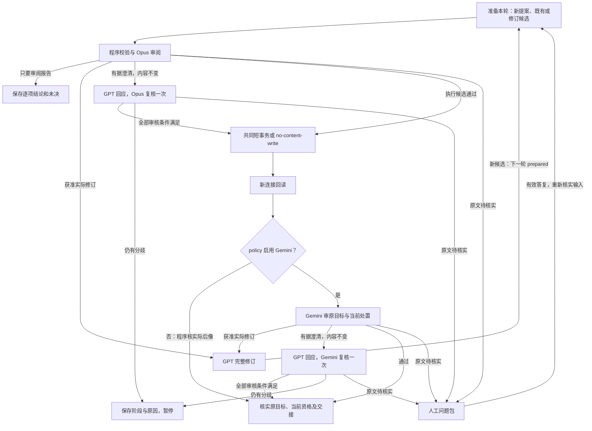

# Claim Management 2.0 operations 与生命周期设计

> **读者**：流程负责人、Solution architect、Developer。
> **类型**：规范。
> **状态**：当前目标设计；新多轮契约未启用。
> **与代码对齐**：2026-10-13；main 基线 `1947a581` 与主控阶段 `9eeb64d` 的交易入口、运行状态及独立 Claim 审计边界已静态核对。本文规定的扩展未实现／验收，不声明现有代码已支持全部 operations。
> **权威范围**：#435 的 operations、完整生命周期、审核与多轮出口、当前可用资格和 Claim 域交接；不授予模型调用、正式内容修改或旧预算重开权限。

Claim Management 的目标是让新建和既有 Claim 都忠于教授的完整自身来源，保留证据、论证和限定，并通过同一套管理流程持续审阅和更新。Create 从 GPT 候选开始；既有 Claim 直接作为候选进入 Review。Verify 是审阅中的核实，Cleanup 是 Update 的用途。

当前新 action 暂停 Gemini 终审，默认采用 [Opus-only policy](../../../backend/pipeline/policies/wang_claim_management_opus_only_v1.json)：`independent_audit=false`、Gemini 调用预算为 0。Opus 内容审阅、版本／来源校验、事务、真实写集、回读和原始目标核实保留；结果明确为 `opus_and_program_readback`，不标成独立终审通过。本文的 Gemini 分支只适用于明确启用独立终审的 policy；既有已绑定任务和完成记录不改变。

Review 就是审阅，作为独立业务 operation 保留。Update 内含审阅、必要修正与独立审计，不需要另发 Review 请求。Create、Retire、Restore、Split、Merge 同样内含审核；这些操作共用现有执行机制。Read 只读取，不触发模型或内容事务。

本域归 [#435](https://github.com/junyang168/smart-answer/issues/435)，共同协调归 [#357](https://github.com/junyang168/smart-answer/issues/357)，下游观点与连接管理归 [#436](https://github.com/junyang168/smart-answer/issues/436)。

遵守 [Project Mission Statement](../00-overview/project_mission_statement.md)、[Solution Architecture](../00-overview/solution_architecture.md)、[Claim 设计](./claim_design.md) 和 [CanonicalViewpoint 设计](./canonical_viewpoint_design.md)。

## 目录

| 节 | 内容 |
| --- | --- |
| [1](#1-目标与共同不变量) | 目标与共同不变量 |
| [2](#2-统一对象与执行模型) | 统一对象与执行模型 |
| [3](#3-现有执行基础与扩展边界) | 现有执行基础与扩展边界 |
| [4](#4-operations-定义) | operations 定义 |
| [5](#5-材料身份与原始任务目标) | 材料、身份与原始任务目标 |
| [6](#6-共同生命周期与恢复) | 共同生命周期与恢复 |
| [7](#7-审阅独立审计与澄清) | 审阅、独立审计与澄清 |
| [8](#8-多轮出口与预算) | 多轮出口与预算 |
| [9](#9-人工核实与来源修订) | 人工核实与来源修订 |
| [10](#10-审核有效性与下游交接) | 审核有效性与下游交接 |
| [11](#11-批处理与验收) | 批处理与验收 |
| [12](#12-实施与阶段交付) | 实施与阶段交付 |

## 1 目标与共同不变量

| 目标 | 不变量 |
| --- | --- |
| 忠实 | 完整自身来源支持每条判断和推理；不添加教导，不漏承重限定，不裁定神学对错 |
| 对象明确 | 稳定身份、内容版本、审核结论、有效状态和下游完成分别记录 |
| 权限明确 | 操作、对象及字段范围在执行前绑定；模型发现问题不扩大写权限 |
| 审核当前内容 | 旧 pass 不批准新内容，原始模型回答不覆盖 |
| 原子提交 | 一个联合变更的内容、history、实际写集、确定性影响和进度同事务生效 |
| 有界恢复 | 轮次共用原 action 预算；unknown 不重发，已提交不重复写入 |
| 最小必要人工 | 工程问题自主处理，只有完整来源仍不能决定的实质疑点转人工 |
| 完整完成 | 每轮通过须支持原始任务目标；Claim 可用、来源覆盖和 CVP 完成分别报告 |

## 2 统一对象与执行模型

| 对象或术语 | 含义 |
| --- | --- |
| Claim／Occurrence | 某份来源中的判断／该判断的一次出现和锚点，稳定 ID 与记录版本分开 |
| Evidence | 观察、经文或推理步骤，含来源、支持资格与 Claim owners |
| 单篇关系／反方节点 | 同源内容的支持、限定、反驳关系；反方立场独立保存 |
| action | 一次获准任务，保存原始目标、权限、policy、总预算、问题和最终结果 |
| 执行单元 | action 中必须共同处置的对象与依赖；一轮至多提交一个联合 ChangeSet |
| 轮次 | 一个执行单元的一份精确候选及其审核、提交、回读和审计进度 |
| 候选 | 完整后像、逐对象处置、实际 delta 与替代映射；既有记录可以原样进入 |
| finding | 有持续身份的问题，带目标、来源、类别、依据、接受条件与各轮处置 |
| read pins | 对象版本、新对象不存在及必要依赖集合的约束，用于写前与完成时复验 |
| ChangeSet | 现有正式写入与版本历史机制，一个联合变更的完整写集 |
| Claim-ready | 当前对象有仍有效且足以支持使用的审核结果；由现有记录派生，不建资格库 |

Claim 域管理 Claim、Evidence、occurrences、必要来源片段、单篇关系和反方节点。原件校订由负责人完成。跨讲身份、ArgumentRoute 与 CVP 连接语义归 #436；Claim 域只登记影响，不代其批准内容。

operation 表达用户要做什么；执行阶段与对象处置表达系统怎样完成它。所有内容写入共用 retain（保留）、update（新记录版本）、create（新对象）、retire（退役）、restore（重新生效）和替代映射，编译到既有 ChangeSet；每个 operation 只增加其必要审核要求。

## 3 现有执行基础与扩展边界

### 3.1 已有基础

main 的 `PostgresKnowledgeStore.apply_plan()` 已使用 PostgreSQL transaction 和事务级写锁。

主控阶段的 [共同 SQL 入口](https://github.com/junyang168/smart-answer/blob/9eeb64d22397c1f7ca03dc4344051e71f11d514e/backend/pipeline/cvp_sql_flow.py) 与 [store](https://github.com/junyang168/smart-answer/blob/9eeb64d22397c1f7ca03dc4344051e71f11d514e/backend/api/canonical_repository/postgres_store.py) 扩展了以下能力；实施基线须包含这些能力，不能仅因 main 已有 transaction 就视为等同。

| 已有机制 | 本设计的使用方式 |
| --- | --- |
| 同一 store、短事务与写锁 | 内容操作编译到共同 ChangeSet，不另建事务框架；Read 和只要报告的 Review 不产生内容写集 |
| read pins、完整依赖与写前校验 | 包含修改对象、共享 owners 和必要只读依赖；漂移时拒绝提交 |
| 实际写集、RETURNING、后像与 history／edges／review_events 核对 | 验证实际发生的全部修改及确定性副作用，任一晚项失败全部 rollback |
| 依赖失效及 affected runs 更新 | 随内容提交登记影响并使受影响运行回到待审计状态 |
| pipeline_runs 的 prepared／reviewed／applied／audited | 保存 action、阶段和结果，completion 文件仅供展示 |
| 原调用 intent、raw、输出位置及跨 root 身份 | 扩展同一预算的轮次，不另建调用账本 |
| 已提交身份优先与新连接回读 | lost reply 后查实际 ChangeSet，接续回读与审计，不重复 apply |
| no-content-write 分支 | 正确既有 Claim 可完成审核，不制造内容 revision 或空业务写集 |

共同交易与恢复依据是主控的 [CVP 交易與恢復設計 v2](https://github.com/junyang168/smart-answer/blob/9eeb64d22397c1f7ca03dc4344051e71f11d514e/docs/wang-knowledge-platform/20-knowledge/cvp_transaction_workflow_v2.md)。[PR #428](https://github.com/junyang168/smart-answer/pull/428) 是交付定位，不是本文对合并或生产验收的替代声明。

### 3.2 本次需要扩展的责任

新增责任集中在现有契约内：operations 的权限与对象映射、有序多轮候选及 findings、各 operation 的完整独立审计问题、Claim-ready 与已存在失效／completion 的对应。复用 SQL 进度、审核记录和 artifact 引用，不建另一套状态数据库或独立证明框架。

沿用现有单一使用者、批次串行的运行前提；新 Claim 多轮不顺便引入并发调度。已有读依赖校验和事务锁继续防止人工改动、过时输入及实现错误。若未来改变运行前提，需单独验证调度，不能从本规范推导并行写入许可。

## 4 operations 定义

### 4.1 操作、审核要求与完成

本表是各 operation 的唯一差异定义。内容操作的“完成”均须满足第 6–10 节共同规则。

| Operation | 输入与处置 | 必须核查 | 完成结果 |
| --- | --- | --- | --- |
| Read | 指定当前／历史对象，只读取 | 版本、来源、当前可用性、退役／替代及缺失披露 | 返回可追溯材料；不触发模型或内容写入 |
| Review | 既有或新候选；只审阅，不自动修改 | 完整自身正文、归属、限定、Evidence、单篇关系与请求指定的处置 | 逐项报告，保留未决；要求确认当前可用性时继续独立审计或复用有效审核 |
| Create | 指定来源范围；create 必要 Claim、Evidence 与关系 | 自身来源、归属、非重复判断、限定、论证、绑定与支持资格 | 新对象 Claim-ready；来源覆盖另计 |
| Update | 指定既有对象；retain 或 update，内含审阅 | 同一来源判断、修改依据、完整后像；共享 owners 与关系两端的支持仍成立 | 当前对象 Claim-ready；正确对象可原样保留 |
| Retire | retire 对象，保留历史 | 历史前像、退役理由、原教导处置与消费者影响；不要求错误旧 Claim 为真 | 退役合理、影响已登记；不产生旧对象 Claim-ready |
| Restore | restore 退役对象，形成新生效版本 | 退役原因已消解、当前来源成立、完整内容合格、无重复有效替代 | 当前对象 Claim-ready；不复活旧 pass 或旧消费者 |
| Split | create 多个对象、retire 原对象及映射 | 原始对象与全部最终对象间的判断、限定、位置、Evidence／关系无遗漏、无增加 | 最终对象均就绪，旧对象退役，映射与交接完整 |
| Merge | create 新对象、retire 全部旧对象及映射 | 同源同判断确属重复，全部有效材料保留，无虚构综合 | 新对象就绪，旧对象退役，映射与交接完整 |

Split／Merge 产生新 ID。跨讲同看法交 CVP，不 Merge 成单一 Claim；不提供正常内容物理 Delete。来源覆盖任务中遗漏教导的处置见第 11 节。

### 4.2 权限与提交边界

Update 可在获准范围内联合修正 Claim 表述／归属／类型／经文／限定、occurrences、Evidence 表述／绑定／owner／资格和单篇关系。Evidence 补入不批准扩大 Claim；解绑保存理由；最后一个支持 Evidence 被撤回时，Claim 不可继续就绪。反方改标签不能成为教授立场的支持证据。

程序在准备候选时固定执行单元：必须协调修改才能保持语义及引用一致的写项共同提交，不能丢掉失败写项后提交其余部分。Split／Merge 的新旧对象与映射必属同一单元。只读共享 owners、关系两端和必要来源进入 read pins 与审核范围，不因被读取而进入写集。

独立单元可串行推进；重叠的只读依赖在下一单元提交前重新核验，因前次提交变动时重新准备候选。共同依赖需要协调写入时合并单元；不能仅按 Claim ID 拆批，也不能因共读一份来源就自动把全篇变成一个写入事务。

原许可内的修订和补偿自动推进，无须每轮另发 Review 请求；确需范围外修改时记录准确需要并暂停相关单元。初始许可明确恢复操作及对象范围，模板不会自动授予 Restore、Retire 或新建权限。整代重新抽取与局部维护分别授权。

## 5 材料、身份与原始任务目标

### 5.1 共同材料

| 材料 | 必须绑定 |
| --- | --- |
| 请求与目标 | 原始目的、目标清单／来源范围、允许操作和字段、所需结果、policy 与预算 |
| 对象与来源 | 完整前像、有效状态、审核与必要历史、完整自身正文及物理版本；其他来源明示为上下文 |
| 候选与依赖 | 完整后像、逐对象处置、delta、替代映射、全部必要 owners／关系／消费者；区分只读与可写 |
| 问题与证据 | 旧 findings 的解决／持续／重开、新发现、回应及来源核实记录 |
| 执行与验收 | 调用身份、原始回答、完整写集、影响登记、原始与当前目标对应、审核要求 |

材料缺口先作工程处理；不能让模型在残缺包上判断原文有错。人工核实记录是有来源绑定的新证据，不能当作批准结论。

### 5.2 原始目标持续有效

首次 prepared 固定 action 原始目标、必要前像和第 4.1 节规定的审核问题，各执行单元明确承接哪些原目标。后续轮次使用实际 current 作写入前像，但不替换原始目标。替代映射、补偿和新发现追加对应对象与审核义务，不能删除旧义务或用新对象数替换原目标数。

每轮 Opus 和 Gemini 都核该单元的原始目标、必要历史与当前完整处置。Opus 收到累计未决；Gemini 按第 7.1 节先独立判断、再对账累计未决。结构操作后续改用 Update／Retire 时，仍审其原始 Split／Merge 的完整映射与内容保留；不能只审最后一次操作。旧记录错误或反方成分须有审核过的纠正／退役／反方处置，不强行保留为教授主张。

单元完成由程序核对所有原目标与追加义务均有精确当前版本的有效审核、没有未决、映射及交接完整。最后一轮正常 Gemini 审计覆盖该单元原始操作要求与本轮处置；无变化部分按第 10 节复用仍有效的结果，不额外增加一次“任务终审”。action 汇总完成时再次核实所有原目标与各单元的当前有效性；后续提交使已完成单元失效时，经同一依赖机制恢复待审计，不能只统计旧 audited。局部完成可以保留，不能冒充整批完成。

### 5.3 对象与问题身份

同一来源判断的误抽措辞、否定或遗漏限定可 Update，由位置和完整语境证明仍在修正同一判断；另一判断另行 Create；没有对应判断则 Retire；边界变化才 Split／Merge。

finding 身份按原 action、目标判断／成分、问题类别与来源依据固定，各轮版本另绑；不按模型理由文字或当轮 SHA 改名。Split／Merge 的映射承接旧问题和预算，无法确定对应时暂停核实。每个候选／回应有独立请求身份，累计仍归原 action。

历史跨来源 Claim 可 Review：分别展开每份完整自身来源，逐来源判断，不拼成某一份的论证。已有审核按第 10 节判断是否仍有效；需要修改为单来源记录时，按原许可 Split 并保留映射，没有权限则报告待迁移。来源别名由来源管理确认，不由 Claim 模型自行合并。

## 6 共同生命周期与恢复

### 6.1 共用审核与执行路径

Read 按读取契约返回。Review 只要求报告时，Opus 审阅后保存逐项结论和未决即可完成，不修改 Claim／Evidence，也不自动开展修订。Opus 明示为实质异议、且经程序核验完整材料、引文与版本的 finding，按第 10.2 节原子登记问题与受影响资格；未经核实的提示只留在报告，不据此撤销有效结果。要求独立核实或确认当前可用性的 Review，沿执行路径使用 no-content-write，不因操作名称省略缺少的审核。

所有内容操作沿提交后核实路径：准备 → Opus 审阅与必要修正 → 共同短事务 → 新连接回读 → 原始目标与当前资格核实。policy 启用 Gemini 时，回读后追加其独立内容审计；暂停时由程序核对实际 SQL 完整后像与获准计划，不安排第二个内容模型。模型和人工等待始终在数据库事务之外。

Claim action 不以每次整库备份或外接 SSD 可用作为前置条件。原子 transaction、精确版本／来源校验、实际写集验证、ChangeSet／版本历史和独立回读承担业务修改的保护；提交后发现的内容问题由获准修订或恢复处理，不把已提交事实冒充事务撤销。整库备份属于数据库运维的灾难恢复职责，与单条 Claim 操作分开。

| 节点 | 职责 |
| --- | --- |
| 准备 | GPT 提议新对象；既有对象直接作候选，保留真实 provenance；固定本轮版本与原目标 |
| 程序校验与 Opus 审阅 | 校验材料和权限；审完整候选、处置与影响，正确内容允许保留 |
| GPT 完整修订 | 依具体 findings 修正完整后像，按原 action 预算重新审核 |
| 澄清复核 | 程序核引文、问题与版本绑定，只回原审核角色；详见第 7 节 |
| 报告／暂停 | 保存原答、未决及范围；暂停另保存 checkpoint、原因和恢复条件 |
| 共同短事务 | 校验 read pins，提交完整联合写集或已有 no-content-write 核实 |
| 新连接回读 | 确认实际提交；回复丢失先查事实，不再 apply |
| policy 启用 Gemini？ | 按原 action 的绑定配置选择终审路径，不运行中切换或重开预算 |
| Gemini 审计 | 独立读原件、当前与必要历史，审核原始操作要求和当前完整处置 |
| 人工问题包 | 准确来源疑点转人工；来源返回路径见第 9 节 |
| 完成核实 | 验证第 5.2 节原目标和第 10 节资格／交接；Claim 完成不替代 CVP 完成 |

### 6.2 每轮进度与恢复

Opus 或 Gemini 要求实际修订时，新完整候选均进入下一轮 prepared；原未提交轮次也保留其审阅及问题记录。每个执行单元的每轮在现有 pipeline_runs 中使用独立运行身份，关联同一原 action 和前轮。下表 checkpoint 只表示该轮；原 action 汇总目标、当前各单元轮次、总预算及结果，不用一枚循环 checkpoint 代替所有轮次。具体运行 metadata 和索引接入现有机制，属于待实现扩展。

| checkpoint | 已成立事实与恢复入口 |
| --- | --- |
| prepared | 本轮输入和权限已绑定；从校验／审阅继续，不重复未知调用 |
| reviewed | 精确候选已获 Opus 通过；提交前仍核 current 和 read pins |
| applied | ChangeSet 已提交或 no-content-write 已确认；从回读／独立审计继续，不再 apply |
| audited | 本轮规定审计和当前核实已完成；不等于整个 action 或 CVP group 完成 |

一次失败不抹掉 applied。审计拒绝保存原答与未决，checkpoint 保留 applied；需要实际修订时另建下一轮 prepared，前轮不回退。恢复按该单元最新一轮身份和它的实际提交事实定位；原 action 的旧已提交记录仍可解析，不能因看到任意旧 applied 就跳过新一轮提交。

提交后拒绝可能否定操作本身。补偿按实际 current 生成获准新候选与 ChangeSet，继续满足原始目标；不自动回灌旧快照。没有所需补偿权限时暂停，保存已提交事实与当前不可用原因。

## 7 审阅、独立审计与澄清

### 7.1 角色与输入

GPT 6.1 Sol high 订阅负责提案、修订和回应；Opus 5.5 high 订阅负责审阅完整候选；Gemini 负责独立终审。新的 [Argon policy](../../../backend/pipeline/policies/wang_claim_management_argon_v1.json) 精确绑定 `gemini-4-argon`，既有 Flash policy 仍绑定 `gemini-3.8-flash`，不得改变已启动 action 的模型或重开其预算。policy 绑定精确模型 ID、backend、effort、prompt 与 schema，角色名称不代替执行配置。

当前默认 Opus-only policy 不预留或调用 Gemini；其内容结论来自 Opus，完成资格同时绑定实际 SQL 后像、当前依赖和程序回读，`independent_audit_complete=false`。重新启用需为新任务明确选择 Argon policy，不改写已有任务的审核类型。

Opus 读取候选及 delta，以来源判断，不沿用 GPT 自评或旧批准。Gemini 使用自己的读取路径直接核物理原件、实际当前与必要历史、完整操作处置及理由、原始目标、已绑定来源核实记录和必要依赖；首次判断不由 GPT／Opus 的 pass 引导。先保存首次独立判断，再对账旧问题和异议回应。

复用已有 layers 1／2／3，扩展现有独立 Claim 审计以覆盖第 4.1 节要求，不另建审计器。零对象、少项、重复项、抽样、被删减原文或默认 active-only 查询不能满足完整终审。新对象、退役旧对象、所有受影响共享 owners 和必要关系均进入相应审核范围。

### 7.2 findings 与 Opus 指令

一份回答返回各项 verdict、旧问题解决／持续／重开和全部新发现。finding 带精确版本、typed 类别、来源引用、疑点、已查语境、接受条件或具体人工问题；程序核分母、逐字引文和版本，原答不改写。

> 审完整自身原文、完整候选与操作处置，主动报告提议者未发现的问题，不只审修改片段。
>
> 原文清楚、记录有错时，给具体修订接受条件。原文疑点先查说话者、反方引述、对象、时间、条件、否定和模态；完整语境仍不能决定时，提出可核实的人工问题。
>
> 材料、schema 和版本问题归工程；不裁定神学、不自动校订原文、不创造调和解释、不删教导来通过。正确内容允许保留。

### 7.3 实际修订与有据澄清

实际修订须有具体未决、接受条件、可执行方向、来源、权限与剩余预算。程序核真实 delta，Opus 判断是否解决问题；问题数量下降不代表进展，新发现不丢弃。

澄清保留完整候选，只指出审核误引、漏读的精确原文或误用既定标准；不能只说不同意或引用另一模型 pass。同一候选／来源／稳定问题最多一次，计入原角色调用与 action 预算，只由原审核角色处置。保存原拒绝、回应和复核原答，不能改写旧 raw。

程序先核候选、来源、依赖及问题绑定一致；内容或审核依据变化须重新准备并审核。Gemini 澄清不重走 Opus、内容提交或另一轮完整初审。只有该阶段全部问题已处置、全部条件满足，才能推进；消解一个 finding 不等于全部通过。

无有效回应或复核仍有分歧时先暂停并作根因检查，不自动转入改写，也不反复问到同意。若后来已有来源支持的实际修正方案，按第 8 节核查恢复条件后走正常修订；不能把未解决的语义分歧靠换措辞隐藏。Gemini 的原异议必须由 Gemini 消解，最终绑定首次判断与有效处置并披露历史分歧。

## 8 多轮出口与预算

### 8.1 结果与暂停原因

结果统一为完成或暂停未完成；暂停原因独立记录，业务结论与 checkpoint 不互相代替。Read／只要报告的 Review 按其报告契约完成，保留未决，不把报告完成说成内容通过。执行维护和资格确认按下表结案。

| 结果／原因 | 条件与接续 |
| --- | --- |
| 完成 | 原目标与追加义务均满足；当前版本审核、问题处置、映射和交接完整，所有原目标项完成 |
| 必要人工 | 排除工程与漏包后，完整原文仍不能决定转录／归属／实质冲突；保存问题包，按第 9 节接回 |
| 工程／资源 | schema、漂移、hold、缺审核、unknown、quota 或提交状态不明；修好后按 checkpoint 接续，不盲重发或降级 |
| 权限不足 | 必要操作或范围超出许可；不扩大写集，后续许可按既有授权机制绑定且保留旧账 |
| 无进展 | 重复／振荡或澄清后仍有分歧；先根因检查，只有出现有效推进路径才可恢复 |
| 预算耗尽 | 预绑定上限不足以覆盖下一轮全部规定步骤，含独立审计与完成核实；准备时阻止推进，提交前复验，不主动提交已知缺终审预算的候选；不能换 root／finder／父任务重开 |

恢复同一 action 须有明确原因消解、有效输入、原权限和原预算；语义分歧仍在且没有来源支持的具体修正方向时保持暂停；出现该方向时按第 7.3 节从正常修订恢复，保留原异议及暂停记录。来源版本改变、范围改变或原预算不可继续时，后续 action 必须另有明确授权，关联原目标、未决与已提交事实，不隐藏失败。模型分歧和预算耗尽不单独成为内容人审理由。

### 8.2 一个预算和进展判断

首次调用前 policy 固定最大修订轮次、各角色调用上限和请求／输出资源界限；有合计资源上限也同时绑定，缺值不执行。独立审计预算计入 Gemini 的角色上限，澄清计入原角色上限并受第 7.3 节每问题一次的限制，不另开账本。所有单元和轮次共用原 action 总量，准备下一轮前按已有 intent／预留机制覆盖全部规定调用及资源，提交前复核独立审计的预留仍有效，不能只预算 GPT。预留不保证 provider 可用；quota 或 unknown 仍按原 checkpoint 暂停，不盲重发。

调用预留、unknown 和总量核对复用已有 ledger。首次候选不计修订次数，后像实际变化才占用一个新修订轮次并建立新运行身份；澄清不占修订轮次但计角色调用。内容指纹忽略纯 mechanical provenance，A→A 不算修订，A→B→A 触发振荡检查；合法澄清另存类型。根因检查核材料、版本、权限与审核标准，不自动增加模型仲裁。已有效完成部分不因其他项预算耗尽被取消，缺审部分也不因此获准。旧一轮 policy、raw、预算和 campaign 均不重开。

## 9 人工核实与来源修订

### 9.1 人工核实的返回

Opus 或 Gemini 可主动提出原文疑点。程序先核完整材料、引文、版本与位置；工程问题修复后恢复。问题包包含原答、精确对象／来源版本、原文位置／录音区间、上下文、检查结果、可能解释、一个具体确认问题及已知影响。

| 人工返回 | 接回方式 |
| --- | --- |
| 确认字面原文无误，核实归属／说话者等 | 保存可追溯核实记录与录音／笔记依据，绑定原来源位置；审核者读取该新增证据 |
| 确认逐字稿文字错误或需校订 | 负责人修订原件并产生新来源版本，再绑定后续 action；不能以备注替代源文校订或绕过逐字锚点匹配 |
| 解释或接受候选 | 明示人的判断；没有原件证据仍保留来源未决，不冒充教授原话 |
| 无法确认／暂缓 | 保留未完成与依赖，不生成确定内容 |
| 授权新操作 | 单独登记执行许可，不等于内容审核通过 |

答复后重新核来源、依赖、权限与预算；按第 8 节恢复或建立有授权的后续 action。需要修订时仍走 Opus 与完整独立审计。模型不能无视绑定证据，也不能只凭“人批准了”给 pass；原拒绝、人答复和新判断分别保存。

### 9.2 原文只改一段或几段

来源维护产生一次可核实的版本交接：完整新旧原件及 SHA、完整段落差异、段落对应表、绑定旧版本的依赖清单。Claim Management 消费这份交接，不再制作第二份对应表，也不增加 operation。新来源版本注册行与依赖影响登记在同一短 DB transaction 内成立；物理原件仍按第 10.2 节的文件版本边界核实。旧审核与历史内容保留；当前是否可用由第 10.1 节派生，不增加“待确认”状态字段。

依赖清单按实际旧来源绑定和反向依赖取得，覆盖 SourceFragments、Evidence、Claims、关系及下游消费者，也包括自身属于别的来源而使用了该来源 Evidence 的 owner。改动段落的直接引用是必须维护／检查的最小集合。来源内其余 Claims 和上述间接 owners 仍须进入语境影响审阅：新增段落可能补充、限定、否定或改变未改引文所支持的判断，不能因没有锚点或引文未改而排除。

段落编号只表示版本内位置。插入、删除、移动、拆合与重复文本必须显式对应；不能按同一 `S` 编号或第一次文本匹配猜新锚点。来源维护仅对已证明唯一对应、逐字引文及位置正确的项提出机械绑定迁移。凡存储字段实际改变，仍由共同 ChangeSet 升 storage revision、写 history；不另造“语义 revision”，也不伪造新批准。第 10.1 节的机械复用证明须覆盖迁移前后完整后像，单凭 migration 标签不获资格。Claim payload 完全未变的项保持原 revision。

**语境影响审阅就是一个 Review action。** 其版本化 policy 固定“新旧来源变化是否影响已有判断和审核依据”的问题范围，原 action 绑定完整 Claim 分母、新旧来源、差异、当前对象／依赖和可复用的旧审核。资源限制时划分执行单元，各单元共用第 8 节的原总预算；批间来源变化时停止，后续 action 另有授权并关联旧未决。模型读取完整新旧自身原文及每项 Claim 与证据，不抽样、不只读 diff。

该 Review 走已有 prepared → Opus → no-content-write → 新连接回读 → 独立 Gemini 的路径；Gemini 自己读新旧原件和实际 DB。这里的通过表示**影响结论可信**，不表示所有目标 Claim 内容合格。报告同时保留逐项影响结论、具体 findings 和维护方向；需要修改的项不因报告完成变成 Claim-ready。澄清、分歧、人工与预算出口仍用第 7–9 节。它不是第 4.1 节通常的全内容资格确认；policy 能力及实际已答问题必须明确区分，不能拿影响审阅充当缺失的完整内容审核。

| 逐项影响结论 | 接回既有流程 |
| --- | --- |
| 判断与审核依据不受变化影响 | 在既有审核记录中保存来源适用性复核事件，绑定原有效审核、当前对象／依赖、新旧来源及本次 Review／Gemini 结果 |
| 内容、锚点、Evidence 或关系需要维护 | 保存具体 finding 和接受条件；按明确许可进入 Update、Retire、Restore、Split 或 Merge，继续正常多轮审核 |
| 完整来源仍无法确定原文或归属 | 按第 9.1 节保存人工问题包；未决项继续受保护 |

无影响结论与当前资格分别判断。只有先前完整审核存在、问题范围足够且对象／依赖未发生未解释漂移时，适用性复核才能让旧审核覆盖新来源版本；缺审核、已有未决或 hold 的项继续保留这些事实。复核事件使用现有 review_events／pipeline_runs 及共同证明消费边界，不新建状态库、不递归重建历史链。机械绑定迁移有真实新 revision 时，复核引用精确迁移证明而非要求 revision 字面相等；Claim 内容确实修改则走正常维护审核。复用后的证明直接绑定必要当前依赖和实际审核，下一次消费不回放整条版本链。

Review 中发现新增或此前遗漏的教导，按第 11.1 节登记来源覆盖义务：许可内 Create，范围外保存后续处置。影响报告完成、目标 Claims 当前维护完成、来源覆盖完成和下游完成仍分别核实。未处置的维护、人工或覆盖义务使来源修订保持部分完成；CVP 和文章按第 10.3 节继续受保护。

这样，完整新旧来源负责判断，差异与依赖负责定位，实际必要对象负责写入。确认无影响的 Claim 不重走生成流程，也不通过改业务内容制造新资格。现有段落维护实现提供机械绑定迁移；这里的 Review policy、来源适用性事件及当前消费仍须共同接通并验收后启用。

## 10 审核有效性与下游交接

### 10.1 当前可用与审核复用

Claim-ready 是下游使用当前合格 Claim 的共同派生判断；至少要求完整当前对象、Evidence、来源和必要单篇关系有适用的有效审核，没有未处置实质 finding、hold 或依赖漂移，写入／无变化核实及影响登记成立。不另建“历史资格”和“2.0 资格”。

`review_status` 记录审核结论，`maturity` 记录治理／出版阶段，二者保留既有含义，不单独作为当前可用的开关。`approved` 不自动证明独立审计已完成，`candidate` 也不替代检查实际审核记录；新流程完成须按既有字段语义同步适用结论，不留下字段与审核事实矛盾。治理或可见性限制仍须满足，Claim-ready 不授权发布。

审核记录绑定精确对象／来源／依赖、规则版本、已覆盖的第 4.1 节问题与范围。覆盖能力由版本化 policy 固定声明，以程序匹配，不让运行模型自称覆盖。旧版本按明确已知能力映射；记录缺失或覆盖不明不能推定已经审核。人工结论保留真实身份与依据，不自动等同模型独立终审。

新流程上线或一般代码变化不触发全库重审。内容、来源、依赖和适用问题范围仍有效且无未决时复用；超出原审核范围或绑定不一致时，只重审受影响单元的完整必要问题，不新建“补一个问题”的审计器。纯机械 metadata 改动由程序证明内容、语义和引用不变，再决定是否复用；不能仅凭字段标签绕过审核。

### 10.2 失效与事务

内容修改、来源／依赖变化、证据损坏、确认的规则缺陷或当前实质 finding，使相关审核失效或不足，记录准确范围和原因；新内容不借旧 pass，无关有效结果继续保留。初步未核实提示与正式异议分开，工程请求失败不自动否定仍有效的旧结果。

内容写入与影响登记使用共同短事务，涵盖 history、实际写集、依赖失效、受影响运行和本轮 checkpoint；写前核所有 read pins 与新出现的必要依赖。Review／无内容变化发现的正式问题也须由现有问题登记与失效机制原子保存，不能只写报告而遗漏当前使用保护。

新流程 applied 后缺适用终审的版本保持待审计，不能凭 active、旧 review_status 或旧 proof 宣称当前可用。所有下游当前读取都核同一可用性规则；历史可展示，不冒充最新已核实。审核完成后共同 completion 短事务复验当前 pins、未决、目标对应与影响，再登记结果。

物理来源不受 DB transaction 锁保护；沿用来源不被外部并发修改的运行前提，准备、审计、完成与消费均按既有来源版本检查，漂移即停止。改变这一运行前提须另行验证，不能用 SQL 锁声称已保护文件。

### 10.3 下游影响

修改或审核失效都通过同一依赖机制登记 affected runs、共享 owners、单篇关系、CVP links 和其他消费者。Claim-ready 可以先成立而 CVP pending；Claim 完成须证明影响已持久登记、未完成依赖受到保护，不能顺手清除 CVP 的语义待验。

旧目标及原依据按历史版本可解析，但不能作为已退役／失效的当前有效输入。结构变更、替代映射与失效义务同事务成立；validator 核历史可解析、当前消费被阻止、待验义务完整。映射不自动批准新连接，Retire／Restore 不自动撤回／复活全部 links。

共同 store 尚不能表达某种 operation 的合法待验状态时，该 operation 尚不可执行；补共同引用与失效规则，不以逐案例豁免或自动改 link 语义让写入通过。

## 11 批处理与验收

### 11.1 两种分母

指定 Claims 以原始清单为分母，逐项报告保留、更新、替代、退役或暂停原因。来源整理另以来源覆盖为分母：现有 Claims 全通过不代表来源无遗漏；新发现保存来源绑定候选，许可内 Create，范围外登记后续处置。遗漏被接收或有审核过的处置后，来源覆盖才可完成。

独立单元可完成，整批仍未完成；只读依赖和写权限分别管理。Split 子对象数不替换原项，第 5.2 节统一约束最终验收。Review 报告完成、内容维护完成和来源覆盖完成分别报告。

### 11.2 典型任务

“审阅这组 Claims”：逐项准备完整来源，Opus 给出结论与问题，保存报告即可完成 Review；发现的问题保留。若请求还要求确认当前可用性，再完成独立核实，不自动更新内容。

“清理这组 Claims”：进入 Update，已有内容直接作候选；问题在许可内多轮修正，正确对象原样保留，审核及交接完成后结案，无须用户再请求 Review。

“把 C 拆成 A、B”：原始 C 与完整映射成为持续目标。Gemini 发现 B 漏限定后，下一轮 Update B；最后正常审计仍核 C 到当前 A、B 的内容与映射，不能只以 B 修改通过结案。Merge 使用同一规则核全部原对象到当前新对象。

“这条 Claim 不该保留”：Retire 审退役理由和原教导去向。提交后发现退役错误，只有原许可覆盖 Restore 才执行补偿；重新生效版本仍须审核，旧 links 不自动复活。

“原文可能有错”：引文与完整材料先核实；确认转录文字错误须校订源文并绑定新版本。若只确认归属且字面无误，核实记录进入审阅材料；来源仍不能决定时保持未完成。

### 11.3 验收矩阵

| 场景 | 必须证明 |
| --- | --- |
| Read／Review／Update | Read 无模型；Review 报告完整但未决仍在；Update 自带审核，正确对象可原样保留，无伪造 GPT provenance |
| Create 与多轮修订 | 初稿正确零修订；旧 findings 跨轮保留；新后像重新完整审核，不以问题数量代替进展 |
| Split／Merge 后修订或补偿 | 当前版本作写前像，原始目标作验收基准；最后 Update 通过不掩盖原对象内容／映射遗漏；无额外任务终审调用 |
| Retire／Restore | 审前像、理由与教导处置；错误退役需获准补偿；Restore 不复活旧 pass／links；无权限就准确暂停 |
| 共享 Evidence 与批次 | 共需写入的项不可拆；只读 owner 不自动入写集；重叠依赖串行重验；独立项完成不冒充整批完成 |
| 审阅误读 | 一次有据澄清只回原角色；仍有分歧先暂停，有来源支持的实际修正方向才能恢复；未改内容不重新提交，消解一项不等于全部通过 |
| 人工与来源 | Opus 主动发现原文疑点；核实证据进入 Gemini 输入；文字错误校订源文；解释不冒充原话，工程不转内容人工 |
| 局部来源修订 | 全文新旧版本可核；直接与语境影响都覆盖；未改引文但新增限定的 Claim 进入维护；无锚点新增教导成为覆盖义务；插入／删段／重复文本不猜对应；无影响复用保留旧审核身份，未改 payload 的 Claim 保留 revision，实际迁移字段仍写版本历史；缺审核项不获资格 |
| 共同 transaction | read pins 漂移、额外依赖、错误写集、晚项 validation／history 失败均整体 rollback；影响与进度同事务成立 |
| 中断与恢复 | 第 1 轮 applied、第 2 轮 reviewed 时定位第 2 轮；lost reply 查提交事实，不重复 apply；无内容变化不造 revision |
| 审核有效性 | 上线不全库重审；改后不继承 pass；覆盖不明不豁免；正式 finding 与失效原子保存；审核字段不代替当前检查 |
| 预算与交接 | 单元／轮次共用总预算；预算只够 GPT／Opus 不够 Gemini 时准备阶段停止，不能提交；角色预留不免除 quota／unknown 暂停；不换 root 耗尽后重开；Claim-ready 与 CVP pending 分开 |
| 历史和覆盖 | 跨来源逐源 Review、获准迁移；退役对象不被 active-only 漏掉；遗漏教导不丢失，新旧 source 不串用 |

先用真实保存材料零模型、零正式内容写入预检，再在隔离 SQL 验证完整生命周期。合成 reviewer 只证明契约与路由；有界实际模型验收另需授权。性能与人工成本记录有效轮次、重复调用、依赖复验与各类暂停，实测存独立记录，不把局部测试称为全流程完成。

## 12 实施与阶段交付

先固定包含共同 SQL 能力的合并基线、代码 SHA 与新 policy，再扩展现有运行 metadata 的 action／单元／轮次绑定、问题身份和审核范围，对接 operations、共同 ChangeSet、独立审计与 completion。复用 source／Claim runner、store、pipeline_runs、原 ledger 和独立读取器，不复制未合并实现，不新增 runner／状态库／证明框架。

交付依第 11 节完整路径验收；先共同材料与多轮恢复，再 operations 和当前可用／影响机制，最后预检及另行有界验收。本文不重开旧 campaign，不授权文章、发布、部署、ArgumentRoute 或 #358。设计 PR 使用 Refs #435、Refs #357，实施及主控继续开放。
