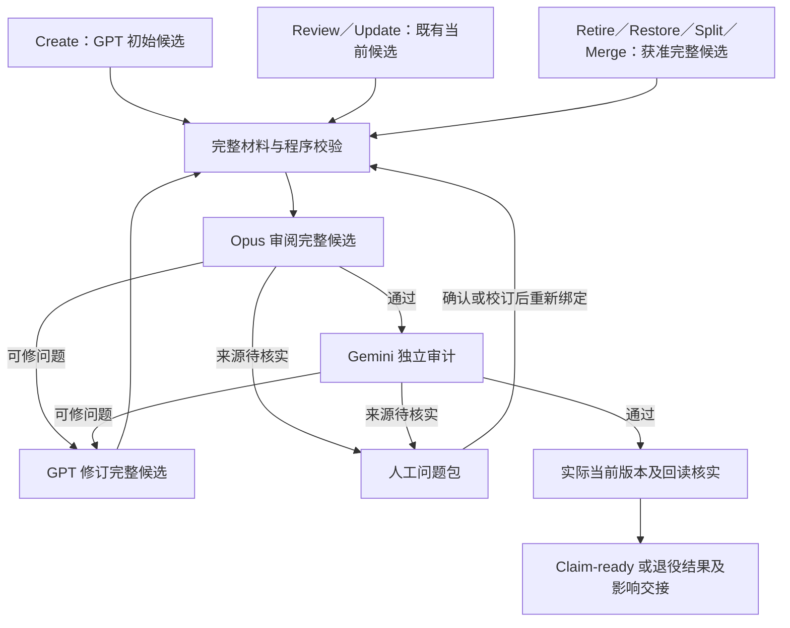

# Claim Management 2.0 operations 与审核流程设计

> **读者**：流程负责人、Solution architect、Developer。
> **类型**：规范。
> **状态**：当前目标设计；未启用为生产契约。
> **与代码对齐**：未核对；第 13 节仅列实现定位，不声明功能已实现或验收。
> **权威范围**：#435 的业务 operations、对象边界、共用审核流程、多轮出口、人工恢复及 Claim-ready 交接。受使命与架构约束，不授予模型调用、正式内容写入或旧预算重开权限。

Claim Management 要使新建和既有 Claim 都忠于教授的完整自身来源，保存论证与限定，并能持续审阅和更新。已有代码从 creation 演化而来；业务操作应按对象及目的定义，再映射到现有 runner，不能把所有维护都解释为重新抽取。

本域属于 [#357 主控](https://github.com/junyang168/smart-answer/issues/357)，实施归 [#435](https://github.com/junyang168/smart-answer/issues/435)。[CVP Management #436](https://github.com/junyang168/smart-answer/issues/436) 接收当前可用 Claim，并负责连接、观点和全部下游影响结案。共同目标设计随主控交付；本规范细化 Claim 域，不重跑已完成 campaign。

## 目录

| 节 | 内容 |
| --- | --- |
| 1 | 目标与约束 |
| 2 | 对象和术语 |
| 3 | operations 总表 |
| 4 | 操作契约与身份版本 |
| 5 | 各操作的内容规则 |
| 6 | 创建与既有 Claim 的共用流程 |
| 7 | 审阅契约与 Opus prompt |
| 8 | 多轮修正与出口条件 |
| 9 | 原文问题与人工恢复 |
| 10 | 当前证明、写入与 CVP 交接 |
| 11 | 批处理与执行恢复 |
| 12 | 模式与验收矩阵 |
| 13 | 现有机制复用与交付 |

## 1 目标与约束

| 目标 | 可检验结果 |
| --- | --- |
| 忠实且完整 | 判断、归属、限定及论证均能回到完整自身来源；没有新增教授未教导的内容 |
| 清晰 operations | 每项操作有输入、权限、完整后像、影响和完成条件，不以发现者或生产 group 推导权限 |
| 复用同一流程 | GPT 初稿和既有 Claim 从不同入口进入同一审核与必要修订流程 |
| 有效多轮 | 修正可持续推进；重复、振荡、无进展和预算耗尽不会被当作通过或自动转人工 |
| 必要人工 | 只转无法由完整材料解决的来源／内容问题，工程问题自主处理 |
| 当前可用与完整交接 | Claim-ready 绑定当前内容及独立终审；准确登记全部影响，CVP 完成另计 |

遵守 [Project Mission Statement](../00-overview/project_mission_statement.md)、[Solution Architecture](../00-overview/solution_architecture.md)、[Claim 设计](./claim_design.md) 和 [CanonicalViewpoint 设计](./canonical_viewpoint_design.md)。不判断神学对错，不把编辑归纳当原话，不用其他讲道补成这一篇未讲过的论证。

不为降低人工成本删除难处理材料或略过独立审核。设计、离线验证、实际模型验收及生产结果分别报告；没有实测不声称成本下降。

## 2 对象和术语

| 术语 | 含义与归属 |
| --- | --- |
| Claim | 教授在某一份来源中表达的判断；稳定身份与记录版本分开 |
| 自身来源 | 该 Claim 对应的完整教授正文及其精确物理版本；其他来源只能作明示上下文 |
| Occurrence | 同一来源中该判断出现的位置，内含引用锚点；不同讲道的同一看法由 CVP 关联 |
| Evidence | 教授的观察、经文或推理步骤，及其来源绑定、支持资格和 Claim owners |
| 单篇论证关系 | Claim／Evidence 的支持、限定、反驳等具体关系；反方立场独立记录 |
| action | 一次获准操作及其输入、权限、policy、预算和有序历史；不是一次模型调用 |
| 前像与后像 | 修改前记录与候选完整修改后记录；后像不能只是字段补丁 |
| finding | 审阅发现的具体问题，带对象、来源位置、类型、依据和接受条件 |
| Claim-ready | 当前 Claim／Evidence／来源经完整独立终审且实际回读一致的可用证明；不是人工批准 |
| 影响集合 | 实际改变影响的全部共享 Evidence owners、关系、CVP links 和其他消费者 |
| ChangeSet | 现有正式版本化写入机制，保存完整写集、history、current 和回读 |

Claim Management 管 Claim、Evidence、occurrences、必要来源片段、单篇关系及其审核资格。原件校订归负责人；本域只提出问题及接收校订后的来源。

CVP 核心、身份、成员角色、连接类型、端点和完整下游结案归 CVP Management。Claim 域登记影响，不以 Update 权限批准 CVP 语义变更。单篇反方节点及关系只在来源内处理；跨讲约束不因本域权限自动可改。

## 3 operations 总表

Verify 是 Review 中的核实工作；Cleanup 是 Update 的用途。批处理是固定范围上执行操作；retry、resume、回读和 rollback 是执行机制。它们都不额外产生内容修改权限。

| Operation | 输入与目的 | 允许结果 | 完成条件 |
| --- | --- | --- | --- |
| Read | 读取当前／历史 Claim、Evidence、来源和证明 | 查询结果或材料包 | 版本、有效状态与缺失材料披露准确 |
| Create | 从明确完整来源形成新判断 | 新 Claim、Evidence、锚点及必要单篇关系 | 当前完整候选审核与实际回读成立，取得 Claim-ready |
| Review | 审阅新候选或既有记录 | 通过、修订发现、来源人审问题、工程发现 | 固定审阅范围逐项有完整结果；审阅报告完成不等于 Claim-ready |
| Update | 修正既有对象的记录 | 同一 Claim 身份的新版本及必要关联变更 | 新完整后像通过共用流程，实际回读一致，影响登记完成 |
| Retire | 停用错误抽取、被替代或确属重复的记录 | 退役状态、理由、替代及影响映射 | 依据审核成立，当前状态及所有依赖处置核实；退役对象不产生 Claim-ready |
| Restore | 重新启用退役记录 | 新有效版本，保留退役历史 | 原退役原因已消解，当前来源与内容重新审核，取得新的 Claim-ready |
| Split | 将混在一条记录中的独立判断分开 | 多个新 Claim，旧 Claim 退役，替代映射 | 旧实质内容完整对账，新对象各自就绪，旧依赖逐项登记 |
| Merge | 合并同一来源内同一判断的重复记录 | 新的合并 Claim，旧记录退役，替代映射 | 等价与保留内容经审阅，合并候选就绪，全部旧依赖登记 |

内容管理无物理 Delete。错误记录和旧记录保留。Split／Merge 创建新身份以避免任意挑一个旧 ID 代表新的对象边界；旧 ID 仍可查询及解析其替代去向，不自动代表新内容。

## 4 操作契约与身份版本

### 4.1 每项操作的共同输入

操作须绑定：类型与目的、执行授权、目标对象及 current／history 版本、完整自身来源及物理 SHA、全部 Evidence／occurrences／必要关系、依赖与只读上下文、字段和对象权限、审核 policy、证明要求、预算上限及预期输出。

Read 和仅报告的 Review 不取得写入权。已授权审阅并清理时，可在原权限内由 Review 进入 Update；仍须逐项保存实际操作，不把审阅 pass 当作修改许可。

权限只覆盖明确对象和变更。Create 不能覆盖已有对象；Update 不能悄悄新增／拆合判断；Retire 不自动退役全部下游；Restore 不自动解除别人的 hold。新发现需要额外操作时，登记依赖并等待准确权限，不泛问人是否批准内容。

### 4.2 身份连续性

稳定身份记录同一来源判断，revision 记录我们怎样表达和锚定它。修正误抽措辞、否定、归属或遗漏限定可以是 Update，但必须由原位置及完整语境证明仍在修正同一个来源判断。

一条记录实际含多个判断时 Split；同篇重复记录同一判断时 Merge；没有对应判断时 Retire。另一处遗漏的判断另行 Create，不用换 statement 的方式盗用旧 ID。

不同讲道不 Merge 成一条 Claim；相关但独立的判断不 Merge 成摘要。来源校订不自动创建新 Claim 身份，须先判断原判断是否仍成立及哪些记录需替代。

历史跨来源 Claim 必须保留并明确披露其形态；新契约不得暗中拆改存量，也不得仅因历史字段存在就沿用跨来源身份语义。迁移需单独明确范围及替代映射。

### 4.3 版本与证明

每次真实变化保留前像、完整后像、字段差异、原始审阅、实际写入及历史。无变化不制造内容 revision；可以记录新的审阅事件和当前可用证明。

身份、内容、审核、生命周期和下游完成是不同状态。`candidate`、`approved`、SQL applied、active 都不能单独推导 Claim-ready。旧人审判断不能被重命名为模型批准，模型通过也不能被标为人工批准。

## 5 各操作的内容规则

### 5.1 Create 与 Review

Create 从完整来源产生 GPT 候选，保留材料覆盖与未收录候选理由；不得以审阅一条候选代替证明整篇无遗漏。发现已有对象时返回明确重复／需维护判断，不把 Create 变成隐式覆盖。

Review 可以独立交付报告，也可以是获准维护流程的一步。它必须核查完整自身正文、表述、归属、范围、条件、否定、模态、Evidence 资格和论证，而非仅核对引文逐字存在。Review 通过不隐含整篇抽取完整或 CVP 身份正确。

### 5.2 Update

| 修改内容 | 审核与权限边界 |
| --- | --- |
| Claim 表述、归属、类型、经文、限定 | 依据自身正文，不扩大判断；归属变化不是换一个标签获得资格 |
| Occurrence 与锚点 | 引文逐字、位置及版本可验证；历史来源位置保留 |
| Evidence 表述及推理 | 保留教授真实步骤，不补推理桥梁 |
| 补入、解绑、调整 Evidence owner | 全部共享 owners 纳入核查，Claim 与 Evidence 双向归属一致；移除依据及历史保留 |
| Evidence 支持资格 | 支持／上下文／扣下分别说明；已有 pass 或反方改标签不构成升级依据 |
| 单篇关系与反方节点 | 作用、两端及说话者准确；同主题不表示支持，反方不变成教授主张 |
| 编排分类 | 编辑分类不成为教授立场、身份或支持事实 |
| 机械 metadata | 程序证明内容、语义及引用不变；按实际证明依赖确定是否可复用 |

一个 Update 可联合修改上述对象，但完整联合后像必须被审核，相关权限逐项成立。Evidence 正确而归属错时只修归属；Claim 正确时保留其内容。

纯机械变更不为自己制造模型调用；沿用现有确定性证明、版本历史及影响规则。任何依赖变化都会重新判断证明有效性，不能凭“metadata”这个名字绕过内容审核。

### 5.3 Retire 与 Restore

Retire 的候选包括原内容、理由、替代去向及完整依赖处置。不得以困难、预算耗尽、模型不赞同或缺 CVP 覆盖为理由删除教导。最后一个支持 Evidence 被撤回时，Claim 不能继续保持就绪；须明确修补、退役或未完成处置。

Restore 检查退役原因为何消解、期间来源和依赖变化、是否已有合法替代对象。恢复须有新审核，不复活旧 pass，也不能自动形成两个重复有效对象。无法明确时保留退役状态及具体问题。

### 5.4 Split 与 Merge

Split 必须逐项映射旧判断、限定、occurrences、Evidence、单篇关系至新对象或明确的不再使用理由。不得把难处理的限定丢到映射之外。旧 CVP links 不自动复制到每个新 Claim。

Merge 只处理同源同判断的真实重复；保留各有效位置、证据、不同论证和限制条件。证据增加不自动提高资格，重复证据不是独立支持。不同真值条件、归属、对象或限定的判断不得合并。合并后的综合判断若教授未表达，必须拒绝。

### 5.5 来源变化

来源版本变化是已有 operations 的触发原因，不另建业务 runner。先冻结旧／新原件和实际变化，再确定 Review／Update／Create／Retire／Split 等准确操作及范围。

整代重新抽取和局部维护分开授权。既有来源迁移或 supersede 路径须保留全部历史与消费者处置；不得借原件改版重跑已完成 campaign 或跳过现有合法成功 lineage。

## 6 创建与既有 Claim 的共用流程

| 流程节点 | 责任 |
| --- | --- |
| 初始候选 | Create 使用 GPT 初稿；现有 Claim 直接成为候选，保留真实生成与版本记录，不伪造 GPT provenance |
| 完整材料与程序校验 | 核实来源、权限、版本、字段、引文、完整依赖与预算；失败进入准确暂停出口 |
| Opus 审阅 | 当前指定 Opus 5.5 high 订阅；审完整后像及逐项处置，独立发现问题 |
| GPT 修订 | 当前指定 GPT 6.1 Sol high 订阅；根据明确发现修订，不能扩大操作权限 |
| Gemini 独立审计 | 当前指定 Gemini 3.8 Flash，复用独立 layers 1／2／3、直接读原件，不使用生成器读取器 |
| 人工问题包 | 请求不可替代的来源／内容核实，返回后继续相同问题历史 |
| 当前结果 | 证明与当前 SQL／来源一致；登记所有影响，CVP completion 另计 |

精确模型 ID、后端、effort、schema 及 policy 必须在新 action 首次调用前绑定，角色名称不代替执行配置。

图示是逻辑闭环，不强迫另建写入前审计。可复用现有提交后独立审计边界；已提交仍未终审的候选不得成为新 Claim-ready。若采用待写后像审计，必须以真实写后回读证明同一后像。Retire 的独立审计核查退役依据及影响，不把待退役的错误内容当作需成立的 Claim。

## 7 审阅契约与 Opus prompt

### 7.1 输入和输出

Opus 输入包含完整自身正文、current 前像、完整候选后像、所有 Evidence／occurrences／必要单篇关系、共享 owners、权限、实际 delta 和全部旧 findings。CVP 上下文只供影响识别；不授予身份裁定权限。

在现有每项 verdict 及原始响应机制内扩展 typed findings，不另建审核账本。每个 finding 包含稳定问题身份、对象和版本、来源 SHA／位置／逐字引用、问题类型、依据、已查上下文、处置类别、修订接受条件或具体人工问题及影响范围。

每轮在同一回答报告旧问题已解决／持续／重开及全部新问题，不增加专门找下一轮问题的审核。问题身份依据稳定对象或替代 lineage、来源位置及 typed 问题；版本属于 occurrence binding，不因修订措辞、换发现者或换 root 生成新预算。

程序检查固定审阅分母、重复／遗漏 verdict、来源引用、实际 delta 与 findings 的对应。模型列出的影响不是完整影响集合的替代品。

### 7.2 Opus 必须遵守的审阅指令

> 独立核查完整自身原文、当前记录、全部 Evidence 和候选完整后像。提议者没报告的问题也必须指出。不要仅审查修改片段或沿用旧批准。
>
> 区分候选可修问题、原文待人工核实、输入／工程问题。原文明确时指出正确记录应满足的条件；不能把普通分歧交给人。
>
> 对来源疑点先查说话者、反方引用、对象、时间、条件、否定、模态和完整上下文。仍不能决定转录、归属或实质冲突时，提供精确位置、引文、已检查依据和具体人工问题。
>
> 不裁定神学对错，不自动校订原文，不创造调和解释，不删除教导以获得通过。教授的立场与一般知识不同不是来源错误。
>
> 同一回答完整报告旧问题解决／持续／重开及新问题；可修问题给接受条件。原文待核实项拒绝批准，正确项允许保留。

新契约移除旧“仅一轮纠正”的执行指令，但不改旧已保存 prompt／raw／预算。Gemini 可产生同类 findings，使用同一处置出口；其独立性不由 Opus pass 代替。

## 8 多轮修正与出口条件

### 8.1 进入下一轮的条件

只有以下条件全部成立，才可继续：存在具体未解决问题和接受条件；完整原文足以决定；有可执行修正方向；修改在权限内；输入／版本／调用状态有效；预先绑定预算足够完成下一轮规定的修订与审核。

GPT 输出后，程序检查完整后像和真实变化，Opus核查变化是否解决问题。不能先声称有进展再核查 delta。问题数量下降不是进展判据；关键归属得到修正但发现新问题可以是进展，只有换措辞则不是。

每轮保存完整输入、候选 SHA、字段变化、findings 生命周期、请求／raw／intent、累计资源和下一步。修正仍属于同一个 action 与预算，不通过换 parent、root、finder 或理由重置。

### 8.2 出口与判断优先级

先核实输入、版本、证明及未知执行状态；这些失效时只能工程暂停，不能依据无效材料宣布内容通过或转人工。有效审阅成立后，按下表决定；同一批不同项可以有不同出口。

| 出口 | 精确条件 | 保存结果与恢复 |
| --- | --- | --- |
| 完成 | 程序／Opus／Gemini 针对当前完整候选成立，全部问题处置，真实 current／来源／回读一致，影响登记完整 | Claim-ready 或经审计退役结果；CVP pending 另列 |
| 必要人工 | 完整材料及工程条件有效，转录／归属／原文实质冲突仍不可确定 | 最小具体问题包；人工返回后重新核实完整候选 |
| 工程／资源暂停 | 漏包、schema、版本／来源漂移、hold、缺 proof、未知调用、quota、写入状态不明 | 未完成及精确恢复入口；不自动重发／降级／清 hold |
| 权限不足 | 必要修正需未获准的对象、字段或 Split／Merge 等操作 | 登记所需准确操作；不得扩大范围或当作内容人工问题 |
| 无进展暂停 | 重复后像、振荡或相同未变输入重复异议，经根因检查仍无可证明有效修正路径 | 保留原拒绝与未完成；不挑有利回答，不自动转人工 |
| 预算耗尽 | 预先绑定轮次或总资源上限已到，不能完成下一规定步骤 | 明示耗尽点及待完成步骤；不以预算判定内容，不换 root 重开 |

预算上限是执行约束，不是准确性阈值。完成证明若已合法成立可报告完成；预算耗尽不能取消已形成的结果，也不能为尚缺终审的候选背书。

### 8.3 重复与振荡

完整候选用内容和来源绑定识别。A→A 无实际 delta，A→B→A 为振荡；程序保留轨迹，不仅凭模型自述。根因检查覆盖漏包、读错版、归属约束、标准冲突、权限和规范化改变。

工程修正后输入确有变化且预算允许，才可恢复；相同完整输入不得盲目再审。发现新的实质问题可以登记，但改理由或问题 ID 不能制造进展。多轮修订及根因检查均不能绕过首次绑定的上限。

Opus pass 只退出 GPT／Opus 修正阶段，进入独立终审。Gemini 发现可修问题回同一链；新完整候选经 Opus 后重新接受完整独立审计。初稿正确不制造修订。

## 9 原文问题与人工恢复

### 9.1 转人工条件

只有完整上下文仍不能决定的具体转录错误疑点、说话者／归属不明或实质原文冲突才进入此出口。引文错绑、材料缺失、候选过强、不同场合侧重、普通模型分歧或神学异议不单独构成人工条件。

程序先验证原件版本、完整材料及逐字位置。人工问题包保存原始审核、Claim／Evidence／来源版本、精确引文与必要上下文、不能自行解决的原因、可能解释及具体确认问题、全部已知影响和暂停范围。可能解释不能预选成答案。

例如：相邻论证似乎与某段“不能”不一致，完整上下文仍无法确定是否漏字；请负责人核对具体录音区间，确认实际说的是“能”还是“不能”，或标记无法确认。不得泛问“同不同意 Claim”。

### 9.2 人工返回

| 返回 | 处理 |
| --- | --- |
| 确认原文／归属或解释 | 保存准确判断及依据，回原问题链，按需 Update 并重新审核 |
| 负责人校订原件 | 绑定新来源，按来源更新确定准确 operations；旧证明不能套用 |
| 无法确认／暂缓 | 保留未完成及依赖，不生成确定答案 |
| 接受精确候选或授权新操作 | 与来源判断分别记录；不能改成模型 pass，新的候选仍须对应审核 |

沿用原 action 剩余预算；耗尽就停。来源改版或范围改变使原 action 不适用时，须明确获准后续 action 与前后关联，不暗中换 root。原 raw、拒绝、人工说明和预算保留。

## 10 当前证明、写入与 CVP 交接

Claim-ready 绑定当前完整 Claim、全部 Evidence／occurrences／必要关系、物理来源版本、程序校验、Opus 精确候选审核、Gemini 原始完整独立审计、真实 SQL current 与回读。没有未解决实质问题、hold 或来源漂移才可成立。

只有全部审核输入、依赖、标准和适用契约仍完全相同，才可复用已有证明；Claim 字面未变不足以证明 Evidence／上下文／来源没变。预算或模型 policy 改变不自动批准新输入。过滤／资源失败等例外不得冒充独立终审完成。

联合变更使用现有 ChangeSet 短事务及完整实际写集，保存 current／history、晚项验证与回读。批准的候选不得在编译阶段被暗改；允许的机械 provenance 变换必须提前声明并证明。

准确登记所有 owned links、共享 Evidence owners、单篇关系及消费者。受影响的旧下游证明不得默认为继续有效；建立精确 pending／失效处置，不裸改 link SHA 来结案。CVP 全成员与关系的后续维护、审核、审计和 pending closure 归 #436。

Split／Merge／Retire 的旧消费者不得自动 redirect 成批准连接；映射仅供后续判断。Claim 域完成需要证明交接已登记且保护未完成依赖，不要求它自己批准 CVP 内容。

## 11 批处理与执行恢复

批处理冻结原始清单与实际输入版本，每条 Claim 有保留、更新、退役、替代、人工、工程或预算处置。追加新发现须明示范围变化；不能从分母删掉未完成项。审核子集不等于全来源／全主题穷尽。

只读邻近材料不自动成为修改对象。共享 Evidence owner、相连单篇关系及真实消费者进入完整依赖集合；只有证明无依赖的项才可独立推进。一个联合事务不能为局部通过静默删掉失败写项；拆分执行必须重新明确边界及审核适用性。

进度分别报告输入数、保留数、变更及替代数、Claim-ready、退役完成、人工、工程、预算未完成和 CVP pending。Split 后的新对象数不能取代原始分母；原项完成须所有子项和映射处置成立。

恢复依据不可变输入、调用 ledger、实际 ChangeSet 和回读。unknown／lost reply 不自动重发；已 applied 不重复写；来源／版本漂移不继续套旧审核；rollback 使用补偿 ChangeSet，不抹 history。修复工程后从最早失效步骤恢复，合法结果依法复用。

## 12 模式与验收矩阵

| Operation／模式 | 正常验收 | 必须拒绝或准确暂停的情况 |
| --- | --- | --- |
| Read | 当前／历史、退役及替代 lineage 清楚 | 缺材料冒充完整；历史冒充 current |
| Create | 初稿正确不修改；遗漏候选准确登记 | 同 ID 覆盖；无来源新判断；子集声称全篇完整 |
| Review | 既有候选接入共用流程；报告模式零内容写入 | Review 自动扩权；只读修改片段；旧 pass 背书新版本 |
| Update | 两轮以上修好；Evidence owner／资格／绑定及关系联合变更正确 | 偷换来源判断；解除 hold；漏共享 owner；跨讲拼证据 |
| Retire | 依据、历史、替代与全部依赖可核实 | 以预算或困难删除教导；悬空消费者 |
| Restore | 原因已消解，当前内容完整新审核 | 复活旧批准；恢复造成重复 active；自动恢复 CVP links |
| Split | 旧判断及限定无遗漏，新对象各自就绪 | 丢限定；复制旧身份连接；部分子项冒充原项完成 |
| Merge | 同源真实重复，保留证据差异和全部位置 | 跨来源合并；不同判断合成教授未讲的新主张 |
| 来源更新 | 旧／新原件绑定，准确选择局部或整代操作 | 盲重跑 campaign；旧证明套新原文 |
| 多轮与独立审计 | Gemini发现遗漏→GPT修订→Opus→新完整Gemini→就绪 | A→A、A→B→A、旧问题重开、新问题、预算耗尽状态混淆 |
| 人工出口 | Opus主动发现GPT未报原文疑点；核实后恢复 | 神学分歧或漏包转人；人答复改写为模型 pass |
| 执行恢复 | 真隔离 SQL 写集／history／current、晚项 rollback、lost reply、already applied、cache 恢复 | unknown／quota／hold／缺 proof 自动重发或换预算 |
| CVP 交接 | 全部影响登记，Claim-ready 与 pending 分别披露 | SQL applied 当完成；机械换 SHA 清 pending |

先完成真实保存材料零模型、零正式内容写入预检与真隔离 SQL 生命周期测试。合成 reviewer 仅验证契约和路由，不称 provider 批准。实际有界模型验收另需授权，且不重启旧已耗尽 action。

测量有效轮次、重复候选／调用、机械准备与回读耗时、工程暂停、人工次数及完整依赖复验。数据留独立运行记录，不塞入规范；无关历史增长不应迫使固定依赖重复全量重建。

## 13 现有机制复用与交付

### 13.1 实现对应范围

| 机制 | 可复用责任 | 需要补齐的契约 |
| --- | --- | --- |
| extraction／review／adjudication／merge／ingest | Create 候选及正式写入 | 统一当前 Claim-ready 和新 operation 权限 |
| extraction supersede／来源更新 | 整代替换、旧对象及消费者处置 | 与局部 operations 区分，保护已完成 lineage |
| PostgreSQL store、ChangeSet、current／history、回读 | 完整写集、幂等、退役／恢复及执行恢复 | 各 operation 的业务审核，不以底层能力代替许可 |
| layers 1／2／3 独立审计 | 直接原件核实与独立 Claim 判断 | 新后像完整终审、typed findings、复用边界 |
| 主控阶段的 Claim issue／first management、source reconciliation | 既有候选、完整来源、问题登记及分域交接 | 多轮生命周期、准确出口、新权限与 prompt |
| 主控阶段的 Evidence intake／eligibility／completion | Evidence 补入、资格和共享 owners | 统一 Update 子范围，补全解绑／归属及依赖验收 |

主控阶段机制定位于 [PR #428](https://github.com/junyang168/smart-answer/pull/428)，不是本规范对 main 已有功能的声明。实施前固定实际合并基线、当前代码 SHA 和适用 policy；不得复制未合并代码造第二套 runner。

### 13.2 阶段交付

先交付 operation／输入／权限／审核材料／写集／影响／出口／代码入口／验收对应矩阵，再补现有路径。新增抽象须指出真实重复或原机制无法承担的责任；不新增逐案例 runner、第二调用账本、状态库或证明框架。

新契约只作用于新获准 action。旧一轮 policy、raw、拒绝和预算保留。目标设计不启用模型、不修改 Registry／教授原件，不授权文章、发布、部署、ArgumentRoute 或 #358。

设计阶段 PR 只引用 #435 与 #357，不关闭尚未完整验收的实施卡或主控。后续成熟阶段及时交付，各 operation 的设计覆盖不能冒充实现覆盖。
