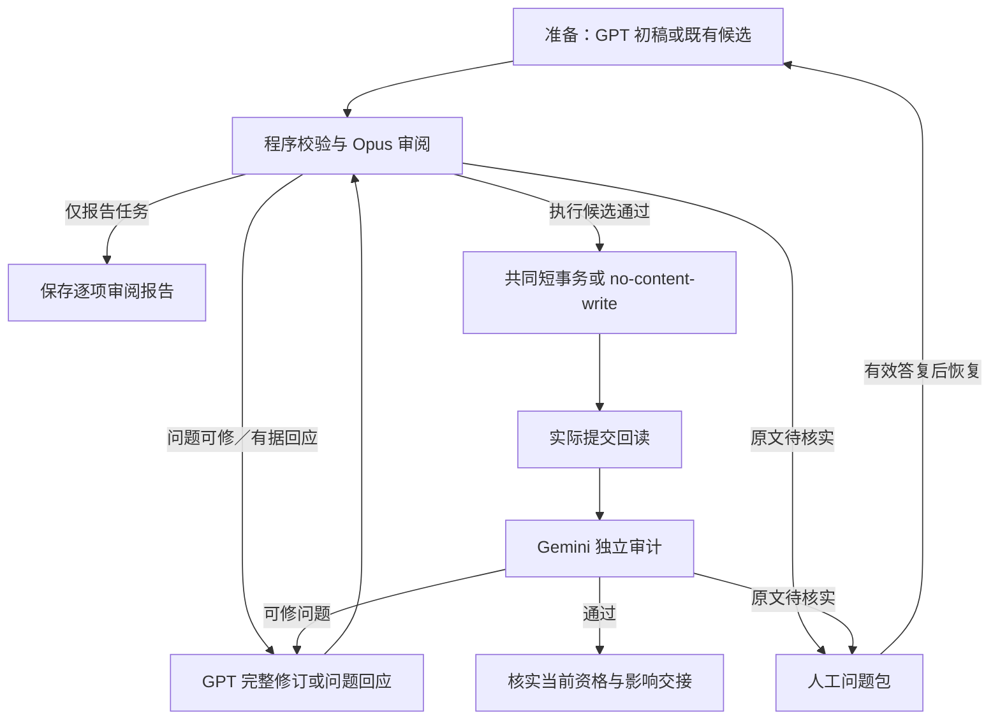

# Claim Management 2.0 operations 与生命周期设计

> **读者**：流程负责人、Solution architect、Developer。
> **类型**：规范。
> **状态**：当前目标设计；新多轮契约未启用。
> **与代码对齐**：2026-10-13；main 基线 `1947a581` 与主控阶段 `9eeb64d` 的交易入口、运行状态及独立 Claim 审计边界已静态核对。本文规定的扩展未实现／验收，不声明现有代码已支持全部 operations。
> **权威范围**：#435 的 operations、完整生命周期、审核与多轮出口、当前可用资格和 Claim 域交接；不授予模型调用、正式内容修改或旧预算重开权限。

Claim Management 的目标是让新建和既有 Claim 都忠于教授的完整自身来源，保留证据、论证和限定，并通过同一套管理流程持续审阅和更新。Create 从 GPT 候选开始；既有 Claim 直接作为候选进入 Review。Verify 是审阅中的核实，Cleanup 是 Update 的用途。

所有 operations 共用现有材料准备、模型调用、问题记录、SQL transaction、版本历史和恢复机制。操作之间只定义内容权限、对象映射、审核问题与完成分母的差异；不为每个故障另建执行入口。

本域归 [#435](https://github.com/junyang168/smart-answer/issues/435)，共同协调归 [#357](https://github.com/junyang168/smart-answer/issues/357)，下游观点与连接管理归 [#436](https://github.com/junyang168/smart-answer/issues/436)。遵守 [Project Mission Statement](../00-overview/project_mission_statement.md)、[Solution Architecture](../00-overview/solution_architecture.md)、[Claim 设计](./claim_design.md) 和 [CanonicalViewpoint 设计](./canonical_viewpoint_design.md)。

## 目录

| 节 | 内容 |
| --- | --- |
| [1](#1-目标与共同不变量) | 目标与共同不变量 |
| [2](#2-对象与职责) | 对象与职责 |
| [3](#3-现有执行基础与扩展边界) | 现有执行基础与扩展边界 |
| [4](#4-operations-定义) | operations 定义 |
| [5](#5-统一操作材料与身份) | 统一操作材料与身份 |
| [6](#6-共同生命周期) | 共同生命周期 |
| [7](#7-审阅与独立审计契约) | 审阅与独立审计契约 |
| [8](#8-多轮推进与出口) | 多轮推进与出口 |
| [9](#9-人工处理与恢复) | 人工处理与恢复 |
| [10](#10-当前可用资格与交接) | 当前可用资格与交接 |
| [11](#11-批处理覆盖与验收) | 批处理覆盖与验收 |
| [12](#12-实施与阶段交付) | 实施与阶段交付 |

## 1 目标与共同不变量

| 目标 | 所有操作必须满足的不变量 |
| --- | --- |
| 忠实 | 每条判断及推理有完整自身来源；不添加教导，不漏承重限定，不裁定神学对错 |
| 对象明确 | 身份、内容版本、审核结论、有效状态和下游完成分别记录，不能相互代替 |
| 权限明确 | 模型发现问题不产生写权限；操作、对象、字段及结构变化均由已绑定契约决定 |
| 审核当前内容 | 审核对象是精确完整候选及其依赖，旧 pass 不批准新内容；真实原始回答保留 |
| 原子提交 | 一个获准联合变更的内容、history、实际写集、确定性影响和运行进度在共同短事务内一致生效 |
| 有界恢复 | 同一 action 保留所有轮次、调用和预算；unknown 不重发，已提交不重写，未完成不冒充成功 |
| 最小必要人工 | 工程问题自主处理；只有完整来源仍不能决定的来源／内容问题才请求人核实 |
| 完整交接 | 所有实际影响都有去向；Claim 域就绪与 CVP 域完成分别报告 |

主要风险是正确的局部结果被当成完整完成：一条 Claim 有来源不表示整篇无遗漏，事务 commit 不表示独立终审通过，Claim-ready 不表示已有 CVP 已更新。这些区别是共同状态规则，不靠逐案例判断。

## 2 对象与职责

| 对象或术语 | 含义 |
| --- | --- |
| Claim | 教授在某份来源中表达的判断；稳定 ID 与记录版本分开 |
| Occurrence | 该判断在来源中的一次出现及引用锚点 |
| Evidence | 观察、经文或推理步骤，连同来源绑定、支持资格及其 Claim owners |
| 单篇论证关系 | 同一来源内 Claim／Evidence 的支持、限定、反驳等关系；反方立场独立记录 |
| action | 一次获准维护任务，绑定允许的 operations、对象范围、policy、预算及有序历史；可包含必要的联合子操作 |
| 候选 | 待审核的完整后像与处置方案；既有记录也能作为未修改候选 |
| finding | 具体审阅问题，带对象、来源位置、类别、依据及接受条件 |
| read pins | 本次实际依赖的对象版本及新对象不存在的约束，用于现有事务内复验 |
| Claim-ready | 当前 Claim 可供下游使用的派生资格，来自现有审核、运行记录、来源和 SQL 当前版本的一致性 |
| ChangeSet | 现有正式写入及版本历史机制；一次获准写入的完整修改集合 |

Claim Management 负责 Claim、Evidence、occurrences、必要来源片段、单篇关系和反方节点的内容与资格。原件校订由负责人完成；本域提出具体疑点并接收校订版本。

CVP Management 负责跨讲身份、核心命题、成员角色、连接类型／端点和完整下游结案。Claim 域登记实际影响，不能借 Update 批准 CVP 语义变更。跨讲论证约束不因单篇关系权限自动可改。

## 3 现有执行基础与扩展边界

### 3.1 已有基础

main 的 `PostgresKnowledgeStore.apply_plan()` 已使用 PostgreSQL transaction 和事务级写锁。主控阶段的 [共同 SQL 入口](https://github.com/junyang168/smart-answer/blob/9eeb64d22397c1f7ca03dc4344051e71f11d514e/backend/pipeline/cvp_sql_flow.py) 与 [store](https://github.com/junyang168/smart-answer/blob/9eeb64d22397c1f7ca03dc4344051e71f11d514e/backend/api/canonical_repository/postgres_store.py) 扩展了以下能力；实施基线须包含这些能力，不能仅因 main 已有 transaction 就视为等同。

| 已有机制 | 本设计的使用方式 |
| --- | --- |
| 同一 store、短事务与写锁 | 所有 operation 编译到共同 ChangeSet，不另建事务框架 |
| read pins、完整依赖与写前校验 | 包含修改对象、共享 owners 和必要只读依赖；漂移时拒绝提交 |
| 实际写集、RETURNING、后像与 history／edges／review_events 核对 | 验证实际发生的全部修改及确定性副作用，任一晚项失败全部 rollback |
| 依赖失效及 affected runs 更新 | 随内容提交登记影响并使受影响运行回到待审计状态 |
| pipeline_runs 的 prepared／reviewed／applied／audited | 保存 action、阶段和结果，completion 文件仅供展示 |
| 原调用 intent、raw、输出位置及跨 root 身份 | 扩展同一预算的轮次，不另建调用账本 |
| 已提交身份优先与新连接回读 | lost reply 后查实际 ChangeSet，接续回读与审计，不重复 apply |
| no-content-write 分支 | 正确既有 Claim 可完成审核，不制造内容 revision 或空业务写集 |

共同交易与恢复依据是主控的 [CVP 交易與恢復設計 v2](https://github.com/junyang168/smart-answer/blob/9eeb64d22397c1f7ca03dc4344051e71f11d514e/docs/wang-knowledge-platform/20-knowledge/cvp_transaction_workflow_v2.md)。[PR #428](https://github.com/junyang168/smart-answer/pull/428) 是交付定位，不是本文对合并或生产验收的替代声明。

### 3.2 本次需要扩展的责任

新增责任集中在现有契约内：operations 的权限与对象映射、有序多轮候选及 findings、各 operation 的完整独立审计问题、Claim-ready 与已存在失效／completion 的对应。复用 SQL 进度、审核记录和 artifact 引用，不建另一套状态数据库或独立证明框架。

沿用现有单一使用者、批次串行的运行前提；新 Claim 多轮不顺便引入并发调度。已有读依赖校验和事务锁继续防止人工改动、过时输入及实现错误。若未来改变运行前提，需单独验证调度，不能从本规范推导并行写入许可。

## 4 operations 定义

### 4.1 业务操作

| Operation | 输入与允许变化 | 审核重点 | 正常完成 |
| --- | --- | --- | --- |
| Read | 当前／历史 ID 和来源；不产生内容修改 | 版本、退役／替代关系及缺失披露 | 返回可追溯材料 |
| Create | 指定来源范围；新增 Claim 及必要 Evidence／关系 | 自身来源、非重复判断、完整限定与论证 | 新对象 Claim-ready；覆盖任务另计 |
| Review | 既有或新候选；审阅本身不改内容 | 完整自身正文、归属、限定、Evidence 与操作处置 | 逐项审阅报告；可按任务继续到当前资格确认 |
| Update | 指定既有对象与字段；同一来源判断的新记录版本 | 修改有据、未改目标判断、共享依赖完整 | 新后像 Claim-ready，影响登记 |
| Retire | 明确对象及依据；停止当前使用，保留历史 | 为什么可停用、原教导有无丢失、消费者去向 | 退役事实与影响审核完成，不产生该对象的 Claim-ready |
| Restore | 退役记录；重新启用的新版本 | 原因消解、当前来源成立、无重复有效替代 | 当前候选 Claim-ready；旧消费者另行处理 |
| Split | 一条包含多个独立判断的记录 | 各判断、限定、位置、Evidence 和关系完整映射 | 新对象分别就绪，旧对象退役，影响登记 |
| Merge | 同源同判断的重复记录 | 真正重复、全部有效材料保留、无虚构综合 | 新合并对象就绪，旧对象退役，影响登记 |

不提供正常内容物理 Delete。Split／Merge 产生新 ID 和明确替代映射；旧 ID 可查，不自动成为批准的新连接。跨讲同一看法交 CVP，不 Merge 成单一 Claim。

### 4.2 Update 的内容范围

一个 Update 可以联合修正 Claim 表述／归属／类型／经文／限定、occurrences、Evidence 的表述／绑定／owner／资格，以及单篇关系或编排字段。每一类修改都须在原权限中明确，联合后像完整审核。

Evidence 补入不批准扩大 Claim；解绑保留原历史及理由；共享 Evidence 改变要核对全部 owners，Claim 与 Evidence 双向归属一致。最后一个支持 Evidence 被撤回时，Claim 不可继续就绪。反方改标签不能成为支持教授立场的证据。

只需核查的共享 owner 进入 read pins 和审阅分母，不自动进入写集；确需修改且无权限时暂停相应联合变更。关系的类型、两端和作用都须有依据，同主题和相邻出现不等于支持。

纯机械 metadata 修改须由程序证明内容、语义和引用不变。按实际依赖确定证明是否可复用，不为了机械修改制造模型调用，也不能仅凭“metadata”标签绕过审核。

### 4.3 操作转换

任务可以预先授权“审阅并更新”或明确的一组联合操作。Review 发现问题后依据该权限自动推进，无须每轮问人。超出许可的 Split／Merge／新增对象须登记准确操作及理由，进入权限不足出口。

模型发现的问题、生产 group、命令名字和文件目录都不产生新业务权限。来源变化也是触发条件：绑定旧／新原件后选择 Review／Update／Create／Retire 等操作。整代重新抽取与局部维护分别授权。

## 5 统一操作材料与身份

### 5.1 一份共同材料契约

| 材料 | 共同要求 |
| --- | --- |
| 请求 | 目的、允许 operations、报告或执行模式、目标清单、范围及预算 |
| 当前对象 | 完整前像、有效状态、原审核与必要历史；读取事实不代表新批准 |
| 来源 | 每份完整自身正文、物理版本及引用位置；其他来源明示为上下文 |
| 依赖 | 全部 Evidence、occurrences、单篇关系、共享 owners 和实际消费者；区分只读与可写 |
| 候选 | 完整后像、逐对象 retain／update／create／retire 等处置、实际 delta 与替代映射 |
| 问题与回应 | findings 的持续身份、各轮发生版本、解决／持续／重开、新发现及依据 |
| 执行与输出 | 精确 policy、调用引用、审核要求、完整写集、影响登记及完成分母 |

operation 只改变这份材料中的允许处置、必要映射和审核要求；材料缺口先进入工程处理，不让模型在残缺包上判断原文有错。

### 5.2 Claim 和 finding 的身份

同一来源判断的误抽措辞、否定或遗漏限定可以 Update；必须由来源位置和完整语境证明仍在修正同一个判断。另一处不同判断另行 Create；无对应判断则 Retire；对象边界变化才 Split／Merge。

finding 的稳定身份由所属 action、目标判断／成分、问题类别及来源依据确定；各轮版本另行绑定。程序在现有问题记录中保存显式前后对应，不以模型理由文字或当轮 SHA 重新命名问题。Split／Merge 使用替代映射承接旧问题，不清零问题和预算；无法确定对应关系时暂停核实。

一个 action 内每个候选／回应有独立请求身份和有序记录，累计预算仍属于原 action。因来源或许可范围改变必须另建后续 action 时，保存准确关联、原未决及新的执行授权，不用换 root 隐藏历史。

### 5.3 历史跨来源记录

既有跨来源 Claim 可进入 Review，不应因缺唯一 source_id 就丢出任务。材料按实际 occurrence／Evidence 分别展开各份完整来源，每份来源独立判断其所支持的内容；不得把多份证据拼成某一份来源的论证。

这种记录的 Review 输出逐来源结果及历史形态标记，可以完成报告，但不直接取得新单源 Claim-ready。需要写入新契约时，在已获准范围内 Split 成有明确自身来源的对象并保留原记录映射；没有此权限则准确报告待迁移，不阻塞无依赖对象。原记录按其已有合法契约使用，不伪造 2.0 资格。

同一物理材料的来源别名先由来源管理确认，不让 Claim 模型自行合并 source IDs。新证据证明历史内容有问题时照常登记未决及影响，不能以兼容历史为由忽略。

## 6 共同生命周期

### 6.1 正常路径

新多轮沿用提交后独立审计：候选准备 → Opus 审阅及必要修正 → 共同 SQL 短事务 → 新连接回读 → Gemini 独立审计 → 当前资格和交接核实。模型和人工等待始终在数据库事务之外。

| 节点 | 职责 |
| --- | --- |
| 准备 | Create 由 GPT 提议；已有 Claim 原样进入候选位，保留真实 provenance；结构操作生成完整处置方案 |
| 校验与审阅 | 程序核材料与权限；Opus 审完整候选和影响，正确内容允许保留 |
| GPT 回应 | 提出修订，或按第 8 节提供有据异议回应；不靠修改正确内容买通过 |
| 报告 | Review-only 保存原回答、发现及范围，结束任务；不自动修订或宣称 Claim-ready |
| 共同事务 | 提交审核过的完整变更；无内容变化使用现有 no-content-write 路径 |
| 回读 | 确认实际提交，失败从此恢复而不是再 apply |
| 独立审计 | Gemini 直接读原件和精确已提交对象，审核第 7 节规定的完整分母 |
| 人工 | 具体来源问题暂停相关项，答复后重新核实输入和权限 |
| 完成 | 当前内容与证明一致；Claim 域结果及未完成的 CVP 义务分别记录 |

图中的原文出口之外，任一步的工程、权限、预算和无进展暂停均按第 8 节处理。仅报告模式不修改 Claim／Evidence，也不借调用报告操作绕过既有 proof 或调用预算。真实审阅发现写入现有问题／运行记录；受影响当前资格不得被新请求忽略。

### 6.2 运行状态与轮次

| 已有 checkpoint | 2.0 的含义与边界 |
| --- | --- |
| prepared | 本轮完整输入、权限、依赖及预算已绑定；候选尚未通过 |
| reviewed | Opus 已审核精确候选，正式内容尚未提交；仍须事务内 current 校验 |
| applied | 已提交并保留 ChangeSet，或已确认无内容写入；独立审计未完成 |
| audited | 本轮规定的独立审核及当前核实已完成；Claim 域完成不能直接标成 CVP group 完成 |

轮次和 findings 在现有 action／pipeline_runs 元数据及 artifact 引用中表达，不新增与 SQL 竞争的状态库。业务结论、checkpoint 和暂停原因分别保存；一次失败不抹掉 applied。

Gemini 提出修正时，在同一 action 下准备下一轮，前一轮已提交的 ChangeSet 和拒绝仍有效。新一轮使用实际 current 作前像；候选不回退冒充旧状态。独立审计通过只推进 Claim 域结果，现有 CVP group 的 audited 仍须满足其完整结案条件。

提交后审计否决的可能是操作本身，例如不应退役某条 Claim。下一轮须按实际 current 选择获准的修正或补偿操作，不机械重复原 operation。初始 action 明确其允许的恢复范围；补偿也走完整候选审核和新 ChangeSet。原许可不含所需恢复操作时准确进入权限不足，保留已提交事实和当前不可用状态，不自动 Restore 或回灌旧快照。

## 7 审阅与独立审计契约

### 7.1 角色与独立性

GPT 6.1 Sol high 订阅负责初提案、修订和有据回应；Opus 5.5 high 订阅审核完整候选；Gemini 3.8 Flash 负责独立终审。新 action 必须绑定精确模型 ID、backend、effort、prompt／schema／policy，角色名称不能代替执行配置。

Opus 必须看到候选及 delta 才能审阅，但不能把 GPT 的理由、自评或旧批准当证据。Gemini 首次判断只依据自己的物理原件读取、实际候选和本 operation 的审核要求，不读取 GPT／Opus 的 pass 作为判断依据。第一次独立判断保存后，才对账旧 findings 和必要异议回应。

复用现有 layers 1／2／3。现有 Layer 3 主要判断当前 Claim 是否被证据支持，不能直接承担结构操作的完整性审核；扩展其输入和响应契约，不创建另一套审计器。样本审计、被过滤删减的正文和漏掉待退役对象的分母不能满足完整终审。

### 7.2 每项 operation 的独立审核对象

| Operation | 必须独立核查的对象与问题 |
| --- | --- |
| Create／Update／Restore | 全部保留或新生效的 Claim／Evidence；归属、限定、绑定、支持资格与单篇关系是否由自身来源支持 |
| 无变化候选 | 当前完整记录及依赖，不因没写内容就跳过缺失终审；已有完全适用证明可依法复用 |
| Retire | 历史前像、退役理由、原教导的处置及消费者影响；判断退役是否合理，不要求错误旧 Claim 为真 |
| Split | 旧对象、全部新对象及替代映射；逐项核对判断、限定、位置、Evidence／关系，排除静默遗漏 |
| Merge | 全部旧对象和新对象；同源同判断、保留内容及无虚构综合，不能只查新 Claim 是否成立 |
| 共享 Evidence／关系变化 | 全部受影响 owners、关系两端及必要自身来源；未改内容的 owner 也须核实其资格是否仍成立 |

程序先固定对象及处置的完整分母，审计独立读取当前和必要历史版本，并返回每项结果。零对象、少项、重复项或范围过滤不等于通过。新对象和退役旧对象必须分别有处置，不依赖默认只读 active Claims 的查询。

### 7.3 findings 与 Opus 指令

同一回答返回各项 verdict、旧问题解决／持续／重开及全部新问题。finding 包含准确对象与版本、typed 类别、来源引用、具体疑点、已检查语境、接受条件或人工问题；程序核分母、逐字引用和版本，原始回答不改写。

> 独立核查完整自身原文、全部候选和操作处置；提议者未指出的问题也须报告。不要仅审修改片段，不沿用旧批准。
>
> 原文清楚而记录错误时，提出具体修订接受条件。原文疑点先检查说话者、反方引述、对象、时间、条件、否定和模态；完整上下文仍不能决定时提出具体人工核实问题。
>
> 缺材料、版本或 schema 问题归工程处理。不得判断神学对错、自动校订原文、创造调和解释或删除教导来通过。正确内容允许保留。
>
> 一次报告全部发现及每个旧问题的处置。对有据异议回应检查引用和标准是否适用；不得因提议者不同意就放行，也不得要求无实质必要的改写。

## 8 多轮推进与出口

### 8.1 两种有效推进

正常修订必须有具体未决问题、接受条件、可执行方向、完整自身来源、原权限及剩余预算。GPT 输出后程序核完整后像和 delta，Opus 判断实际变化是否解决问题。问题数量下降不是进展标准；新发现保留并继续对账。

候选正确但审核可能误读时，GPT 可以保留完整候选并回应 finding。回应必须指出原审核误引、漏读的精确原文或错误适用的既定标准，不能只说不同意、引用另一个模型 pass 或换措辞。程序可验证引文与绑定，语义是否足以消解问题仍由原审核角色判断。

同一候选／来源／稳定问题只允许一次这种明确绑定的澄清复核，计入原 action 总预算。保存原拒绝、回应与复核原答，不把旧 raw 改成 pass。没有有效回应或复核仍不同意时，进入根因检查／无进展暂停；不重复同一完整输入仲裁。新 Claim 后像仍接受正常完整审核，不能借澄清跳过新版本 Gemini。

Gemini 异议的澄清在其第一次独立判断后进行，输出另存为问题处置，必须由 Gemini 明确给出依据和结论；GPT／Opus 不能撤销它的异议。Claim-ready 绑定完整初审与有效处置，披露曾有异议，不声称最初一致通过。

### 8.2 出口条件

先检查输入、来源、版本和执行事实是否有效，再判内容。不同项可以有不同出口，联合不可分割变更不能丢掉失败项后提交。

下表约束执行维护与当前资格确认。Read 和 Review-only 可在各自报告完整时结束，报告必须带未决发现；报告完成不把以下内容问题、暂停或未完成资格改成通过。

| 出口 | 条件 | 后续 |
| --- | --- | --- |
| 完成 | 本 operation 的程序、Opus、独立审计分母全部成立，当前回读一致，问题处置及影响登记完整 | Claim-ready 或退役／结构操作结果；CVP pending 另计 |
| 必要人工 | 排除材料与工程问题，转录、归属或实质来源冲突仍无法确定 | 精确问题包，暂停受影响项 |
| 工程／资源暂停 | 漏包、schema、漂移、hold、缺 proof、unknown、quota 或提交状态不明 | 保存 checkpoint 与恢复入口，不自动重发或降级 |
| 权限不足 | 必要操作或对象范围超出已绑定许可 | 登记准确范围，不扩大写集，不归为内容人审 |
| 无进展暂停 | 重复／振荡或异议经根因检查及允许的有据回应仍无有效推进路径 | 保留未完成和原判断，不挑有利回答 |
| 预算耗尽 | 首次调用前绑定的轮次／总资源上限已到，不能完成下一规定步骤 | 保存耗尽点，不换 root／finder／父任务重开 |

Opus pass 只推进到提交及独立审计，不是整个任务完成。Gemini 可修异议回同一链；来源疑点走同一人工出口。初始候选正确就直接推进，不制造修订。

### 8.3 预算、重复与恢复

新 policy 在首次调用前明确最大修订轮次、各角色调用上限、澄清复核上限、请求／输出资源界限和独立审计预算。具体数值随版本化 policy 交付；缺值不执行。调用预留、unknown 和总量核对复用已有 ledger，下一轮须有预算覆盖其规定审核，不能只预算 GPT。

内容指纹区分真实后像与 mechanical provenance 变化。A→A 不算修订，A→B→A 触发振荡检查；合法有据回应有独立类型，不用制造 delta 绕过。根因检查包括材料、版本、规范化、权限和审核标准；不自动生成额外模型调用。

预算耗尽不取消已成立的结果，也不批准缺审候选。来源改版、权限变化或后续人工答复导致新 action 时必须明确授权、关联旧 action 及未决，不抹旧账。所有旧一轮 policy／raw／预算保持原样。

## 9 人工处理与恢复

Opus 或 Gemini 可在任何审阅轮次主动指出原文问题。程序先验证引文、来源版本和完整材料；材料问题修好后恢复，不将缺包交给人判断内容。

问题包包含原始审核、对象及来源版本、精确位置／录音区间、必要上下文、已检查但无法决定的原因、可能解释、一个具体确认问题和全部已知影响。模型对神学的不同意见不是来源错误；负责人可回答仍无法确认。

| 人工返回 | 接回方式 |
| --- | --- |
| 核对录音／笔记后确认原文或归属 | 保存可追溯核实记录，绑定到原来源位置；审阅者能读到这项新增证据及来源 |
| 校订原件 | 负责人产生新来源版本，再确定受影响 operations、输入与权限 |
| 解释或接受候选 | 明示为人的判断；若无原件证据可决定，保留来源未决，不能把解释冒充教授原话 |
| 无法确认／暂缓 | 保留未完成及依赖，不能生成确定内容 |
| 授权新操作 | 单独记录执行许可，不等于内容批准 |

人工返回后重新核实输入，必要修订走 Opus 和新的完整独立审计。有效来源核实可以消解疑点；模型不得无视已绑定新证据，也不得仅凭“人批准了”给 pass。原拒绝、人答复与模型新判断分别保存。

## 10 当前可用资格与交接

### 10.1 Claim-ready 与 transaction 的对应

Claim-ready 是已有审核／运行记录和当前对象的一致性判断，保存必要引用，不另造权威库。至少要求：精确当前 Claim、Evidence、来源、必要单篇关系与独立审计一致；当前没有未处置实质 finding、hold 或依赖漂移；写入／无变化核实及影响登记成立。

共用现有事务完成内容写入、确定性依赖失效、history、受影响运行待审计和 checkpoint。2.0 必须把新资格所依赖的对象与运行记录纳入现有失效计算，而非在 commit 后另补一个无保护的失效步骤。写前核查全部 read pins，包括未改的共享 owners；提交时新出现的必要依赖也必须被检测。

已 applied 但 Gemini 未通过的版本保留为当前待审计内容，不能凭 active／review_status／旧 proof 对外声称当前可用。下游所有声明使用当前合格 Claim 的入口都须消费同一资格规则；不能只保护 CVP 新生成而漏掉其他当前读取路径。历史版本可按原证据展示，但不得冒充最新已核实版本。

独立审计后，现有 completion 短事务再次核对其审计 pins、来源绑定、未决问题和影响，再登记本轮资格。文件系统不受 DB transaction 锁保护，物理来源按既有检查核验；运行沿用来源不被外部并发修改的前提，发现漂移就停止，消费时仍验来源版本。

### 10.2 证明复用和问题失效

无变化且来源、依赖、适用审核规则完全一致时，可复用已有审核；不同 operation 的证明不能互换，旧 supported 不能批准 Retire。一般代码变化不自动推翻全部历史，只有明确规则缺陷、证据损坏或依赖变化才定位失效范围。

新发现的当前版本实质问题记录在既有问题／运行机制，阻止该版本取得或继续声称 2.0 当前资格；不靠退役内容或覆盖旧 pass 表示此状态。纯工程请求失败不自动否定一个仍有完整有效证明的旧版本。初步未核实提示与正式审阅异议分开，前者不能随意撤销已完成结果。

### 10.3 Claim 到 CVP

Claim 域登记完整实际影响：owned links、共享 Evidence owners、单篇关系、CVP 当前成员／关系所需的后续义务及其他消费者。关系语义由 #436 审核，不机械更新 Claim SHA 清 pending。

Claim-ready 可以先成立而 CVP pending；Claim 域完成须证明影响已持久登记、未完成依赖受到保护。Split／Merge 的旧连接只获得替代映射，不自动批准新 target 或 type。Retire／Restore 同样不能顺手撤回或复活所有 CVP links。

待验引用须有明确语义：旧目标及原依据仍能按历史版本解析，但不能作为当前有效输入。Retire／Split／Merge 的内容变更、替代映射和这种失效义务必须同事务成立；不能留下被视为当前有效的悬空引用。共同 validator 要核查历史可解析、当前消费被阻止、待验义务完整这三点，不得笼统跳过引用检查。

这项待验契约须在现有失效机制中实现并验收；若 store 尚不能表达某种 operation 的合法待验状态，该 operation 就尚未可执行。应补共同引用与失效规则，不靠某个案例的豁免、自动改 link 语义或提前清 pending 让写入通过。

## 11 批处理覆盖与验收

### 11.1 两种完成分母

审阅指定 Claims 时，以原始清单为分母，逐项报告保留、变更、替代、退役、人工、工程、权限及预算结果。审核中发现其他遗漏教导，作为来源绑定的候选问题保存；在原权限内 Create，否则登记后续处置，不静默丢弃。

整理指定来源范围时，另有来源覆盖分母，复用已有来源／抽取覆盖记录。现有 Claims 全通过不表示来源整理完成；发现的遗漏必须被接收或给出已审核处置后才能结案。Review 报告可完成，同时清理或来源整理仍未完成。

Split 的子对象数不替换原始分母；原项完成须全部子对象和映射处置成立。无依赖项可以推进；一个联合变更不能为局部通过裁掉失败写项。所有 shared owners 的核查资格与写权限分别管理。

### 11.2 验收矩阵

| 场景 | 必须证明 |
| --- | --- |
| 创建与既有入口 | 初稿正确零修订；现有候选无伪造 GPT provenance；Review-only 无内容写入；无变化执行可就绪 |
| Update | 多轮改完；绑定／资格／归属／关系均按明确字段权限，shared owners 完整核查 |
| 结构操作 | Retire 审理由与历史；Restore 不复活旧 pass；Split／Merge 对账前后全部内容，漏限定必须被独立审计拒绝 |
| 历史输入与来源更新 | 跨来源记录可出逐来源 Review，写入按许可迁移；新旧原件不串用，不重跑旧 campaign |
| 审阅错误与真实修订 | 有据回应可保留正确内容；同一问题澄清次数受限；新候选重新完整审核；原拒绝始终保留 |
| 独立审计 | Gemini 首读不受已有 pass 引导；新后像重新审；退役／历史对象不被 active-only 查询漏掉；缺项不能 pass |
| 人工 | Opus 发现 GPT 未报原文疑点；核实证据返回后恢复；解释不冒充原文；工程问题不转内容人工 |
| 共同 transaction | read pins 漂移、额外依赖、错误写集、晚项 validation、history 写入失败均整体 rollback；同事务登记影响与待审计 |
| 提交后恢复 | lost reply 查已提交事实；Gemini拒绝保持 applied 待审计，下一轮以实际 current 为前像；no-content-write 不造 revision |
| 当前资格 | 审计后依赖漂移阻止 completion；Review发现当前实质问题可阻止旧资格误用；合法历史不被一般代码变化清空 |
| 预算与暂停 | unknown／quota／hold／缺 proof 停止；重复／振荡／无进展与预算耗尽不转人工、不循环审到pass |
| 分母与交接 | Claims审阅完成和来源覆盖完成分开；遗漏候选不消失；Claim-ready 与 CVP pending 分开，交接不扩语义权限 |

先用真实保存材料做零模型、零正式内容写入预检，再在真隔离 SQL 验证完整生命周期。合成 reviewer 只证明契约与路由，不能称 provider 批准；实际有界模型验收另需授权。

性能与人工成本记录机械准备、回读、有效轮次、重复调用、依赖复验、工程暂停及必要人工次数。固定依赖不随无关历史增长反复重建；实测放独立运行记录，不以局部测试宣称全流程完成。

## 12 实施与阶段交付

先固定包含共同 SQL 能力的合并基线、实际代码 SHA 和 policy，再把每项 operation 映射到共同材料、权限、审核、ChangeSet、独立审计及 completion。复用 source／Claim runner、store、pipeline_runs、原调用 ledger 和独立审计读取器；不复制未合并实现，不新增逐案例 runner、第二账本或 workflow 平台。

实施扩展须能在第 11 节的完整路径中验收：先共同材料和轮次／findings，再 operation 的审核分母与生命周期接入，最后真实保存材料预检及另行有界模型验收。只完成某个 helper 或某个案例不代表 operation 完成。

本设计不重开旧一轮 action、已耗尽预算或已完成 campaign，不授权文章、发布、部署、ArgumentRoute 或 #358。设计 PR 使用 Refs #435、Refs #357；实施及主控继续开放，成熟阶段及时审查交付。
