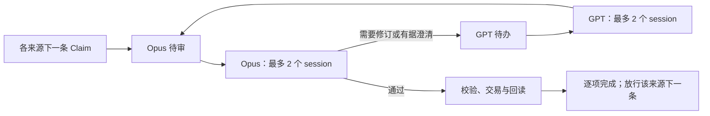

# Claim 分区 refresh 与模型容量排程设计

> **读者**：流程负责人、Solution architect、Developer。
> **类型**：规范。
> **状态**：容量与持续补位接线已实施，隔离验收通过；真实小批及全分区 refresh 尚未完成。
> **与代码对齐**：2026-10-29 在 #519 接入既有清单入口、batch、Update 执行器、资格核对和订阅 transport。模型容量由 `claim_model_capacity.py` 共享控制；batch 的显式容量模式支持小窗口与持续补位，旧入口默认行为不变。真实供应商吞吐尚待验收。
> **权威范围**：已指定 Claim 分区的 refresh 编排与验收；不改变 [Claim Management 2.0](./claim_management_2_design.md) 的内容、权限、预算及交易契约，不授权 CVP 更新或模型调用。

## 1 目标与范围

在不重复 refresh 已有效完成内容的前提下，持续处理指定分区的剩余 Claims。同一来源内一次只处理一条，按原文顺序推进；不同来源可以并行。GPT 和 Opus 各自最多同时两个实际 session，名额跨本维护入口的批次共享。单个 Claim 可以跨多个模型阶段，但不会一直占一个模型名额。

首批采用负责人指定的 #411 现有马太福音清单，不重新分类、不按引用经文或来源标题扩大范围：

- 输入：`$DATA_BASE_DIR/wang-knowledge-platform/staging/exegesis-grouping-411/matthew-l2-opus55-20261001-v3/manifest.json`。
- artifact SHA：`93f8834a191a86bce3b00ac527928466f71f24d313ecba44db8d3d0cf45ce1d1`。
- 原始分母：973 个唯一 Claim ID。核对正式接受引用、文件 SHA、artifact SHA、scope 和成员恰好一次。

旧 manifest 确定成员身份，不要求把当前内容改回旧版本。每条执行前读取当前记录与完整自身来源。退役、替代或后续新建均单列，不能修改原分母以提高完成率；新建对象的资格属于其创建 action 的完成义务，不自动扩为一次新的全分区任务。不会因某个目标属于本分区，就把同篇的其他 Claims 也加入目标。

## 2 清点与待办

| 当前事实 | 安排 |
| --- | --- |
| 有有效的完整 Claim Management 资格，包括等效的已审新建，且无针对本目标的未处置正式问题 | 记录证明并跳过模型；不能只看旧 `review_status` |
| 从未完成完整 refresh | 完整 Update |
| 完成过但当前资格失效 | 保留历史；按具体失效原因接续或核对，不一律重新完整 Update |
| 已有未完成 action | 连接原 action、root、回答及预算；不能另开重复任务 |
| 已退役或被替代 | 排除 active refresh，单列 ID、理由与替代去向；不自动扩入分区外替代对象 |
| 真正人工 hold、来源未定或身份缺失 | 明确暂停原因，不冒充完成 |

先按这张表恰好一次登记原清单，再逐条准备当前请求。已登记的本目标异议、必要维护待办或人工返回不能被旧 pass 遮住；其他任务保存的 context finding 先保留为本目标待核线索，不伪称它已被判定或解决。AI 建议人工抽查与真实人工决定按既有精确规则区分，不能因字段同为 `human_review_required` 就一律放行或一律阻断。来源占用使用正式 `source_id`，先消除已知标题／路径别名，不按显示名称分配名额。来源归属与排序从当前正式来源、锚点及已有顺序取得；位置不明确的项单列，不能按 Claim ID 字符串猜顺序。

持久记录复用 `pipeline_runs`、原 action 及调用账本；分区清单只保存成员、处理去向和这些记录的引用。显示状态可以重建，不另建资格库或复制一套内容真相。未完成项同时属于后续状态而非额外分母。

## 3 持续补位与来源串行

编排器为每个来源维护有序待办，同时让多个来源提供下一条可执行任务。来源的运行占用从该 Claim 准备执行开始，跨越排队、Opus、GPT 修订、提交和回读，不能在模型回答返回时提前放行同源下一条。

模型待办按实际阶段分为 GPT 和 Opus 两队。哪个角色有可用名额，就取其最早可执行项；工作尚未就绪时不占模型名额。新任务与返修都能进入同一队列，不能因不断加入新任务让返修或旧任务永远等不到。已保存回答的程序校验、提交和回读不占模型名额。

既有 Claim 先作为候选送 Opus，发现异议才交 GPT；保留既有多轮与出口。初期只有 Opus 忙、GPT 尚无必要工作是合理状态，不能为了名额使用率先让 GPT 无必要地重写。材料仍是完整自身来源、全部必要自身论据与直接相邻 Claims，不递归扩大 Claim 关系。

除了同一来源不能并行，不增加按跨源读写集合合组、禁止并行或强制联合 Update 的排程条件。既有权限、read pins、实际写集、短交易写锁和提交校验继续执行。真实跨源版本冲突只拒绝受影响的提交，保留候选和已耗预算；不能强交旧候选或为了“没有排程限制”取消校验。

明确暂停且已确认没有活动调用、未定提交的 Claim 可以释放来源占用，原问题留在清单，下一条从最新已提交状态准备。调用仍活跃或提交结果未定时，该来源保持占用；不会阻挡其他来源。

## 4 两家容量与限流

两个 session 是每家上限，不是必须填满的指标。容量名额与 action 的调用预算是两件事：前者限制同时活动的真实调用，后者限制该任务允许总共调用多少次。两者都必须满足才发出请求。

| 情况 | 调度行为 |
| --- | --- |
| 启动或长时间暂停后恢复 | 每家先发一个，确认正常返回后再逐个放开至两个；错峰发出，不同时倾倒整批请求 |
| 正常且有可执行项 | 完成一个补入一个，同时服从该供应商的最早允许发出时间 |
| Opus 消化不过来 | 控制待审积压，暂缓增加新修订工作；不让 GPT 产出无限候选占内存或长期过时 |
| 明确限流或临时容量不足 | 只对该供应商停止新发、按返回的等待时间冷却，降低并行度；其他供应商处理仍有价值的工作 |
| 重复限流 | 延长冷却，保持低速；不能轮换其他 Claim 绕过供应商冷却 |
| 额度耗尽、认证失败或供应商持续不可用 | 暂停该供应商的新呼叫，保存清楚原因；不反复探测、不自动切模型或账号；暂停会进一步积压的上游工作 |

每家分别记录并行上限、当前允许并行度、最早允许发出时间及待办数量。只准备少量接近执行的完整请求，待办其余部分只保存 ID／来源／阶段引用。积压上限、发出间隔和冷却参数在启动配置里固定并记录，首个有界样本测量后才能调整，不能声称未经测量的每分钟速率安全。

名额在实际发出前取得；等待名额不应伪报“模型运行中”或“已生成一次”。名额关联现有调用 intent 和 transport，真实调用结束且回答或失败证据持久保存后释放。重启须核实活动调用，不能清空名额计数重发；不能仅凭等待超时、旧 PID 或旧 `running` 文件判断 session 已结束。接入的其他批次也必须经过同一个容量入口；维护范围内有绕过它的活动调用时，先纳入计数或停止派发，不能宣称配额全局有效。

冷却与积压限制是资源调节，不增加内容分组或跨源依赖互斥。冷却只调节之后何时允许发出，不授予重发旧调用的权限。明确的未生成拒绝按现有可验证恢复规则处理；unknown 保留原不确定事实及消耗，只有具体授权和现有接续契约允许时才恢复。成功返回逐步提高容量，不能冷却结束就同时启动四个调用。

## 5 失败隔离与恢复

单条内容疑点、权限不足、预算耗尽或程序拒收均保存精确原因和原回答，其他来源继续。缺失必要来源、来源版本漂移时暂停对应来源，先走现有来源修订／人工返回流程；不得换文件、猜锚点或截短材料继续。共通数据库故障或运行契约损坏才暂停整体。

恢复沿原任务找到其唯一接续关系，不创建第二条并行预算链。已返回答复复用；已提交先查 ChangeSet，只续回读。授权接续仍保留旧预算、原错误、未知调用及唯一继承关系；新 action 需要创建许可时用它自己的正式 SQL 身份预留，不复制前任预留身份。无许可时不重试，不通过换 root 解锁。

控制器复用现有后台运行与执行锁。控制器退出不能让仍运行的子调用丢失容量或同源保护；恢复前要找到实际继承者并完成或隔离它。已确认结束的暂停不长期占模型名额。程序把正常等待、供应商冷却、内容待人工、未知答复和技术错误分别显示，不让负责人靠聊天反复询问才发现任务已经停了。

## 6 当前完成与下游

每条完成包括审阅、必要修改、真实交易／无修改处置及回读。来源队列收尾时，先复用仍有效的资格，只对实际过期的项使用现有一次冻结的只读核对；不得顺带修改共用内容而重新触发循环。只读核对仍受同源占用、两家容量和冷却约束。

按实际写集登记受影响的既有完成项，并去重。跨源后续修改又使某项失效时，报告该项目前未完成；不把整篇重新送完整 Update。任务最终核对全分母当前资格；已有收尾核对已耗尽而仍不成立的项保持暂停，不能通过再建一份核对清单无限重审。

最终清账区分目前有效、正常退役／替代排除、待执行／运行、待人工、技术／资源暂停。所有原项都有去向，才能说清点结束；只有所有必须处理项满足当前完成条件、没有待办／活动调用／未定提交，才能说 refresh 全部完成。不能把队列已退出、action 历史 completed 或执行过一次当成成功。

已连接的 CVP、ArgumentRoute 和分组影响按现有失效机制登记并去重；本阶段不生成或更新 CVP，不重新归属 #411 分区，也不把旧分组／论证层自动视为仍有效。

## 7 规模与验收

只做一次范围清点并批量取得历史索引、来源归属及当前记录。历史索引须覆盖既有资格入口能识别的所有正式路径，包括新建、来源重验证和批后只读核对；不能只索引普通 Update 目标。只对可能具有资格的项调用既有当前资格入口，不复制或简化其判定规则，不逐条扫描全部历史或重建整库图。每次补位只读即将执行项的必要依赖；不能每完成一条就重读所有剩余任务。最终做一次分母清账，中间按实际写集登记变化，不能对每条提交再全分区复验。

执行 agent 负责端到端操作、异常处置与结果验证，不把设计、代码或启动本身当作交付；负责人无需逐条发命令。程序只承担可重复的后台编排与进度保存，不新建另一套自治 agent 平台。

沿用清单入口、Update 执行器、调用账本、事务和资格核对；补充的是持续补位、来源占用与供应商容量控制。不能用当前 `max_workers=2` 冒充两家各两个 session，也不另建分布式队列、资格数据库或全库备份。现有旧 batch 的合同保持不变；显式容量模式另外绑定配置及补入 manifest 的追加清单，不修改旧请求、权限、预算或 manifest。补位只准备接近执行的下一条，来源锁跨模型与回读保留；CLI 继承容量、来源及运行锁，控制器死亡不能提前释放它们。未定 transport 保留名额事实，禁止自动重发。

| 验收反例 | 必须证明 |
| --- | --- |
| 两家并行 | 多来源可同时达到 2 GPT＋2 Opus；没有可执行 GPT 工作时允许 GPT 空闲 |
| 来源串行 | 同源候选即使等待另一个模型，也不能启动下一条；不同来源不因读 pins 相交被强制合组 |
| 不漏补位、不饿死 | 一个调用结束后可补入可执行项；新任务和返修都有机会执行；冷却与无工作能解释空闲 |
| 限流与积压 | 启动错峰；一次 429／明确容量拒绝使该供应商降速并遵守等待时间；重复拒绝延长冷却；下游停顿不产生无限上游候选 |
| 中断 | 控制器死亡后活动调用仍占原名额与来源；重启不超过各两个，不重复生成或提交 |
| 失败与范围 | 单条失败不拖停其他来源；旧回答、预算、创建身份和人工决定保持；973 个原始 ID 恰好一次清账 |
| 当前资格 | 同批、跨源后续修改均能发现失效；冻结只读核对不循环；退休不是 Claim-ready，CVP pending 不是 CVP 完成 |
| 性能 | 固定一次 Claim 的必要依赖后，补位成本不随无关待办数增长；记录请求字节、调用时长、模型使用率、空闲原因及有效完成量 |

先通过隔离模型与 SQL 反例，再运行明确授权的小批真实样本，记录实际限流与吞吐后扩大到完整清单。样本成功或启动成功都不代替全分区完成。

## 8 实施验证记录

2026-10-29 隔离测试验证了真实文件锁下的两家各两个名额、同源串行、跨源共享读写对象不作为排程互斥、补位、限流冷却、零退出码中的供应商额度错误、未定答复与调用者死亡后的锁继承。既有清单、段落批次、资格核对和调用接续测试也通过。测试不调用真实模型，不代表 973 条已完成或当前全部有效。

运行参数显式固定为共享容量目录、最多 4–8 条就绪操作、发出间隔与冷却时间；每家先一个，成功后最多两个。等待名额先于调用意图及 SQL 调用预算预留；已保存回答复用不占名额。预检失败且未产生 transport invocation 不误记成模型调用或供应商故障。限流只推迟新调用，不授权重试原调用。返回 `Retry-After` 时不得提前发出。

旧实现绑定的已暂停 action 保留原执行版本接续或走正式恢复；不能因本次排程升级重写旧审核契约。旧 action 的 completed 是历史事实，仍须按本设计做最终当前资格清账。

## 9 明确授权的 Opus API 切换

负责人于 2026-10-29 授权 Opus 改用 API，并提供 100 美元 credit。新请求可显式选择同一 `claude-opus-5-5`、high effort 的 `anthropic_api`；GPT 继续订阅。旧策略及旧原始答复保留其真实 backend，不改标成 API。

已暂停的未提交 Update 通过唯一 predecessor 接续，授权绑定前任 metadata、原权限、同一模型和共享 100 美元支出目录。旧成功与失败调用都保留并扣除预算；只有有完整退出证据、明确 `usage_limit_reached` 且输入输出均为零的订阅拒绝，才允许按本切换接续，未知调用不放行。已保存的 GPT 候选从 SQL 的前任记录交接并做精确来源校验，API 重新审阅实际候选；尚待 GPT 的任务继续正常判定。

API 仍通过同一名额入口，使用持久 request、invocation、流事件、最终 response 和退出收据；不自动重试，不回退订阅。发出前为请求和最大输出预留费用；已返回调用按 usage 记账，结果不确定时保留预留。该任务共享费用上限为 100 美元，不代表获准花完余额。费用采用 [Anthropic 官方价格](https://platform.claude.com/docs/en/about-claude/pricing) 的 Opus 5.5 标准档：每百万输入 token 4 美元、输出 20 美元；不使用付费服务器工具或加速档。

## 10 缓存与无损请求编码

新请求通过显式版本化的 `request_encoding_contract=wkp_shared_shapes_json_v6` 启用已有无损编码；每次验证编码前后完整语义数据一致。不得删除或摘要替代自身来源、经文证据、直接邻居及必要关联对象。旧 policy 不增加该字段，已绑定的原请求与答复不改写。

Opus API 在系统指令和完整用户输入设置五分钟缓存断点。账本分别记录普通输入、缓存写入、缓存读取和输出；预留费用按五分钟缓存写入的较高输入价格计算，未知调用仍保留预留。按官方标准档，每百万 token 的五分钟写入为 5 美元、缓存读取为 0.20 美元；只有真实 usage 才能证明命中及节省，配置启用不等于已经命中。

GPT 保持 Codex 订阅，使用服务端自动缓存；不虚构 CLI 缓存开关，也不切换 API。新 profile 保持固定的空工作目录，启用 CLI JSON 事件并保存 `cached_input_tokens`。缺少 usage 时记录未知，不沿用前次值。业务 response schema、ID 约束和最终完整校验保持不变。

有界样本选择六条尚未尝试的分区成员，按既有来源顺序取队首，不为制造缓存命中重复已完成任务。记录输入字节、完整还原证明、实际缓存 token、费用及当前资格；不同六条的工作量可能不同，不把总价变化直接归因为缓存收益。
