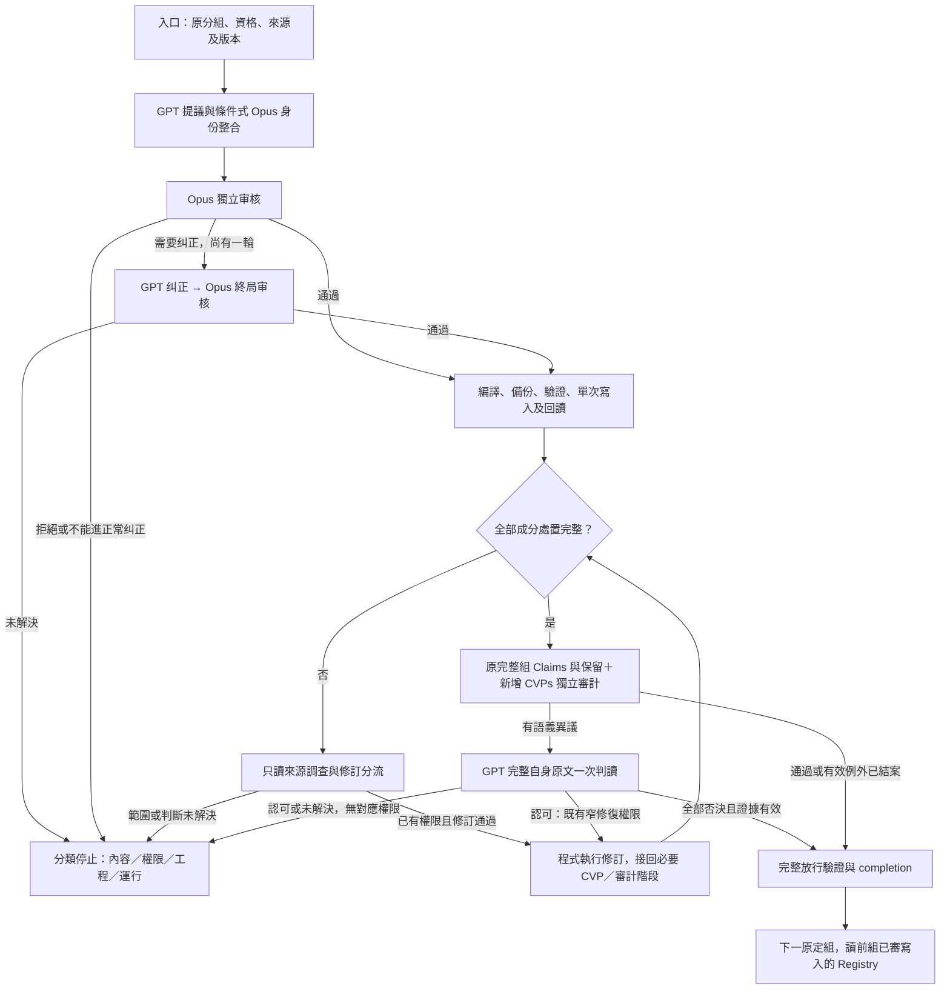

# Claims → CVP 現行完整流程

> **讀者**：流程負責人、神學編輯、Solution architect、Developer。
> **類型**：流程。
> **狀態**：當前內容流程；儲存、交易與恢復由 v2 共同 SQL 入口承擔，舊執行方案禁用。本文不啟動生產、不新增內容修改授權。
> **與代碼對齊**：2026-10-07 核對到 `3223533` 的內容角色／政策與 `cvp_sql_flow.py`、`cvp_sql_actions.py`；新交易入口已作隔離測試及真實保存結果等價驗證，正式遷移和生產仍未啟用。
> **權威範圍**：說明 Claims 到 CVP 的正常路徑、例外分流、人工出口與恢復接點。內容定義服從 [CanonicalViewpoint 设计](./canonical_viewpoint_design.md)，使命與限制服從 [Project Mission Statement](../00-overview/project_mission_statement.md) 和 [Solution Architecture](../00-overview/solution_architecture.md)。具體授權仍以相應 policy／精確人工決定為準，不能拿本文擴權。

## 目錄

- [1. 目標與責任](#1-目標與責任)
- [2. 名詞與模型分工](#2-名詞與模型分工)
- [3. 全流程與共同接點](#3-全流程與共同接點)
- [4. 入口資格與歷史證明](#4-入口資格與歷史證明)
- [5. 正常生成與唯一纠正輪](#5-正常生成與唯一纠正輪)
- [6. 編譯、寫入與回讀](#6-編譯寫入與回讀)
- [7. 暫緩成分的來源調查](#7-暫緩成分的來源調查)
- [8. 來源、Claim 與連接修訂](#8-來源claim-與連接修訂)
- [9. 完整組獨立審計與異議處理](#9-完整組獨立審計與異議處理)
- [10. 工程與運行例外](#10-工程與運行例外)
- [11. 人工真正要決定什麼](#11-人工真正要決定什麼)
- [12. 中斷恢復與完成條件](#12-中斷恢復與完成條件)
- [13. 尚未接通的自動化與交易改版](#13-尚未接通的自動化與交易改版)
- [14. 程式與驗證依據](#14-程式與驗證依據)

## 1. 目標與責任

目標是：**在既有權限內，由程式完成生成、審核、修復、寫入、審計和續跑；人只處理程式與模型不能合法決定的問題。** 不把每一個技術錯誤都交給 owner 說「繼續」，也不靠反覆問模型直到得到 pass。

最重要的人工內容出口是原文錯誤或歧義、歸屬不明，以及教授教導之間尚不能消解的矛盾。此處的「神學問題」不是讓系統裁判教授對錯：應核查不同語境、時間、對象、引述與本人立場，必要時保留張力；不能替教授創造調和答案。

目前實作尚有授權範圍、未知呼叫結果、資源／工程故障等其他停止點。它們不是神學裁決，也不表示全部必須請 owner 批准內容。第 10、11、13 節分別交代誰處理、何時真的需要新的決定，以及自動化尚欠哪一段。

模型只產生提案或審核資料，**不直接修改 database**。寫入由受控執行器決定並執行；獲准提案、SQL 已提交、完整组可續跑是三件不同的事。

## 2. 名詞與模型分工

| 名詞 | 本文意思 |
| --- | --- |
| Claim／成分 | 單篇来源中的主張；一條 Claim 可以有幾個各需交代的實質判斷 |
| CVP／CVR | 跨講道觀點身份／該觀點的一個表述版本；相近主題不等於同一觀點 |
| 成員連接 | Claim 到 CVP 的版本化連接；全文等價、成分等價與支持不是同一種關係 |
| Registry | PostgreSQL 中的知識記錄及其歷史，不是模型回答檔案 |
| packet／raw | 模型實際收到的材料包／保存的原始回答；兩者都須綁定精確來源和版本 |
| frozen／SHA | 固定某次輸入身份／內容指紋；不是把資料變成永遠不可修訂，也不是一個新的資料庫 |
| ChangeSet／後像 | 一次精確變更清單／預定或實際修改後的記錄內容 |
| disposition／hold | 每個成分的明確處置／不得自動提升引用或審核資格的待決限制 |
| completion／seed | 一組達到放行條件的證據／恢復時引用的已完成組集合；不是重新執行那些組 |

下列是 #357 現行明示配置，不是所有歷史回答的模型。舊回答按原實際配置驗證，不能重新標成新模型。

| 職責 | 模型及通道 | 輪次與用途 |
| --- | --- | --- |
| 初始 CVP 提議 | GPT 6.1 Sol，high，ChatGPT 訂閱 | 提出成分處置、CVP、連接及允許範圍內的關係 |
| 新觀點身份整合 | Opus 5.5，high，訂閱 | 有新候選且有 Registry 上下文時，判斷是否其實已有同一觀點；不是獨立審計 |
| 獨立提案审核 | Opus 5.5，high，訂閱 | 審初始有效提案；需要時再審唯一纠正後的精確提案 |
| 正常纠正 | GPT 6.1 Sol，high，ChatGPT 訂閱 | 最多一輪，必須處理审核意見及身份整合約束 |
| deferred 來源調查 | GPT 與 Opus 各自讀同包 | 不看對方回答；只診斷，不批准寫入 |
| 完整組獨立審計 | Gemini 3.8 Flash，API，兩個 worker | 與提議／审核分開，檢查全部指定 Claims 及 CVPs |
| 原文異議終局判讀 | GPT 6.1 Sol，high，ChatGPT 訂閱 | 完整語義審計異議，帶完整自身原文，按 standing policy 一次處理 |

模型請求遵守各入口自己的大小限制；正常 CVP 上限為 500000 bytes，來源調查入口另有更小上限。不能因故障換模型、把 GPT／Opus 改走 API 或提高上限。智能分組是上游工作；已接受的 #411 原 973 Claims／156 組在本流程內不重分、不跳過、不改順序。

## 3. 全流程與共同接點

圖中入口／生成見第 4、5 節，寫入見第 6 節，來源與修訂見第 7、8 節，審計與結案見第 9、12 節。任何階段的機械或運行錯誤都進第 10 節，不能冒充圖中的語義通過。修訂回路不是無限重試：每個入口保留自己的批准範圍、輪次與一次預算；拒絕不能換目錄再審。

## 4. 入口資格與歷史證明

1. 讀 SQL 中原接受分組及已登記完成紀錄，確認組身份、成員、順序和既有復審 flags；選第一個尚未合法結案的組。歷史 completion 在明示接納時驗證；正常啟動不重新建立整條證明，也不能僅看進度百分比。
2. 讀當前 Claim、自身 Evidence、fragment、SourceDocument 和必要 CVP 上下文，核對版本、物理來源 SHA、逐字位置、歸屬、審核身份及真實 hold。來源上下文不能自動升格成本 Claim 的證據。
3. 核對模型／prompt／policy、实际訂閱可執行檔身份與已驗證 runtime proof；相同身份可復用診斷，不每組重跑診斷模型。
4. 完成零模型、零 Registry 寫入的資格與 dry-run。這表示「可以執行」，不是組完成。

明示歷史接納可能需要以下**機械證明橋接**，不是正常入口遞迴重建或重新叫模型審歷史：

| 現象 | 已有處理方式 | 絕不能用什麼代替 |
| --- | --- | --- |
| duplicate donor 合併使 recipient 的證據／定位改變 | 驗完整批次審核身份、donor 裁決與 overrides、原完整 package 重建及 initial applied 版本 | 僅取一份 sealed final 或任挑一個 pass |
| review input 的邏輯路徑後來被覆蓋 | 按原完整 SHA 尋找唯一歸檔，再驗原審核與 applied package | 按最新檔名／時間挑選 |
| transcript ID 與 SourceDocument ID 不同 | 證明同一個唯一、有效、已登記來源身份 | title／path 模糊比對 |
| 舊 anchor 被移除、坐標或審核 metadata 已遷移 | 消費完整已審、已應用歷史 plan／event／後像與來源證明 | 把任意刪除當追加，或 source_kind 白名單 |
| 已批准來源／Claim 版本更新，舊分組投影過期 | 驗完整已應用更新，再編譯当前比較投影；原組成員不變 | 改原接受清單，或直接忽略版本差異 |

只有完整且唯一的歷史身份能自動消費。缺失、歧義、篡改、內容真的變更或 human hold 都不能由歷史 pass 放行。已證明是程式漏消費現成證據，按既有工程授權修程式；確實缺審核或授權則報出缺什麼，不要求 owner 隨口「同意」來替代證據。

## 5. 正常生成與唯一纠正輪

### 5.1 每個成分必須有處置

提議與审核面對完整 Claim，不只處理容易歸併的半句。保留條件、否定、模態、對象與教授／他人立場；不能借另一條 Claim 的結論補成本 Claim 的依據。

| 判斷 | 正常處置 |
| --- | --- |
| 自身證據充分、歸屬清楚、可復用的實質判斷 | `cvp_required`：匹配真正成立的既有 CVP／有依據的關係，沒有合適目標就 `new_viewpoint` |
| 只有一段與 CVP 等價 | `equivalent_component`，定位須逐字、精確且綁定 Claim 版本；不能拼接成一句新話 |
| 全文與 CVP 等價 | 依實際語義與 locator 契約表示；不能單憑 span 覆蓋全文就自行改連接類型 |
| 支持某觀點但不等價 | 有證據的 `supports` 等關係，不能為了覆蓋硬造等價 |
| 純背景、例證或連接語而非可復用判斷 | 明示 `observation_only` 等合法處置，不把它計作新 CVP |
| 證據不足、歸屬未決、來源衝突或 human hold | 保留具體待決原因，不強行造 CVP、不偷解除 hold |

审核的覆蓋欄位綁定當前 Claim SHA、自身 Evidence IDs、理由及可解析目標。`cvp_covered=true` 只證明有目標，不證明連接語義正確。僅因 Registry 沒有舊 CVP 而 defer，不是合法理由。

### 5.2 提議、整合、初審與終審

GPT 提議後先做 schema、成員、引用、版本、定位等確定性驗證。有新觀點候選及既有上下文時，Opus 做身份整合；判為同一觀點的約束必須進入後續提案，不能在纠正時丟掉而悄悄建立重複身份。

Opus 獨立審核成分、遺漏、觀點修訂及實際提出的關係／結構。全部通過便編譯；要求纠正則 GPT 最多一次纠正，重新過機械驗證，再交 Opus 審**有效提案的精確後像**。不能用對 A 的批准寫入 B。

終局仍未通過就保存完整拒絕並停止，不加第二輪正常纠正。審核格式問題只有第 10 節所述極窄修正通道。本文不啟動 ArgumentRoute 或任何下游文章流程。

## 6. 編譯、寫入與回讀

1. 程式將真正獲准的有效提案編譯成 package 和 ChangeSet；保存模型、prompt、材料、批准與來源身份，確定精確寫入範圍。
2. 按現行入口要求完成 fresh backup、備份 SHA／SSD 身份、`pg_restore` 清單、dry-run、前置版本與授權檢查。備份不是審核批准。
3. 保存 apply intent；共同 store 在短 PostgreSQL transaction 內執行 `apply_plan`，核對實際 RETURNING 全寫集、後像、依賴、審核／版本歷史和 SQL checkpoint。任何 validation 失敗全部 rollback，成功才 commit。
4. commit 後用新連線驗實際後像與歷史，不建立整庫回讀 JSON。來源、完整必要依賴及非目標不變門檻由 v2 交易邊界承擔；真實 SQL 已提交，不能因後續 JSON proof 失敗而再次 apply。
5. 處置完整才轉完整組審計；若仍有 deferred 成分，即使本組其他 CVP 已寫入，也不得標成完成或先啟動下一組。

v1 的整庫前像、指紋、回讀及遞迴歷史證明已退出執行路徑，不能用作 fallback。v2 交易／changelog 責任見第 13 節。JSON 只記錄或固定模型與來源材料，模型審核不會因為讀了 JSON 就修改 SQL。

## 7. 暫緩成分的來源調查

`viewpoint_deferred_source_check` 對本 Claim 自身證據及綁定段落／鄰接上下文做一次雙模型只讀調查。每個 deferred 成分恰好一項，引用須逐字驗真。兩模型一致也只是 `investigated_not_resolved`，不是修改批准或 completion。

| 兩模型診斷 | 實際 handoff | 接下來做什麼 |
| --- | --- | --- |
| 已綁定的證據本來就足夠 | `reviewed_cvp_repair_required` | 回正常 CVP 覆蓋／修復入口；不修改 Claim。v6 應在正常唯一纠正輪處理漏 CVP；已停舊批次不能無條件重跑 |
| 自身原文有支持，但尚未綁成本 Claim 證據 | `claim_evidence_repair_authorization_required` | 檢查既有 deferred Claim 授權；符合者走 evidence-binding 修復，不把診斷引用直接升為證據 |
| 提供的原文不足以支持成分 | `claim_source_review_required` | 區分 Claim 抽取過強與原文真的有問題；符合明示 Claim 修訂權限者可提議修訂，不能由診斷自行刪改原文 |
| 任一模型未決，或兩模型不一致 | `human_judgment_required` | 帶兩份原始判讀和精確來源交人工；不採多數、不循環追問 |

原因混合、來源不唯一或真正 hold，不進通用 Claim 自動路由。來源充分的判斷也不能解除引用資格 hold；「教授講過」與「這條 Claim 的證據和批准已完整」分開驗證。

## 8. 來源、Claim 與連接修訂

### 8.1 來源不變的 deferred Claim 修復

已有通用 `deferred_claim_repair_runner`，不是每個問題都要寫一個新的生成器。它需要明示授權檔，核對保存的診斷、原組完整成員、原批次已應用狀態和本次可改欄位。

- `evidence_binding`：補齊自身原文的證據綁定，保留原 Claim statement 和原引文；不能把 context-only／withheld 證據直接提升。
- `claim_statement`：只在相應權限、診斷和欄位範圍內提議 Claim 修訂；不是 CVP runner 獲得任意改 Claim 的權利。
- 材料包含受影響的全部 consumer（引用這些記錄的下游物件）、既有 CVP 的其他成員及真實 holds。GPT 提議 → Opus 獨立審核 → 必要時唯一纠正／終審，再按精確變更寫入、回讀並審計受影響組。
- Claim 修復完成後，仍須回正常 CVP 流程處理尚缺的成分。保留舊有效 CVP／連接，不能重放整個已應用批次。

通用入口已存在，不代表 campaign 的每個 deferred handoff 都已自動 dispatch 它；目前 campaign 會保存調查並停止，維護執行者需按已存在權限選對入口。詳見第 13 節。

### 8.2 原文確實改變

原文校對由人工處理。已授權的新來源版本走 [来源修订 → Claim → CVP 更新流程](./source_reconciliation_workflow_v1.md)：保存新舊來源身份，計算完整受影響範圍，逐項审核與傳遞版本，檢查全部相關组。

不能只更新 source SHA、直接重新抽取整庫，或因新版原文出現新材料就靜默擴大原 campaign 成員。未能消解的來源／教導矛盾要保留，不以統一措辭抹平。

### 8.3 CVP 或連接本身需要修訂

| 修訂類型 | 現有授權與執行路徑 |
| --- | --- |
| 完整審計經 GPT 認可的單一等價連接問題，改為 supports | 已有窄 standing policy；精確 GPT／Opus 後像雙審、最多一次受控修復、備份、寫入、回讀、完整組審計 |
| 已授權的 whole-Claim `equivalent_component → equivalent_full` 修正 | `owner_approved_link_correction` 驗精確前後像與原異議，單次 Opus 獨立审核；無額外 GPT 前置，拒絕就停；批准後由 code 執行並接回後續階段 |
| CVP 文字／身份修訂、其他關係重分類、退役錯誤連接 | 不由上述權限自動涵蓋；需核對已有精確授權，沒有就只請求新增範圍。歷史某組的一次特批不是未來通用許可 |
| observation-only 等背景處置 | 須明示、綁定原 Claim 和實際审核／completion；不得靠漏掉該 Claim 讓 coverage 過關 |

每次修訂保留原拒絕、原版本及已提交事實；新的批准必須指向新後像。不能把 owner 同意「去修」標成他已逐字批准內容，也不能把新物件的 provenance 複製成舊審核已批准。

## 9. 完整組獨立審計與異議處理

### 9.1 審計分母

審計涵蓋**原組全部 Claims，以及此次有效處置涉及的保留和新增 CVPs**，不是只審剛寫入的幾條。修訂若影響其他組，來源更新流程亦須處理完整受影響範圍。

四層分別檢查逐字來源／定位、依賴與覆蓋、Claim 是否由自身證據支持、CVP 身份歸併是否成立。campaign 明示 Claim／CVP IDs 並使用完整上下文與兩個 Gemini worker；不能拿一般審計 CLI 的抽樣預設當完整組驗收。機械層結果也須經 scoped disposition 檢查，未解決錯誤不放行。

### 9.2 完整語義異議的 GPT 終局

先證明審計母體完整、無漏判／來源缺失／模型錯誤，再把異議與完整自身原文交 GPT 一次判讀。逐字引用、實際模型後端、packet／raw／來源 SHA、當前 Registry 版本全部要吻合。

- **全部 `audit_objection_rejected`**：standing policy 允許獨立 final resolution 結案；保留 Gemini 原 disputed 與 raw，不改成假的 pass，不回送 Gemini、不追加 Opus 同題審核。
- **有 `audit_objection_upheld`**：不能套用上述放行。只有第 8.3 節現有窄權限可自動修；其餘交明示範圍決定。
- **混合 rejected／upheld**：保存完整判讀，只挑有權限的 upheld 目標；rejected 不重做原題。修訂後仍須驗完整組的實際新版本，不能把舊 rejected 身份移植到改變後的輸入。
- **未解決、母體不完整或機械驗證失敗**：停止，不能用 owner 同意或 GPT 的語義意見抵銷。

這項政策只處理**獨立審計異議**，不等於 GPT 可以推翻正常 Opus 初審／終審、來源調查分歧或任意修訂拒絕。

### 9.3 Gemini 真實 content-blocked 例外

只有已保存、可驗證的 Gemini `PROHIBITED_CONTENT`／`SAFETY` provider receipt 才觸發指定 GPT 訂閱一次補充判讀。完整同請求、來源、版本與 SHA 必須保留；不能刪內容、隱藏觸發文字或把網路、quota、缺來源當成這種例外。

這不是完整獨立審計通過。有效例外可按現行政策續行，但 completion／seed 必須保留 `revisit_required=true`、`independent_audit_complete=false`，其他異議仍照常處理。恢復、來源修訂、後續組都不能把這兩個 flags 洗掉。

## 10. 工程與運行例外

| 情況 | 處理責任與可做動作 | 禁止事項／停止條件 |
| --- | --- | --- |
| 已證明的歷史讀取／schema／投影／回讀機械 bug | 維護程式在既有工程授權內修復，保留失敗、補反例、使用 `backend/.venv` 驗證、提交，再從精確保存階段接續 | 不改 Claim／來源來迎合 bug；不能拿測試通過當組完成 |
| 自動 recovery patch | supervisor 只診斷；受控 executor 限定 audit-library 來源讀取及新反例，驗 patch 後執行固定測試 | 不執行模型任意 shell；一般主 agent 的修復權限不等於此 executor 可自行改全部程式 |
| 請求過大 | 已實作 compact JSON、完全相同長字串的共享表及逐字往返校驗；合法舊 cache 有明示無損遷移路徑 | 不摘要來源、不拆原組、不加上限；仍過大則停止，不能換 root 重置预算 |
| Opus `pass` 同時帶 finding code | 僅無 correction、符合已知矛盾形狀時交同 Opus 一次格式修正；所有 decision／reason／identity／其他欄位不變 | 真異議不能清掉；缺欄位、內容漂移、第二次非法回答停止 |
| 已保存合法模型回答 | 按原 request／model／backend／prompt／config／encoding／SHA 驗證並復用 | 改配置後不能把舊回答冒充新审核；只讀驗證不得偷偷 fallback 新呼叫 |
| 已有 call intent 或舊 request-encoding 痕跡卻沒有回答 | `outcome_unknown`，保存原記錄；需精確一次重發方向時，只問這個未定請求 | 無 raw 不等於沒呼叫；不刪 intent、不跨 root 自動重發；新 unknown 再停 |
| 明確 provider schema 400、證明生成前拒絕 | 僅既有專用 verifier 完整證明後，按該一次機械交接契約處理 | 不能把一般 timeout、本地錯誤或 stderr 猜測套成已知未執行 |
| CLI 身份／版本、訂閱／quota／網路故障 | 核實 canonical executable 與 runtime proof；修正已證明配置 bug；實際 quota 按政策等可用性及恢復方向 | 不自動换模型、API 或把舊 binary 報錯解釋成帳號無權限 |
| 磁碟不足、備份失敗、SSD 缺失或 UUID 錯誤 | 運行維護處理；精確歸檔需原授權和 SHA／size／restore 驗證 | 不刪證據、失敗與预算，不降安全閾值、不回落未批准儲存 |
| 性能超限、反覆整庫重建 | 工程設計／性能驗收問題；報告階段、讀取量、耗時和真實資料結果 | 不再啟動同一慢 fallback；局部 cache 測試不是完整恢復驗收 |

維護先核對實際進程、目前 root、進度、log、state／attempt receipts，非阻塞取得 `recovery.lock`；未取得就退出。有活動維護／producer 時不並行 patch 或重啟。歷史 PID、screen 名稱、舊 `watching` 都不證明現在活躍。

同一 failure fingerprint 的一次修復預算跨 root 保留。已用完且再遇同錯，不能靠更名、刪檔或 reset 假裝首次；工程可證性不足時報出阻塞，不再試到成功。

## 11. 人工真正要決定什麼

### 11.1 四種不同出口

| 出口 | 誰處理 | 要問的最小問題 |
| --- | --- | --- |
| 來源／歸屬／教導張力 | 原文校對者或內容負責人 | 哪個來源／語境應保留？是否是轉錄錯誤、他人立場，或必須保留未決差異？ |
| 新修改範圍 | owner | 是否只授權列明對象和欄位的修訂／退役？已授權範圍不重問 |
| 缺證明／程式故障／性能 | 工程維護者 | 缺哪一份證據或哪個 invariant 失敗？能否在既有權限內證明並修復？不能請人替機械檢查蓋章 |
| 資源／模型呼叫結果未定 | 運行負責人；必要時 owner | 恢復何種資源或是否批准這個精確未定呼叫的一次重發？不是內容批准 |

交接包包含：停止階段、精確對象／版本、完整自身來源、原模型不同意什麼、哪些已實際提交、尚未執行什麼、允許動作與影響範圍。已完成項目不再次要求批准。

### 11.2 人工決定如何進入 code

已有 `viewpoint_human_review` 區分 `interpretation`（解釋）、`accept_exact_postimage`（接受精確後像）、`authorize_revision`（允許另作修訂）及 `defer`。解釋不等於寫入批准；接受必須綁定完整精確 package，不得只接受半包或移用到新版。

人工例外保留 `human_exception_review` 身份，不能改寫原模型 verdict 或假稱雙模型一致。它也不能豁免來源、schema、backup、dry-run、exact-once、回讀、完整審計等執行門檻。

一旦相應 bounded action 已明確批准，**後續由 code 完成原路徑的審核、寫入、回讀、審計及安全續接，不逐步等人再說繼續**。只有新範圍、真實新分歧、未定副作用或新的運行阻塞才再次交接。程式仍需有對應執行入口；不能用口頭批准代替缺失的 validator。

## 12. 中斷恢復與完成條件

### 12.1 從真實完成階段恢復

| 已保存事實 | 下一步 |
| --- | --- |
| 尚無 intent／回答，亦無舊 encoding 呼叫痕跡 | 驗原预算與 runtime 後，才可執行該階段 |
| proposal／consolidation／review 已保存 | 精確復用，不再呼叫已完成角色 |
| intent 或舊 encoding 有、結果未知 | 按第 10 節停止；不得把它當未開始 |
| apply 結果不明 | 先查 SQL ChangeSet／物件版本及精確計劃；未知時停，不依 receipt 缺失推定零寫入 |
| 已 applied、proof 或 readback 文件失敗 | 核對實際已提交內容，只修復／接續驗證；不能 reapply |
| 完整審計已保存 | 驗 input、版本、來源、raw／cache 及分母，復用已完成審計；不重跑模型來補機械交接錯誤 |
| 組完成、交接失敗 | 查 SQL audited checkpoint 和原 flags，接續下一組；不重建 seed、內容或祖先證明，不重寫該組 |

### 12.2 組放行與運行狀態

放行須同時滿足：原成員逐項有合法處置、实际批准與寫入／回讀一致、物理来源與當前版本成立、完整組审计及异议合法结案、機械检查通过，並保留所有復審 flags。CVP 完成不代表 ArgumentRoute 完成。

下一組讀取前組已審寫入的 Registry。v2 從 SQL checkpoint 續跑，不啟動舊 continuation／supervisor；歷史 receipt 只作交接證據，不作當前執行狀態。process 啟動、CLI exit 0、已寫入或 log 沒新字，都不是整組完成證據。

owner 暫停／指定 checkpoint 優先於自動恢復。停止時明確交代「誰需要做哪個決定」，不讓 owner 和程式互相等；普通進度可安靜，真失敗、實際修復、完成或必要操作須報告。

## 13. 尚未接通的自動化與交易改版

本文描述現有能力，不宣布所有 special cases 已自動閉環：

| 目前缺口 | 不能誤稱為 | 後續設計方向，不是本次新增授權 |
| --- | --- | --- |
| deferred 調查的真實證據不足、來源歧義或新範圍 | 所有來源不足都已自動修復 | 現有綁定證據充分且已有 coverage 權限者自動補 CVP；需修改 Claim／證據者仍核精確修訂權限，其餘只送最小人工問題 |
| 正常 v6 防漏，但已保存舊批次的遺漏不能重新標為 v6 通過 | 一條新 prompt 就修復了全部歷史 | 保留原批准，明示新增 coverage 的正常审核與單次修改身份 |
| supports 是窄通用政策；其他 CVP 文字／身份／退役有一次性路徑 | owner 曾同意一例便允許未來全部修訂 | 需另定可驗證的通用範圍；先確保不消解真來源衝突或改教授立場 |
| 程式故障仍需工程診斷；舊 patch supervisor 禁用 | 已有全自動任意 bug 修復器 | 維持可審 patch、反例、预算及安全交接，不讓模型自行擴權或執行舊方案 |
| v2 已隔離驗證，正式 schema／歷史接納仍未執行 | v2 已經上線 | 正式遷移與啟用分開核對；缺 SQL campaign 停止，不借旧 root 啟動 |

[CVP 交易與恢復設計 v2](./cvp_transaction_workflow_v2.md) 已以共同 store／runner 實作：保留本文件的內容判斷和原始模型／來源證據，簡化儲存、validation 和恢復。模型與人工仍在 SQL transaction 外；commit 後的內容審計發現問題，須新修訂，不能 rollback 一個已結束的交易。

先驗收真實第 57 組保存資料的完整恢復和第 58 組只讀入口，不以新增快取層代替端到端驗收。隔離驗收和正式啟用分開記錄；生產保持停止，舊執行方案不得使用。

## 14. 程式與驗證依據

下表是維護本文的查核入口，非可隨手執行的恢復命令；測試涵蓋不等於當前生產已驗收。案例與歷史特批另見 [CVP 特殊案例索引](../90-ops/cvp_special_cases_20261007.md)。

當前執行入口僅為 [共同 SQL flow](../../../backend/pipeline/cvp_sql_flow.py) 及其 [修訂分支](../../../backend/pipeline/cvp_sql_actions.py)。下表的舊 orchestrator 只保留純內容 compiler、驗證器和歸檔讀取；其原執行入口已拒絕，不能據表中鏈接恢復舊流程。

| 流程 | 主要實作／政策 | 反例與行為測試 |
| --- | --- | --- |
| 串行組、停止與完成 | [campaign runner](../../../backend/pipeline/viewpoint_cvp_campaign_runner.py) | [campaign tests](../../../backend/tests/test_viewpoint_cvp_campaign_runner.py) |
| 生成、整合、纠正與終審 | [batch runner](../../../backend/pipeline/viewpoint_batch_resolution_runner.py)、[v6 policy](../../../backend/pipeline/policies/wang_cvp_resolution_policy_v6.json) | [required coverage](../../../backend/tests/test_viewpoint_required_cvp_coverage.py) |
| 歷史資格橋接 | [lineage tests](../../../backend/tests/test_viewpoint_lineage_inventory.py)、[merge bridge](../../../backend/tests/test_viewpoint_legacy_merge_target_bridge.py) | [coordinate proof](../../../backend/tests/test_legacy_coordinate_review_proof.py) |
| deferred 調查／修復／CVP 接續 | [source check](../../../backend/pipeline/viewpoint_deferred_source_check.py)、[repair runner](../../../backend/pipeline/deferred_claim_repair_runner.py)、[continuation](../../../backend/pipeline/deferred_claim_cvp_continuation.py) | [diagnosis](../../../backend/tests/test_viewpoint_deferred_source_check.py)、[repair](../../../backend/tests/test_deferred_claim_repair.py)、[continuation tests](../../../backend/tests/test_deferred_claim_cvp_continuation.py) |
| 完整審計與 GPT 終局 | [audit population](../../../backend/pipeline/viewpoint_group_audit_population.py)、[adjudication](../../../backend/pipeline/viewpoint_audit_source_adjudication.py)、[final policy](../../../backend/pipeline/policies/wang_audit_source_resolution_v1.json) | [population tests](../../../backend/tests/test_viewpoint_group_audit_population.py)、[resolution tests](../../../backend/tests/test_viewpoint_audit_owner_resolution.py) |
| 窄連接修復／精確 owner action | [supports policy](../../../backend/pipeline/policies/wang_audit_link_repair_v1.json)、[link repair](../../../backend/pipeline/viewpoint_audit_link_repair.py)、[owner link executor](../../../backend/pipeline/owner_approved_link_correction.py) | [link repair tests](../../../backend/tests/test_viewpoint_audit_link_repair.py)、[owner link tests](../../../backend/tests/test_owner_approved_link_correction.py) |
| content-blocked 例外 | [fallback policy](../../../backend/pipeline/policies/wang_content_blocked_fallback_v1.json)、[executor](../../../backend/pipeline/viewpoint_content_blocked_fallback.py) | [fallback tests](../../../backend/tests/test_viewpoint_content_blocked_fallback.py) |
| 人工決定與 provenance | [human review](../../../backend/pipeline/viewpoint_human_review.py) | [human decision tests](../../../backend/tests/test_viewpoint_human_review.py) |
| 格式、cache、未知呼叫 | [format repair](../../../backend/pipeline/viewpoint_review_format_repair.py)、[model runtime](../../../backend/pipeline/viewpoint_resolution_runtime.py) | [format tests](../../../backend/tests/test_viewpoint_review_format_repair.py)、[runtime tests](../../../backend/tests/test_viewpoint_runtime_robustness.py)、[cache handoff](../../../backend/tests/test_viewpoint_model_cache_handoff.py) |
| 機械 recovery | [supervisor](../../../backend/pipeline/viewpoint_cvp_recovery_supervisor.py)、[executor](../../../backend/pipeline/viewpoint_cvp_recovery_executor.py) | [executor tests](../../../backend/tests/test_viewpoint_cvp_recovery_executor.py) |
