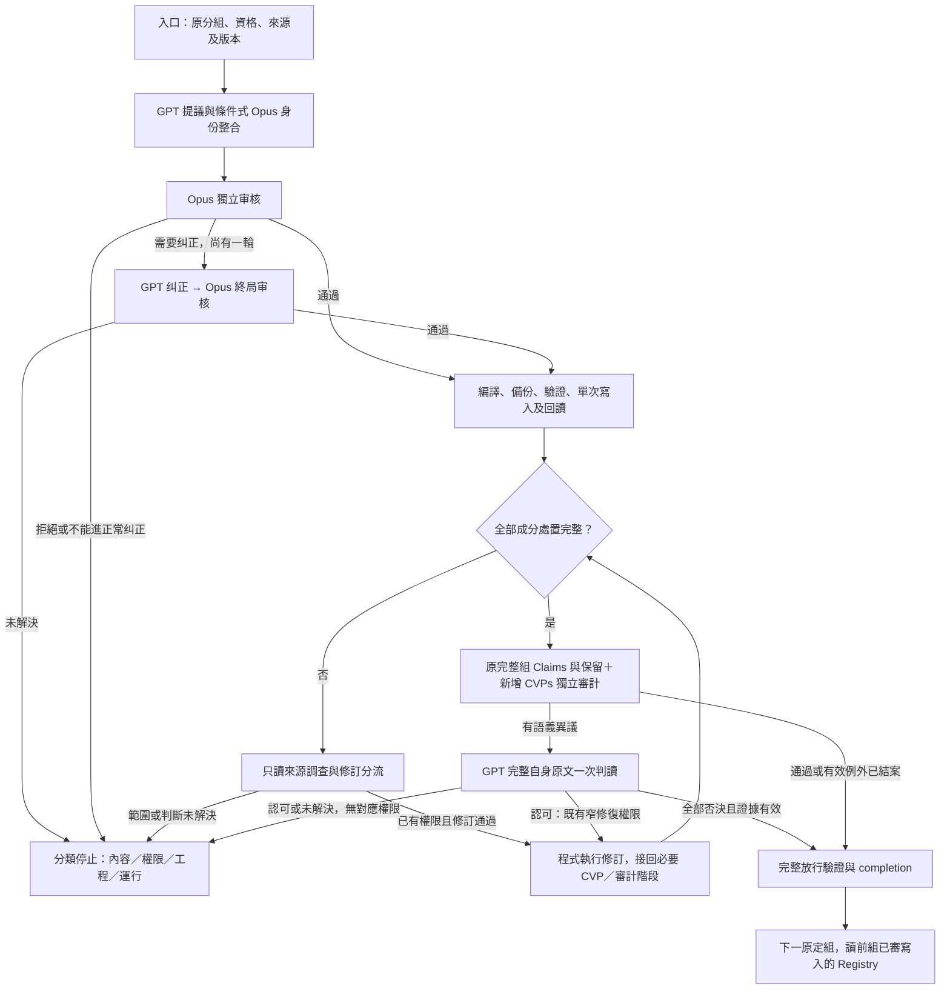

# Claims → CVP 現行完整流程

> **讀者**：流程負責人、神學編輯、Solution architect、Developer。
> **類型**：流程。
> **狀態**：當前內容流程；第 13 節共同 Claim 問題接點、聯合後像審核及 SQL 分支已啟用，來源不變的 Claim 修訂、CVP 覆蓋及完整組獨立審計已經實際驗收。儲存、交易與恢復由 v2 共同 SQL 入口承擔，舊執行方案禁用。本文不啟動生產、不新增內容修改授權。
> **與代碼對齊**：2026-10-08；交易基線 `6b9541e`、程式版本綁定 `4ce1a4c`；第 13 節核對 `0a93a08`、`d55b999`、`cf72c39`、`1f995b2` 的共同接點、policy／migration、診斷正文與 Evidence 區分及 SQL 交接。正式啟用和實際組驗收另存獨立 receipt，不由文檔追認未授權內容。
> **範圍管理代碼對齊**：2026-10-09 核對本次 `cvp_scope_management.py`、共享 SQL action、policy／prompt 和隔離 SQL rollback／恢復測試；真實模型／組驗收另記，不由離線測試宣稱完成。
> **權威範圍**：說明 Claims 到 CVP 的正常路徑、例外分流、人工出口與恢復接點。內容定義服從 [CanonicalViewpoint 设计](./canonical_viewpoint_design.md)，使命與限制服從 [Project Mission Statement](../00-overview/project_mission_statement.md) 和 [Solution Architecture](../00-overview/solution_architecture.md)。具體授權仍以相應 policy／精確人工決定為準，不能拿本文擴權。

## 目錄

- [1. 目標與責任](#1-目標與責任)
- [2. 名詞與模型分工](#2-名詞與模型分工)
- [3. 全流程與共同接點](#3-全流程與共同接點)
- [4. 入口資格與歷史證明](#4-入口資格與歷史證明)
- [5. 正常生成與唯一纠正輪](#5-正常生成與唯一纠正輪)
- [6. 編譯、寫入與回讀](#6-編譯寫入與回讀)
- [7. 暫緩成分的來源調查](#7-暫緩成分的來源調查)
- [8. 來源、Claim 與連接修訂](#8-來源claim-與連接修訂)
- [9. 完整組獨立審計與異議處理](#9-完整組獨立審計與異議處理)
- [10. 工程與運行例外](#10-工程與運行例外)
- [11. 人工真正要決定什麼](#11-人工真正要決定什麼)
- [12. 中斷恢復與完成條件](#12-中斷恢復與完成條件)
- [13. Claim 與 CVP 管理的變更閉環](#13-claim-與-cvp-管理的變更閉環)
- [14. 程式與驗證依據](#14-程式與驗證依據)

## 1. 目標與責任

目標是：**在既有權限內，由程式完成生成、審核、修復、寫入、審計和續跑；人只處理程式與模型不能合法決定的問題。** 不把每一個技術錯誤都交給 owner 說「繼續」，也不靠反覆問模型直到得到 pass。

最重要的人工內容出口是原文錯誤或歧義、歸屬不明，以及教授教導之間尚不能消解的矛盾。此處的「神學問題」不是讓系統裁判教授對錯：應核查不同語境、時間、對象、引述與本人立場，必要時保留張力；不能替教授創造調和答案。

目前實作尚有授權範圍、未知呼叫結果、資源／工程故障等其他停止點。它們不是神學裁決，也不表示全部必須請 owner 批准內容。第 10、11、13 節分別交代誰處理、何時真的需要新的決定，以及自動化尚欠哪一段。

模型只產生提案或審核資料，**不直接修改 database**。寫入由受控執行器決定並執行；獲准提案、SQL 已提交、完整组可續跑是三件不同的事。

## 2. 名詞與模型分工

| 名詞 | 本文意思 |
| --- | --- |
| Claim／成分 | 單篇来源中的主張；一條 Claim 可以有幾個各需交代的實質判斷 |
| CVP／CVR | 跨講道觀點身份／該觀點的一個表述版本；相近主題不等於同一觀點 |
| 成員連接 | Claim 到 CVP 的版本化連接；全文等價、成分等價與支持不是同一種關係 |
| Registry | PostgreSQL 中的知識記錄及其歷史，不是模型回答檔案 |
| packet／raw | 模型實際收到的材料包／保存的原始回答；兩者都須綁定精確來源和版本 |
| frozen／SHA | 固定某次輸入身份／內容指紋；不是把資料變成永遠不可修訂，也不是一個新的資料庫 |
| ChangeSet／後像 | 一次精確變更清單／預定或實際修改後的記錄內容 |
| disposition／hold | 每個成分的明確處置／不得自動提升引用或審核資格的待決限制 |
| completion／seed | 一組達到放行條件的證據／恢復時引用的已完成組集合；不是重新執行那些組 |

下列是 #357 現行明示配置，不是所有歷史回答的模型。舊回答按原實際配置驗證，不能重新標成新模型。

| 職責 | 模型及通道 | 輪次與用途 |
| --- | --- | --- |
| 初始 CVP 提議 | GPT 6.1 Sol，high，ChatGPT 訂閱 | 提出成分處置、CVP、連接及允許範圍內的關係 |
| 新觀點身份整合 | Opus 5.5，high，訂閱 | 有新候選且有 Registry 上下文時，判斷是否其實已有同一觀點；不是獨立審計 |
| 獨立提案审核 | Opus 5.5，high，訂閱 | 審初始有效提案；需要時再審唯一纠正後的精確提案 |
| 正常纠正 | GPT 6.1 Sol，high，ChatGPT 訂閱 | 最多一輪，必須處理审核意見及身份整合約束 |
| deferred 來源調查 | GPT 與 Opus 各自讀同包 | 不看對方回答；只診斷，不批准寫入 |
| 完整組獨立審計 | Gemini 3.8 Flash，API，兩個 worker | 與提議／审核分開，檢查全部指定 Claims 及 CVPs |
| 原文異議終局判讀 | GPT 6.1 Sol，high，ChatGPT 訂閱 | 完整語義審計異議，帶完整自身原文，按 standing policy 一次處理 |

模型請求遵守各入口自己的大小限制；正常 CVP 上限為 500000 bytes，來源調查入口另有更小上限。不能因故障換模型、把 GPT／Opus 改走 API 或提高上限。智能分組是上游工作；已接受的 #411 原 973 Claims／156 組在本流程內不重分、不跳過、不改順序。

## 3. 全流程與共同接點

圖中入口／生成見第 4、5 節，寫入見第 6 節，來源與修訂見第 7、8 節，審計與結案見第 9、12 節。任何階段的機械或運行錯誤都進第 10 節，不能冒充圖中的語義通過。修訂回路不是無限重試：每個入口保留自己的批准範圍、輪次與一次預算；拒絕不能換目錄再審。

## 4. 入口資格與歷史證明

1. 讀 SQL 中原接受分組及已登記完成紀錄，確認組身份、成員、順序和既有復審 flags；選第一個尚未合法結案的組。歷史 completion 在明示接納時驗證；正常啟動不重新建立整條證明，也不能僅看進度百分比。
2. 讀當前 Claim、自身 Evidence、fragment、SourceDocument 和必要 CVP 上下文，核對版本、物理來源 SHA、逐字位置、歸屬、審核身份及真實 hold。來源上下文不能自動升格成本 Claim 的證據。
3. 核對模型／prompt／policy、实际訂閱可執行檔身份與已驗證 runtime proof；相同身份可復用診斷，不每組重跑診斷模型。
4. 完成零模型、零 Registry 寫入的資格與 dry-run。這表示「可以執行」，不是組完成。

明示歷史接納可能需要以下**機械證明橋接**，不是正常入口遞迴重建或重新叫模型審歷史：

| 現象 | 已有處理方式 | 絕不能用什麼代替 |
| --- | --- | --- |
| duplicate donor 合併使 recipient 的證據／定位改變 | 驗完整批次審核身份、donor 裁決與 overrides、原完整 package 重建及 initial applied 版本 | 僅取一份 sealed final 或任挑一個 pass |
| review input 的邏輯路徑後來被覆蓋 | 按原完整 SHA 尋找唯一歸檔，再驗原審核與 applied package | 按最新檔名／時間挑選 |
| transcript ID 與 SourceDocument ID 不同 | 證明同一個唯一、有效、已登記來源身份 | title／path 模糊比對 |
| 舊 anchor 被移除、坐標或審核 metadata 已遷移 | 消費完整已審、已應用歷史 plan／event／後像與來源證明 | 把任意刪除當追加，或 source_kind 白名單 |
| 已批准來源／Claim 版本更新，舊分組投影過期 | 驗完整已應用更新，再編譯当前比較投影；原組成員不變 | 改原接受清單，或直接忽略版本差異 |

只有完整且唯一的歷史身份能自動消費。缺失、歧義、篡改、內容真的變更或 human hold 都不能由歷史 pass 放行。已證明是程式漏消費現成證據，按既有工程授權修程式；確實缺審核或授權則報出缺什麼，不要求 owner 隨口「同意」來替代證據。

## 5. 正常生成與唯一纠正輪

### 5.1 每個成分必須有處置

提議與审核面對完整 Claim，不只處理容易歸併的半句。保留條件、否定、模態、對象與教授／他人立場；不能借另一條 Claim 的結論補成本 Claim 的依據。

| 判斷 | 正常處置 |
| --- | --- |
| 自身證據充分、歸屬清楚、可復用的實質判斷 | `cvp_required`：匹配真正成立的既有 CVP／有依據的關係，沒有合適目標就 `new_viewpoint` |
| 只有一段與 CVP 等價 | `equivalent_component`，定位須逐字、精確且綁定 Claim 版本；不能拼接成一句新話 |
| 全文與 CVP 等價 | 依實際語義與 locator 契約表示；不能單憑 span 覆蓋全文就自行改連接類型 |
| 支持某觀點但不等價 | 有證據的 `supports` 等關係，不能為了覆蓋硬造等價 |
| 純背景、例證或連接語而非可復用判斷 | 明示 `observation_only` 等合法處置，不把它計作新 CVP |
| 證據不足、歸屬未決、來源衝突或 human hold | 保留具體待決原因，不強行造 CVP、不偷解除 hold |

审核的覆蓋欄位綁定當前 Claim SHA、自身 Evidence IDs、理由及可解析目標。SHA 由程式從已驗證的精確輸入綁定，模型只返回 Claim ID、成分編號、完整判斷與依据，不再抄寫版本 SHA；初審、唯一纠正、終審與來源／Claim 修訂審核共用此規則。原 raw 不變，舊配置仍按原身份驗真，不因 SHA 回填錯字再問模型／人工。`cvp_covered=true` 只證明有目標，不證明連接語義正確。僅因 Registry 沒有舊 CVP 而 defer，不是合法理由。

### 5.2 提議、整合、初審與終審

GPT 提議後先做 schema、成員、引用、版本、定位等確定性驗證。有新觀點候選及既有上下文時，Opus 做身份整合；判為同一觀點的約束必須進入後續提案，不能在纠正時丟掉而悄悄建立重複身份。

Opus 獨立審核成分、遺漏、觀點修訂及實際提出的關係／結構。全部通過便編譯；要求纠正則 GPT 最多一次纠正，重新過機械驗證，再交 Opus 審**有效提案的精確後像**。不能用對 A 的批准寫入 B。

終局仍未通過就保存完整拒絕並停止，不加第二輪正常纠正。審核格式問題只有第 10 節所述極窄修正通道。本文不啟動 ArgumentRoute 或任何下游文章流程。

## 6. 編譯、寫入與回讀

1. 程式將真正獲准的有效提案編譯成 package 和 ChangeSet；保存模型、prompt、材料、批准與來源身份，確定精確寫入範圍。
2. 按現行入口要求完成 fresh backup、備份 SHA／SSD 身份、`pg_restore` 清單、dry-run、前置版本與授權檢查。備份不是審核批准。
3. 保存 apply intent；共同 store 在短 PostgreSQL transaction 內執行 `apply_plan`，核對實際 RETURNING 全寫集、後像、依賴、審核／版本歷史和 SQL checkpoint。任何 validation 失敗全部 rollback，成功才 commit。
4. commit 後用新連線驗實際後像與歷史，不建立整庫回讀 JSON。來源、完整必要依賴及非目標不變門檻由 v2 交易邊界承擔；真實 SQL 已提交，不能因後續 JSON proof 失敗而再次 apply。
5. 處置完整才轉完整組審計；若仍有 deferred 成分，即使本組其他 CVP 已寫入，也不得標成完成或先啟動下一組。

v1 的整庫前像、指紋、回讀及遞迴歷史證明已退出執行路徑，不能用作 fallback。v2 交易／changelog 責任見第 13 節。JSON 只記錄或固定模型與來源材料，模型審核不會因為讀了 JSON 就修改 SQL。

## 7. 暫緩成分的來源調查

`viewpoint_deferred_source_check` 對本 Claim 自身證據及綁定段落／鄰接上下文做一次雙模型只讀調查。每個 deferred 成分恰好一項，引用須逐字驗真。兩模型一致也只是 `investigated_not_resolved`，不是修改批准或 completion。

| 兩模型診斷 | 實際 handoff | 接下來做什麼 |
| --- | --- | --- |
| 已綁定的證據本來就足夠 | `reviewed_cvp_repair_required` | 回正常 CVP 覆蓋／修復入口；不修改 Claim。v6 應在正常唯一纠正輪處理漏 CVP；已停舊批次不能無條件重跑 |
| 自身原文有支持，但尚未綁成本 Claim 證據 | `claim_evidence_repair_authorization_required` | 檢查既有 deferred Claim 授權；符合者走 evidence-binding 修復，不把診斷引用直接升為證據 |
| 提供的原文不足以支持成分 | `claim_source_review_required` | 區分 Claim 抽取過強與原文真的有問題；符合明示 Claim 修訂權限者可提議修訂，不能由診斷自行刪改原文 |
| 任一模型未決，或兩模型不一致 | `human_judgment_required` | 帶兩份原始判讀和精確來源交人工；不採多數、不循環追問 |

原因混合、來源不唯一或真正 hold，不進通用 Claim 自動路由。來源充分的判斷也不能解除引用資格 hold；「教授講過」與「這條 Claim 的證據和批准已完整」分開驗證。

## 8. 來源、Claim 與連接修訂

### 8.1 來源不變的 deferred Claim 修復

已有通用 `deferred_claim_repair_runner`，不是每個問題都要寫一個新的生成器。它需要明示授權檔，核對保存的診斷、原組完整成員、原批次已應用狀態和本次可改欄位。

- `evidence_binding`：補齊自身原文的證據綁定，保留原 Claim statement 和原引文；不能把 context-only／withheld 證據直接提升。
- `claim_statement`：只在相應權限、診斷和欄位範圍內提議 Claim 修訂；不是 CVP runner 獲得任意改 Claim 的權利。
- 材料包含受影響的全部 consumer（引用這些記錄的下游物件）、既有 CVP 的其他成員及真實 holds。GPT 提議 → Opus 獨立審核 → 必要時唯一纠正／終審，再按精確變更寫入、回讀並審計受影響組。
- Claim 修復完成後，仍須回正常 CVP 流程處理尚缺的成分。保留舊有效 CVP／連接，不能重放整個已應用批次。

通用入口已存在，不代表 campaign 的每個 deferred handoff 都已自動 dispatch 它；目前 campaign 會保存調查並停止，維護執行者需按已存在權限選對入口。詳見第 13 節。

### 8.2 原文確實改變

原文校對由人工處理。已授權的新來源版本走 [来源修订 → Claim → CVP 更新流程](./source_reconciliation_workflow_v1.md)：保存新舊來源身份，計算完整受影響範圍，逐項审核與傳遞版本，檢查全部相關组。

不能只更新 source SHA、直接重新抽取整庫，或因新版原文出現新材料就靜默擴大原 campaign 成員。未能消解的來源／教導矛盾要保留，不以統一措辭抹平。

### 8.3 CVP 或連接本身需要修訂

| 修訂類型 | 現有授權與執行路徑 |
| --- | --- |
| 完整審計經 GPT 認可的單一等價連接問題，改為 supports | 已有窄 standing policy；精確 GPT／Opus 後像雙審、最多一次受控修復、備份、寫入、回讀、完整組審計 |
| 已授權的 whole-Claim `equivalent_component → equivalent_full` 修正 | `owner_approved_link_correction` 驗精確前後像與原異議，單次 Opus 獨立审核；無額外 GPT 前置，拒絕就停；批准後由 code 執行並接回後續階段 |
| CVP 文字／身份修訂、其他關係重分類、退役錯誤連接 | 不由上述權限自動涵蓋；需核對已有精確授權，沒有就只請求新增範圍。歷史某組的一次特批不是未來通用許可 |
| observation-only 等背景處置 | 須明示、綁定原 Claim 和實際审核／completion；不得靠漏掉該 Claim 讓 coverage 過關 |

每次修訂保留原拒絕、原版本及已提交事實；新的批准必須指向新後像。不能把 owner 同意「去修」標成他已逐字批准內容，也不能把新物件的 provenance 複製成舊審核已批准。

## 9. 完整組獨立審計與異議處理

### 9.1 審計分母

審計涵蓋**原組全部 Claims，以及此次有效處置涉及的保留和新增 CVPs**，不是只審剛寫入的幾條。修訂若影響其他組，來源更新流程亦須處理完整受影響範圍。

四層分別檢查逐字來源／定位、依賴與覆蓋、Claim 是否由自身證據支持、CVP 身份歸併是否成立。campaign 明示 Claim／CVP IDs 並使用完整上下文與兩個 Gemini worker；不能拿一般審計 CLI 的抽樣預設當完整組驗收。機械層結果也須經 scoped disposition 檢查，未解決錯誤不放行。

### 9.2 完整語義異議的 GPT 終局

先證明審計母體完整、無漏判／來源缺失／模型錯誤，再把異議與完整自身原文交 GPT 一次判讀。逐字引用、實際模型後端、packet／raw／來源 SHA、當前 Registry 版本全部要吻合。

- **全部 `audit_objection_rejected`**：standing policy 允許獨立 final resolution 結案；保留 Gemini 原 disputed 與 raw，不改成假的 pass，不回送 Gemini、不追加 Opus 同題審核。
- **有 `audit_objection_upheld`**：不能套用上述放行。只有第 8.3 節現有窄權限可自動修；其餘交明示範圍決定。
- **混合 rejected／upheld**：保存完整判讀，只挑有權限的 upheld 目標；rejected 不重做原題。修訂後仍須驗完整組的實際新版本，不能把舊 rejected 身份移植到改變後的輸入。
- **未解決、母體不完整或機械驗證失敗**：停止，不能用 owner 同意或 GPT 的語義意見抵銷。

這項政策只處理**獨立審計異議**，不等於 GPT 可以推翻正常 Opus 初審／終審、來源調查分歧或任意修訂拒絕。

### 9.3 Gemini 真實 content-blocked 例外

只有已保存、可驗證的 Gemini `PROHIBITED_CONTENT`／`SAFETY` provider receipt 才觸發指定 GPT 訂閱一次補充判讀。完整同請求、來源、版本與 SHA 必須保留；不能刪內容、隱藏觸發文字或把網路、quota、缺來源當成這種例外。

這不是完整獨立審計通過。有效例外可按現行政策續行，但 completion／seed 必須保留 `revisit_required=true`、`independent_audit_complete=false`，其他異議仍照常處理。恢復、來源修訂、後續組都不能把這兩個 flags 洗掉。

## 10. 工程與運行例外

| 情況 | 處理責任與可做動作 | 禁止事項／停止條件 |
| --- | --- | --- |
| 已證明的歷史讀取／schema／投影／回讀機械 bug | 維護程式在既有工程授權內修復，保留失敗、補反例、使用 `backend/.venv` 驗證、提交，再從精確保存階段接續 | 不改 Claim／來源來迎合 bug；不能拿測試通過當組完成 |
| 自動 recovery patch | supervisor 只診斷；受控 executor 限定 audit-library 來源讀取及新反例，驗 patch 後執行固定測試 | 不執行模型任意 shell；一般主 agent 的修復權限不等於此 executor 可自行改全部程式 |
| 請求過大 | 已實作 compact JSON、完全相同長字串的共享表及逐字往返校驗；合法舊 cache 有明示無損遷移路徑 | 不摘要來源、不拆原組、不加上限；仍過大則停止，不能換 root 重置预算 |
| Opus `pass` 同時帶 finding code | 僅無 correction、符合已知矛盾形狀時交同 Opus 一次格式修正；所有 decision／reason／identity／其他欄位不變 | 真異議不能清掉；缺欄位、內容漂移、第二次非法回答停止 |
| 模型回填版本 SHA 少字、多字或錯字 | 不使用回填值；共同程式從完整驗真的原 request 及回答，以精確 ID／成分產生內部版本綁定，保留原 raw 與獨立衍生證據 | 不模糊匹配，不改內容判讀；未知／重複 ID、輸入或來源身份衝突仍停止，不借此重發模型 |
| 已保存合法模型回答 | 按原 request／model／backend／prompt／config／encoding／SHA 驗證並復用 | 改配置後不能把舊回答冒充新审核；只讀驗證不得偷偷 fallback 新呼叫 |
| 已有 call intent 或舊 request-encoding 痕跡卻沒有回答 | `outcome_unknown`，保存原記錄；需精確一次重發方向時，只問這個未定請求 | 無 raw 不等於沒呼叫；不刪 intent、不跨 root 自動重發；新 unknown 再停 |
| 明確 provider schema 400、證明生成前拒絕 | 僅既有專用 verifier 完整證明後，按該一次機械交接契約處理 | 不能把一般 timeout、本地錯誤或 stderr 猜測套成已知未執行 |
| CLI 身份／版本、訂閱／quota／網路故障 | 核實 canonical executable 與 runtime proof；修正已證明配置 bug；實際 quota 按政策等可用性及恢復方向 | 不自動换模型、API 或把舊 binary 報錯解釋成帳號無權限 |
| 磁碟不足、備份失敗、SSD 缺失或 UUID 錯誤 | 運行維護處理；精確歸檔需原授權和 SHA／size／restore 驗證 | 不刪證據、失敗與预算，不降安全閾值、不回落未批准儲存 |
| 性能超限、反覆整庫重建 | 工程設計／性能驗收問題；報告階段、讀取量、耗時和真實資料結果 | 不再啟動同一慢 fallback；局部 cache 測試不是完整恢復驗收 |

維護先核對實際進程、目前 root、進度、log、state／attempt receipts，非阻塞取得 `recovery.lock`；未取得就退出。有活動維護／producer 時不並行 patch 或重啟。歷史 PID、screen 名稱、舊 `watching` 都不證明現在活躍。

同一 failure fingerprint 的一次修復預算跨 root 保留。已用完且再遇同錯，不能靠更名、刪檔或 reset 假裝首次；工程可證性不足時報出阻塞，不再試到成功。

## 11. 人工真正要決定什麼

### 11.1 四種不同出口

| 出口 | 誰處理 | 要問的最小問題 |
| --- | --- | --- |
| 來源／歸屬／教導張力 | 原文校對者或內容負責人 | 哪個來源／語境應保留？是否是轉錄錯誤、他人立場，或必須保留未決差異？ |
| 新修改範圍 | owner | 是否只授權列明對象和欄位的修訂／退役？已授權範圍不重問 |
| 缺證明／程式故障／性能 | 工程維護者 | 缺哪一份證據或哪個 invariant 失敗？能否在既有權限內證明並修復？不能請人替機械檢查蓋章 |
| 資源／模型呼叫結果未定 | 運行負責人；必要時 owner | 恢復何種資源或是否批准這個精確未定呼叫的一次重發？不是內容批准 |

交接包包含：停止階段、精確對象／版本、完整自身來源、原模型不同意什麼、哪些已實際提交、尚未執行什麼、允許動作與影響範圍。已完成項目不再次要求批准。

### 11.2 人工決定如何進入 code

已有 `viewpoint_human_review` 區分 `interpretation`（解釋）、`accept_exact_postimage`（接受精確後像）、`authorize_revision`（允許另作修訂）及 `defer`。解釋不等於寫入批准；接受必須綁定完整精確 package，不得只接受半包或移用到新版。

人工例外保留 `human_exception_review` 身份，不能改寫原模型 verdict 或假稱雙模型一致。它也不能豁免來源、schema、backup、dry-run、exact-once、回讀、完整審計等執行門檻。

一旦相應 bounded action 已明確批准，**後續由 code 完成原路徑的審核、寫入、回讀、審計及安全續接，不逐步等人再說繼續**。只有新範圍、真實新分歧、未定副作用或新的運行阻塞才再次交接。程式仍需有對應執行入口；不能用口頭批准代替缺失的 validator。

## 12. 中斷恢復與完成條件

### 12.1 從真實完成階段恢復

| 已保存事實 | 下一步 |
| --- | --- |
| 尚無 intent／回答，亦無舊 encoding 呼叫痕跡 | 驗原预算與 runtime 後，才可執行該階段 |
| proposal／consolidation／review 已保存 | 精確復用，不再呼叫已完成角色 |
| intent 或舊 encoding 有、結果未知 | 按第 10 節停止；不得把它當未開始 |
| apply 結果不明 | 先查 SQL ChangeSet／物件版本及精確計劃；未知時停，不依 receipt 缺失推定零寫入 |
| 已 applied、proof 或 readback 文件失敗 | 核對實際已提交內容，只修復／接續驗證；不能 reapply |
| 完整審計已保存 | 驗 input、版本、來源、raw／cache 及分母，復用已完成審計；不重跑模型來補機械交接錯誤 |
| 組完成、交接失敗 | 查 SQL audited checkpoint 和原 flags，接續下一組；不重建 seed、內容或祖先證明，不重寫該組 |

### 12.2 組放行與運行狀態

放行須同時滿足：原成員逐項有合法處置、实际批准與寫入／回讀一致、物理来源與當前版本成立、完整組审计及异议合法结案、機械检查通过，並保留所有復審 flags。CVP 完成不代表 ArgumentRoute 完成。

下一組讀取前組已審寫入的 Registry。v2 從 SQL checkpoint 續跑，不啟動舊 continuation／supervisor；歷史 receipt 只作交接證據，不作當前執行狀態。process 啟動、CLI exit 0、已寫入或 log 沒新字，都不是整組完成證據。

owner 暫停／指定 checkpoint 優先於自動恢復。停止時明確交代「誰需要做哪個決定」，不讓 owner 和程式互相等；普通進度可安靜，真失敗、實際修復、完成或必要操作須報告。

## 13. Claim 與 CVP 管理的變更閉環

本節是共同流程及有界實作契約，不是執行授權。新接點已接入共同 SQL flow；正式使用须有已綁定 policy 和實際驗收。新增通用 Claim／Evidence 或 CVP 連接修訂權限須分域由 owner 確認有界 policy；確認一次後，由 code 完成各自權限內的後續步驟，不逐條、逐步再問「繼續」。一域的批准不擴大另一域的權限。

### 13.1 管理域、職責與現有缺口

變更按業務責任分為兩類，不按「在哪個 pipeline 發現」分。Claim 本身及 Claim Evidence 的變更由 **Claim management** 負責；Claim 與 CVP 的連接、觀點及其身份由 **CVP management** 負責。CVP 生產發現 Claim 抽取錯誤，應交 Claim management 修訂，不因此取得任意改 Claim 的權限。

| 管理域 | 管理的變更 | 不直接決定的內容 |
| --- | --- | --- |
| Claim management：Claim change | Claim 表述、限定、模態、經文／對象、歸屬及其修訂審核與版本 | Claim 應掛哪個 CVP、是否等價／支持、CVP 核心或身份 |
| Claim management：Claim Evidence change | Evidence 本身的表述／精確引文／定位、Claim–Evidence 綁定與支持資格；仍以獲准自身正文為依據 | 不以補證據為由自動改 Claim–CVP 連接，不解除真 hold、不改教授原文 |
| CVP management：Claim–CVP link change | 目標 CVP、連接類型、成分 locator、與新 Claim／Evidence 版本相符的身份判定與審核 | 不為維持等價關係而回頭改 Claim 或 Evidence |
| CVP management：CVP change | 因相關 Claim／Evidence 變更而確需修改的 CVP 表述、修訂、身份及其他觀點關係 | 不因一條 Claim 變更就默認整個 CVP 改寫、合併或退役；需自己的內容權限與审核 |

兩個 management 是業務責任與批准邊界，不是兩份資料庫、兩個微服務或兩套 transaction／呼叫預算。共用既有 SQL store、執行器及 changelog；各自產生有權限、已审核的變更方案，執行器只驗證和提交，不替任一管理域做語義判斷。

共同接點 `claim_issue_management` 登記精確問題、保留發現角色／報告、匹配權限，並沿用 source compiler 提出／審核完整 Claim、Evidence 及 CVP 影響後像。GPT 提議的 deferred、Opus 初審／終審的 typed 證據或歸屬問題、已保存 deferred 調查，以及一次原文仲裁確認的 Gemini Claim 異議，均有共同入口。直接連接異議仍由原 CVP 分支處理。未通過准入的機械來源／ID／hold 問題仍停止取證；不能把缺失證明冒充可自動修的內容異議。

重構沿用 `cvp_sql_flow`、`cvp_sql_actions`、既有內容 compiler 和 SQL transaction。補齊問題分流與修訂 policy，不另建工作流引擎、第二份呼叫帳本、逐 case wrapper 或歷史 proof 鏈。普通工程錯誤交工程維護，不冒充 Claim 內容異議。

### 13.2 共同入口與證據材料

以下入口發現問題時都登記同一問題並路由到相應管理域：准入／引文校驗、GPT 提議、Opus 初審或終審、deferred 處置、Gemini 完整組審計，以及已有精確人工指正。正常審核的 `pass + evidence_insufficient` 仍是待處理 Claim 問題，不能只因 decision 為 pass 而跳過。發現入口負責報告，不擁有跨域修改權。

問題綁定 Claim ID、當前 revision、成分精確 span、物理來源版本、具體爭議和已有判讀；同一問題從另一入口再次出現，只追加其報告引用，不取得新模型預算。ID、SHA 和版本均由程式綁定，模型不抄寫 SHA。

材料必須區分三類：

| 材料 | 可以做什麼 | 不可以做什麼 |
| --- | --- | --- |
| 本 Claim 已批准、已綁定的逐字證據 | 支持当前 Claim，接受來源忠實性與語義核對 | 只因存在 ID 就當作充分 |
| 本 Claim 自身來源中的其他完整正文 | 診斷抽取錯誤，或提議新增精確證據綁定 | 未經修訂审核就自動成為 eligible Evidence |
| AI／編輯新增小標題、摘要、導航文字 | 帶明示標籤作定位提示；判斷時排除 | 當作教授原話、支持 Claim 或推翻 reviewer 的依据 |

提供完整自身來源與實際已有證據，不只限於相鄰一段。引用仍逐字綁定教授正文及位置；不借其他 Claim／來源補論據。來源角色不能從資料夾名稱猜，無法證明正文／編輯身份時停止取證。請求仍受既有上限限制，不截斷來源以過關。

措辭修訂的分類理由可以引用其他自身正文來說明舊詞為何過強；這些診斷引用不自動成為 Evidence。拟後像仍须有實際 eligible、已綁定的支持引用，並由 Opus 完整核查新 Claim 是否充分受支持。補綁 Evidence 的方案則须將所聲稱的新證據引用逐項落在實際綁定中。不能因理由裡引用了一句背景，就強制把它新增為支持證據，也不能只有未綁背景而提交新 Claim。

### 13.3 GPT 分類與處理方向

Opus 發現問題後，先交 GPT 讀完整自身來源、原異議及精確 Claim，判斷是否需要修改、改哪一層及根據哪句原話。不直接交 owner，也不把 GPT 判讀當成寫入批准。可修者在同一有界回答提出最小修訂，避免另跑一輪只回答「需要修改」的前置審核。

| 根因 | 最小處理 | 自動化邊界 |
| --- | --- | --- |
| 原有證據充分，初審誤解 | 不改 Claim，逐字說明原異議不成立 | 正常初審仍須原唯一纠正／終審契約；GPT 不能直接推翻 Opus 終審。完整獨立審計異議則按第 9.2 節 standing 終局政策 |
| 原文明確支持，但 Evidence 漏綁、定位或資格分類錯誤 | 提議精確 fragment／Evidence／anchor 或資格修訂，Claim statement 不變 | 綁定修訂依 evidence-binding policy；context-only 資格復核依明示的新版 policy，不能未經审核直接使用，不能提升 AI 小標題 |
| Claim 抽取加強、丟限定、否定／模態／對象不符 | 提議忠於自身正文的最小 Claim 新版本 | 在批准的 statement-repair policy 內；逐項說明差異，不把改寫當作「只修 metadata」 |
| Claim 正確，缺 CVP 或連接分類錯誤 | Claim 不改，走正常 coverage 或有權限的連接修訂 | 未批准的 CVP 正文／身份／退役不能由 Claim policy 順帶修改 |
| 明確只是背景、例證或編輯歸納 | 提議對應的明示處置與歸屬，保留原條目與歷史 | 須精確獨立审核；不能因證據不足而隨意降為 observation-only 逃避审计 |
| 原文缺失、轉錄歧義、歸屬不明、教導間未消解矛盾 | 保存具體未決，不生成調和結論 | 交原文／內容負責人；不由 code 改教授原文 |
| SHA 回填、schema、SQL／磁碟／quota 等問題 | 程式、工程或運行分流 | 不啟動內容仲裁、不重置 intent／预算，不讓 owner 給機械檢查蓋章 |

「Claim 有錯」和「教授的原文有错」分開。抽取比正文強，不代表原文需要校對。新表述須逐項保留正文實際的經文、對象、条件、否定、因果、模態和歸屬；完全找不到可支持判斷時，不硬造新 Claim、不默默刪除原成員。

### 13.4 一次修訂與獨立審核

共同接點為：**發現並登記 → 本源核查／GPT 分類 → 交相應 management 提出最小變更 → 程式驗證與 Opus 獨立審核精確後像 → 必要時一次 GPT 纠正與 Opus 終審 → 共用 SQL 提交 → 完整影響復驗 → 結案續跑。**

Claim／Evidence 修訂的批准只准改 Claim management 的內容；Claim–CVP 連接與 CVP 核心的批准由 CVP management 產生。兩域所需的完整上下文、精確写集與權限都在同一包時，可由同一次完整提議／獨立审核覆蓋，不因劃分職責多審一遍；但不能用只審了 Claim 的回答冒充已審 CVP 連接。

GPT 提議不批准自己的內容；Opus 檢查完整新 Claim、證據、差異理由及所有受影響連接。若 reviewer 不同意，回 GPT 最多一輪，再審有效後像；終審仍拒絕時，按第 13.8 節先查工程與內容根因，不直接請人工批准，也不換 root 重試。獨立 Gemini 審計與第 9 節終局規則不被這個 production review 取代。

已有完整、同版本、同角色、同範圍的回答才可復用；原 Opus 拒絕 A 不是對改後 B 的批准。先前同問題已用掉的纠正／修復輪次帶入此分支，不因分類改名、換入口或重寫異議理由取得第二份預算。正常 CVP 唯一纠正與 Claim 新版本审核分別記錄，但不能對同一失敗候選重複審到 pass。

初次 Claim 問題在 CVP commit 前發現，先完成這個分支，避免把未解決 Claim 的 CVP 先寫入。已保存舊提案或已提交部分 CVP 的恢復，不重放整組；精確保留未受影響且仍有效的批准／更改，只修受影響部分。新版本的批准不能沿用舊版，判定改動語義不允許假裝它是無損 cache 遷移。

### 13.5 Transaction、版本傳遞與影響範圍

修訂前用索引取得完整受影響集合：Claim、Evidence／fragment、所有引用該版本的連接與判定、相關 CVP 的其他成員、相關已完成組及產品依賴。正常流程不讀整庫快照。計劃中每個對象必須有明確的 retain／update／invalidate／needs_direction 處置；不默認「換 Claim SHA 就好了」。

兩域已各自批准的 Claim／Evidence 修訂、連接與必要 CVP 變更，可以組成同一完整方案，在一個短 transaction 內驗證寫集、當前依賴、hold、後像與 changelog；失敗 rollback，成功 commit。管理責任分開，不要求把一致性寫入拆成多筆交易，也不把等待模型的時間放進 transaction。

若只完成 Claim 修訂批准，必須由已有確定性失效規則在同一交易登記受影響下游資格待重新驗證；旧連接及其歷史不可冒充已批准的新版本連接。這個 pending／失效機制亦須通過共同 validator；尚未具備時停止提交，不留下看似有效的半套資料。不能因 Claim 寫入而自動改連接為 supports、等價或退役；相關組在 CVP management 完成處置前不得結案。

保留 Claim ID、原組成員、容量與邏輯順序，修訂只增加既有記錄版本，舊內容與拒絕留在 SQL 歷史。不靜默新增、拆分、刪除 Claim 或改來源正文。引用、locator 和批准必須綁新版本並實際重新核對，不機械替換哈希。

產品依賴可依原確定性規則失效，但不啟動 ArgumentRoute、文章、發布或部署。确需 CVP 核心、身份或其他未批准關係更改時，只交新增範圍，不能把 Claim 修復自動擴權成全庫重整理。

### 13.6 Claim 變更到 CVP management 的交接

**先完成 Claim／Evidence 本源，再處理 CVP。** 已保存聯合提案中的本源修訂若可獨立成立，不得因另一 CVP 成員／身份問題而先執行 CVP 管理、阻擋本源終審與提交。共同入口 `--action source --claim-first` 只消費原註冊 action／root、精確舊提議與唯一纠正；從原纠正後像選取 Claim／Evidence／fragment 寫集，另把全部 CVP 影響明示為 pending，不把原未決改成 retain 或 pass。仍使用原尚未消費的完整 Opus 終審，逐項批准本源後像；CVP verdict 明示未審、非內容批准。無合法本源修訂、原終審已另有 intent／回答、未知呼叫、缺來源／版本／hold 或真正本源拒絕均不產生新預算。

本源合法批准後共用短 SQL transaction、實際完整 RETURNING／後像／歷史／新連線回讀及直接 SSD backup。交易保留完整 `pending_cvp_claim_ids` 並失效相關舊完成資格，不能留下看似已審的新版本下游。以當前原組全部 Claims、完整自身正文作獨立 Gemini 第 1／2／3 層審計，逐項驗證實際模型回答及來源，保存 `claim_layer_audited_cvp_pending` 證明；不作第 4 層 CVP 身份判讀。這個入口隨即退出，不啟動 CVP 管理、不標 group audited、不啟動下一組。CVP 只在本源確已完成後依新當前材料另行管理；原 CVP 提案、拒絕和預算保持歷史，不能沿用舊前像重新整包提交。

Claim change 和 Claim Evidence change 都須產出精確影響清單；Claim statement 沒變，不代表相關 CVP 一定不受影響。Evidence 被增加、移除、限定或改變支持資格時，原 Claim–CVP 關係的依據也可能變化。共享 Evidence 變更先找齊所有引用它的 Claims，再找這些 Claims 的全部 CVP 連接，不能只看當前遇到的一條 Claim。

交接沿用已有 SQL action／材料引用，至少包含：Claim 與 Evidence 的前後版本、逐欄差異、正文依据及实际审核、所有受影響連接／CVPs／原組、確定保留項及待判項。它是本源修訂結果，不是 CVP 修改批准；不新增消息系統或第二份歷史。

CVP management 依新 Claim／Evidence 及相關 CVP 全部必要成員，逐項選擇：

| 影響評估 | CVP management 的動作 |
| --- | --- |
| 原關係仍成立，CVP 命題仍有充分依據 | 保留 CVP 核心；合法驗證後重新綁定必要版本／locator／判定，不創建無意義的新 CVR |
| Claim 的意思或支持作用變了，原連接不再成立 | 在其權限內提議新的精確連接處置並獨立审核；不能只替換 Claim SHA |
| CVP 核心的某項內容失去依据 | 查看所有其他成員後，再提議有權限的 CVP 修訂，或轉新增範圍；不自動改寫／退役 |
| 無法判定或有真實矛盾／hold | 保留未決與已提交事實，不以「Claim 已修好」宣布 CVP 完成 |

直接的 Claim–CVP 連接錯誤只進 CVP management；只有本源核查另證明 Claim／Evidence 本身有錯，才交回 Claim management。不能為讓一條連接過關而改 Claim，也不能為保留旧 Claim 而硬造 CVP 支持。

原等價成員實際退役而當前只剩 supports 時，交常規 `cvp_membership_management`，不逐案等 owner 批准同核心成員重驗。共同接點核對精確退役 SQL pins、完整 current CVR／成員、候選 Claim 的原批准及完整自身正文；GPT 提議新成員成分，Opus 獨立審核完整後像，必要時最多一輪糾正。不能自動把 supports 當等價、復活退役 Claim／VIC，或改教授來源、Claim、Evidence、核心、signature、scope 和原組成員。

成員管理以當前 CVP／CVR 決定穩定呼叫身份，跨 finder／group／root 不重置預算。已消費的原 Claim 糾正保留未決；只有精確的新成員獨立批准證明，才能形成明示的 domain resolution 和完整聯合終審包，不簡單把原 raw 改成 retain。新連接及 fresh VIC／VID 與原獲准修訂共用一次 SQL transaction；寫集、版本、hold、完整後像／歷史和受影響獨立審計仍逐項驗證。獨立批准、待聯合提交、已提交與 group audited 分開記錄；機械測試不冒充真實內容批准。

完整自身正文須逐來源提供全部正文段落，不能把完整證據段落冒充全文；獨立 validator 以實際物理來源及 body SHA 重現全部段落。候選完整 Claim 已在 before records 時可用精確 ID 引用而不重複全文，引用須可無損還原。新成員建立、變更或退役即使不改 CVP head，也使該 CVP 的完整成員審計分母改變；共同交易必須登記相關已完成組待復驗，不能沿用舊完整審計。

既有成員分支確因程式漏送完整自身正文而耗盡輪次時，工程修復契約須綁全部原材料／四階段 request、raw、來源、當前版本及 standing 工程方向。只有可證明的正文補齊及無損重複消除，才能進固定父 action 的 `complete-input-repair-once`：一次 GPT 提議、一次 Opus 獨立審核，零追加糾正。原未決及預算不刪、不改；完整正文原已送出、實質待寫候選遭拒、來源／版本漂移、未知呼叫或已消費補齊都不產生此預算。補齊後仍未決就停止，不換 root 或再次補齊；這不授權來源、Claim、核心或範圍更改，也不表示舊模型看過全文。

教授在不同講道持續豐富同一觀點時，範圍更新屬常規 CVP management，不是每次另請 owner 批准的 exception。共同 `cvp_scope_management` 接點消費已綁定的 scope policy：對 typed `scope_mismatch` 且完整原文判讀未否決的異議，沿用同一次最小 GPT 提議、Opus 完整後像獨立审核及必要唯一纠正，不重問原仲裁。純 Claim 問題仍走 Claim management；over-merge、核心身份衝突不被改名為範圍問題。

接點讀完整 current 成員／支持 Claims、自身原文、關係端點及歷史結構。提議必須逐 Claim 引用自己正文、分清經文適用限定與材料覆蓋。當一般命題只是誤把最早材料的經文列表存成適用限定時，可提議不按該列表限定；不是刪 Claim 的經文或證據。只有 Opus 判定仍是教授同一核心及真值條件，才可進交易。核心、完整 signature、歸屬、人群／歷史範圍、Claim／Evidence／來源、連接作用及關係語義不能順帶改。

新 CVR 保留 supersedes 鏈和舊 CVR；全部 current links、相關 relations 以同一批准更新版本引用，實際本輪 provenance 由程序產生。歷史結構仍引用其審過的版本，明示 impact-only，不生成新結構／路線／文章；產品資格依原交易失效規則處理。受影響已 audited 組按 SQL pending 事實復驗，不重跑舊提議或 ChangeSet，也不提前執行尚未到達的組。新 scope 問題若在同組這次修訂後仍出現，停止而不再自動開第二個修訂循環。

### 13.7 復驗、完成與中斷恢復

commit 後用新 SQL 連線回讀，確認精確修改及歷史；再以當前版本審計完整受影響的原組 Claims、所有保留／新增／相連 CVPs 和必要其他成員。已完成舊審計只對未變的精確輸入有效；新版本須新審計，不能搬用舊 pass。

Claim management 的修訂已提交／本源復驗完成，與 CVP management 的影響處置完成分開記錄：可以明確回報「Claim 已修復，CVP 影響待驗」，不能混成一個 pass。整個問題只有在兩域所需的處置已合法核驗、原成員完整、受影響獨立審計及異議全部合法結案時才能標 resolved。SQL applied 不等於 resolved，resolved 也不代替 group audited。組中其他未決尚在，下一組仍不得啟動；35／37 復審 flags 等歷史限制不洗掉。

沿用 `pipeline_runs` 的 issue／action／review 記錄引用材料、問題分類、權限與當前待做動作，不建立第二套狀態資料庫。問題以當前 Claim／Evidence／fragment／來源及精確 spans 決定穩定 ID；finders、理由、root 或 policy 改名不能換預算。SQL issue metadata 記 `detected → action_reserved → owner_group_audited`，分類及審核內容在原 action 材料中；不另建六階段工作流。不改 group 的 `prepared → reviewed → applied → audited` 契約。

`owner_group_audited` 只表示該原組已完成，不表示其他被失效的組或 35／37 revisit 義務已解除；其他組仍依 SQL pending 事實復驗。尚有 `pending_cvp_claim_ids` 時，共同 completion transaction 拒絕結案。修訂後同 Claim 再出現內容問題，保存新報告並停止，不自動開第二個修訂循環。

恢復先查 SQL 已提交事實和原角色呼叫預算：已保存回答不再叫模型；已 commit 不再 apply；未完成審計只接尚未完成且有合法預算的項。無回答 intent 保持 unknown，程式錯誤與資源問題分別標工程／運行負責人。正常恢復不遞迴重建歷史 proof，不重新驗前面所有組。

### 13.8 人工出口、實作與驗收

**Human in the loop：只要不是必需，就不停下來等 owner。**「必需」指原文錯誤、觀點模糊、歸屬不明、實質衝突等現有證據與规则不能消解、確需人工判斷的內容問題。已授權的常規 Claim／CVP management、工程排錯、測試、提交和安全續跑由 Agent 自主完成，不逐案、逐步再問「繼續」。常規管理分支或 validator 缺失應補齊共享流程，不能當作等待 owner 的理由；補齊不等於未審內容可直接寫入。

審核最終拒絕不是自動轉人工的充分條件。Agent 必須先核對真實 SQL／來源版本、完整自身正文與所有必要成員、實際 request／raw、材料組包、程式正規化和流程交接，分辨是內容分歧還是 code bug／flow 漏洞。可證明的工程缺陷由 Agent 自主修共享 code、補反例、使用 `backend/.venv` 測試、提交並安全恢復；只有排除工程原因後仍有真正內容問題，才交原文／內容負責人。不得用堆疊錯誤或「reviewer 拒絕」代替根因說明。

修復必須保留原提案、拒絕、未決、intent、raw 和所有 once 預算。工程原因可解釋拒絕，但不能把原拒絕改成 pass，也不自動授予追加 GPT／Opus 呼叫；只消費合法保存回答或已有明確有界輸入修復契約。不能以換 root、finder、policy 名稱或管理域重新仲裁同一失敗候選，不能循環重審到通過。新管理動作須是真實不同的獲准變更，綁定精確當前身份、完整來源、獨立後像審核及實際 SQL 解決證明；不得把舊未決簡單改成 retain。

安全停止與人工內容介入分開：quota、outcome unknown、缺失／衝突 proof、真 hold 或資源不可用仍須保持原限制，不冒險續跑。Agent 先完成可安全自主進行的查核與處理；只有確實需要人的決定、資源操作或新权限，才說明具體證據、已排除的工程原因、誰須決定什麼及可選方向。不能宣稱仍在運行、已通過或已完成來掩蓋停止。

目標是只把原文問題、未消解教導張力／歸屬問題及有界纠正後仍有實質分歧交內容負責人。缺權限時問「是否批准這個明確的修訂範圍」，不是每項 metadata 問題都請人同意。一次批准的通用 policy 只允許列明的欄位、來源不變條件及復驗程序；原文編輯、Claim 刪拆、CVP 身份／正文／退役仍不自動涵蓋。

人工包只顯示最小決定所需的原話、Claim 差異、兩模型理由、已提交與待修改狀態；人工回答後仍由共同 code 路徑執行，不手寫 Registry。原模型不同意原樣保存，不伪造 consensus。機械、资源和未知副作用的 hold 另列，不能承諾它們不會停止執行。

實作共用既有 SQL runner／transaction，不替案例寫 runner。正式啟用前須先核對 owner policy 和索引 migration 007；只有實作或局部測試通過不能啟動生產。新 profile 的初次實際模型／完整組修訂驗收與離線測試分開記錄。

目前支援的明確 policy 欄位：Claim 的 statement／claim_type／attribution／discourse_mode／scripture_refs／occurrences，既有 eligible Evidence 的 statement／source_fragment_id(s)，及既有連接的 pinned_claim_revision／component_locator／evidence_bindings／link_type。可新增同自身正文的精確 fragment，不替換 Evidence 所有權 buckets。CVP 正文／新 CVR／關係只接受另列的精確 permission；不自动取得身份、退役、端點改換或新 Claim 權限。

`context_only` 是證據用途分類，不是永久禁止修訂或人工裁決的證明。明示 `evidence_eligibility_review` 的新版 policy 允許對教授 asserted、角色明示、已綁完整自身片段的既有證據提出 `eligible_with_label` 及必要 `valid_for_identity_review` 修訂。此分支只改資格，保留表述、說話者、角色、引文及綁定；教授轉述耶穌的解釋不得變成逐字經文。所有共享 Claim 都須有精確判讀，相關 CVP 仍完整影響审核。GPT 提議、Opus 獨立审核及原交易／審計門檻不變。

受保護的审核狀態、withheld／rejected 不由資格分支順帶覆蓋；這不表示它們永久不可管理，更不能僅憑字段名宣稱 owner 曾要求 hold，須核查實際來源及裁決。舊 policy、prompt、回答與預算保持原契約；新版使用獨立 prompt 身份，不就地改既有 binding 或重問已消費的呼叫。

聯合管理只新增分類／最小提案的 GPT 回答與完整後像的 Opus 回答；必要時唯一纠正／終審。Claim 正確時明確 retain，不製造純版本更新；尚未寫入的原 normal-CVP 包保留為歷史，不能冒充新版本批准。後續必要 coverage 是帶實際 management 批准的新階段；已提交的旧正常包與未受影響連接保留，不重 apply。

共同入口的 `--claim-issue-rescope-authorization` 可消費明示的一次權限修訂：原 action 尚未提交，只有完整已保存的資格／連接未決提議，沒有初審、纠正、終審或未知呼叫時，精確綁原材料／packet／raw、原 SQL pins 和新 policy。原 issue／action／呼叫預算仍保留，SQL 只附加一項固定父 action 的 amendment reservation；換 root、第二份方向、已提交或已消費纠正不能取得新預算。

修訂只許明列 Evidence 資格及另列的既有連接 locator／Evidence 綁定或錯誤 supports 的邏輯退役後像；不改 Claim、CVP 核心或端點。退役保存 SQL 前像歷史並撤回 active 作用，不刪教授主張。完整當前其他 Claims 可作只讀上下文，不新增組成員、不將退役的舊 Claim 冒充有效成員，也不以補包自動批准 CVP 身份。新提議仍須實際 Opus 完整後像审核、共同 transaction 和完整影響審計。

驗收必須覆蓋：

1. 現有證據充分／初審誤解：不改 Claim，正常审核輪次內結案，不重複仲裁。
2. 正文支持但漏綁：新增精確合法證據，舊 context-only／hold 不被悄悄升級。
3. 抽取過強：只做原文支持的最小新版本，兩模型拒絕及完整歷史保留。
4. AI 小標題恰好支持錯 Claim：仍排除為證據，不能用它駁回 reviewer。
5. Claim 正確而 CVP 有問題：不動 Claim，沒有對應權限就清楚標新範圍。
6. 改 Claim 影響已有連接／其他組：完整集合被讀取、批准或留置；不漏成員、不沿用舊版审核。
7. 真 hold、來源歧義、教導矛盾：不循環審到 pass，不改教授的原文或立場。
8. 最後一項 SQL validation 失敗／commit 回覆丟失／審計中斷：分別完整 rollback、只恢復不重寫、按原預算續接。
9. 固定受影響集合增加無關歷史：機械處理不讀歷史整庫、不重建祖先鏈，沿用既有時間／bytes 護欄。
10. 只改 Evidence、Claim statement 不變：仍產生精確 CVP 影響評估；共享 Evidence 的所有相關 Claims 被覆蓋。
11. 直接改連接但 Claim／Evidence 正確：只走 CVP management，不順帶改本源主張。
12. 兩域聯合方案或 Claim 已提交而 CVP 待驗：分別證明共同交易批准完整、下游不能冒充新版本有效，以及各域進度／總結案不混淆。

先用當前已保存 Claim 問題材料作零模型、零正式寫入的分類／計劃預覽與隔離 SQL 反例；這不等於批准真實內容修訂。政策及實作確認後，真實有界修訂仍需指定模型、來源、backup、transaction、全層審計與 completion 的實際驗收。

## 14. 程式與驗證依據

下表是維護本文的查核入口，非可隨手執行的恢復命令；測試涵蓋不等於當前生產已驗收。案例與歷史特批另見 [CVP 特殊案例索引](../90-ops/cvp_special_cases_20261007.md)。

當前執行入口僅為 [共同 SQL flow](../../../backend/pipeline/cvp_sql_flow.py) 及其 [修訂分支](../../../backend/pipeline/cvp_sql_actions.py)。下表的舊 orchestrator 只保留純內容 compiler、驗證器和歸檔讀取；其原執行入口已拒絕，不能據表中鏈接恢復舊流程。

| 流程 | 主要實作／政策 | 反例與行為測試 |
| --- | --- | --- |
| 共同 Claim／Evidence 問題及 CVP 影響 | [management 接點](../../../backend/pipeline/claim_issue_management.py)、[SQL actions](../../../backend/pipeline/cvp_sql_actions.py)、[有界角色契約](../../../backend/pipeline/prompts/claim_issue_management_v1.md) | [共同入口／隔離交易／保存材料預覽](../../../backend/tests/test_claim_issue_management.py) |
| 常規 CVP 經文範圍豐富 | [scope management](../../../backend/pipeline/cvp_scope_management.py)、[scope policy](../../../backend/pipeline/policies/wang_cvp_scope_management_v1.json)、[完整成員角色契約](../../../backend/pipeline/prompts/cvp_scope_management_v1.md) | [核心／限定／引用反例與 SQL rollback／單次恢復](../../../backend/tests/test_cvp_scope_management.py) |
| 串行組、停止與完成 | [campaign runner](../../../backend/pipeline/viewpoint_cvp_campaign_runner.py) | [campaign tests](../../../backend/tests/test_viewpoint_cvp_campaign_runner.py) |
| 生成、整合、纠正與終審 | [batch runner](../../../backend/pipeline/viewpoint_batch_resolution_runner.py)、[v6 policy](../../../backend/pipeline/policies/wang_cvp_resolution_policy_v6.json) | [required coverage](../../../backend/tests/test_viewpoint_required_cvp_coverage.py) |
| 歷史資格橋接 | [lineage tests](../../../backend/tests/test_viewpoint_lineage_inventory.py)、[merge bridge](../../../backend/tests/test_viewpoint_legacy_merge_target_bridge.py) | [coordinate proof](../../../backend/tests/test_legacy_coordinate_review_proof.py) |
| deferred 調查／修復／CVP 接續 | [source check](../../../backend/pipeline/viewpoint_deferred_source_check.py)、[repair runner](../../../backend/pipeline/deferred_claim_repair_runner.py)、[continuation](../../../backend/pipeline/deferred_claim_cvp_continuation.py) | [diagnosis](../../../backend/tests/test_viewpoint_deferred_source_check.py)、[repair](../../../backend/tests/test_deferred_claim_repair.py)、[continuation tests](../../../backend/tests/test_deferred_claim_cvp_continuation.py) |
| 完整審計與 GPT 終局 | [audit population](../../../backend/pipeline/viewpoint_group_audit_population.py)、[adjudication](../../../backend/pipeline/viewpoint_audit_source_adjudication.py)、[final policy](../../../backend/pipeline/policies/wang_audit_source_resolution_v1.json) | [population tests](../../../backend/tests/test_viewpoint_group_audit_population.py)、[resolution tests](../../../backend/tests/test_viewpoint_audit_owner_resolution.py) |
| 窄連接修復／精確 owner action | [supports policy](../../../backend/pipeline/policies/wang_audit_link_repair_v1.json)、[link repair](../../../backend/pipeline/viewpoint_audit_link_repair.py)、[owner link executor](../../../backend/pipeline/owner_approved_link_correction.py) | [link repair tests](../../../backend/tests/test_viewpoint_audit_link_repair.py)、[owner link tests](../../../backend/tests/test_owner_approved_link_correction.py) |
| content-blocked 例外 | [fallback policy](../../../backend/pipeline/policies/wang_content_blocked_fallback_v1.json)、[executor](../../../backend/pipeline/viewpoint_content_blocked_fallback.py) | [fallback tests](../../../backend/tests/test_viewpoint_content_blocked_fallback.py) |
| 人工決定與 provenance | [human review](../../../backend/pipeline/viewpoint_human_review.py) | [human decision tests](../../../backend/tests/test_viewpoint_human_review.py) |
| 格式、cache、未知呼叫 | [format repair](../../../backend/pipeline/viewpoint_review_format_repair.py)、[model runtime](../../../backend/pipeline/viewpoint_resolution_runtime.py) | [format tests](../../../backend/tests/test_viewpoint_review_format_repair.py)、[runtime tests](../../../backend/tests/test_viewpoint_runtime_robustness.py)、[cache handoff](../../../backend/tests/test_viewpoint_model_cache_handoff.py) |
| 程式版本綁定 | [response binding](../../../backend/api/canonical_repository/viewpoint_response_binding.py)、[wire adapter](../../../backend/api/canonical_repository/viewpoint_resolution.py) | [全輪次與保存回答驗證](../../../backend/tests/test_viewpoint_program_response_binding.py)、[來源修訂 SQL 回滾](../../../backend/tests/test_cvp_sql_actions_postgres.py) |
| 機械 recovery | [supervisor](../../../backend/pipeline/viewpoint_cvp_recovery_supervisor.py)、[executor](../../../backend/pipeline/viewpoint_cvp_recovery_executor.py) | [executor tests](../../../backend/tests/test_viewpoint_cvp_recovery_executor.py) |
