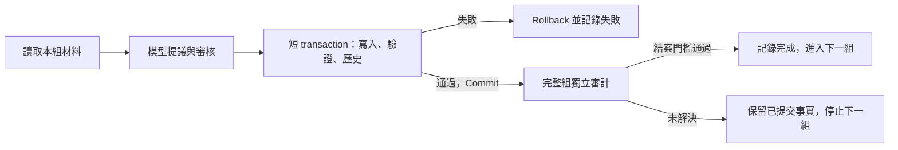

# CVP 交易與恢復設計 v2

> **讀者**：Solution architect、Developer、流程負責人。
> **類型**：規範。
> **狀態**：當前；SQL 共同交易與恢復入口已實作、遷移並啟用。隔離驗證、歷史接納與實際組驗收分開記錄；執行仍遵守 owner 停止邊界。舊整庫快照／歷史鏈執行器禁用，不得回退。
> **與代碼對齊**：2026-10-08；交易基線核對到 `6b9541e`，程式版本綁定核對本次工作樹的 `viewpoint_response_binding.py`、共同模型入口及回歸。正式啟用與組驗收須有獨立 receipt。
> **權威範圍**：CVP 及已授權來源／連接修訂的交易、changelog、執行狀態與恢復；不變更內容判定、授權範圍、模型分工或分組。受 [Solution Architecture](../00-overview/solution_architecture.md) 與 [CanonicalViewpoint 設計](./canonical_viewpoint_design.md) 約束。

## 1. 設計決定

完整內容流程與 special cases 見 [Claims → CVP 現行完整流程](./cvp_production_process_v1.md)。本設計只重整儲存、交易驗證與恢復責任，不把尚未接通的內容修復或歷史特批暗中變成通用自動授權。

PostgreSQL 是資料、已提交更改及執行進度的權威。一次獲准修改在一個短 transaction 內寫入、validation、記錄歷史；任一項失敗就 rollback，全部成功才 commit。恢復查已提交的 ChangeSet 和分組進度。

運行前提沿用單一使用者、生成期間無外部修改、批次串行。同一組可能有多次已批准修訂，每次各自提交；不把等待模型或人工裁決的幾十分鐘包進一個 transaction。

JSON 保存模型的精確輸入、原始回答、來源副本、批准與審計證據。正常生產不生成整庫 `before/frozen/readback`，也不以它們重建已提交歷史。既有 JSON、拒絕和失敗記錄保留為歸檔。

版本綁定由程式管理，不讓模型抄寫 SHA。正常初審／終審、GPT 纠正與來源／Claim 修訂審核的 wire schema 不含 `proposal_sha256`、`review_sha256`、`coverage_claim_sha256` 這些回填欄位；模型只按精確對象 ID、Claim ID 與成分编号返回完整內容判讀。共同入口先驗證實際 request、模型／backend／prompt／config、encoding、intent 及 raw，才從該次輸入產生內部版本欄位。原始回答不改；衍生結果及其綁定證據分開保存，並納入 SQL 批准材料。

這不是 SHA 模糊比對，也不是只凭 Claim ID 接受任何舊回答。已保存回答沿用實際舊配置驗真，再作同一程式綁定；不因抄錯字元重新詢問模型或人工。不改 decision／reason／correction／證據判讀，不把證據不足變成通過。真正的來源或業務記錄 SHA、SQL 版本／依賴／hold 檢查、未知呼叫 hold 與完整審計全部保留；已完成歷史不重編或重審。

本版沿用一個 store 和一個 runner，不引入事件溯源平台、通用工作流引擎或新的證明／快取框架。讀取目前記錄用 `objects`，看歷史才按 ID／版本查 `object_versions`。

## 2. 沿用的資料與最小補充

| 用途 | 已有能力 | v2 的使用方式 |
| --- | --- | --- |
| 當前資料 | `objects`；內容用經驗證的 JSONB 保存 | 按本組及實際依賴讀取，保留所有必要成員與來源 |
| 交易識別 | `change_sets`；ID 主鍵、fingerprint 唯一約束 | 記錄精確修改、批准、執行者、原因與提交事實 |
| 更改清單 | `change_operations`；記錄 ID、前後版本與 SHA | 查某次交易實際新增、修改、退役及失效哪些資料 |
| 歷史內容 | `object_versions`；每個版本的完整 payload 與 ChangeSet | 用前後版本連接查詢顯示 diff，不再保存一份整庫副本 |
| 審核 | `review_events`；決定、理由與 artifact | 保留實際審核身份、對象版本和精確證據引用 |
| 關係查詢 | `edges` 的 from/to 索引、JSONB 索引 | 查完整受影響依賴；缺少必要索引時補索引，不退回 Python 整庫掃描 |
| 運行紀錄 | `pipeline_runs` | 增加 `cvp_group` stage，以穩定 campaign 身份與原 group key 決定唯一 run ID；不按恢復目錄重新命名 |

`pipeline_runs.status` 沿用 queued/running/succeeded/failed 等運行狀態。`metadata` 保存有版本的分組契約：原成員與順序、`checkpoint`、精確材料與审核引用、ChangeSet IDs、完整審計目標／結果、原復審 flags、停止原因和下一步。checkpoint 只用 `prepared → reviewed → applied → audited`；SQL 成功不等於整組完成。

同一張運行表分別保存 campaign、group、精確 action 和已完成 review；用穩定 ID 按項查詢。group 只帶當前階段，不內嵌全部舊修訂材料或祖先鏈。SQL 登記每個角色／action 的原輸出位置，換目錄不能取得第二份呼叫預算。

模型角色仍沿用既有持久 call intent、原回答及跨 root 一次預算。分組紀錄只指向這些證據，不另造第二個呼叫帳本。`progress.json` 和 completion JSON 如仍供工具顯示，只是可重建輸出，不能與 SQL 各自決定進度。

Changelog 由現有四張表 `change_sets / change_operations / object_versions / review_events` 的查詢組成，不新增重複歷史表。補足新交易必填的 reason、執行者、授權及材料 SHA，還有按 ChangeSet 查版本的索引。舊資料缺原因就如實顯示缺失；不能補造批准或覆寫旧版本。

失敗嘗試寫入 `pipeline_runs` 或既有執行日誌。被 rollback 的修改不會出現在已提交 changelog。Changelog 也不代替資料庫備份；現行備份、SSD 身份和 restore-list 要求保持。

## 3. 一條執行路徑

| 階段 | 執行內容與完成依據 |
| --- | --- |
| 讀取本組材料 | 從原成員出發，取 Claim、Evidence、fragment、完整自身來源、已有 CVP 及其必要成員／反向引用。材料保存精確 ID、版本、SHA、批准與 hold，不截斷真正依賴 |
| 模型提議與審核 | 沿用指定 GPT／Opus 及正常唯一纠正輪次、500000 bytes 和覆蓋規則；驗證批准確實對應待寫狀態。模型不取得 SQL 寫入權限 |
| 短 transaction | 依第 4 節驗證並提交。backup、模型、來源檔案及完整材料的 SHA 驗證在進入 transaction 前完成，不長時間持 SQL 鎖等待外部服務 |
| 完整組獨立審計 | commit 後先以新連線讀取實際寫入記錄，再走原完整組 Gemini 審計、standing GPT 終局與既有例外規則；審計分母包含保留及新建 CVPs |
| 完成或停止 | 審計結案結果、所審精確版本和 flags 以短 transaction 登記。下一組只在前一組達到原放行條件後開始 |

物理來源在材料建立、恢復使用及審計時按本組來源核驗；檔案不受 SQL rollback 保護。來源內容變更仍走原完整授權流程，不因資料庫有 transaction 就省略原文驗證。

## 4. Transaction 的 validation

以下是既有 `PostgresKnowledgeStore.apply_plan` 的重構契約，實作仍放在同一 store：

1. 取得原短交易鎖。先查 ChangeSet 唯一 ID／fingerprint。已提交且精確身份相符就返回原結果；身份衝突則停止。這項檢查先於「尚未套用的前像」，避免已成功交易因舊前像不再存在而無法恢復。
2. 讀取並鎖定本次會改的記錄，核對必要讀取依賴的版本、來源、current CVR、完整關係集合及實際 hold。新建 ID 必須不存在。單使用者也保留這些廉價局部檢查，以攔截過時材料和程式錯誤。
3. 建立本次允許的完整寫入清單：批准的業務修改，以及依明確規則算出的產品依賴失效／impact events。只因交易觸發的確定性副作用也必須列入、記錄原因，不能默認「其他變化都安全」。
4. 用固定 SQL、精確主鍵執行寫入。每個寫入 helper，包括 retire、edge 同步和失效處理，須以 `RETURNING` 收集實際記錄與行數，交同一驗證器；不容許修訂 wrapper 自己執行額外 DML。
5. 用**同一連線、同一 transaction**讀回實際後像；比對批准內容與確定性 provenance、前後版本、寫入集合、引用完整性、反向引用、成分定位、覆蓋、關係唯一性、未聲明欄位保留及 holds。查詢涉及真正受影響的依賴，不只驗證 changed rows。
6. 同 transaction 核對 `change_operations`、`object_versions`、`edges` 和 `review_events` 全部對得上實際寫入，將 ChangeSet 標為 applied，將本組 checkpoint 標為 applied。任何缺漏、額外記錄或內容不同都拋錯 rollback；正常退出才 commit。

Transaction 本身只保證原子性，不能證明一條錯誤 SQL 沒改到別人。非目標不變由「所有 DML 經單一入口、精確寫入清單、實際 RETURNING 集合和後像／歷史核對」共同保證；測試須故意注入錯誤 WHERE／額外副作用並證明整筆 rollback。不能只查計劃中的幾個 ID 就聲稱全範圍安全。若現有 helper 無法納入這個邊界，先重構該 helper，不能直接拿掉原全庫 guard。

commit 後的新連線回讀用於确认可見結果與交接審計。它若失敗，SQL 已提交的事實仍成立，不能再稱 rollback；恢復核對該 ChangeSet 後接續。審計發現內容問題也不能 rollback 已結束的 transaction，須按原授權邊界處理新修訂。

## 5. 恢復由已保存狀態決定

| 中斷位置 | 恢復動作 |
| --- | --- |
| 模型呼叫前 | 檢查原 intent／預算；允許時才呼叫 |
| intent 已有、回答缺失 | 保持 outcome unknown，不能靠 SQL transaction 保證外部模型恰好一次，也不能自動重發 |
| 回答已保存 | 核驗精確材料與原回答，直接接下一階段 |
| SQL commit 前 | 連線失效使未提交 transaction rollback；恢復取得同一交易鎖並查主庫，確定沒有提交，才可按原同一計劃繼續；不重發模型 |
| commit 回覆丟失 | 查主庫 ChangeSet；已 applied 則接續回讀／審計。資料庫不可達、舊交易仍未定或結果有歧義時停止，不把「沒看見回執」當成沒寫入 |
| 已提交、尚未審計完成 | 不再 apply；消費已完成的精確審計項，未解決呼叫仍遵守原 once 規則 |
| 完整組已結案 | 讀該組已登記結果與必要當前依賴，再選下一組；不重建父／子／祖先完整證明 |

正常續跑信任先前由驗證器寫入的歷史事實及版本關聯；相關來源或記錄真的變更時，只使受影響的完成資格失效，保留原審核歷史。透過同一寫入入口維護這個失效關係；來源實際變化仍須物理檢查。批准紀錄不能只剩無來源的 `pass=true`。

歷史審核記錄原模型、prompt、policy、來源和材料 SHA；交易記錄原驗證器版本。日後修改一般程式碼不自動推翻全部歷史，也不再因整個 module 的檔案 SHA 變化重編所有舊投影。只有明確判定原驗證規則有缺陷、證據損壞或依賴變更時，才針對受影響項進行有記錄的處理。

## 6. 從正常路徑移除什麼

| 目前責任 | v2 接替方式 |
| --- | --- |
| 每組／每次修訂建立整庫 before、frozen、readback | 本組精確材料 + SQL 版本歷史 + transaction 內局部完整驗證 |
| `_assert_registry_fingerprint` 掃所有 active payload | 本次必要讀取版本／關係集合與實際完整寫入清單 |
| build proof 後反覆 verify、parent／child 全鏈遞迴 | 當階段驗證完成時登記一次結果；後續查精確已提交版本與目前相關依賴 |
| 每次重啟重算所有完成組的巨大 physical bindings | 一次歷史接納後讀 SQL 分組紀錄；本次所用材料與來源仍核驗 |
| 每次 bug 加一個新的恢復 wrapper／root | 原穩定 group run、checkpoint 和 ChangeSet 繼續；新輸入建立新批准身份，保留原預算 |
| 同一入口兩次 cold preflight | 同一 runner 完成預檢後繼續，dry-run 是該入口的只讀模式 |
| 用進程內快取與多種 compiled predecessor 解正常恢復 | 不再新增這類層；現有投影工具僅可供明確的歷史遷移使用 |

各種修訂仍有自己的內容權限與 validator。它們輸出相同的材料／批准／ChangeSet 契約後，共用交易與恢復步驟；統一執行器不等於統一或擴大內容授權。

業務責任分為 Claim management（Claim 本身、Evidence 與 Claim–Evidence 綁定）和 CVP management（Claim–CVP 連接及 CVP）；Claim／Evidence 修訂须在共同後像包評估相關觀點及完整其他成員，不默認 CVP 必須改寫。兩域已批准的完整方案共用同一短 transaction；有 pending coverage／影響時，completion 拒絕結案。共同接點、policy 邊界及實作狀態見[管理域變更閉環](./cvp_production_process_v1.md#13-claim-與-cvp-管理的變更閉環)，不由本文提前授權內容修改。

**舊 solution 不再使用。** 原 campaign／batch 執行、來源與父子續接、逐組 special-case 修復及舊 recovery/watch 的執行入口直接拒絕。沒有環境旗標、路徑判斷或失敗 fallback 可以重新啟用它們。舊 artifacts、模型回答、失敗、預算和歷史驗證的純讀取函式保留；讀取歸檔不等於執行舊流程。

## 7. 先用第 57 組完成驗收

第一個里程碑是原 57 組資料的完整恢復入口。合成規模矩陣、其他生產功能和新模型呼叫都不列為此前置工作。

1. **一次歷史接納**：讀原 57 組 completion、原 SQL ChangeSet／操作／版本、原審核與完整審計證據，建立可追溯的分組狀態。需要的大快照只在這個明示、有預算、可停止的遷移步驟讀取一次；已驗證的步驟能斷點續接，不把整段 proof 建構重新跑一遍。試作先輸出接納預覽及載入隔離資料庫，沒有驗收就不寫正式運行狀態。
2. **第 57 組識別**：接納器核對既有 `KCS-1b2850d74d71c6824299`（59 ops）、`KCS-f5d3969df38f0adb9831`（6 ops）、`KCS-ccb6f76a11c679a5f29f`（3 ops）、`KCS-107d076eb4632d9ecbdb`（9 ops）及保存的完整 16 Claims／11 CVPs 最終審計。它們只作歷史匹配，不生成新批准、不重 apply 或重跑模型。
3. **完整入口驗收**：新冷進程讀取接納後的 SQL 狀態，確認 57 unique groups／321 original Claims、原 973／156 順序與成員、35／37 復審 flags；完成第 58 組只讀資格／材料準備後退出。第一次只讀預覽不啟動模型或生產。前 57 組歷史材料不再進入正常讀取量。
4. **真實 rollback 測試**：隔離 PostgreSQL 中覆蓋末條 validation 失敗、歷史寫入失敗、錯誤 WHERE／多改一條、漏副作用、版本不符、真 hold、缺審核或來源、交易中斷及 commit 回覆丟失。失敗時對象／歷史／進度一起不生效，成功且回覆丟失時只接續、不重寫。
5. **完整結果與耗時**：同一真實保存資料比對准入結果、後像、完整依賴及審計分母；測量冷啟動、同進程下一組與 commit 後恢復的時間、SQL rows、檔案 bytes 和峰值記憶體。正常機械階段沿用現有 64 MiB／5 s 護欄，不提高上限；備份、模型及內容審計另計。局部測試通過不能宣布本里程碑完成。

原 completion 證據不足、實際 SQL 衝突或內容未解決時，接納預覽逐項報告，不能把所有舊資料直接標為成功。設計、實作、隔離接納驗收、正式遷移與恢復是分別可核對的交付；隔離驗證通過不啟動生產，也不授予新內容修改權限。

## 8. 實作範圍與代碼依據

先改既有 store 的 transaction 邊界與實際寫入核對，再接現有 `pipeline_runs` 分組進度，最後把一個 runner 的讀取／恢復切到 SQL。來源修訂、連接修訂、一般 CVP 只接這個共同入口。不得把此次設計變成又一套旁掛的 proof consumer。

| 代碼依據 | 已核對到的能力或問題 |
| --- | --- |
| [SQL migration 001](../../../backend/api/canonical_repository/migrations/001_postgres_authoring_store.sql) | 目前資料、版本、ChangeSet、操作與審核表；具備 changelog 的基礎 |
| [SQL migration 006](../../../backend/api/canonical_repository/migrations/006_cvp_transaction_runs.sql) | 現有運行表增加 `cvp_group` 及精確 group／action／依賴索引；須另作正式遷移 |
| [Postgres store](../../../backend/api/canonical_repository/postgres_store.py)／[交易驗證](../../../backend/api/canonical_repository/transaction_validation.py) | 原子業務與確定性失效、實際 RETURNING 全寫集、後像與歷史核對、同交易 checkpoint；已提交 ID 優先判斷，錯誤 WHERE／隱藏 trigger 不放行 |
| [共同 runner](../../../backend/pipeline/cvp_sql_flow.py)／[修訂分支](../../../backend/pipeline/cvp_sql_actions.py) | 正常 CVP、來源／Claim、owner link、窄 supports 及必要 coverage 共用提交與恢復；source Claim 的真實審核事件同交易寫入 |
| [程式版本綁定](../../../backend/api/canonical_repository/viewpoint_response_binding.py)／[共同模型邊界](../../../backend/pipeline/viewpoint_resolution_runtime.py) | wire schema 移除模型回填 SHA，真實輸入及原回答驗證後衍生內部欄位；[回歸](../../../backend/tests/test_viewpoint_program_response_binding.py)涵蓋完整唯一纠正／終審與零重呼叫恢復 |
| [歷史接納](../../../backend/pipeline/cvp_sql_admission.py) | 明示有預算的移入預覽；stream 物理 SHA 並匹配已提交 SQL 歷史，不解析整庫快照或重跑模型 |
| [獨立審計](../../../scripts/audit-library.py) | 自己的 scoped SQL 讀取器、完整原 group 與 CVP 成員；報告攜帶實際所審版本 pins，不能由 producer 的 pins 代替 |
| [舊入口拒絕](../../../backend/pipeline/cvp_retired_runtime.py) | 不依目錄或環境開關，執行前 fail closed；純內容 compiler 和歸檔讀取不擴權 |
| [交易反例](../../../backend/tests/test_cvp_sql_transaction_postgres.py)／[修訂交易](../../../backend/tests/test_cvp_sql_actions_postgres.py)／[完成契約](../../../backend/tests/test_cvp_sql_checkpoint_contracts.py) | 真實隔離 SQL commit／rollback、lost reply、hold、原成員、後續修訂與禁用舊入口 |
| [真實保存資料驗收](../../../backend/tests/test_cvp_sql_real_saved_acceptance.py)／[規模驗證](../../../backend/tests/test_cvp_sql_scalability.py) | 前者只讀正式資料、寫隔離資料庫，精確復用原審計輸入；後者固定受影響集合增加無關資料，不能冒充 1,000 篇實測 |

新 runner 須指定已接納的 SQL campaign；缺少時停止，不從旧 root 自動導入。`--dry-run` 僅當前組只讀準備，正式執行須明示 `--execute`。schema migration、歷史接納和 production execution 是三個不同操作；隔離測試不能代替各操作的實際 receipt。

單組／有界驗收必須指定 `--stop-after-group N`：只有 SQL 已保存第 N 組 `audited` 才正常退出，不準備下一組。執行 root 的不可變 `execution-boundary.json` 固定 campaign 與停止組號；恢復不能省略或擴大此邊界。已有第 N 組完成時直接回報 owner checkpoint，不把它說成全量完成。準備、生成審核、已提交、完整獨立審計與完成階段各輸出即時事件，提交不等於組完成。
