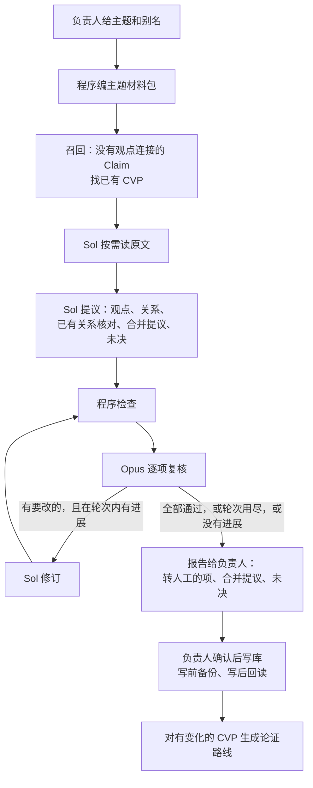

# CVP 3.0：主题式 CVP Agent

> **读者**：Solution architect、神学编辑、Developer
> **类型**：规范
> **状态**：当前（负责人 2026-10-26 批准，#456）
> **与代码对齐**：2026-10-26（核对到 352b7d7e）。第 4–8 节对应试跑程序 `backend/pipeline/topic_cvp_pilot.py`；第 6 节的多轮修订与第 9 节的写库层尚未实现
> **权威范围**：CVP 3.0 的工作单位、流程、分工、关系证据标准、多轮修订与转人工、写库与论证路线的衔接，以及从 CVP 2.0 沿用和退役的部分。等价、成员、summary 的语义规则仍以 [CVP 2.0 语义规则](../../../config/wang_cvp_contextual_semantics_v2.md) 为准，本文只写改动。

**目标：一次处理一个主题。Agent 看得到这个主题的全部 CVP 和相关 Claim，原文按需去读，提出观点和观点之间的关系，自己与复核者来回修订到定稿；拿不准的交负责人。每条关系都附教授自己把两个观点连起来讲的原话。**

CVP 3.0 用主题式 Agent 取代 CVP 2.0 的分批生成（负责人 2026-10-26：「我們做的是 CVP 3.0 了，Agent 替換掉 batch processing」）。分批生成每批最多 20 条 Claim，同一主题的观点从来没有一起放在一个模型面前；「人子」试跑表明，整个主题一起看，关系、身份和核心论证才显得出来。

## 目录

| 节 | |
| --- | --- |
| [1. 负责人已定的规则](#1-负责人已定的规则) | 2026-10-25／26 在 #456 定下的每一条 |
| [2. 术语](#2-术语) | |
| [3. 流程](#3-流程) | 从主题到写库，谁做哪一步 |
| [4. 范围与召回](#4-范围与召回) | 主题包含什么；没有观点连接的 Claim 怎样找已有观点 |
| [5. 阅读与提议](#5-阅读与提议) | 按需读原文；输出什么 |
| [6. 复核、多轮修订与转人工](#6-复核多轮修订与转人工) | 修到什么时候停，什么交负责人 |
| [7. 关系的证据标准](#7-关系的证据标准) | 知识层不即兴发挥落到程序上 |
| [8. 程序检查](#8-程序检查) | 送复核前机械核对的项目 |
| [9. 写库](#9-写库) | 负责人确认之后怎样写，怎样保证安全 |
| [10. 论证路线](#10-论证路线) | 写库之后，按 CVP 逐个生成 |
| [11. 从 CVP 2.0 沿用与退役](#11-从-cvp-20-沿用与退役) | |
| [12. 不在本文范围](#12-不在本文范围) | |
| [13. 实施顺序](#13-实施顺序) | |

## 1. 负责人已定的规则

| 规则 | 内容 |
| --- | --- |
| 输入 | 现有 CVP 和相关 Claim 的全部数据；讲道原文按需读 |
| 知识层不即兴发挥 | 观点关系只记教授自己把两个观点连起来讲的地方，附他的原话。模型从两处原文推出来的关系不写（第 7 节） |
| 母本算原话 | 释经课母本已经人工审定，里面第三人称的整理文字与讲道逐字稿一样可以作证据 |
| 例外记限定 | 教授自己交代了例外，或解释了表面上的例外为什么不算例外（文法不允许、属于转引），记「限定」，不记「张力」。例：「耶稣每次说『人子』都用定冠词」与「約5:27 因文法省略定冠词」 |
| 观点关系增加「支持」 | 「因为甲，所以乙」而甲不足以单独推出乙，记 `supports`；能单独推出才记 `entails`（`entails`：推出） |
| 宽窄不一只立一个观点 | 同一观察在不同讲道里说得宽窄不一，只立一个观点，较窄的说法用延伸或限定连到它；同一篇讲道里由此推彼的（「因此……」）是两个判断 |
| 语境不进观点层 | Claim 之间的「语境」关系留在 Claim 层，观点层只记论证 |
| 合并由负责人确认 | Agent 只提出合并，不自行合并 |
| 分工 | Sol 提议、Opus 复核；两种分工对照后定下 |
| 多轮修订，拿不准的转人工 | Agent 自己与复核者修到定稿；仍定不下的交负责人（第 6 节） |
| 论证路线不在 Agent 内 | 观点定下、写库之后，用现有路线代码逐个 CVP 生成（第 10 节） |
| 修订最多 3 轮 | 2026-10-26 定 |
| 没有证据的已有关系照旧保留 | 全库 185 条只有理由文字的关系不动；主题运行时的核对结论只进报告 |

## 2. 术语

| 术语 | 意思 |
| --- | --- |
| **主题** | 一次运行处理的范围：教授反复讲的一个话题，例如「人子」。由 CVP 的 statement 命中主题词或别名决定 |
| **主题材料包** | 一个主题的全部 CVP、相关 Claim 及其证据原文、Claim 关系、已记录的观点关系，加上全库 CVP 一行一个的目录 |
| **原文块** | 讲道或母本按段切成的编号块；模型按编号请求 |
| **召回** | 对没有任何观点连接的 Claim，在全库 CVP 里找可能相关的已有观点；沿用 CVP 2.0 的召回函数 |
| **Claim 关系** | 已有记录：教授在一篇讲道里把一条主张作为另一条的依据、应用、限定等（`claim_relations`） |
| **转人工** | 复核与修订定不下来的项，连同双方理由，交负责人决定 |

## 3. 流程

| 步骤 | 谁做 | 说明 |
| --- | --- | --- |
| 编包、召回 | 程序；召回用 Sol | 第 4 节 |
| 阅读与提议 | Sol | 第 5 节 |
| 程序检查 | 程序 | 第 8 节；不通过的不送复核 |
| 复核与修订 | Opus 与 Sol | 第 6 节 |
| 负责人审报告 | 负责人 | 只看转人工的项、合并提议和未决；已通过的项在报告里可查 |
| 写库 | 程序 | 第 9 节 |
| 论证路线 | 现有路线代码 | 第 10 节 |

## 4. 范围与召回

**范围**：statement 含主题词或别名的 CVP，加上它们的全部连接 Claim，以及 statement 含主题词的 Claim。「人子」的别名是 `Son of Man`：只查中文时漏掉了「耶穌以帶定冠詞的『The Son of Man』自稱……完全的人，也是完全的神」。

只收本身讲这个主题的 CVP。与主题有关联、但本身不讲它的 CVP 不收：它们在全库目录里，可以做关系的对端；与范围内 Claim 有关系的那几条 Claim 也作为邻接 Claim 进包。试跑时收过 7 个这样的 CVP，带进 30 条与人子无关的 Claim，请求超出了上限。

**召回**：范围内没有任何观点连接的 Claim，用 CVP 2.0 的召回函数（`backend/pipeline/cvp_recall.py` 的 `run_recall`，每次最多 20 条 Claim，读全库 CVP 的 statement 与经文范围）找相关的已有观点。召回到的范围外观点连同其成员 Claim 的 statement 放进包里，提议者先比较再决定是否新建。召回不截断候选；放不下就停，不删。「人子」范围里这样的 Claim 有 5 条，召回到 3 个已有观点，约 1 KB。

**容量**：单次请求上限 450 KB。原文阅读的额度按剩余空间计算，最多 40,000 字；剩下不到 15,000 字时停下，请负责人把主题缩小，程序不截断。

## 5. 阅读与提议

阅读沿用写文章 Agent 的循环（`backend/pipeline/draft_first_source_reader.py`）：每回合提议者看材料包、自己的笔记和保留的原文块，请求下一批块；读够了再出正式提议。每回合的请求与回答都存盘。

提议包含：

| 部分 | 内容 |
| --- | --- |
| Claim 处置 | 范围内每条 Claim：成员（等价）、支持、限定、延伸、背景，或未决。现有连接附类型发给提议者，只有等价才算成员 |
| 观点 | 保留、充实（新成员、新 summary）、新建。summary 最多 500 字，只整合成员，不写进别的观点的内容 |
| 新关系 | 两个观点之间的类型化关系，附第 7 节的证据 |
| 已有关系核对 | 范围内每条已记录的关系：找到证据、没找到、方向或类型与原话不符（写明应是什么）。只判定，不撤销 |
| 合并提议 | 哪几个已有观点是同一判断，附各自的原话 |
| 未决 | 需要负责人判断的问题，附两边的依据 |

论证路线不在提议里（第 10 节）。

## 6. 复核、多轮修订与转人工

**复核**：Opus 逐项判定提议里每一项：通过、修改（写明改成什么）、驳回（写明违反哪条规则）。程序核对判定恰好覆盖全部项，不漏不多。复核者拿到同一份材料包和提议引用到的全部原文块。

**修订**：Sol 按复核意见改，不同意的写明理由。程序重新检查后，Opus 只复核改动过的项；上一轮已通过、没有改动的项沿用通过。项目编号在各轮之间不变。

**什么时候停**：

| 情形 | 处理 |
| --- | --- |
| 全部通过 | 停，进报告 |
| 3 轮修订用尽 | 停；未通过的项转人工 |
| 某一项连续两轮判定不变，没有进展 | 这一项转人工，其余继续修 |
| 提议者写明不同意复核，复核者仍坚持 | 这一项转人工 |
| 修订后程序检查不通过 | 提议者带着问题清单再改一次；仍不通过即停，整份转人工 |

**转人工的项**进报告的最前面，每项附：原提议、复核意见、提议者的回应、引用的原文。负责人逐项决定；决定写进运行目录的 `owner-decisions.json`，写库时执行。

「人子」试跑里，转人工的四项是：两对双向「支持」保留哪个方向、16:27 与 16:28 之间记不记限定、观点层要不要「语境」类型、两个讲普世宣教的观点要不要合并。

## 7. 关系的证据标准

一条新关系只在下面两种情形之一才能提出：

| 证据 | 是什么 | 程序怎么核 |
| --- | --- | --- |
| **Claim 关系** | 已有一条 Claim 关系，一端是甲观点的成员，另一端是乙观点的成员 | 关系存在，两端确实分别是甲、乙的成员 |
| **原话** | 教授在一段话里亲口把两件事连起来讲 | 引文逐字出现在本次读过的原文块里 |

**张力**要两边各一段原话，并且教授没有交代例外（第 1 节「例外记限定」）。不调和，不裁定谁对。

**「强调X——A、B」**：「强调」的直接对象是 X，不能凭破折号后的身份说明断定它分别强调 A 和 B，再据此与别的观点比较冲突（沿用 CVP 2.0 的提议与复核规则）。

**不能提出的**：两个观点逻辑上相关，但教授没有在同一处连起来讲。确有价值的列为未决。

**已记录的关系也执行同一标准**：只判定，不撤销；方向或类型不符的，写库时由负责人确认后改正。

## 8. 程序检查

送复核之前，程序机械核对：

- 引用的短编号都存在；范围内每条 Claim 都有处置；
- summary 不超过 500 字；新建观点有 statement 和 summary；
- 引用的原文块都是本次实际读过的；
- 每条新关系的证据成立（第 7 节），且不与已记录的关系重复；
- 张力有两段逐字原话；
- 每条已记录的关系都有核对结论；
- 不修改范围外观点的 statement 或 summary。

## 9. 写库

**尚未实现。** 负责人审完报告、定了转人工的项以后：

1. 整库备份（`scripts/backup-registry.sh`）。
2. 程序把定稿的提议与负责人决定补成完整记录：Claim 与观点的连接、观点关系（附支持它的 Claim 或 Claim 关系）、充实后的 summary、已有关系的类型更正。记录格式沿用现有数据模型（`backend/api/canonical_repository/knowledge_models.py`）。
3. 写入前先列出写入清单给负责人确认。
4. 用库的提交接口写入一个事务，写后回读核对。
5. 审计依据：Sol 的定稿提议、Opus 的各轮复核、负责人的决定，三者的原始文件和指纹随写入保存。

写库不挂在 CVP 2.0 的批次运行之下。合并沿用 CVP 2.0 的合并代码（`cvp_merge_management.py`）：它独立读两个观点的全部成员和原文再判断，判不出是同一观点就不写。

## 10. 论证路线

写库之后，对这次有变化的 CVP 用现有路线代码（`backend/pipeline/viewpoint_route_cvp_worker.py`）逐个生成路线。每个 CVP 的路线自己就是提议、复核、修正的多轮，没有进展或判断不了就不写。

**并行由程序调度，不用模型。** 路线代码带一个按 CVP 排队的任务队列（`viewpoint_route_cvp_queue.py`）：每个 CVP 一个任务，worker 领任务时加带期限的锁，不会两个 worker 做同一个；worker 中途停掉，锁到期后别的 worker 接手。主题写库后，程序把有变化的 CVP 排进队列，同时启动 2–3 个 worker，数量以订阅额度不被限流为准。路线先不写库，负责人看过再写。

路线不放进 Agent 的提议，原因有三：

- 路线建立在成员之上，成员定下之前做路线，实例会算错讲道；
- 路线要逐篇讲道核对论证步骤，和观点、关系挤在一次调用里，总有一部分被敷衍；
- 关系要跨讲道找连接的那一句，路线要读完一篇讲道的整段论证，共用一份阅读额度，两边都读不深。

## 11. 从 CVP 2.0 沿用与退役

| | 沿用 | 退役或改变 |
| --- | --- | --- |
| 工作单位 | — | 每批最多 20 条 Claim 的分组、campaign 与批次运行，不再用于生成观点 |
| 语义规则 | 等价、成员、支持的定义；summary 写法 | 加入第 1 节负责人定的各条；「全称加明确例外就是张力」改为「教授交代了例外就记限定」 |
| 召回 | `run_recall` 与它的提示 | 只对没有观点连接的 Claim 召回 |
| 数据模型 | 全部记录格式 | 观点关系类型加 `supports` |
| 复核 | Opus 逐项判定、判定集合核对 | 多轮修订与转人工按第 6 节 |
| 写库 | 备份、事务、回读 | 不经批次运行（第 9 节） |
| 合并 | `cvp_merge_management.py` | 由 Agent 提出、负责人确认后调用 |
| 论证路线 | 路线代码 | 不变 |

## 12. 不在本文范围

- **全库推广时怎样定主题**：另一张卡负责（负责人 2026-10-26）。候选做法是用 Claim 的主题词（`topic_terms`）找出现在多篇讲道里、经常一起出现的词，列成候选主题交负责人挑。
- Claim 层的修改：发现 Claim 有问题，回 Claim Management 2.0。
- 写文章：本 Agent 的产出是知识库，不是文章。

## 13. 实施顺序

1. **多轮修订与转人工**：把试跑程序的一轮修正改成第 6 节的多轮，转人工的项进报告。
2. **写库层**：第 9 节，先用「人子」的定稿结果与负责人的四项决定做第一次写入，写前给负责人看清单。
3. **论证路线衔接**：写库后对有变化的 CVP 排队生成路线，先不写入，负责人看过再写。
4. **第二、三个主题**：赎价、称义／成义，检验能否总结出核心观点。

第 1–3 步是代码，按卡走 PR；跑模型、写库各自等负责人明确的指令。

试跑的过程与数字见 [主题式 CVP 试跑记录（2026-10-25／26）](./topic_cvp_agent_pilot_record_20261025.md)。
