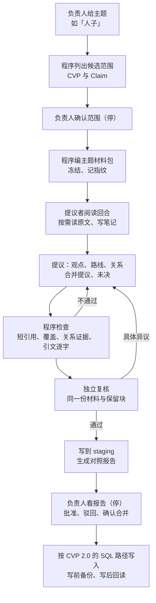

# 主题式 CVP Agent：方案

> **读者**：Solution architect、神学编辑、Developer
> **类型**：规范
> **状态**：待负责人评审（#456）
> **与代码对齐**：未核对（尚无实现）。第一节的数字于 2026-10-25 从 PostgreSQL `wang_knowledge` 只读查得
> **权威范围**：主题式 CVP Agent 的输入、阅读方式、输出、关系证据标准、合并的处理，以及「人子」实验的设计。CVP 身份、充实、摘要、复核、权限与提交的规则仍由 [Claim／CVP Management 2.0 主控设计](./claim_cvp_management_2_design.md) 管辖，本文只写与它不同的地方。

**目标：一次处理一个主题，让模型看得到这个主题的全部 CVP 和相关 Claim，原文按需去读，一次提出观点、论证路线和观点之间的关系。每条关系都要附上教授自己把两个观点连起来讲的原话。**

## 目录

| 节 | |
| --- | --- |
| [1. 为什么做](#1-为什么做) | 「人子」在观点图上暴露的三个缺口及其数据 |
| [2. 负责人已定的四点](#2-负责人已定的四点) | 2026-10-25 |
| [3. 术语](#3-术语) | 本文新用的词 |
| [4. 流程](#4-流程) | 从定主题到写入，各步由谁做 |
| [5. 输入：主题材料包](#5-输入主题材料包) | 包里有什么、多大 |
| [6. 阅读：沿用写文章 Agent 的循环](#6-阅读沿用写文章-agent-的循环) | 什么照搬、什么要改 |
| [7. 输出](#7-输出) | 观点、路线、关系、合并提议、未决 |
| [8. 关系的证据标准](#8-关系的证据标准) | 知识层不即兴发挥落到程序上 |
| [9. 合并与退役交给负责人](#9-合并与退役交给负责人) | 比 CVP 2.0 第 8.5 节更严的一处 |
| [10. 不变的部分](#10-不变的部分) | 沿用 CVP 2.0 的复核、轮次、出口与提交 |
| [11. 「人子」实验](#11-人子实验) | 基线、量什么、负责人怎么看 |
| [12. 负责人待定](#12-负责人待定) | |
| [13. 实施顺序](#13-实施顺序) | |
| [14. 不在本文范围](#14-不在本文范围) | |

## 1. 为什么做

现在的 CVP 一批一批生成：每批最多 20 条 Claim，模型看到这批的材料和召回的已有 CVP（[CVP 2.0 第 8.1–8.3 节](./claim_cvp_management_2_design.md#8-cvp-接收生成与维护)）。观点关系基本只在同一批里建立；论证路线是[另一条流水线](./canonical_viewpoint_design.md#5-论证路线)。同一个主题的观点从来没有一次放在同一个模型面前。

「人子」在观点图上暴露了后果（#453）：

| 缺口 | 例子 |
| --- | --- |
| 分量重的观点处在边缘 | 「耶穌按但以理第七章的背景以「人子」自稱時，這個稱號是在強調祂的神性，而不是強調祂的人性」出现在 7 篇讲道里（全库最多），只有 2 条关系 |
| 疑似同一观点分在两处 | 「約翰福音5:27的「人子」因文法而省略定冠詞，其語境仍強調耶穌基督的神性」在另一个群里，没有归并，也没有连线 |
| 常讲的观点是孤立的 | 「耶穌所自稱的人子在地上有赦罪的權柄」出现在 4 篇讲道里，没有任何关系 |

数据上的缺口比图上更大。下表是 2026-10-25 的只读查询结果：

| | 全库 | 涉及「人子」CVP |
| --- | --- | --- |
| active CVP | 722 | 27（文字含「人子」），其中 14 个孤立 |
| 已记录的 CVP 关系 | 188 | 15 条触及，6 条两端都在这 27 个里 |
| 教授在同一篇讲道里把两个 CVP 的成员 Claim 连起来（Claim 关系） | 502 对 CVP | 43 对 |
| 其中已记成 CVP 关系的 | 79 对 | 7 对 |
| 已记录的 CVP 关系里附有证据（`supporting_claim_ids` 或 `supporting_claim_relation_ids` 非空）的 | 3 条 | — |

两点值得注意：

- **教授连过、库里没记。** 他亲口把两个观点连起来讲的地方有 502 对，库里只记了 79 对。
- **库里记了、没附证据。** 现有 188 条关系里，185 条只有理由文字，没有指向任何 Claim 或 Claim 关系。

## 2. 负责人已定的四点

2026-10-25 在 #456 的讨论中决定：

1. **输入**：现有 CVP 和相关 Claim 的全部数据。讲道原文按需读，与写文章 Agent 相同。
2. **知识层不即兴发挥**：关系只记教授自己把两个观点连起来讲的地方，每条附他的原话。模型从两处原文推出来的关系不写。
3. **合并交给负责人确认**：归并已有 CVP、让一个 CVP 退役，一律不自动写入。
4. **先用「人子」做实验**：结果先放 staging，负责人看过并批准之前不写入观点库。

CVP 的身份、充实、摘要等规则一律参照 CVP 2.0。

## 3. 术语

| 术语 | 意思 |
| --- | --- |
| **主题材料包** | 一个主题的全部 CVP 与相关 Claim 的完整数据，加上全库 CVP 的一句话目录。写在磁盘上、不可变，带内容指纹 |
| **原文块** | 讲道或母本按段切成的编号块。模型按编号请求，不按关键词 |
| **笔记** | 模型在阅读回合之间自己写下的阅读所得与待核问题，最多 6,000 字，随下一回合一起发回给它 |
| **保留块** | 模型决定留在后续回合里的原文块。未保留的块下一回合不再发送，但仍在包里，可以再请求 |
| **Claim 关系** | 已有记录：教授在一篇讲道里，把一条主张作为另一条的依据、应用、限定等（`claim_relations`）。是他自己的推理连接 |
| **短引用** | 程序给材料里每个对象编的短编号。模型只引用短引用，不抄内部 ID，内部 ID 由程序换回（[CVP 2.0 第 8.4 节](./claim_cvp_management_2_design.md#84-精简输出有界修订与完整复核)） |

## 4. 流程

| 步骤 | 谁做 | 说明 |
| --- | --- | --- |
| 候选范围 | 程序 | 见第 5 节；关键词命中只是候选，不证明属于这个主题 |
| 确认范围 | 负责人 | 实验阶段每个主题停一次。以后是否保留这个停点，见第 12 节 |
| 编包 | 程序 | 超出容量即停，不截断（第 5 节） |
| 阅读与提议 | 提议模型 | 第 6、7 节 |
| 程序检查 | 程序 | 第 7、8 节列出的每一项；不通过的输出不送复核。提议者带着程序列出的问题自修一次，仍不通过即停 |
| 复核 | 复核模型 | 与提议者不同厂商；规则同 CVP 2.0 第 8.4 节 |
| staging 与报告 | 程序 | 不写观点库 |
| 批准 | 负责人 | 实验阶段整份报告由负责人看；合并与退役永远由负责人确认（第 9 节） |
| 写入 | 程序 | 第 10 节 |

## 5. 输入：主题材料包

### 5.1 候选范围怎样列

程序按三条线索列候选，交负责人确认：

1. **文字命中**：CVP 的 statement，或 Claim 的 statement 含主题词（简繁两种写法都查），以及负责人给的别名。「人子」的别名是 `Son of Man`：试跑 1–3 只查中文，漏掉了「耶穌以帶定冠詞的『The Son of Man』自稱……完全的人，也是完全的神」，而它正好与「強調神性，而不是強調人性」直接相关。
2. **成员与连线**：命中 CVP 的全部成员 Claim；命中 CVP 已记录关系的对端 CVP（只到一跳）。
3. **Claim 关系**：与范围内 Claim 有 Claim 关系的其他 Claim，以及这些 Claim 所属的 CVP。

关键词命中只用来列候选，不决定身份，也不证明主题已穷尽（CVP 2.0 第 5 节）。负责人可以增删；删掉的也要记下理由。

程序把第 1 条命中的 CVP 列为核心范围，把第 2、3 条找到的列为候选，写成 `scope.md`：每个候选附它与核心范围之间的 Claim 关系条数，以及有没有已记录的观点关系。负责人在候选里勾选，勾中的按 `viewpoint_id` 加入范围。「人子」有 28 个候选，多数是「解经应查看上下文」这类方法判断，不该整批加入，所以这一步不能由程序自动扩一跳了事。

**只收本身讲这个主题的 CVP。** 一个 CVP 进了范围，它的全部成员 Claim 都跟着进包。试跑 4 收了「耶稣就是神」「四兽」「阿们」「登山变像」等 7 个候选，带进 30 条 Claim，没有一条讲人子，包从 286 KB 涨到 351 KB，出结果的请求超了上限。只是与主题有关联的 CVP 不用收：它们本来就在全库目录里，可以做关系的对端；与范围内 Claim 有关系的那几条成员 Claim 也已经作为邻接 Claim 进了包。

### 5.2 包里有什么

| 部分 | 内容 |
| --- | --- |
| 范围内 CVP | statement、scope、summary、全部有效成员及连接角色、论证路线与各篇实例、观察、已记录关系（含理由、对端 CVP 的 statement）、版本历史中被取代的表述 |
| 范围内 Claim | statement、限定与条件字段、attribution、经文、全部证据步骤、各自绑定的原文片段（逐字）、Claim 关系、所属 CVP |
| 全库目录 | 722 个 active CVP 各一行：短引用、statement、经文范围。约 108 KB |
| 原文块索引 | 每篇来源的标题与块编号。正文不在首个请求里，按需读（第 6 节） |

全库目录让模型看得见范围外的近似观点，避免另起一个重复的 CVP。它只用于比较，不授予修改范围外 CVP 的权限；要动范围外的 CVP，作为未决交负责人。

### 5.3 容量

「人子」的范围：27 个 CVP，成员 Claim 83 条（97 条连接），文字含「人子」的 Claim 78 条，其中 5 条还不属于任何 CVP。写「人子」文章时，19 篇来源、76 条 Claim 的包编出来，单次请求在 140–285 KB 之间。本主题的包在实现第 1 步实测。

单次请求上限沿用写文章 Agent 的 450 KB。超过就停，报告超多少，不截断成员、不抽样、不删原文（[Solution Architecture 第 2 节](../00-overview/solution_architecture.md#2-质量属性)）。主题太大时，由负责人把它分成几个子主题，而不是由程序切。

## 6. 阅读：沿用写文章 Agent 的循环

写文章 Agent 的阅读器是 `backend/pipeline/draft_first_source_reader.py`。每回合是一次新的模型调用，发给模型的是：完整材料包（不含原文正文）、笔记、保留块，以及上一回合请求的块。模型回答四样：`ready`、`notebook`、`requests`（要读的块）、`retain`（要留的块）。`ready` 后再调用一次，产出正式结果。每回合的请求与回答都存盘，可以零调用回放。

| | 照搬 | 要改 |
| --- | --- | --- |
| 回合结构 | 读→记笔记→留块→请求更多；`ready` 后出正式结果 | — |
| 上限 | 每请求 450 KB；保留块加请求块共 55,000 字；笔记 6,000 字；10 回合 | 实验第 1 步按实测调整，写进版本化 policy，首次调用前绑定 |
| 存盘与回放 | 请求、原始回答逐回合保存；输入变了拒绝复用 | — |
| 谁读 | 写文章只有作者读 | 提议者读；复核者也读（第 10 节），两者的保留块分开记录 |
| 读什么 | 来源块 | 同。另外可以请求一个 CVP 的版本历史或范围外 CVP 的完整数据 |
| 正式结果 | 一篇文章 | 第 7 节的结构化输出 |

**读与不读的风险。** 按需读的风险是模型自信不读，于是判错语气或限定。所以程序要求：每条新关系、每个合并提议、每条修改了 statement 或 summary 的 CVP，引用的原文块必须是本次运行实际读过的（在某回合的请求或保留记录里）。没读过就引用，程序拒绝。

## 7. 输出

提议者一次输出下列五类，全部用短引用：

| 类 | 内容 | 依 CVP 2.0 哪条 |
| --- | --- | --- |
| **观点** | 新建、为已有 CVP 增加成员（充实）、更新 summary（最多 500 字）、确认已有覆盖、明确背景 | 第 8.1、8.4 节：先判断能否充实同一观点，再考虑新建；同主题不等于同观点 |
| **论证路线** | 每个 CVP 在各篇讲道里的路线与实例；完整或部分 | [CVP 设计第 5 节](./canonical_viewpoint_design.md#5-论证路线)：路线的身份是推理骨架，不是引了同一节经文 |
| **关系** | 两个 CVP 之间的类型化关系，附第 8 节要求的证据 | 第 8.3 节的关系范围；证据标准见本文第 8 节 |
| **合并与退役提议** | 哪几个 CVP 是同一观点，留哪个、退哪个，附双方原文 | 第 8.5 节；本文第 9 节 |
| **未决** | 证据不足、需要负责人判断的身份或连接问题，附两种判断和原文位置 | 第 7 节「必要内容人工」的格式 |

范围内每条 Claim 都要有处置：属于某个 CVP、新建、明确背景，或未决（带理由）。程序核对没有遗漏、没有越界。

试跑暴露的缺口，输出格式里都要有字段，由程序核对：

| 字段 | 为什么 | 程序核什么 |
| --- | --- | --- |
| 成员的 `link_type` 与 `component` | 一条 Claim 只有一部分与观点等价时，CVP 设计要求定位到那一段（[CVP 设计第 4 节](./canonical_viewpoint_design.md)的 `equivalent_component`）。试跑 2 把「新約中所有關於人子的描述都帶有定冠詞，並且都指向基督」拆给两个新观点，只在说明里用文字交代 | 成分必须逐字出自该 Claim 的 statement |
| `removed_members` | Claim 改归别的观点后，原观点的成员表里还留着它 | 原观点不再列这条 Claim 的，必须在原观点的移出表里；新列的必须在新观点的加入表里 |
| `pair_dispositions` | 程序只核「提出的对不对」，不核「该提的有没有提」。「人子」范围里有 36 对 CVP 的成员 Claim 之间已有 Claim 关系、观点层却没有记录；试跑 2 最终只记了其中一部分，其余没有交代 | 每一对都要有处置：记关系，或写明不记的理由；不记的理由逐条送复核 |
| `item` 编号 | 修正轮里条目重新编号，新旧对不上，复核者两次指出 | 修订沿用上一轮编号，新增项另编；差异复核按编号比对 |

成员只收等价的 Claim。论据、限定、延伸挂在观点下面，处置标成 `supports`／`qualifies`／`extends`，不当成员，也不丢成背景（[CVP 设计第 4 节](./canonical_viewpoint_design.md)的连接类型）。试跑 6 只给了成员、背景、未决三种处置，模型把 13 条论据移出成员后只能标成背景，论证联系就断了。

**观点关系增加「支持」**（负责人 2026-10-25 定）：教授最常见的连法是「因为甲，所以乙」，甲是乙的理由但不足以单独推出乙。原有类型里没有它，试跑 9 的 16 项未决里有 13 项都是这一类，7 条已有关系也因为被硬记成「推出」「应用」而判为类型不符。

**宽窄不一的同一观察算一个观点**（负责人 2026-10-25 定）：教授在不同讲道里说「耶稣每次说」「新约每次用」「新约指耶稣时」都带定冠词，取最宽的说法立一个观点，较窄的作为成员充实它，不按范围拆成几个。这是口语讲道的措辞差异，不是他有意区分的几个判断。

引文少于 12 个字的，程序不认作证据：太短的片段证明不了两件事被连在一起讲。

## 8. 关系的证据标准

负责人的原则是「知识层不即兴发挥」。落到程序上，一条新关系只在下面两种情形之一才能提出：

| 证据 | 是什么 | 程序怎么核 |
| --- | --- | --- |
| **A. Claim 关系** | 范围内已有一条 Claim 关系，一端是 X 的成员 Claim，另一端是 Y 的成员 Claim | 机械核对：关系存在、有效，两端确实分别属于 X 和 Y。写入 `supporting_claim_relation_ids` |
| **B. 原话** | 教授在某一段里亲口把两件事连起来讲（「所以」「因为」「這就是說」之类） | 引文必须逐字出现在本次读过的原文块里；块必须分别连得上 X、Y 的成员 Claim，或在同一段里同时讲到两者。写入 `supporting_claim_ids` 并保存引文位置 |

**张力另有标准**：两个观点不能调和，教授通常不会在同一处讲到两边，所以张力不要求证据 A 或 B 那样一处把两边连起来，而是要两边各引一段原话。不调和、不裁定、不交负责人判对错，就记成 `tensions_with` 关系。写文章时它进入待说明项（`draft_first_checklist` 的 `T:` 项），两面都要讲到。复核者只核两件事：两段引文是否逐字出现；是否真的不能调和。

**张力与限定的分界**（负责人 2026-10-25 定）：教授自己交代了例外，或解释了表面上的例外为什么不算例外（文法不允许、属于转引），就记限定，由交代例外的一方限定全称的一方，即使他在别处说「每次」「从来没有」。「耶稣每次说『人子』都用定冠词」与「約5:27 因文法省略定冠词」就是这样：他说的「唯一的例外」不是反例，是文法不允许加冠词。司提反（徒7:56）同理。只有教授没有交代、两边又确实不能调和时，才记张力。试跑 2 判张力、试跑 3 判限定，两次都通过了复核，所以这条要写死，不交给模型临场判断。

**母本算原话**（负责人 2026-10-25 定）：释经课母本（`notes_manuscript`）已经过人工审定，里面第三人称的整理文字，与讲道逐字稿一样可以作为证据 B。报告里标明引文出自母本还是讲道，方便负责人看。

**不能提出的**：两个观点逻辑上相关，但教授没有在同一处连起来讲。模型认为「X 可以推出 Y」，却找不到 A 或 B，就不写这条关系。真有价值的，作为未决交负责人。

**关系的类型由复核者把关**：证据 A 只证明教授把两条主张连了起来，不自动决定 CVP 之间是「推出」还是「应用」。复核者要核对类型与原话相符。

**对已有关系也执行同一标准**：范围内已有的关系，提议者逐条判定「找到证据 A／B」「没找到」。只做判定，不撤销已批准的关系；没找到的列入报告，由负责人决定怎么处理（第 12 节第 1 项）。

## 9. 合并与退役交给负责人

CVP 2.0 第 8.5 节允许在显式维护权限下合并与退役。本文更严：主题式 Agent **不取得**合并与退役的写入权限，只提出合并提议。

一份合并提议包括：

- 要合并的 CVP 及其 statement；
- 建议保留哪个 statement，或给出一个新 statement；
- 每个 CVP 的成员原文，各取能说明是同一观点的一段；
- 不同之处：范围、条件、语气，以及会不会因合并而丢掉限定；
- 合并后受影响的关系、路线，以及引用它们的文章。

负责人在报告里逐条确认或驳回。确认的合并，按 CVP 2.0 的维护路径写入（新旧身份映射、成员与关系的完整后像），复核仍要通过。驳回的合并作为负责人的决定记下，以后同一对 CVP 不再提出，除非成员变化。

## 10. 不变的部分

下列全部沿用 [CVP 2.0](./claim_cvp_management_2_design.md)，不另造：

- **模型分工**：提议者 GPT 6.1 Sol high，复核者 Opus 5.5 high，均走订阅 CLI。不同厂商，不让同一模型复核自己。负责人 2026-10-25 在两种分工对照后确认这一分工（第 11.5 节）。
- **对照复核**：实验阶段同一份提议另送 Sol 复核一次，它的判定只用来对比，不驱动修正。两个复核者判定不同的项单列在报告里，那正是最需要负责人看的地方。
- **复核**：复核者拿到同一份材料包、提议者的保留块，以及每条引用所在的块。复核者也可以按需读，但它请求的新材料先进入共同材料，由提议者回应后再审，不能私下多读然后直接批准（CVP 2.0 第 8.3 节末段）。复核对实际候选逐项判定，程序核对判定集合恰好相等（第 8.4 节）。
- **轮次与出口**：有界多轮，每轮有具体异议和真实进展；四类出口与人工出口的条件不变（第 6、7 节）。轮次上限首次调用前绑定，实验建议值见第 12 节。
- **权限**：hold、人工精确保留、Claim 内容一律不动（第 8.5 节）。
- **写入**：现有 SQL 短事务、实际写集、版本历史、回读与影响结案（第 8.6 节）。实验写入前按负责人的规矩先做整库备份。

## 11. 「人子」实验

### 11.1 基线

在第一次模型调用前，冻结并保存当前状态，作为对照：

- 27 个 CVP 及其成员、summary、路线与实例、关系；
- 范围内全部 Claim 与 Claim 关系；
- 第 1 节表格中的数字。

### 11.2 量什么

| 指标 | 怎样算 |
| --- | --- |
| 关系 | 新提出的关系条数，按证据 A／B 分；第 1 节的 43 对里有多少被判为该连，多少不该连，理由是什么 |
| 已有关系 | 15 条触及「人子」的关系，各自找到证据与否 |
| 合并提议 | 提了几组；负责人确认几组、驳回几组 |
| 论证路线 | 每个 CVP：有路线实例的讲道数与成员讲道数之比，实验前后对比 |
| 忠实度 | 负责人读报告时指出的错误：表述走样、限定丢失、关系没有原话撑 |
| 成本 | 模型调用次数、阅读回合、请求大小、耗时；负责人看报告用了多久 |

### 11.3 负责人怎么看

程序生成一份对照报告，挂在文库 admin「运行」下面，一个 CVP 一节：

- 旧状态与提议的新状态并排；
- 每条新关系附原话；
- 合并提议单列在最前面，逐条确认或驳回；
- 未决单列。

负责人的确认与驳回都记下来；只有确认的部分进入写入。

### 11.4 实验算不算成功

由负责人判断，不设分数门槛。建议看三件事：新关系的原话是否真的在连这两个观点；合并提议是否抓到了真正的重复，且没有丢限定；负责人看完这份报告花的时间是否值得。成功了再讨论推广到全库，以及旧的分批生成路径怎样处置。

### 11.5 试跑记录（2026-10-25）

| 试跑 | 分工 | 结果 |
| --- | --- | --- |
| 1 | Sol 提议，无复核 | 24 条「新关系」中 12 条重复已有关系；定冠词的全称与约5:27 例外列为未决，因为当时的证据标准拦住了张力 |
| 2 | Sol 提议，Opus 复核，一轮修正 | 64 项：首轮通过 43、修改 19、驳回 2；修正后 68 项全部通过。复核拦下 4 个越出成员的 summary、4 条把无成员讲道算成实例的路线 |
| 3 | Opus 提议，Sol 复核，一轮修正 | 16 分钟；最终 42 项通过。路线只做了 3 条；全称加例外判成限定，与试跑 2 的张力相反；提出了「强调神性」与「完全的人，也是完全的神」的关系问题 |

据此修了第 5.1 节的别名与候选确认、第 7 节的四个字段、第 4 节的自修一次和第 10 节的对照复核。

## 12. 负责人待定

1. **没有证据的已有关系怎么办**：全库 185 条关系没有附证据。实验只判定、只报告。之后是保留并标为「待补证据」，逐条请负责人看，还是另开一张卡重新核？
2. **确认范围这个停点**：实验阶段每个主题停一次。推广后是否保留？保留，每个主题要负责人看一次清单；不保留，范围完全由程序和模型定。
3. **轮次上限**：建议实验用 3 轮内容修订，耗尽即按 CVP 2.0 的工程／资源出口停下。
4. **复核者是否也做按需阅读**：本文建议做（第 10 节），代价是复核调用变多。试跑里复核者只读提议引用到的块，所以看不到遗漏；第 7 节的观点对处置部分补上了这一点。

## 13. 实施顺序

1. **编包**：范围列候选、编「人子」主题材料包，实测大小；零模型调用。
2. **提议者的阅读与输出**：复用阅读器，加第 7 节的输出结构与第 8 节的程序检查；用保存的回答零调用回放测试。
3. **复核与多轮**：接 CVP 2.0 的复核与判定集合核对。
4. **staging 与对照报告页**。
5. **跑「人子」**：负责人说「跑」之后才调用模型。产出写 staging，不写观点库。
6. **负责人看报告**；确认的部分在负责人说「写」之后，备份、写入、回读。

第 1–4 步是代码，按卡走 PR；第 5、6 步动模型和数据，各自等负责人明确的指令。

## 14. 不在本文范围

- CVP 2.0 自身的规则修订。
- Claim 层的修改：发现 Claim 有问题，回 Claim Management 2.0。
- 全库推广，以及旧分批生成路径的退役：实验之后另定。
- 写文章：本 Agent 的产出是知识库，不是文章。
