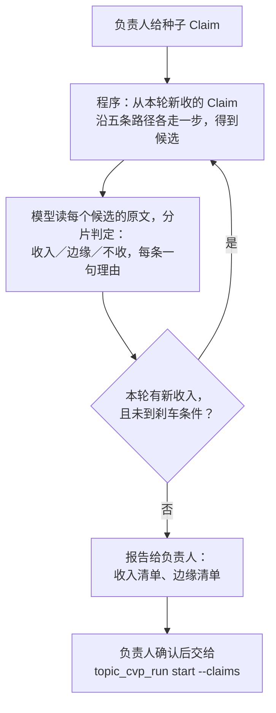

# 主题发现 Agent：从种子 Claim 找出同一主题的全部 Claim

> **读者**：Solution architect、神学编辑、Developer
> **类型**：规范
> **状态**：当前（待负责人评审，#459）
> **与代码对齐**：2026-10-26，`backend/pipeline/topic_discovery.py`（第 4–7 节）；第 4 节的试算数字来自同日对知识库的只读查询，尚未跑模型
> **权威范围**：主题发现 Agent 的输入、候选收集、判定、轮次与刹车、交给 [CVP 3.0 主题式 Agent](./topic_cvp_agent_solution.md) 的输出。观点与关系怎样定，仍由 CVP 3.0 决定。

**目标：负责人给一两条讲这个主题的 Claim，Agent 沿教授自己的连接把同一主题的 Claim 全部找出来，每条附一句理由和找到它的路径；负责人看一眼，这份清单就是 `topic_cvp_run start --claims` 的输入。**

## 1. 为什么需要

CVP 3.0 一次处理一个主题，它的输入是这个主题的 Claim。现在这份清单靠主题词去搜，有两个毛病：

- **措辞不同就漏。**「人子」只搜中文时漏掉了「耶穌以帶定冠詞的『The Son of Man』自稱……完全的人，也是完全的神」，要人想到别名才补回来。
- **提到不等于在讲。** 主题词搜出的 91 条「人子」Claim 里，有 7 条讲的是太 10:23「人子就到了」的时间问题，与「人子」这个称号强调什么不是同一个问题。

负责人 2026-10-26 指出：相关的 Claim 常常和种子没有一个词相同，但可以沿 Claim 关系和原文追到。所以收候选是**沿教授自己的连接走**，不是关键词过滤；主题词只是多一个入口。

## 2. 术语

| 术语 | 意思 |
| --- | --- |
| **种子** | 负责人给的一到三条 Claim，代表这个主题要回答的问题 |
| **候选** | 从已收的 Claim 沿某条路径走一步到达、还没判定过的 Claim |
| **路径** | 候选是怎样到达的，例如「与种子 2 同引太 20:28」。每个候选记下全部路径 |
| **收入／边缘／不收** | 模型对候选的判定。只有「收入」的 Claim 下一轮继续往外走 |

## 3. 流程

## 4. 收候选：五条路径

程序做，不用模型。每轮只从**上一轮新收入**的 Claim 出发走一步，不从候选出发。

| 路径 | 走到哪里 | 数据 | 范围 |
| --- | --- | --- | --- |
| Claim 关系 | 与它有支持、应用、限定等关系的 Claim | `claim_relations`，11,005 条 | 同一篇讲道内（全部 11,005 条两端都在同一篇） |
| 原文相邻 | 证据落在同一段或前后一段的 Claim | 证据片段的 `paragraph_key` | 同一篇讲道内 |
| 同一观点 | 与它连到同一个 CVP 的其他 Claim | `viewpoint_claim_links`；连到 CVP 的 Claim 共 1,170 条 | 跨讲道 |
| 相关观点 | 与它所在 CVP 有已记录关系的 CVP 的成员 | `viewpoint_relations`，214 条有效 | 跨讲道 |
| 同一经文 | 证据步骤引用的经文有重叠的 Claim | `evidence_steps.scripture_refs`，用 `backend/api/sermon_search/bible_refs.py` 的 `normalize_ref` 与 `refs_overlap` 归一比较 | 跨讲道 |

**主题词是第六个入口，与五条路径并用。** 负责人给主题词和别名（别名可以是这个主题的关键词，例如赎价的「多人」），第一轮把 statement 含这些词的 Claim 也作为候选，同样经模型判定，不直接收入。两种入口漏的东西不同：路径找得到措辞不同的论证步骤，关键词找得到与已收 Claim 没有任何连接的段落。赎价试算里，关键词找到了 3 条路径没走到的 Claim，例如 S 210131「希伯來書所說的『多人』就是所有的人」，这篇讲道不在原来的清单里；而含「赎价」「ransom」「λύτρον」的 Claim，路径全部走到了。

**别名要具体。** 赎价第一轮用「多人」做别名，候选从 70 条涨到 436 条，多出来的大多是「哥林多人」「許多人」；改用带引号的「『多人』」只多 9 条。

**试算（2026-10-26，只读）。** 从两条「人子」种子出发（「耶穌說『人子』不是強調祂的人性，而是強調祂的神性」与「約翰福音 5:27 省略『人子』的定冠詞有文法依據……」），假设模型判定与主题词清单完全一致：

| 轮 | 要判定的候选 | 其中在 91 条清单里 | 累计 |
| --- | --- | --- | --- |
| 1 | 76 | 42 | 44 / 91 |
| 2 | 339 | 25 | 69 / 91 |
| 3 | 187 | 9 | 78 / 91 |
| 4 | 90 | 0 | 78 / 91 |

三条结论：

- **人子三轮收敛。** 第四轮没有新收入，三轮共判定约 600 条候选。轮数不设上限，收敛靠边界（第 6 节）。
- **同一经文是最大的噪音来源。** 第二轮按路径计到达 1,076 次（同一条 Claim 可从几条路径、几个出发点到达），其中经文路径 740 次，其余四条合计 336 次。这正是要模型判定、而不是程序直接收的原因。
- **没走到的 13 条多数只是提到「人子」。** 其中 7 条讲太 10:23 的时间问题，1 条讲干犯人子与干犯圣灵。它们是否属于这个主题，正是判定标准要回答的，不能直接算作漏掉。

**赎价**同样试算，种子是「耶穌捨自己作萬人、所有人的贖價」与「ἀντί 的意思是代替……」，对照赎价运行的 26 条输入 Claim：四轮候选 73／257／43／2，走到 25 条；没走到的一条讲「失去的来世生命没有任何赎价可以换回」，只是用了「赎价」一词。更要紧的是反方向：第一轮的候选里就有约 20 条讲同一问题、却不在那 26 条里的 Claim，例如「猶太人的講話習慣中，『多人』等同於『所有的人』」。它们大多出自清单已有的讲道：26 条来自 11 篇，加上这 20 条共 13 篇，只新增 2 篇。清单缺的主要是同一篇讲道里的其他论证步骤，不是整篇讲道。

## 5. 判定

模型做，按片判定，每片约 50 条候选（实现时按请求大小定）。沿用 CVP 2.0 召回的分片调用方式（`backend/pipeline/cvp_recall.py`）。

**判定必须读原文**（负责人 2026-10-26）。只看 statement 会把「提到」当成「在讲」，也会漏掉 statement 写得窄、原文其实在回答这个问题的 Claim。

每条候选给模型看：statement、证据步骤与逐字片段、全部路径，以及**证据所在的原文块和前后各一块**的全文；还有本主题已收入的 Claim 一行一条。同一片里几个候选共用的原文块只放一次。读了仍拿不准的，模型可以判「要再读」并指明要哪几块，程序补上原文后只对这些候选再判一次；每片最多一次追加阅读，之后还拿不准的判边缘。

**标准：是同一个问题，不是提到同一个人或同一节经文。每一轮都只对照种子的问题判定**，已收入的 Claim 只用来找下一轮的候选，不作标准。赎价第一次运行（2026-10-26，`贖價-run-01`）拿已收入的 Claim 作对照，第二轮一步一步从赎价走到了揀選：「為所有人贖罪」→「神揀選所有人」→「人可以選擇作貴重的器皿」，五片就收入 80 条。

| 判定 | 什么时候 | 例 |
| --- | --- | --- |
| 收入 | 它回答的是种子所回答的问题，或是教授为这个回答给出的理由、限定、例外 | 「約 5:27 省略定冠詞有文法依據」是「人子强调神性」的例外说明，收入 |
| 边缘 | 讲到同一称号或经文，但问的是另一个问题；或者只在这个回答里作背景 | 太 10:23「人子就到了」的时间问题 |
| 不收 | 只是同一篇讲道或同一节经文，内容无关 | |

每条判定附一句理由。判定集合必须恰好覆盖本片全部候选，程序核对，不漏不多。

**不另设复核模型。** 这份清单交给负责人看一眼，再进 CVP 3.0；CVP 3.0 会逐条给每个 Claim 处置（成员、支持、背景、未决），收错的在那里还会被看到。发现阶段最要紧的错是**漏**，漏掉的复核模型也看不见，要靠第 8 节的对照来量。

## 6. 轮次与刹车

| 情形 | 处理 |
| --- | --- |
| 一轮没有新收入 | 停：路径走到的都是边缘或不收，这个主题到了边界（负责人 2026-10-26：遇到边缘就停） |
| 已跑十轮仍有新收入 | 停，报告标明没有收敛，负责人看是否漂到了别的主题。这只是防止失控，不是正常的停法 |
| 收入超过约 90 条（一次主题运行通常的量） | 不停（负责人 2026-10-26：90 不是硬上限）；报告里标出，负责人看是否拆成几个子问题 |

候选不截断。一片放不下就多分一片；放不下也不删。

## 7. 输出

运行目录在 `staging/topic-discovery/<主题>-<编号>/`，每轮的候选、请求与回答都存盘。报告一页：

1. **收入清单**：Claim、出处、一句理由、找到它的路径；
2. **边缘清单**：同上，负责人决定要不要加进去；属于负责人指定的另一个主题的，单列一节；
3. **数字**：每轮候选数、收入数，停下的原因。

负责人确认后，收入清单（加上他从边缘清单挑的）写成 JSON，交给 `python -m backend.pipeline.topic_cvp_run start <主题> --claims <文件>`。

### 7.1 边缘就是这个主题的边界

（负责人 2026-10-26）边缘 Claim 是一次发现的边界：路径不从它们往外走，它们也是相邻主题开始的地方。所以每次运行另写一份 `borderline.md`，把全部边缘 Claim 列在一张表里，按负责人指定的另一个主题（例如「揀選」）和讲道排序，附模型说明它回答的是什么问题。负责人从这张表挑下一个要发现的主题，挑中的 Claim 作种子。

下一次运行时，上一个主题作为「另一个主题」传入（例如发现揀選时 `--other-topic 贖價`），这样两个主题从同一条边界各自向内，不会互相收进对方。

## 8. 验收

- **人子**：用上面两条种子跑，对照主题词清单的 91 条，列出三组：两边都有、只有 Agent 有、只有主题词清单有。后两组由负责人逐条看，判断是 Agent 漏了、收错了，还是主题词清单本来就收宽了。
- **赎价**：用一两条种子跑，对照 [赎价试跑](./topic_cvp_agent_pilot_record_20261025.md) 的 26 条输入 Claim，同样分三组。

## 9. 安全

对知识库只读；模型调用只经订阅 CLI；输出只进 staging。

## 10. 不在本文范围

- **从 Claim 里找出主题**（全库推广时主题从哪里来）：本文从负责人给的种子开始，不自己选主题。
- **Claim 本身的缺漏**：原文里有论证、却没有抽出 Claim 的，本 Agent 看不见，回 Claim Management 2.0。

## 11. 实施顺序

1. 第 4 节的候选收集，加单元测试；用人子种子复现试算数字。
2. 第 5 节的分片判定与追加阅读，第 6 节的轮次。
3. 报告与 `--claims` 文件。
4. 第 8 节的两项验收，结果交负责人。

跑模型等负责人明确的指令。
