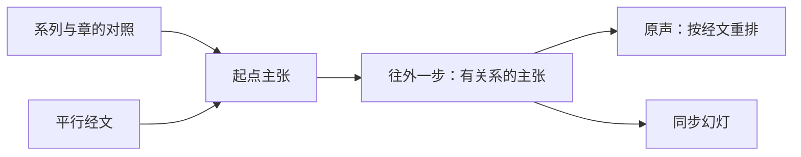

# 马太福音按章释经页：方案

> **读者**：Solution architect、神学编辑
> **类型**：规范
> **状态**：当前（负责人 2026-11-03 定试点为太 5，确认系列与章的对照）
> **与代码对齐**：2026-11-03（核对到 #638 分支 5a792dbb）：`backend/pipeline/chapter_material.py`、`backend/pipeline/original_audio_index.py`、`web/src/app/resources/wang-repository/audio/`
> **权威范围**：马太福音按章释经页由哪几部分组成；一章的材料从哪几篇讲道、哪些主张取；神学、个人经历、生活应用与问答怎样取舍；同步幻灯上放什么。只管 NYSC 马太福音系列讲座这一个来源；母本与文章都不在本文范围。

**目标：读者打开马太福音某一章，能从头到尾跟住教授在 NYSC 系列讲座里对这一章的释经——听他自己讲，同时看幻灯上他此刻在解哪节经文、立什么判断、怎样推出来。**

## 目录

- [一、问题](#一问题)
- [二、已有的部件](#二已有的部件)
- [三、负责人已定](#三负责人已定)
- [四、方案](#四方案)
  - [4.1 选材：一章的材料从哪里来](#41-选材一章的材料从哪里来)
  - [4.2 神学、个人经历、生活应用与问答](#42-神学个人经历生活应用与问答)
  - [4.3 一章与分段](#43-一章与分段)
  - [4.4 原声：按经文重排](#44-原声按经文重排)
  - [4.5 同步幻灯：由主张与经文驱动](#45-同步幻灯由主张与经文驱动)
  - [4.6 页面入口](#46-页面入口)
- [五、观点层](#五观点层)
- [六、试点：太 5](#六试点太-5)
- [七、不在本文范围](#七不在本文范围)

## 一、问题

NYSC 马太福音释经是一组系列讲座，每个系列讲一段章节。教授在课上把释经、神学、个人经历、生活应用和问答交错着讲；一章常常一堂讲不完，拖到下一堂。

以太 5 为例：2011（二）六堂课，太 5 从第一堂讲到第五堂，第六堂末尾又回来讲登山寶訓的整体结构。第三堂 61 分钟只讲 5:27-28 一处，其中约 40 分钟是三段见证。读者想把太 5 从第 1 节跟到第 48 节，现在只能六篇逐字稿逐篇翻。

这正是[使命](../00-overview/project_mission_statement.md#二目前的進展)第二条「不容易跟得上」。

## 二、已有的部件

这一页要的东西大部分已经有了，只是范围停在太 16 的三段、或停在单篇讲道：

| 部件 | 现在做到哪里 | 代码 |
| --- | --- | --- |
| 原声按经文重排 | 太 16 分三段（16:1-12、16:13-23、16:24-27），每段把各堂课讲这段经文的录音聚起来，一篇讲道一行，点 topic 从他说那句话处起播（#257、#261） | `original_audio_index.build_index`；页面 `resources/wang-repository/audio/[passage]` |
| 同步幻灯 | 单篇讲道从 0:00 播到结束，幻灯跟着播放位置换：标题是此刻占主导的主张，配上它讲的经文和他讲到的原文字词（#259、#263） | `original_audio_index.build_sermon_slides`；`SermonPptSlide.tsx` |
| 系列页 | 每个系列列出讲题、摘要、重点与各堂讲道 | `resources/series/[seriesId]`；`config/sermon_series.json` |

三段的段落列表、标题现在写死在 `original_audio_index.PASSAGES` 里，只服务太 16。

## 三、负责人已定

2026-11-03：

1. **幻灯跟着录音走。** 与现有同步幻灯相同的形式，但内容由主张与经文驱动。这里的幻灯显示在网页上，不是查经用的 PPT 文件。
2. **单位是一章。** 太长时可以分成几段。
3. **问答不放进来**，除非它直接关乎这一章的释经。
4. **神学必须是从这一章的经文推出来的**，才放进来。
5. **先做太 5**，注意太 5 的内容跨讲道。
6. **现在不需要观点（CVP）。**
7. **没有录音时间的主张以后再修**，试点先不处理。
8. **发布不在本方案范围。**
9. **选材从主张数据算出来**，不手写选段表。
10. **平行经文算同一节。**
11. **只用 NYSC 马太福音系列这一个来源**；母本是另一个来源，不进这一页。写文章是另一件事，不在本方案。

个人经历、生活应用与问答都按 [4.2](#42-神学个人经历生活应用与问答) 的同一条规则处理。

## 四、方案

一章一页，页面有两部分：**原声**（4.4）与叠在播放器上的**同步幻灯**（4.5）。两部分用同一份选材（4.1、4.2），听到的和看到的范围一致。

| 框 | 是什么 | 见 |
| --- | --- | --- |
| 系列与章的对照 | 哪个系列讲哪几章 | [4.1](#41-选材一章的材料从哪里来) |
| 平行经文 | 同一句话在别的福音书里的记载 | [4.1](#41-选材一章的材料从哪里来) |
| 起点主张 | 系列讲道里经文引用落在这一章（或其平行经文）的主张 | [4.1](#41-选材一章的材料从哪里来) |
| 往外一步 | 与起点主张有关系的主张，包括从经文推出的神学与应用 | [4.1](#41-选材一章的材料从哪里来)、[4.2](#42-神学个人经历生活应用与问答) |
| 原声、同步幻灯 | 页面的两部分 | [4.4](#44-原声按经文重排)、[4.5](#45-同步幻灯由主张与经文驱动) |

### 4.1 选材：一章的材料从哪里来

**来源单位是系列。** 每个系列讲一段章节（负责人 2026-11-03 确认）：

| 系列 | 讲的章 | 堂数 |
| --- | --- | ---: |
| 2011（二） | 5–7（登山寶訓） | 6 |
| 2012（三） | 8–15 | 6 |
| 2016（四） | 16 | 4 |
| 2016（五） | 16 续、17 | 4 |
| 2017（六） | 19 | 4 |
| 2018（七） | 20 | 4 |
| 2021（八） | 24 | 4 |
| 2022（九） | 26（约与律法） | 4 |

引用不等于讲解：太 5:32 的离婚在 2017（六）讲太 19 时、在 2020–21 年几篇主日讲道里也讲过，那些不属于太 5 这一章的系列，不纳入。

**系列之内，从主张数据算出来，不手写选段表。** 两步：

1. **起点主张**：该章系列讲道里，经文引用落在这一章、或落在这一章经文的平行经文上的主张。落在这一章沿用 `in_passage` 现有的判法（看引用的起点；引用超过 6 处的是跨经文综合，不算）。
2. **往外一步**：与起点主张有关系的主张——支持、限定、提供语境、应用、回答、解释（`supports`、`qualifies`、`contextualizes`、`applies`、`answers`、`explains`）。这一步就是「神学必须从经文推出来」在数据里的样子：他讲 5:28 时带进的雅各书，主张里记着它支持哪一条 5:28 的判断。

只走一步。量过两步：（二）6 讲太 6「不叫我們遇見試探」的一段会被间接拉进来。

**平行经文**（负责人 2026-11-03 同意）：同一句话在别的福音书里的记载算同一节。太 5:32 的离婚，他在（二）4 的问答里是从路加福音 16:18、马太福音 19:3-9 讲的，按引用落不进太 5，却正是这一节。平行经文表按章写在代码里，只列福音书之间同一句话的记载，不列旧约背景或主题相关的经文。

**逐字稿段落标题只用来核对**，不决定选材。太 5 的核对结果见[第六节](#六试点太-5)。

### 4.2 神学、个人经历、生活应用与问答

| 内容 | 取舍 | 在数据里 | 太 5 的结果 |
| --- | --- | --- | --- |
| **神学** | 从这一章的经文推出来的纳入 | 与起点主张有关系 | 纳入：5:17-20 下的宗主国之约、摩西律法与基督律法；5:28 下雅各书的「私慾與罪」 |
| **个人经历** | 排除 | 与起点主张没有关系 | （二）3 三段见证（17–47 分）、（二）2 使徒行传 15 章的案例（23–46 分）都没有关系，自然不进来 |
| **生活应用** | 直接从经文出来的纳入，幻灯上标明是应用 | `applies` 连到起点主张，或本身就是起点主张 | （二）4「兩害取其輕」与墮胎的例子（6–21 分）没有连到 5:32，不进来 |
| **问答** | 直接关乎这一章经文的纳入 | 按同样两步判断，不另设规则 | 路加福音 16:18 与再婚的问答经平行经文纳入 |

规则只有一条：**与这一章的经文连得上，就进来；连不上，就不进来。** 不按逐字稿标题、不按主张类型逐类排除，所以不需要逐章由人写选段表。

### 4.3 一章与分段

**页面一章一页。** 太长时，在页内分成几段：每段有自己的原声列表与幻灯，页面顶上是各段的目录。

**切在哪里**：沿用 #261 的量法——数有多少条主张的经文范围跨过这一刀，只切几乎不切断主张的地方。太 16 量过：12｜13 跨 1 条，23｜24 跨 0 条，9｜10 跨 20 条。

不必只为了时长分段：#261 量过，太 16:13-23 有 87 分钟，他自己立的 21 个判断就是一屏的目录。太 5 是 134 分钟、37 个判断，暂不分段。

### 4.4 原声：按经文重排

原声的播放区间由 4.1 选出的主张在录音里的位置给出，同一篇里两分钟以内的空隙接着播。其余规则不改：

- 一篇讲道一行，教授原来的次序还给他；
- 不去重——他在两堂课里各讲一遍，理由常不一样；
- 他自己立的判断是可点的目录。

太 16 现有的三段页面继续只用起点主张，不往外走；要换时两边一起量。

### 4.5 同步幻灯：由主张与经文驱动

现在的幻灯（#263）只有标题、经文出处和原文字词。按经文重排之后，读者要的是「他在解哪节、解出了什么」，所以每张幻灯放四样东西，全部来自主张与经文：

| 幻灯上 | 来源 | 标为 |
| --- | --- | --- |
| **他此刻在解的那节经文，全文** | 起点主张讲的那一节；往外一步进来的主张，用它连到的起点主张的那一节，取和合本全文；他念到另一节时角上标出 | 经文 |
| **标题：他立的判断** | 此刻占主导的主张（沿用现有的半分钟分块、不满 90 秒并入邻居）。是应用的标为应用 | 编辑整理 |
| **两三条要点：他怎样推到这个判断** | 这条主张的证据步骤，按论证次序；每条可展开看他的原话 | 编辑整理；原话标为原话 |
| **原文字词** | 沿用现有做法：他讲到的希腊文、希伯来文，讲到之后才出现 | 原话 |

**系统不写任何一句新的话。** 幻灯上每一行都能回到一条主张、一个证据步骤、一个来源片段或一节经文；找不到来源的空档，上一张继续停着，不生成过场文字。没有录音时间的主张（太 5 里（二）2 有 54 条）暂时不上幻灯，等录音时间修好。

### 4.6 页面入口

- 系列页上加「本系列讲解的章」，每章一个入口。
- 文库落地页按章列出有原声的章。

## 五、观点层

负责人 2026-11-03：现在不需要观点。原声不去重，幻灯标题用主张自己的表述。

记下现状供以后参考：太 5 往外一步选出的 89 条主张里，38 条有观点（43%）；太 16 是 144 条里 128 条（89%）。

## 六、试点：太 5

量自 2011（二）六堂（2026-11-03，未加平行经文）：

| | 主张 | 可听 |
| --- | ---: | ---: |
| 只用起点主张 | 59 | 约 92 分 |
| 往外一步 | 89 | 约 119 分 |

与逐字稿标题核对：（二）3 留下 2–14 分与 51–61 分，正是标题标为讲 5:27-28 的两段，中间三段见证不进来；（二）1 的八福与律法、（二）6 末尾登山寶訓的结构都在。（二）2 有 54 条主张没有录音时间，暂缺（负责人：以后再修）。

1. 系列与章的对照，填 2011（二）→ 太 5；太 5 的平行经文表。
2. 原声：太 5 一页，区间由 4.1 选出的主张给出。
3. 幻灯：按 4.5 生成，叠在太 5 原声上。

都不需要模型调用；实作见 #638。

## 七、不在本文范围

母本（另一个来源）；写文章（另一件事）；发布与部署；观点（CVP）的补建；没有录音时间的主张的修复；`/bible-study` 的查经 PPT。
