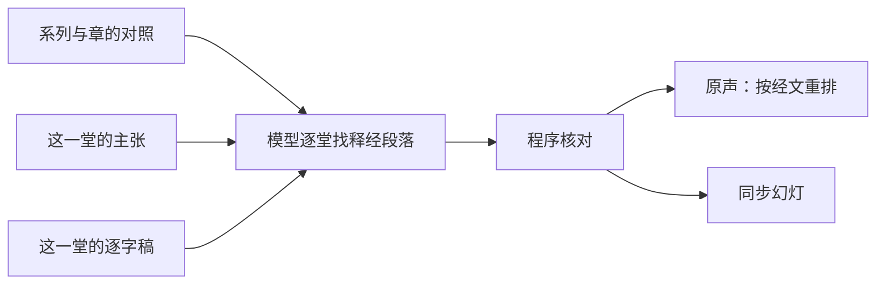

# 马太福音按章释经页：方案

> **读者**：Solution architect、神学编辑
> **类型**：规范
> **状态**：当前（负责人 2026-11-03 定试点为太 5，确认系列与章的对照；同日改为由模型按定义找出释经段落）
> **与代码对齐**：未核对（4.1、4.2 的新做法尚未实作；#638 分支现有的是被取代的引用加关系的选法）
> **权威范围**：马太福音按章释经页由哪几部分组成；一章的材料从哪几篇讲道取、哪些段落算释经；神学、个人经历、生活应用与问答怎样取舍；同步幻灯上放什么。只管 NYSC 马太福音系列讲座这一个来源；母本与文章都不在本文范围。

**目标：让听的人专心在释经上。读者打开马太福音某一章，按经节次序从头到尾听教授在 NYSC 系列讲座里对这一章的释经，同时看幻灯上他此刻在解哪节经文、立什么判断、怎样推出来。**

## 目录

- [一、问题](#一问题)
- [二、已有的部件](#二已有的部件)
- [三、负责人已定](#三负责人已定)
- [四、方案](#四方案)
  - [4.1 选材：一章的材料从哪里来](#41-选材一章的材料从哪里来)
  - [4.2 释经、神学、应用：按定义判断](#42-释经神学应用按定义判断)
  - [4.3 程序核对](#43-程序核对)
  - [4.4 按经节次序分段](#44-按经节次序分段)
  - [4.5 原声：按经文重排](#45-原声按经文重排)
  - [4.6 同步幻灯：由主张与经文驱动](#46-同步幻灯由主张与经文驱动)
  - [4.7 页面入口](#47-页面入口)
- [五、观点层](#五观点层)
- [六、试点：太 5](#六试点太-5)
- [七、不在本文范围](#七不在本文范围)

## 一、问题

NYSC 马太福音释经是一组系列讲座，每个系列讲一段章节。教授在课上把释经、神学、个人经历、生活应用和问答交错着讲；一章常常一堂讲不完，拖到下一堂。

以太 5 为例：2011（二）六堂课，太 5 从第一堂讲到第五堂，第六堂末尾又回来讲登山寶訓的整体结构。第三堂 61 分钟只讲 5:27-28 一处，其中约 40 分钟是三段见证。读者想把太 5 从第 1 节跟到第 48 节，现在只能六篇逐字稿逐篇翻。

这正是[使命](../00-overview/project_mission_statement.md#二目前的進展)第二条「不容易跟得上」。

## 二、已有的部件

这一页要的东西大部分已经有了，只是范围停在太 16 的三段、或停在单篇讲道：

| 部件 | 现在做到哪里 | 代码 |
| --- | --- | --- |
| 原声按经文重排 | 太 16 分三段（16:1-12、16:13-23、16:24-27），每段把各堂课讲这段经文的录音聚起来，一篇讲道一行，点 topic 从他说那句话处起播（#257、#261） | `original_audio_index.build_index`；页面 `resources/wang-repository/audio/[passage]` |
| 同步幻灯 | 单篇讲道从 0:00 播到结束，幻灯跟着播放位置换：标题是此刻占主导的主张，配上它讲的经文和他讲到的原文字词（#259、#263） | `original_audio_index.build_sermon_slides`；`SermonPptSlide.tsx` |
| 系列页 | 每个系列列出讲题、摘要、重点与各堂讲道 | `resources/series/[seriesId]`；`config/sermon_series.json` |

三段的段落列表、标题现在写死在 `original_audio_index.PASSAGES` 里，只服务太 16。

## 三、负责人已定

2026-11-03：

1. **幻灯跟着录音走。** 与现有同步幻灯相同的形式，但内容由主张与经文驱动。这里的幻灯显示在网页上，不是查经用的 PPT 文件。
2. **单位是一章。** 太长时可以分成几段。
3. **问答不放进来**，除非它直接关乎这一章的释经。
4. **神学必须是从这一章的经文推出来的**，才放进来。
5. **先做太 5**，注意太 5 的内容跨讲道。
6. **现在不需要观点（CVP）。**
7. **没有录音时间的主张以后再修**，试点先不处理。
8. **发布不在本方案范围。**
9. **选材不手写选段表。**
10. **平行经文算同一节。**
11. **按经节次序分段，不按讲座次序**；这一页的目的是让听的人专心在释经上。
12. **只用 NYSC 马太福音系列这一个来源**；母本是另一个来源，不进这一页。写文章是另一件事，不在本方案。
13. **审核状态不决定上不上页面**（不看 `ai_consensus_reviewed`）。
14. **主张覆盖教授讲的所有内容，但不是所有主张都是释经。** 释经、神学有通行的定义；**由模型根据主张和逐字稿原文，按定义找出释经的段落和对应的经节**，不用经文引用、主张关系或逐字稿标题去推。太复杂时可以把讲道切成几部分处理。
15. **逐字稿标题不重要**，不作依据。
16. **应用如果直接相关，要放进来**，个人见证也一样。
17. **逐字稿的每个片段都必须决定留不留**，否则整份输出作废。
18. **不保留的部分标为灰色，仍可播放、可看逐字稿**；听不听由读者决定。

个人经历、生活应用与问答都按 [4.2](#42-释经神学应用按定义判断) 的同一套定义判断。

## 四、方案

一章一页，页面有两部分：**原声**（4.5）与叠在播放器上的**同步幻灯**（4.6）。两部分用同一份释经段落（4.1–4.3），听到的和看到的范围一致。

| 框 | 是什么 | 见 |
| --- | --- | --- |
| 系列与章的对照 | 哪个系列讲哪几章，决定读哪几堂 | [4.1](#41-选材一章的材料从哪里来) |
| 模型逐堂找释经段落 | 一堂一次调用，逐个片段决定留不留：留的写经节与释经/神学/应用，不留的写理由 | [4.2](#42-释经神学应用按定义判断) |
| 程序核对 | 每个片段都有决定、经节可解析，程序查过才上页面 | [4.3](#43-程序核对) |
| 原声、同步幻灯 | 页面的两部分 | [4.5](#45-原声按经文重排)、[4.6](#46-同步幻灯由主张与经文驱动) |

### 4.1 选材：一章的材料从哪里来

**来源单位是系列。** 每个系列讲一段章节（负责人 2026-11-03 确认）：

| 系列 | 讲的章 | 堂数 |
| --- | --- | ---: |
| 2011（二） | 5–7（登山寶訓） | 6 |
| 2012（三） | 8–15 | 6 |
| 2016（四） | 16 | 4 |
| 2016（五） | 16 续、17 | 4 |
| 2017（六） | 19 | 4 |
| 2018（七） | 20 | 4 |
| 2021（八） | 24 | 4 |
| 2022（九） | 26（约与律法） | 4 |

引用不等于讲解：太 5:32 的离婚在 2017（六）讲太 19 时、在 2020–21 年几篇主日讲道里也讲过，那些不属于太 5 这一章的系列，不纳入。

**系列之内，哪些段落是这一章的释经，由模型按定义判断**（4.2）。先前的做法是从数据推：经文引用落在这一章的主张为起点，再沿主张关系往外走一步、限 10 分钟以内。量下来推不全，原因在数据本身：

- **主张的 `scripture_refs` 记的是他引来作证据的经文，不是他在解的那节。** 他用雅各书、彼前 4:2-3 解 5:28，主张记的是雅各书、彼前；（二）2 用宗主国之约讲 5:17 的 15 条主张，引的是出埃及记、罗马书，没有一条记着太 5。
- **关系只记「这句支持那句」，不记「这一大段在解 5:17」。** 宗主国之约那一段与任何太 5 的主张都没有关系可走。

所以这一页太 5 只拿到约 130 分钟，模型按定义读出来是约 183 分钟（[第六节](#六试点太-5)）。

### 4.2 释经、神学、应用：按定义判断

**程序先把逐字稿切成片段，模型逐一决定每个片段留不留。** 逐字稿的段落有的很长——（二）1 五十四分钟只有 9 个带时间的段落，最长一段 13.7 分钟，一段里可能前半是释经、后半是见证。所以程序在句末把长段落切开，每片约 300 字；片段的起止时间由程序按字数在段首、段尾时间之间推算，模型不给时间。每条主张按它的录音时间放进它落在的片段里，一起给模型看。

一堂课一次模型调用。模型读到这一章的和合本全文、这一堂编号的片段（带时间），以及每个片段里的主张。按通行定义判断：

| 内容 | 定义 | 取舍 |
| --- | --- | --- |
| **释经** | 解释经文本身的含义：字词、文法、原文、上下文、历史与旧约背景、平行经文、经文结构。引别卷书只要目的是解释这节经文就算，如用雅各书说明 5:28 的「慾念」 | 保留 |
| **神学** | 从这段经文推出的教义或原则，如从 5:17 推出新旧约律法的关系 | 从这一章经文推出的保留；同一堂里与这一章无关的神学不算 |
| **应用** | 从这段经文推出的生活应用 | 直接相关的保留，个人见证用来说明这节经文的应用也算（负责人 2026-11-03）；幻灯上标为应用 |
| **不算** | 与这一章无关的见证、问答、其他章节的释经、开场与行政事项 | 不保留，写明理由 |

**每个片段都必须有一个决定**（负责人 2026-11-03）：保留的写经节和释经/神学/应用；不保留的写一句理由。不可遗漏、合并或重复，少一个片段，整份输出作废。

问答不另设规则：按同一套定义，直接解这一章经文的保留。平行经文也不另列表：他从路加福音 16:18 讲 5:32，模型读得出他在解哪一节。

**模型只做决定，不写一句给读者看的话。** 不保留的理由在页面上显示为灰色片段的说明，标为编辑整理。

### 4.3 程序核对

模型交回的结果，程序查过才用：

- 每个片段编号恰好出现一次，没有遗漏、多出或重复；
- 保留的片段都有经节，经节都在这一章里，格式可解析；
- 保留的片段都标了释经、神学或应用之一，不保留的都有理由。

任何一条不过，这一堂整堂不上页面，报给负责人，不改写模型的回答。主张随片段走：片段保留，里面的主张就上幻灯，所以不会有主张无声消失。结果按讲道、逐字稿 SHA 存档，逐字稿变了才重跑。

### 4.4 按经节次序分段

**页面一章一页，页内按经节次序分段**，不按讲座次序（负责人 2026-11-03）。段落用和合本的分段，太 5 是 5:1-12、13-16、17-20、21-26、27-30、31-32、33-37、38-42、43-48。

- 每个段落按它讲的那一节的**起点**归段：「5:39-44」归 5:38-42。
- 一段里，各堂课讲这几节的录音一堂一行，按堂次排。同一堂课会在几段里各出现一次，因为他在那一堂里讲了好几处经文。
- **同一分钟只归一段**：两段的录音重叠时，较窄的一段留下这几分钟，从较宽的一段里剪掉。太 5 量到两处，各一分半——（二）1 开头讲结构时提到盐和光，（二）6 末尾讲结构。
- 没有材料的段不列。太 5 的 5:43-48 没有单独的材料：他讲爱仇敌时讲的是 5:39-44，归在 5:38-42。
- 一行放完自动接下一行，所以从上往下听就是从 5:1 讲到 5:48，哪怕下一行是另一堂课。
- **不保留的片段也在页面上，显示为灰色**（负责人 2026-11-03）。它们没有经节，放在页面末尾，按堂次列出，每段附不保留的理由。听不听由读者决定：点开可以播放、可以看逐字稿；连续播放跳过它们。

### 4.5 原声：按经文重排

每一段里，原声的播放区间就是 4.2 的段落，同一篇里两分钟以内的空隙接着播。其余规则不改：

- 一段之内一篇讲道一行，那一行里教授原来的次序不动；
- 不去重——他在两堂课里各讲一遍，理由常不一样；
- 他自己立的判断是可点的目录。

太 16 现有的三段页面继续用经文引用选主张；要换时两边一起量。

### 4.6 同步幻灯：由主张与经文驱动

现在的幻灯（#263）只有标题、经文出处和原文字词。按经文重排之后，读者要的是「他在解哪节、解出了什么」，所以每张幻灯放四样东西，全部来自主张与经文：

| 幻灯上 | 来源 | 标为 |
| --- | --- | --- |
| **他此刻在解的那节经文，全文** | 这个段落的经节（4.2），取和合本全文；他念到另一节时角上标出 | 经文 |
| **标题：他立的判断** | 这个段落里此刻占主导的主张（沿用现有的半分钟分块、不满 90 秒并入邻居）。段落是应用的标为应用 | 编辑整理 |
| **两三条要点：他怎样推到这个判断** | 这条主张的证据步骤，按论证次序；每条可展开看他的原话 | 编辑整理；原话标为原话 |
| **原文字词** | 沿用现有做法：他讲到的希腊文、希伯来文，讲到之后才出现 | 原话 |

**系统不写任何一句新的话。** 幻灯上每一行都能回到一条主张、一个证据步骤、一个来源片段或一节经文；找不到来源的空档，上一张继续停着，不生成过场文字。段落里没有主张的那几分钟，原声照播，幻灯停在经文全文上。

### 4.7 页面入口

- 系列页上加「本系列讲解的章」，每章一个入口。
- 文库落地页按章列出有原声的章。

## 五、观点层

负责人 2026-11-03：现在不需要观点。原声不去重，幻灯标题用主张自己的表述。

记下现状供以后参考：太 5 按引用加关系选出的 89 条主张里，38 条有观点（43%）；太 16 是 144 条里 128 条（89%）。

## 六、试点：太 5

2026-11-03 按 4.2 对 2011（二）六堂各跑一次（只写到临时目录，没有写库、没有上页面）。六堂共 313 个片段，五堂一次通过核对；（二）2 有一个片段的经节写成「5:21-22; 5:27-28」，用了分号，核对不过——实作时提示词写明格式，分隔符两种都收。

| 段 | 保留 | 出自 | 其中（分钟） |
| --- | ---: | --- | --- |
| 5:1-12 | 30 分 | （二）1、6 | 释经 24、神学 3、应用 3 |
| 5:13-16 | 1 分 | （二）1 | 释经 1 |
| 5:17-20 | 50 分 | （二）1、2、6 | 释经 26、神学 24 |
| 5:21-26 | 2 分 | （二）2 | 释经 2 |
| 5:27-30 | 30 分 | （二）2、3、4 | 释经 14、神学 4、应用 12 |
| 5:31-32 | 34 分 | （二）4 | 释经 20、神学 6、应用 8 |
| 5:33-37 | 5 分 | （二）5 | 释经 5 |
| 5:38-42 | 25 分 | （二）5 | 释经 14、神学 1、应用 9 |
| 5:43-48 | 0 分 | — | 没有单独讲 |

合计约 178 分钟，先前按引用加关系的选法是约 130 分钟。不保留的主要是：（二）2 使徒行传 15 章的问答（29 分）；（二）3 三段见证（34 分）和脸部过敏、Amen 两处插话；（二）4 被人批评的经历（10 分）与多妻（9 分）；（二）5 墮胎问答与第六、七章（22 分）；（二）6 除末尾 6 分钟外都是第六、七章。

逐片段决定比先前标时间段更细：（二）3 2:50–8:09 先前整段保留，现在其中 4:02–6:42 讲脸部过敏的两分半不保留。

（二）6 的逐字稿有空洞（5:30–17:36、72:58–76:53 没有文字），没有片段可判断；这是逐字稿的问题，不在这一页处理。

实作：4.2 的切片与模型调用经订阅 CLI，结果按讲道存档；4.3 的核对；页面改用存档的决定，并加上灰色片段。见 #638。

## 七、不在本文范围

母本（另一个来源）；写文章（另一件事）；发布与部署；观点（CVP）的补建；补抽没有主张的释经段落；逐字稿空洞的修补；`/bible-study` 的查经 PPT。
