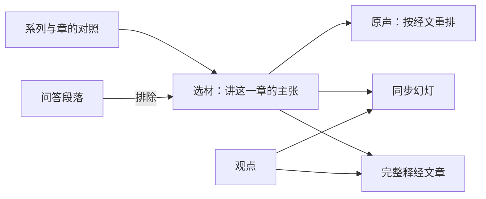

# 马太福音按章释经页：方案

> **读者**：Solution architect、神学编辑
> **类型**：规范
> **状态**：当前（方案稿，待负责人评审；评审通过前不开实作卡）
> **与代码对齐**：2026-11-03（核对到 89c98625）：`backend/pipeline/original_audio_index.py`、`web/src/app/resources/wang-repository/audio/`、`web/src/app/components/sermons/SermonPptSlide.tsx`
> **权威范围**：马太福音按章释经页由哪几部分组成；一章的材料从哪几篇讲道、哪些主张里取；问答怎样排除；同步幻灯上放什么。写作与审稿规则仍由 [Draft-first 文章流程 v1](./draft_first_workflow_v1.md) 与 [Draft-first 双向审稿：方案](./draft_first_two_way_review_solution.md) 管辖。

**目标：读者打开马太福音某一章，能从头到尾跟住教授对这一章的释经——听他自己讲，看幻灯上他此刻在解哪节经文、立什么判断，再读一篇按经文次序写成的完整释经。**

## 目录

- [一、问题](#一问题)
- [二、已有的部件](#二已有的部件)
- [三、负责人已定](#三负责人已定)
- [四、方案](#四方案)
  - [4.1 选材：一章的材料从哪里来](#41-选材一章的材料从哪里来)
  - [4.2 问答怎样排除](#42-问答怎样排除)
  - [4.3 一章与分段](#43-一章与分段)
  - [4.4 原声：按经文重排](#44-原声按经文重排)
  - [4.5 同步幻灯：由主张与经文驱动](#45-同步幻灯由主张与经文驱动)
  - [4.6 完整释经文章](#46-完整释经文章)
  - [4.7 页面入口](#47-页面入口)
- [五、观点层的前提](#五观点层的前提)
- [六、试点：太 16](#六试点太-16)
- [七、负责人待定](#七负责人待定)
- [八、不在本文范围](#八不在本文范围)

## 一、问题

NYSC 马太福音释经是一组系列讲座，每个系列讲一段章节。教授在课上把释经、神学、问答和生活应用交错着讲；一章常常一堂讲不完，拖到下一堂，有时拖到下一个系列。

以太 16 为例：2016（四）四堂、2016（五）四堂，八堂课里都有讲太 16 的部分，中间穿插「靈魂體三元論」「天國與神國」等题目；（四）4 末尾是一段「問答與見證」。读者想把太 16 从第 1 节跟到第 28 节，现在只能八篇逐字稿逐篇翻。

这正是[使命](../00-overview/project_mission_statement.md#二目前的進展)第二条「不容易跟得上」。

## 二、已有的部件

这一页要的东西大部分已经有了，只是范围停在太 16 的三段、或停在单篇讲道：

| 部件 | 现在做到哪里 | 代码 |
| --- | --- | --- |
| 原声按经文重排 | 太 16 分三段（16:1-12、16:13-23、16:24-27），每段把各堂课讲这段经文的录音聚起来，一篇讲道一行，点 topic 从他说那句话处起播（#257、#261） | `original_audio_index.build_index`；页面 `resources/wang-repository/audio/[passage]` |
| 同步幻灯 | 单篇讲道从 0:00 播到结束，幻灯跟着播放位置换：标题是此刻占主导的主张，配上它讲的经文和他讲到的原文字词（#259、#263） | `original_audio_index.build_sermon_slides`；`SermonPptSlide.tsx` |
| 马太按段落的写稿入口 | 方案已有，未实作；马太写稿自 2026-09-10 起停着等它 | [Draft-first 写作流程的可重复化：方案](./draft_first_repeatable_pipeline_solution.md#23-两种入口专题文章与马太释经) 第五节第 5 步 |
| 系列页 | 每个系列列出讲题、摘要、重点与各堂讲道 | `resources/series/[seriesId]`；`config/sermon_series.json` |

三段的段落列表、标题现在写死在 `original_audio_index.PASSAGES` 里，只服务太 16。

## 三、负责人已定

2026-11-03：

1. **幻灯跟着录音走。** 与现有同步幻灯相同的形式，但内容由主张与经文驱动。这里的幻灯显示在网页上，不是查经用的 PPT 文件。
2. **单位是一章。** 太长时可以分成几段。
3. **问答不放进来**，除非它直接关乎这一章的释经。
4. **发布不在本方案范围。**

## 四、方案

一章一页，页面有三部分：**原声**（4.4）、**同步幻灯**（4.5，叠在原声播放器上）、**完整释经文章**（4.6）。三部分用同一批材料（4.1、4.2），所以页面上听到的、看到的、读到的，范围一致。

| 框 | 是什么 | 见 |
| --- | --- | --- |
| 系列与章的对照 | 哪个系列讲哪几章 | [4.1](#41-选材一章的材料从哪里来) |
| 问答段落 | 逐字稿里的问答，不属于释经 | [4.2](#42-问答怎样排除) |
| 选材 | 落在这一章、出自该系列讲道的主张 | [4.1](#41-选材一章的材料从哪里来) |
| 原声、同步幻灯、完整释经文章 | 页面的三部分 | [4.4](#44-原声按经文重排)–[4.6](#46-完整释经文章) |
| 观点 | 跨讲道的同一个观点；幻灯用它统一标题，文章用它合并重复 | [第五节](#五观点层的前提) |

### 4.1 选材：一章的材料从哪里来

**来源单位是系列。** 每个系列讲一段章节，系列页上写着：

| 系列 | 讲的章 | 堂数 |
| --- | --- | ---: |
| 2011（二） | 5–7（登山寶訓） | 6 |
| 2012（三） | 8–15 | 6 |
| 2016（四） | 16 | 4 |
| 2016（五） | 16 续、17 | 4 |
| 2017（六） | 19 | 4 |
| 2018（七） | 20 | 4 |
| 2021（八） | 24 | 4 |
| 2022（九） | 26（约与律法） | 4 |

这张对照存成配置（章 → 系列 → 讲道），由负责人确认，不由程序从主张的经文引用里猜。

**理由：引用不等于讲解。** 只按主张的经文引用去找，太 12 会出现在 2017（六）3、2018（七）1 里——那两堂讲的是太 19、太 20，提到太 12 只是旁证。用这个办法把太 16 拉进来，会多出 2018（七）的 1 条主张。

一章的材料是：**该章所属系列的讲道里、经文范围落在这一章的主张。**「落在这一章」沿用 `in_passage` 现有的判法：看引用的起点；引用超过 6 处的是跨经文综合，不算讲这一段。

### 4.2 问答怎样排除

问答不按主张的类型判断——主张没有「问答」这一类。按**它在逐字稿里落在哪一段**判断：

- 同工校对逐字稿时写下的段落标题明说是问答的，如「問答與見證」「課間問答」「解答聖經疑難」「問答與討論」。33 篇 NYSC 马太逐字稿里有 7 篇有这样的标题。
- 逐字稿里标明的「（問：）」到教授答完为止。

问答段里的主张一律不进原声、不上幻灯、不进文章，**除非**它的经文范围按 4.1 落在这一章——那就是「直接关乎释经」，照常纳入。比如问答里有人问太 16:18 的「磐石」，教授的回答就留下；问墮胎、问再婚的就排除。

试点（第六节）把排除掉的段落逐条列在运行记录里，负责人看一次，确认这条判法；之后各章照此执行，不再逐章请负责人确认。

生活应用不另设规则：应用类主张的经文范围落在这一章就纳入，幻灯上照实标出它是应用。

### 4.3 一章与分段

**页面一章一页。** 太长时，在页内分成几段：每段有自己的原声列表、幻灯和文章段落，页面顶上是各段的目录。

**切在哪里沿用 #261 的量法：** 数每一个可能的切点有多少条主张的经文范围跨过它，只切几乎不切断主张的地方。太 16 量过：12｜13 跨 1 条，23｜24、27｜28 跨 0 条，而 9｜10 跨 20 条。所以太 16 分成 16:1-12、16:13-23、16:24-27 三段；16:28 讲的是登山变像，归太 17。

分不分段由文章的长度决定，原声不必为了时长分段：#261 已经量过，16:13-23 有 87 分钟，但他自己立的 21 个判断就是一屏的目录，读者照目录跳着听。

### 4.4 原声：按经文重排

把 `build_index` 从三段写死的 `PASSAGES`，改为按 4.1 的配置给出任一章、任一段。听的规则一条不改：

- 一篇讲道一行，教授原来的次序还给他；
- 同一篇里两分钟以内的空隙接着播；
- 不去重——他在两堂课里各讲一遍，理由常不一样；
- 他自己立的判断是可点的目录。

唯一的新规则是 4.2：问答段不进来。

### 4.5 同步幻灯：由主张与经文驱动

现在的幻灯（#263）只有标题、经文出处和原文字词。按经文重排之后，读者在原声页上要的是「他在解哪节、解出了什么」，所以每张幻灯放四样东西，全部来自主张与经文：

| 幻灯上 | 来源 | 标为 |
| --- | --- | --- |
| **他此刻在解的那节经文，全文** | 主张的经文范围截到本章，取和合本全文；他念到另一节时角上标出（沿用 `verse_readings`） | 经文 |
| **标题：他立的判断** | 此刻占主导的主张（沿用 `judgement_during` 的半分钟分块、90 秒并邻）。这条主张属于某个观点时，用观点的表述——同一个判断在（四）和（五）里标题一样，读者认得出这是同一件事 | 编辑整理 |
| **两三条要点：他怎样推到这个判断** | 这条主张的证据步骤，按论证次序；每条可展开看他的原话 | 编辑整理；原话标为原话 |
| **原文字词** | 沿用现有做法：他讲到的希腊文、希伯来文，讲到之后才出现 | 原话 |

**系统不写任何一句新的话。** 幻灯上每一行都能回到一条主张、一个证据步骤、一个来源片段或一节经文；找不到来源的空档，上一张继续停着，不生成过场文字。这与 #263 的约束相同。

单篇讲道页（#263）上的幻灯同样换成这四样，两处共用同一个生成函数。

### 4.6 完整释经文章

就是 draft-first 的「马太按段落入口」，范围从一段经文换成一章（或 4.3 分出的一段）：

- **选材**：4.1、4.2 选出的主张全部进材料包。这回答了[可重复化方案](./draft_first_repeatable_pipeline_solution.md#四负责人待定)第四节第 2 项「怎样算选材完整」：该章系列讲道里落在这一章的主张，一条不少；材料包同时列出这一章每一节有没有被讲到，没讲到的节如实写「教授在这一系列中未讲解」，不补。
- **组织**：跟随经文次序。同一个判断在几堂课里讲过，按观点合成一处，几次讲解的不同理由都保留——这是文章与原声的分工，原声不去重，文章合并。这回答了第 3 项。
- **神学岔题**：放在引出它的那节经文下面，只保留与这节经文的论证有关的部分；与本章无关的岔题不进文章。
- **写稿与审稿**：用 draft-first 现有的写稿、双向审稿、修订与来源绑定，不另造流程。
- **与原声相连**：文章每个段落经来源绑定连到主张，主张带录音时间，读者可以从段落跳到原声里那一处。

第 4 项（发布）不在本方案范围；第 5 项（从哪里开始）见第六节。

### 4.7 页面入口

- 系列页上加「本系列讲解的章」，每章一个入口。
- 文库落地页原有的太 16 三段，改为指向太 16 一章的页面。
- 文章尚未写成的章，页面先只有原声与幻灯——#261 已是这样，原声可以先于文章上线。

## 五、观点层的前提

原声与幻灯**不依赖**观点：原声不去重；幻灯标题在主张没有观点时就用主张自己的表述。所以这两部分可以先做，覆盖哪一章都行。

文章**依赖**观点：要把八堂课里讲了几遍的同一个判断合成一处，必须由已记录的观点来判断「这是同一个」，不能由写稿模型自己合并（[D2](../00-overview/solution_architecture.md#d2不用-rag)，以及知识层不即兴的原则）。纳入却没有观点的主张，按 draft-first 现有的「CVP 缺口」停点交给 CVP 2.0，补完再写。

现在的覆盖：

| | 落在太 16 的主张 | 已有观点 |
| --- | ---: | ---: |
| 2016（四） | 94 | 81 |
| 2016（五） | 50 | 47 |
| 合计 | 144 | 128（89%） |

其他系列的整体覆盖低得多：全部 1,898 条 NYSC 马太主张里只有 447 条（24%）有观点，2017（六）是 36／337。做到这些章的文章时，CVP 2.0 是主要工作量，要按章分批规划。

## 六、试点：太 16

选太 16，因为它是唯一已有三段原声页、观点覆盖最高、且有旧版文章可以对照的章。

1. 系列与章的对照配置，先填（四）（五）→ 太 16。
2. 原声：太 16 一页三段；列出 4.2 排除的问答段，负责人看一次。
3. 幻灯：按 4.5 改生成函数，太 16 页与（四）（五）八篇单篇讲道页同时换上。
4. 补齐太 16 的 16 条无观点主张（CVP 2.0）。
5. 文章：马太入口实作，以太 16 三段试写。

1–3 不需要模型调用，可以先上线；4–5 各自另开卡。

## 七、负责人待定

1. **母本是否进文章。** 太 1–16 各有教授释经课笔记生成的母本，同一章的论述更完整、更有组织。原声与幻灯只能用有录音的讲道；文章要不要把同一章的母本也纳入材料？纳入则文章更完整，但它不再只是「NYSC 系列的整理」。
2. **系列与章的对照**（4.1 的表）是否准确。表是按系列页的摘要和主张的经文分布整理的；（三）讲 8–15 章、（五）讲 16 章续与 17 章，尤其需要负责人确认。

## 八、不在本文范围

发布与部署；CVP 2.0 的内部流程（只定义交接点）；写作与审稿规则本身；`/bible-study` 的查经 PPT。
