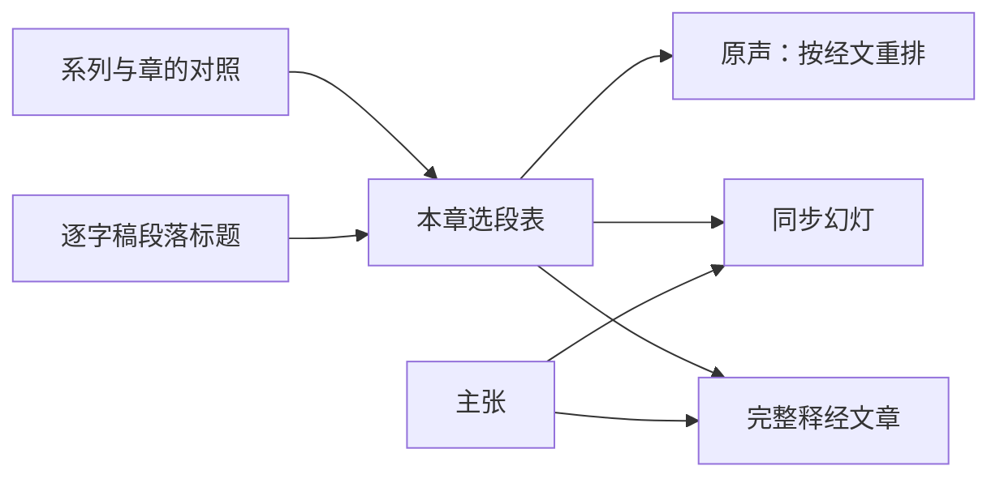

# 马太福音按章释经页：方案

> **读者**：Solution architect、神学编辑
> **类型**：规范
> **状态**：当前（负责人 2026-11-03 定试点为太 5；第七节两项待定）
> **与代码对齐**：2026-11-03（核对到 89c98625）：`backend/pipeline/original_audio_index.py`、`web/src/app/resources/wang-repository/audio/`、`web/src/app/components/sermons/SermonPptSlide.tsx`
> **权威范围**：马太福音按章释经页由哪几部分组成；一章的材料从哪几篇讲道、哪些段落取；神学、个人经历、生活应用与问答怎样取舍；同步幻灯上放什么。写作与审稿规则仍由 [Draft-first 文章流程 v1](./draft_first_workflow_v1.md) 与 [Draft-first 双向审稿：方案](./draft_first_two_way_review_solution.md) 管辖。

**目标：读者打开马太福音某一章，能从头到尾跟住教授对这一章的释经——听他自己讲，看幻灯上他此刻在解哪节经文、立什么判断，再读一篇按经文次序写成的完整释经。**

## 目录

- [一、问题](#一问题)
- [二、已有的部件](#二已有的部件)
- [三、负责人已定](#三负责人已定)
- [四、方案](#四方案)
  - [4.1 选材：一章的材料从哪里来](#41-选材一章的材料从哪里来)
  - [4.2 神学、个人经历、生活应用与问答](#42-神学个人经历生活应用与问答)
  - [4.3 一章与分段](#43-一章与分段)
  - [4.4 原声：按经文重排](#44-原声按经文重排)
  - [4.5 同步幻灯：由主张与经文驱动](#45-同步幻灯由主张与经文驱动)
  - [4.6 完整释经文章](#46-完整释经文章)
  - [4.7 页面入口](#47-页面入口)
- [五、观点层](#五观点层)
- [六、试点：太 5](#六试点太-5)
- [七、负责人待定](#七负责人待定)
- [八、不在本文范围](#八不在本文范围)

## 一、问题

NYSC 马太福音释经是一组系列讲座，每个系列讲一段章节。教授在课上把释经、神学、个人经历、生活应用和问答交错着讲；一章常常一堂讲不完，拖到下一堂。

以太 5 为例：2011（二）六堂课，太 5 从第一堂讲到第五堂，第六堂末尾又回来讲登山寶訓的整体结构。第三堂 61 分钟只讲 5:27-28 一处，其中约 40 分钟是三段见证。读者想把太 5 从第 1 节跟到第 48 节，现在只能六篇逐字稿逐篇翻。

这正是[使命](../00-overview/project_mission_statement.md#二目前的進展)第二条「不容易跟得上」。

## 二、已有的部件

这一页要的东西大部分已经有了，只是范围停在太 16 的三段、或停在单篇讲道：

| 部件 | 现在做到哪里 | 代码 |
| --- | --- | --- |
| 原声按经文重排 | 太 16 分三段（16:1-12、16:13-23、16:24-27），每段把各堂课讲这段经文的录音聚起来，一篇讲道一行，点 topic 从他说那句话处起播（#257、#261） | `original_audio_index.build_index`；页面 `resources/wang-repository/audio/[passage]` |
| 同步幻灯 | 单篇讲道从 0:00 播到结束，幻灯跟着播放位置换：标题是此刻占主导的主张，配上它讲的经文和他讲到的原文字词（#259、#263） | `original_audio_index.build_sermon_slides`；`SermonPptSlide.tsx` |
| 马太按段落的写稿入口 | 方案已有，未实作；马太写稿自 2026-09-10 起停着等它 | [Draft-first 写作流程的可重复化：方案](./draft_first_repeatable_pipeline_solution.md#23-两种入口专题文章与马太释经) 第五节第 5 步 |
| 系列页 | 每个系列列出讲题、摘要、重点与各堂讲道 | `resources/series/[seriesId]`；`config/sermon_series.json` |

三段的段落列表、标题现在写死在 `original_audio_index.PASSAGES` 里，只服务太 16。

## 三、负责人已定

2026-11-03：

1. **幻灯跟着录音走。** 与现有同步幻灯相同的形式，但内容由主张与经文驱动。这里的幻灯显示在网页上，不是查经用的 PPT 文件。
2. **单位是一章。** 太长时可以分成几段。
3. **问答不放进来**，除非它直接关乎这一章的释经。
4. **神学必须是从这一章的经文推出来的**，才放进来。
5. **先做太 5**，注意太 5 的内容跨讲道。
6. **现在不需要观点（CVP）。**
7. **没有录音时间的主张以后再修**，试点先不处理。
8. **发布不在本方案范围。**

个人经历与生活应用按 [4.2](#42-神学个人经历生活应用与问答) 的建议处理（负责人未提异议），试点后核对。

## 四、方案

一章一页，页面有三部分：**原声**（4.4）、**同步幻灯**（4.5，叠在原声播放器上）、**完整释经文章**（4.6）。三部分用同一份选材（4.1、4.2），所以页面上听到的、看到的、读到的，范围一致。

| 框 | 是什么 | 见 |
| --- | --- | --- |
| 系列与章的对照 | 哪个系列讲哪几章 | [4.1](#41-选材一章的材料从哪里来) |
| 逐字稿段落标题 | 同工校对逐字稿时写下的小标题，标出每一段在讲什么 | [4.1](#41-选材一章的材料从哪里来) |
| 本章选段表 | 每个段落标题：讲哪几节、纳入或排除、理由 | [4.1](#41-选材一章的材料从哪里来)、[4.2](#42-神学个人经历生活应用与问答) |
| 主张 | 纳入段落里的主张，给幻灯标题与要点、给文章材料 | [4.5](#45-同步幻灯由主张与经文驱动)、[4.6](#46-完整释经文章) |
| 原声、同步幻灯、完整释经文章 | 页面的三部分 | [4.4](#44-原声按经文重排)–[4.6](#46-完整释经文章) |

### 4.1 选材：一章的材料从哪里来

**来源单位是系列。** 每个系列讲一段章节，系列页上写着：

| 系列 | 讲的章 | 堂数 |
| --- | --- | ---: |
| 2011（二） | 5–7（登山寶訓） | 6 |
| 2012（三） | 8–15 | 6 |
| 2016（四） | 16 | 4 |
| 2016（五） | 16 续、17 | 4 |
| 2017（六） | 19 | 4 |
| 2018（七） | 20 | 4 |
| 2021（八） | 24 | 4 |
| 2022（九） | 26（约与律法） | 4 |

引用不等于讲解：太 5:32 的离婚在 2017（六）讲太 19 时、在 2020–21 年几篇主日讲道里也讲过，那些不属于太 5 这一章的系列，不纳入。

**系列之内，按逐字稿的段落选，不按主张的经文引用选。** 只按引用去找，2011（二）六堂里只找得到约 93 分钟的太 5；按段落标题看，太 5 实际约有四小时。差额来自他讲经文时带进的神学：第三堂整堂讲 5:28，主张却多半引雅各书；第二堂讲 5:17 的律法，主张引的是宗主国之约与使徒行传 15 章。这些是他解这节经文的方式，按引用选会全部漏掉。

所以每一章有一张**选段表**：该章系列里每个讲到这一章的段落标题，写明它讲哪几节、纳入还是排除、理由。段落的起止时间由标题在逐字稿里的位置算出，不手填。纳入段落里的主张全部进材料；没有标题的地方，才退回用主张的经文引用判断。

选段表随代码走 PR，负责人在 PR 上看一次；它决定这一章听到、看到、读到的范围。

### 4.2 神学、个人经历、生活应用与问答

| 内容 | 取舍 | 太 5 的例子 |
| --- | --- | --- |
| **神学** | 从这一章的经文推出来的纳入；岔到别处去的排除 | 纳入：5:17 下的宗主国之约、摩西律法与基督律法；5:28 下的雅各书「私慾與罪」 |
| **个人经历** | 排除 | （二）3 三段见证约 40 分钟；（二）5「以愛化解衝突的個人見證」约 11 分钟 |
| **生活应用** | 直接从经文出来的纳入，幻灯上标明是应用；独立的应用排除 | 纳入：5:17 下「基督徒需要守十誡嗎」；排除：（二）4「離婚後事奉的現代實例」 |
| **问答** | 直接关乎这一章经文的纳入；其余排除 | 纳入：（二）4 路加福音 16:18 与再婚、婚前性行为与意图的罪（5:28）；排除：（二）2「聖靈的感動」、（二）5 墮胎、神蹟與信心 |

逐字稿段落标题是判断的主要依据：33 篇 NYSC 马太逐字稿里有 7 篇有「問答」「課間問答」「解答聖經疑難」这样的标题，见证也多有「見證」「個人見證」「實例」字样。标题之下仍要看内容才能定，所以写进选段表，不由程序按字面自动排除。

### 4.3 一章与分段

**页面一章一页。** 太长时，在页内分成几段：每段有自己的原声列表、幻灯和文章段落，页面顶上是各段的目录。

**切在哪里**：选段表已经写明每个段落讲哪几节，切点取段落之间的经文边界，并沿用 #261 的量法核对——数有多少条主张的经文范围跨过这一刀，只切几乎不切断主张的地方。太 16 量过：12｜13 跨 1 条，23｜24 跨 0 条，9｜10 跨 20 条。

分不分段由文章长度决定，原声不必为了时长分段：#261 量过，太 16:13-23 有 87 分钟，他自己立的 21 个判断就是一屏的目录。

### 4.4 原声：按经文重排

原声的播放区间改由选段表给出：纳入的段落就是要播的区间，同一篇里两分钟以内的空隙接着播。其余规则不改：

- 一篇讲道一行，教授原来的次序还给他；
- 不去重——他在两堂课里各讲一遍，理由常不一样；
- 他自己立的判断是可点的目录。

太 16 现有的三段页面继续由主张的经文引用决定区间，等太 16 也有选段表再换。

### 4.5 同步幻灯：由主张与经文驱动

现在的幻灯（#263）只有标题、经文出处和原文字词。按经文重排之后，读者要的是「他在解哪节、解出了什么」，所以每张幻灯放四样东西，全部来自主张与经文：

| 幻灯上 | 来源 | 标为 |
| --- | --- | --- |
| **他此刻在解的那节经文，全文** | 选段表里这一段讲的经文，取和合本全文；他念到另一节时角上标出 | 经文 |
| **标题：他立的判断** | 此刻占主导的主张（沿用现有的半分钟分块、不满 90 秒并入邻居）。是应用的标为应用 | 编辑整理 |
| **两三条要点：他怎样推到这个判断** | 这条主张的证据步骤，按论证次序；每条可展开看他的原话 | 编辑整理；原话标为原话 |
| **原文字词** | 沿用现有做法：他讲到的希腊文、希伯来文，讲到之后才出现 | 原话 |

**系统不写任何一句新的话。** 幻灯上每一行都能回到一条主张、一个证据步骤、一个来源片段或一节经文；找不到来源的空档，上一张继续停着，不生成过场文字。没有录音时间的主张（太 5 里（二）2 有 54 条）暂时不上幻灯，等录音时间修好。

### 4.6 完整释经文章

就是 draft-first 的「马太按段落入口」，范围从一段经文换成一章（或 4.3 分出的一段）：

- **选材**：选段表纳入段落里的主张全部进材料包；材料包同时列出这一章每一节有没有被讲到，没讲到的节如实写「教授在这一系列中未讲解」，不补。这回答了[可重复化方案](./draft_first_repeatable_pipeline_solution.md#四负责人待定)第四节第 2 项。
- **组织**：跟随经文次序，从经文推出的神学放在那节经文下面。这回答了第 3 项。
- **写稿与审稿**：用 draft-first 现有的写稿、双向审稿、修订与来源绑定，不另造流程。
- **与原声相连**：文章每个段落经来源绑定连到主张，主张带录音时间，读者可以从段落跳到原声里那一处。

文章需要模型调用，在原声与幻灯上线后另开卡，开跑前请负责人确认。

### 4.7 页面入口

- 系列页上加「本系列讲解的章」，每章一个入口。
- 文库落地页按章列出有原声的章。
- 文章尚未写成的章，页面先只有原声与幻灯——#261 已是这样。

## 五、观点层

负责人 2026-11-03：现在不需要观点。原声不去重，幻灯标题用主张自己的表述，文章用主张作材料。

记下现状供以后参考：太 5 选段表纳入的约 146 条主张里，27 条有观点（18%）；太 16 是 144 条里 128 条（89%）。同一个判断在几堂课里各讲一遍时，文章要合成一处，以后需要观点来判断「这是同一个」，不由写稿模型自己合并。

## 六、试点：太 5

1. 系列与章的对照，填 2011（二）→ 太 5。
2. 太 5 选段表：按 4.1、4.2 把（二）1–6 的段落标题逐条写明，负责人在 PR 上看一次。
3. 原声：太 5 一页，区间由选段表给出。
4. 幻灯：按 4.5 生成，叠在太 5 原声上。
5. 文章：马太入口实作后另开卡。

1–4 不需要模型调用。

## 七、负责人待定

1. **母本是否进文章。** 太 5 有「登山寶訓-八福」「義的精意」两份母本，共 95 条主张，论述比讲道更完整。原声与幻灯只能用有录音的讲道；文章要不要把同一章的母本也纳入材料？
2. **系列与章的对照**（4.1 的表）是否准确，尤其（三）讲 8–15 章、（五）讲 16 章续与 17 章。

## 八、不在本文范围

发布与部署；观点（CVP）的补建；没有录音时间的主张的修复；写作与审稿规则本身；`/bible-study` 的查经 PPT。
