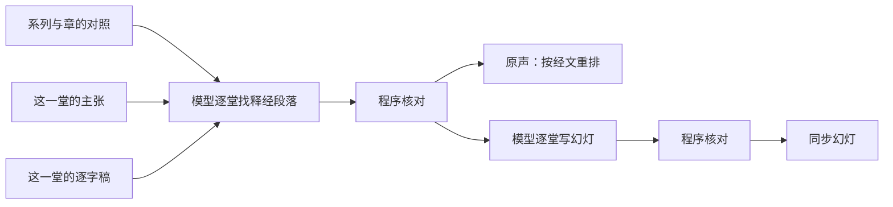

# 马太福音按章释经页：方案

> **读者**：Solution architect、神学编辑
> **类型**：规范
> **状态**：当前（负责人 2026-11-03 定试点为太 5，确认系列与章的对照；同日改为由模型按定义找出释经段落，幻灯改为由模型读逐字稿写要点；2026-11-04 加聆听模式；2026-11-05 加太 8–15、太 6–7；2026-11-09 加太 21；2026-11-10 加 skill `chapter-slides`）
> **与代码对齐**：2026-11-05（核对到 #637 太 6–7 分支，加 `backend/pipeline/chapter_title.py`、`backend/api/scripture.py`、`backend/api/original_audio.py`、`backend/api/public_repository.py`）：`web/src/app/resources/wang-repository/audio/ChapterListener.tsx`、`web/src/app/resources/wang-repository/books/[book]/[chapter]/listen/page.tsx`、`backend/pipeline/chapter_exposition.py`、`backend/pipeline/chapter_slides.py`、`backend/pipeline/chapter_material.py`、`backend/pipeline/original_audio_index.py`、`web/src/app/resources/wang-repository/audio/[passage]/page.tsx`、`web/src/app/resources/wang-repository/audio/ChapterSlide.tsx`
> **权威范围**：马太福音按章释经页由哪几部分组成；一章的材料从哪几篇讲道取、哪些段落算释经；神学、个人经历、生活应用与问答怎样取舍；同步幻灯上放什么。只管 NYSC 马太福音系列讲座这一个来源；母本与文章都不在本文范围。

**目标：让听的人专心在释经上。读者打开马太福音某一章，按经节次序从头到尾听教授在 NYSC 系列讲座里对这一章的释经，同时看幻灯上他此刻在讲什么、读到哪些经文。**

## 目录

- [一、问题](#一问题)
- [二、已有的部件](#二已有的部件)
- [三、负责人已定](#三负责人已定)
- [四、方案](#四方案)
  - [4.1 选材：一章的材料从哪里来](#41-选材一章的材料从哪里来)
  - [4.2 释经、神学、应用：按定义判断](#42-释经神学应用按定义判断)
  - [4.3 程序核对](#43-程序核对)
  - [4.4 按经节次序分段](#44-按经节次序分段)
  - [4.5 原声：按经文重排](#45-原声按经文重排)
  - [4.6 同步幻灯：模型读逐字稿写要点](#46-同步幻灯模型读逐字稿写要点)
  - [4.7 页面入口](#47-页面入口)
  - [4.8 聆听模式](#48-聆听模式)
- [五、观点层](#五观点层)
- [六、试点：太 5](#六试点太-5)
- [6.1 太 8–15](#61-太-815)
- [6.2 太 6–7](#62-太-67)
- [6.3 太 21](#63-太-21)
- [七、不在本文范围](#七不在本文范围)

## 一、问题

NYSC 马太福音释经是一组系列讲座，每个系列讲一段章节。教授在课上把释经、神学、个人经历、生活应用和问答交错着讲；一章常常一堂讲不完，拖到下一堂。

以太 5 为例：2011（二）六堂课，太 5 从第一堂讲到第五堂，第六堂末尾又回来讲登山寶訓的整体结构。第三堂 61 分钟只讲 5:27-28 一处，其中约 40 分钟是三段见证。读者想把太 5 从第 1 节跟到第 48 节，现在只能六篇逐字稿逐篇翻。

这正是[使命](../00-overview/project_mission_statement.md#二目前的進展)第二条「不容易跟得上」。

## 二、已有的部件

这一页要的东西大部分已经有了，只是范围停在太 16 的三段、或停在单篇讲道：

| 部件 | 现在做到哪里 | 代码 |
| --- | --- | --- |
| 原声按经文重排 | 太 16 分三段（16:1-12、16:13-23、16:24-27），每段把各堂课讲这段经文的录音聚起来，一篇讲道一行，点 topic 从他说那句话处起播（#257、#261） | `original_audio_index.build_index`；页面 `resources/wang-repository/audio/[passage]` |
| 同步幻灯 | 单篇讲道从 0:00 播到结束，幻灯跟着播放位置换：标题是此刻占主导的主张，配上它讲的经文和他讲到的原文字词（#259、#263） | `original_audio_index.build_sermon_slides`；`SermonPptSlide.tsx` |
| 系列页 | 每个系列列出讲题、摘要、重点与各堂讲道 | `resources/series/[seriesId]`；`config/sermon_series.json` |

三段的段落列表、标题现在写死在 `original_audio_index.FIXED_PASSAGES` 里，只服务太 16。

## 三、负责人已定

2026-11-03：

1. **幻灯跟着录音走。** 幻灯显示在网页上，不是查经用的 PPT 文件。内容见第 19、20 条。
2. **单位是一章。** 太长时可以分成几段。
3. **问答不放进来**，除非它直接关乎这一章的释经。
4. **神学必须是从这一章的经文推出来的**，才放进来。
5. **先做太 5**，注意太 5 的内容跨讲道。
6. **现在不需要观点（CVP）。**
7. **没有录音时间的主张以后再修**，试点先不处理。
8. **发布不在本方案范围。**
9. **选材不手写选段表。**
10. **平行经文算同一节。**
11. **按经节次序分段，不按讲座次序**；这一页的目的是让听的人专心在释经上。
12. **只用 NYSC 马太福音系列这一个来源**；母本是另一个来源，不进这一页。写文章是另一件事，不在本方案。
13. **审核状态不决定上不上页面**（不看 `ai_consensus_reviewed`）。
14. **主张覆盖教授讲的所有内容，但不是所有主张都是释经。** 释经、神学有通行的定义；**由模型根据主张和逐字稿原文，按定义找出释经的段落和对应的经节**，不用经文引用、主张关系或逐字稿标题去推。太复杂时可以把讲道切成几部分处理。
15. **逐字稿标题不重要**，不作依据。
16. **应用如果直接相关，要放进来**，个人见证也一样。
17. **逐字稿的每个片段都必须决定留不留**，否则整份输出作废。
18. **不保留的部分标为灰色，留在原位，仍可播放、可看逐字稿**；页面顶上一个开关，默认收起，听不听由读者决定。
19. **幻灯呈现的是他讲的内容，不是主张的论证结构**，写法与查经 PPT 相同：由模型读逐字稿写要点。原来由主张拼出的幻灯，（二）1 开头三分半讲登山宝训的结构，只剩一条主张。
20. **他讲到、读到的经文必须显示在幻灯上。**
21. **幻灯不只要有信息，还要听众跟得上**：要点在他讲到时才出现，经文一节一行带节号。负责人以「八福都是天國的祝福」那张为例：四条要点一起出来、两条说同一件事，六节经文连成一大段，听众找不到他读到哪里。
22. **灰色在这一页只指不属本章释经的部分**：目录里没在播的条目用正常的深色。负责人看到浅灰的目录条目，以为开关关着时被略去的部分还显示。
23. **教授没讲的不显示**：不满 20 秒的保留片段（一句话的碎片）不自成一段，跟着前面的保留片段归段；没有自己经节的幻灯退回这一段的经节，不是整章开头。负责人看到 5:43-48 一行 0 分钟、幻灯却显示 5:1-4：（二）5 把 5:38-39 论证中间的「我們要愛仇敵。」（3 秒）标了 5:44。

2026-11-04：

24. **认真听的人要在一个画面里听、看、跟。** 总览适合第一次来的人看这一章讲了哪些经文和题目；认真听的人要的是投影片、播放控制（从头、暂停、前后跳、变速）和逐字稿在同一个画面，能跳上一段、下一段，也能直接挑一段来听。见 [4.8](#48-聆听模式)。
25. **听的人关心的是经节，不是第几堂课。** 总览不按讲座分行，也不放「聽這段」：每段经文一行，点经文就进聆听模式；聆听模式里也不显示讲座名称。网址已经指定来源时，不再显示来源分页。

个人经历、生活应用与问答都按 [4.2](#42-释经神学应用按定义判断) 的同一套定义判断。

## 四、方案

一章一页，页面有两部分：**原声**（4.5）与叠在播放器上的**同步幻灯**（4.6）。两部分用同一份释经段落（4.1–4.3），听到的和看到的范围一致。

| 框 | 是什么 | 见 |
| --- | --- | --- |
| 系列与章的对照 | 哪个系列讲哪几章，决定读哪几堂 | [4.1](#41-选材一章的材料从哪里来) |
| 模型逐堂找释经段落 | 一堂一次调用，逐个片段决定留不留：留的写经节与释经/神学/应用，不留的写理由 | [4.2](#42-释经神学应用按定义判断) |
| 程序核对 | 每个片段都有决定、经节可解析，程序查过才上页面 | [4.3](#43-程序核对) |
| 模型逐堂写幻灯 | 一堂一次调用，读保留的片段，分成一张张幻灯：标题、要点、讲哪几节、读到哪些经文 | [4.6](#46-同步幻灯模型读逐字稿写要点) |
| 原声、同步幻灯 | 页面的两部分 | [4.5](#45-原声按经文重排)、[4.6](#46-同步幻灯模型读逐字稿写要点) |

### 4.1 选材：一章的材料从哪里来

**来源单位是系列。** 每个系列讲一段章节（负责人 2026-11-03 确认）：

| 系列 | 讲的章 | 堂数 |
| --- | --- | ---: |
| 2011（二） | 5–7（登山寶訓） | 6 |
| 2012（三） | 8–15 | 6 |
| 2016（四） | 16 | 4 |
| 2016（五） | 16 续、17 | 4 |
| 2017（六） | 19 | 4 |
| 2018（七） | 20、21 | 4 |
| 2021（八） | 24 | 4 |
| 2022（九） | 26（约与律法） | 4 |

引用不等于讲解：太 5:32 的离婚在 2017（六）讲太 19 时、在 2020–21 年几篇主日讲道里也讲过，那些不属于太 5 这一章的系列，不纳入。

**哪一章用哪几堂、怎样分段，存在 `DATA_BASE_DIR/chapter_exposition/chapters.json`**，不在代码里（负责人 2026-11-05：加一章不该要合并、部署）。每章写经文、来源、系列、讲了这一章的那几堂、和合本的分段；程序按文件的修改时间重读，分段没有从第 1 节接到最后一节、或一堂都没有的那一章跳过，不上页面。加一章：

1. 按逐字稿里念到的马太福音章号，连同前后一堂，把这一章写进文件；
2. 跑 `chapter_exposition`，没有片段保留的那一堂从文件里拿掉；
3. 跑 `chapter_slides`、`chapter_slides --review`、`chapter_title`。

页面下一个请求就有这一章，不用改代码，不用部署。

按次序跑完这几步、怎样报告与记录，写成了 skill：`.claude/skills/chapter-slides/SKILL.md`（Claude Code 与 Codex 共用，`.agents/skills/chapter-slides` 指向同一份）。幻灯被程序拒收而原因在程序这边时，修好后用 `chapter_slides --recheck` 拿同一份回答重核，不再调用模型；已经存过的那一堂不会被旧拒收稿盖掉。

**系列之内，哪些段落是这一章的释经，由模型按定义判断**（4.2）。先前的做法是从数据推：经文引用落在这一章的主张为起点，再沿主张关系往外走一步、限 10 分钟以内。量下来推不全，原因在数据本身：

- **主张的 `scripture_refs` 记的是他引来作证据的经文，不是他在解的那节。** 他用雅各书、彼前 4:2-3 解 5:28，主张记的是雅各书、彼前；（二）2 用宗主国之约讲 5:17 的 15 条主张，引的是出埃及记、罗马书，没有一条记着太 5。
- **关系只记「这句支持那句」，不记「这一大段在解 5:17」。** 宗主国之约那一段与任何太 5 的主张都没有关系可走。

所以这一页太 5 只拿到约 130 分钟，模型按定义读出来是约 183 分钟（[第六节](#六试点太-5)）。

### 4.2 释经、神学、应用：按定义判断

**程序先把逐字稿切成片段，模型逐一决定每个片段留不留。** 逐字稿的段落有的很长——（二）1 五十四分钟只有 9 个带时间的段落，最长一段 13.7 分钟，一段里可能前半是释经、后半是见证。所以程序在句末把长段落切开，每片约 300 字；片段的起止时间由程序按字数在段首、段尾时间之间推算，模型不给时间。每条主张按它的录音时间放进它落在的片段里，一起给模型看。

一堂课一次模型调用。模型读到这一章的和合本全文、这一堂编号的片段（带时间），以及每个片段里的主张。按通行定义判断：

| 内容 | 定义 | 取舍 |
| --- | --- | --- |
| **释经** | 解释经文本身的含义：字词、文法、原文、上下文、历史与旧约背景、平行经文、经文结构。引别卷书只要目的是解释这节经文就算，如用雅各书说明 5:28 的「慾念」 | 保留 |
| **神学** | 从这段经文推出的教义或原则，如从 5:17 推出新旧约律法的关系 | 从这一章经文推出的保留；同一堂里与这一章无关的神学不算 |
| **应用** | 从这段经文推出的生活应用 | 直接相关的保留，个人见证用来说明这节经文的应用也算（负责人 2026-11-03）；幻灯上标为应用 |
| **不算** | 与这一章无关的见证、问答、其他章节的释经、开场与行政事项 | 不保留，写明理由 |

**每个片段都必须有一个决定**（负责人 2026-11-03）：保留的写经节和释经/神学/应用；不保留的写一句理由。不可遗漏、合并或重复，少一个片段，整份输出作废。

问答不另设规则：按同一套定义，直接解这一章经文的保留。平行经文也不另列表：他从路加福音 16:18 讲 5:32，模型读得出他在解哪一节。

**模型只做决定，不写一句给读者看的话。** 不保留的理由在页面上显示为灰色片段的说明，标为编辑整理。

**论证整段判断，不从中间切开**（评审后加，2026-11-03）：他为了解释这一章岔出去讲的例子、故事、别处经文、原文字词，是这段解释的一部分，保留；保留了一个例子的结论或劝告，就要保留例子本身，反之亦然；不保留的应是完整离题的部分。第一版切开过：（二）4 丢了他举的喇合、堕胎的例子，却留下了堕胎例子后面那句「要找教会长者指导」，幻灯上就成了离婚的劝告。

### 4.3 程序核对

模型交回的结果，程序查过才用：

- 每个片段编号恰好出现一次，没有遗漏、多出或重复；
- 保留的片段都有经节，经节都在这一章里，格式可解析；
- 保留的片段都标了释经、神学或应用之一，不保留的都有理由。

任何一条不过，这一堂整堂不上页面，报给负责人，不改写模型的回答。结果按讲道、逐字稿 SHA 存档，逐字稿变了才重跑。

### 4.4 按经节次序分段

**页面一章一页，页内按经节次序分段**，不按讲座次序（负责人 2026-11-03）。段落用和合本的分段，太 5 是 5:1-12、13-16、17-20、21-26、27-30、31-32、33-37、38-42、43-48。

- 每个片段按它所在那张幻灯讲的那一节的**起点**归段：「5:39-44」归 5:38-42。一张幻灯整张归一段——（二）1 开头讲登山宝训结构的三分半是一张幻灯，讲 5:1-12，不因为最后一个片段提到 5:13 就拆去 5:13-16。
- 一段里，各堂课讲这几节的录音一堂一行，按堂次排。同一堂课会在几段里各出现一次，因为他在那一堂里讲了好几处经文。
- 没有材料的段不列。太 5 的 5:43-48 没有单独的材料：他讲爱仇敌时讲的是 5:39-44，归在 5:38-42。
- 一行放完自动接下一行，所以从上往下听就是从 5:1 讲到 5:48，哪怕下一行是另一堂课。
- **不保留的片段也在页面上，留在原来的位置，显示为灰色**（负责人 2026-11-03）。它们没有经节，跟在前面那个保留的片段所在的段里，一堂课开头就不保留的跟在后面第一个保留的片段那一段；接连的并成一块，每个片段附自己不保留的理由。页面顶上一个开关，**默认收起**：收起时连续播放跳过灰色部分；打开后灰色部分回到原位，可播放、可看逐字稿，连续播放也照原来的次序播。

### 4.5 原声：按经文重排

每一段里，原声的播放区间就是 4.2 的段落，同一篇里两分钟以内的空隙接着播。其余规则不改：

- 一段之内一篇讲道一行，那一行里教授原来的次序不动；
- 不去重——他在两堂课里各讲一遍，理由常不一样；
- 他自己立的判断是可点的目录。

太 16 现有的三段页面继续用经文引用选主张；要换时两边一起量。

### 4.6 同步幻灯：模型读逐字稿写要点

负责人 2026-11-03：原来的幻灯由程序从主张拼——标题是此刻占主导的主张，要点是它的证据步骤。主张是论证结构，不是讲课的呈现：（二）1 开头三分半他讲登山宝训的结构，九条主张各只有十几秒，半分钟取一个主导、不满 90 秒并入邻居之后，幻灯上只剩一条。

现在照查经 PPT 的做法：每一堂一次模型调用，读这一堂保留的逐字稿（4.2），每一句编号，模型把它分成一张张幻灯，**在句子上换张**。第一版按约 300 字的片段换，评审发现问题在这一张、答案在下一张，一个话题的尾巴落在下一张。

| 幻灯上 | 谁写 | 标为 |
| --- | --- | --- |
| **标题**：这一张在讲什么 | 模型，不超过 14 字 | 编辑整理 |
| **两到四条要点**，每条在他讲到的那一句出现，按他讲的次序 | 模型，短句，每条标出他讲到它的那一句；同一张里两条不说同一件事；只写他讲的：他提出的问题、理由、结论、劝告；不摘要所读经文的内容，不重复前面的要点；故事写出它要说明的道理；听众提问写「问：」 | 编辑整理 |
| **他（或会众）读出来、几乎逐字引用的每一处经文，全文** | 模型只给出处和在哪一句读到；只提书名章节、没有读的不显示；全文由页面按出处取和合本 | 经文 |

- 他读到经文的那一刻，经文才出现；同一张里先读的留着，新读的放最上面。经文一节一行，前面是节号——他一节一节读，听众要找得到读到哪里。
- 要点同样在他讲到的那一刻才出现，最新的一条亮着，前面的变暗；「要点为编辑整理」标在幻灯底部。
- 幻灯从它第一句开始的时刻换上。句子的时刻由程序按字的位置推算，模型不给时间。
- 每张幻灯写它讲第五章哪几节；片段按它第一句所在那张幻灯的经节归段（4.4），幻灯跟着它第一句所在的片段归段，所以幻灯和它开始时播的录音总在同一段。讲整篇登山宝训结构的写 5:1-48，归 5:1-12。

程序核对，任何一条不过整堂不用：

- 第一张从第一句开始，每张的第一句按次序递增（所以每一句恰好在一张里）；
- 每张二到四条要点，有标题；每条要点的那一句在这一张里，次序与他讲的次序相同；
- 经节可解析且在这一章；经文出处可解析，读到它的那一句在这一张里；标题外层的引号由程序去掉。

程序另外在逐字稿里认经文出处，认出来却不在幻灯上的列出来，不作废：程序会认错（「路加福音十六章十六節」认出一个 16:1），他报段落结构时说的「五章十三節到七章二十九節」也不是在读经文。

**审阅与修正**（负责人 2026-11-03）。幻灯写好后由独立审稿人（另一次模型调用）对照逐字稿完整审一遍，看四件事：忠实（没加他没讲的，「很好的证据」不写成「证明」）、完整（他的问题、理由、结论都在，问题和答案同一张）、跟得上（一条一个意思、不重复、要点出现的句子对、不会长时间只有标题）、经文（读到的都显示，没读的不显示）。作者模型按意见修正一次，交回完整的一份；修正稿过同一套程序核对才替换存档，原稿留作备份；修正稿再完整审一遍，审阅同时给出下一轮的意见。审阅绑定幻灯存档的 SHA，不能拿旧审阅去修新稿。最多两轮修正，审不完的交给负责人。

幻灯按讲道存档，绑定留不留的决定的 SHA；决定重跑过，幻灯就作废重写。没有幻灯存档的那一堂，页面退回由主张拼的幻灯。

### 4.7 页面入口

- 系列页上加「本系列讲解的章」，每章一个入口。
- 文库落地页按章列出有原声的章。

### 4.8 聆听模式

按章页面有两个视图。**总览**（`/books/<书>/<章>`）是经文目录：每段经文一行，写经节、分钟数和他在这几节讲的题目（投影片标题，排成会换行的小标签填满一行，最多十二个，其余写「+N」），不分讲座；点一行进聆听模式，从那一段开始，顶上另有「從頭開始聽」。网址带了 `?source=` 时不显示来源分页，只在标题下写来源名称。**聆听模式**（`/books/<书>/<章>/listen?source=<来源>&section=<经文段>`）占满一个画面，给认真听的人：

- 左边投影片，右边逐字稿，底下播放控制，不用捲动页面。手机上投影片在上、逐字稿在下。
- 整章是一条播放清单：各段按经节次序，段内各堂课，每堂课里要播的几段录音。换堂课就换录音档，听的人不必知道。
- 控制：⏮ 回到这一段开头，开头三秒内再按回到整章开头；倒退、快进 15 秒（可跨段）；播放／暂停；速度 0.75–2 倍；上一段、下一段；下拉选单直接挑一段。进度条只画这一段，一段录音一截，看得见换堂课和跳过的地方。键盘：空白键播放／暂停，← → 前后 15 秒，[ ] 上一段、下一段。
- 逐字稿一句一行，跟着录音标出此刻那一句、自动捲到那里；点一句就从那一句播。读者自己捲动后六秒内不自动捲回，另有「回到目前这一句」。换一段录音（他岔开去讲了别的、或换一堂课）只画一条细线，不写讲座名称。
- 灰色片段照第 18、22 条：开关关着时不播、逐字稿里也不出现；打开时按原位播放，逐字稿以灰色显示，投影片位置显示不收的理由。
- 网址跟着段走，复制下来的连结打开就是那一段。

逐字稿的句子由接口给出：每一行（段 × 讲道）带 `transcript`，句子与投影片要点用同一个切句和计时（`chapter_slides.sentences`），保留的和不保留的片段都切，不保留的标 `left_out`。

**时间对上语音识别。** 逐字稿只在段首有时间，一段常有三分钟，段内按字数平均插值；高亮因此跟不上他（负责人 2026-11-04：「播到下一段，高亮不动」）。对太 5 的六堂量过：中位误差 2–7 秒，有的一堂一成句子差 15–56 秒，最大 4 分半——他讲见证时语速变了。语音识别的原始输出（`script/<讲道>.json`）每 3–5 秒一条、带毫秒，整理过的段落记着来自哪几条（`start_index`/`end_index`）；逐字比对两边，对上的字就是锚点（`original_audio_index.retimer`）。存档的片段时间不改，页面输出时把一行里的所有秒数——录音起止、投影片和要点出现的时刻、逐字稿每一句——用同一个换算换过去，彼此仍对得上。没有原始输出的讲道，时间照旧。

## 五、观点层

负责人 2026-11-03：现在不需要观点。原声不去重。

记下现状供以后参考：太 5 按引用加关系选出的 89 条主张里，38 条有观点（43%）；太 16 是 144 条里 128 条（89%）。

## 六、试点：太 5

2026-11-03 按 4.2 对 2011（二）六堂各跑一次（只写到临时目录，没有写库、没有上页面）。六堂共 313 个片段，五堂一次通过核对；（二）2 有一个片段的经节写成「5:21-22; 5:27-28」，用了分号，核对不过——实作时提示词写明格式，分隔符两种都收。

| 段 | 保留 | 出自 | 其中（分钟） |
| --- | ---: | --- | --- |
| 5:1-12 | 30 分 | （二）1、6 | 释经 24、神学 3、应用 3 |
| 5:13-16 | 1 分 | （二）1 | 释经 1 |
| 5:17-20 | 50 分 | （二）1、2、6 | 释经 26、神学 24 |
| 5:21-26 | 2 分 | （二）2 | 释经 2 |
| 5:27-30 | 30 分 | （二）2、3、4 | 释经 14、神学 4、应用 12 |
| 5:31-32 | 34 分 | （二）4 | 释经 20、神学 6、应用 8 |
| 5:33-37 | 5 分 | （二）5 | 释经 5 |
| 5:38-42 | 25 分 | （二）5 | 释经 14、神学 1、应用 9 |
| 5:43-48 | 0 分 | — | 没有单独讲 |

合计约 178 分钟，先前按引用加关系的选法是约 130 分钟。不保留的主要是：（二）2 使徒行传 15 章的问答（29 分）；（二）3 三段见证（34 分）和脸部过敏、Amen 两处插话；（二）4 被人批评的经历（10 分）与多妻（9 分）；（二）5 墮胎问答与第六、七章（22 分）；（二）6 除末尾 6 分钟外都是第六、七章。

逐片段决定比先前标时间段更细：（二）3 2:50–8:09 先前整段保留，现在其中 4:02–6:42 讲脸部过敏的两分半不保留。

（二）6 的逐字稿有空洞（5:30–17:36、72:58–76:53 没有文字），没有片段可判断；这是逐字稿的问题，不在这一页处理。

实作见 #638：`chapter_exposition` 切片、经订阅 CLI 调用模型、核对，结果存在 `DATA_BASE_DIR/chapter_exposition/<经文>/<讲道>.json`，绑定逐字稿 SHA；核对不过的另存为 `.rejected.json`，不上页面。

### 幻灯评审

第一版六堂 68 张，每两堂一个独立评审，按查经 PPT 的标准逐张对逐字稿：没有一堂发现编造的教导或漏显示的经文；等级（二）1 B−、（二）2 B+、（二）3 B+、（二）4 B−、（二）5 B−、（二）6 C。共同的原因三个：留不留切开了论证、幻灯只能在片段上换、要点写成了摘要。三处一起改后，先重做（二）1（负责人：先只做第一堂）：17 张，评审 B+，没有编造，读到的经文都显示，没读的不显示；剩下的是次要的漏点（律法一段漏了「到约翰为止／一点一画不会落空」的配对）、几处重复显示同一段经文。之后（负责人：「可以全部处理了」）六堂都按同样的步骤重做：留不留重跑、写幻灯、审阅修正。

| 讲道 | 保留 | 幻灯 | 初审 | 修正轮数 | 终审 | 留给负责人的意见 |
| --- | --- | --- | --- | --- | --- | --- |
| （二）1 | 51.8 分 | 23 | B | 2 | B | 7 |
| （二）2 | 38.7 分 | 15 | B | 2 | B | 5 |
| （二）3 | 23.6 分 | 11 | B | 2 | B | 2 |
| （二）4 | 58.9 分 | 32 | B（有阻断） | 2 | B | 8 |
| （二）5 | 30.1 分 | 15 | B | 2 | B（标阻断） | 14 |
| （二）6 | 10.0 分 | 4 | B | 1 | A | 0 |

每轮修正都处理了上一轮的意见，新一轮审阅又提出新的、更小的意见，等级停在 B。（二）5 终审标的阻断经核对不成立：审稿人说「耶稣也起誓」是替他加的，逐字稿 S0007 他自己说「其實啊，耶穌自己啊、神，也起誓」。剩下的意见多是要点出现得晚（一分钟以上只有标题）、故事的前因后果没写全。

另外修了两处页面：一张幻灯从一段的片段开始、讲进另一段的片段时，原来只在开始那一段出现，（二）6 在 5:1-12 的一行因此没有幻灯；现在它在时间跨到的每一段都出现。

### 6.1 太 8–15

负责人 2026-11-05：「你做一下 8-15」。前提是这一系列的主张都已 refresh：2012（三）六堂 177 条有效主张，`claim_management_qualification` 全部 ready。

**选堂。** 一章不再跑整个系列的六堂：按逐字稿里念到的马太福音章号，连同前后一堂，共 24 次 `chapter_exposition`。只加进来作为前后一堂的，一个片段都没保留，与念到的章号一致；没保留的那一堂从章的清单里拿掉（4.1）。

| 章 | 讲道 | 保留 | 幻灯 | 初审 → 终审 | 留给负责人的意见 |
| --- | --- | ---: | ---: | --- | ---: |
| 8 | （三）1 | 26.7 分 | 9 | C（有阻断）→ B | 5 |
| 9 | （三）1 | 36.0 分 | 14 | B → B（标阻断） | 7 |
| 10 | （三）1、2 | 4.1 + 31.4 分 | 1 + 12 | A、B → B、B | 1 + 4 |
| 11 | （三）2、3 | 28.3 + 25.6 分 | 10 + 9 | B、B（有阻断）→ B、B | 3 + 5 |
| 12 | （三）3、4 | 19.5 + 32.4 分 | 10 + 14 | B、B（有阻断）→ B、B | 3 + 3 |
| 13 | （三）4、5、6 | 21.0 + 54.9 + 42.0 分 | 9 + 21 + 17 | 都是 B（（三）5 有阻断）→ 都是 B | 2 + 3 + 4 |
| 15 | （三）6 | 12.1 分 | 5 | B → B | 2 |

- **太 14 没有页面**：只有（三）6 里三分钟的一段转场，复述施洗约翰被杀，接着就讲 15:21。
- **（三）1 有 11 个片段同时归太 8 和太 9**：他把 8:4 和 9:30 的「不要告诉人」放在一起讲。两页都放，不去重（4.5）。
- **太 9 终审标的阻断成立**：S0226 他几乎逐字念了 4:23，幻灯只显示 9:35。两轮修正已用完，交负责人。另有两处经文显示范围偏宽：太 12（三）4 的可 3:28-30 在念到 30 节之前就整段出现；太 15 的 15:28 他只念了前半节，幻灯显示整节。
- **太 12（三）4 第一次被程序拒收**：模型照他念的写「約翰壹書 1:9」，书名表只认「約翰一書」。补了旧版和合本的「壹／貳／參」写法后，用存下的同一份回答重新核对（提示词和留不留决定的 SHA 都与原来相同），没有再调用模型。

**修的两处代码。** 写幻灯的提示词原来写死第五章，改为按章填写。经文全文原来逐节问 bible-api，被限流，太 8–15 的 285 节里 169 节一直取不到；每次请求都重问一遍，一页多等一秒，他念到哪一节也认不出来。现在先读 `bible/cuv/` 里存下的整章和合本。

### 6.2 太 6–7

负责人 2026-11-05：「完成 5-7」；（二）的主张都已 refresh。选堂同 6.1：按念到的章连同前后一堂跑留不留，（二）4 两章都一个片段没保留。

| 章 | 讲道 | 保留 | 幻灯 | 初审 → 终审 | 留给负责人的意见 |
| --- | --- | ---: | ---: | --- | ---: |
| 6 | （二）5、6 | 9.7 + 33.4 分 | 6 + 15 | B、B → A、B | 0 + 2 |
| 7 | （二）1、5、6 | 3.4 + 6.1 + 15.8 分 | 2 + 3 + 9 | B、A、B → A、A、B | 0 + 0 + 3 |

没有剩下经文或忠实方面的意见。两章有交叉，是他讲法本身：他把 6:8 到 7:11 当作一个首尾呼应的单元，「免债」（6:12）和「不论断」（7:1）放在一起讲，所以同一段在两章都出现，同 6.1 的太 8、9。（二）1 归太 7 的 3.4 分是他讲登山宝训第二段的结构。

### 6.3 太 21

负责人 2026-11-09：「我现在要做 21 章」。（七）的主张还没全部 refresh（约 290 条里 67 条 `candidate`、11 条 `human_review_required`），负责人确认先做：留不留由模型读逐字稿判断，主张只作提示。

**选堂。** 逐字稿念到「二十一章」的是（七）2、3，连同前后一堂跑（七）1–4。（七）1 一个片段都没保留（讲太 20 和问答），从章的清单里拿掉。

| 章 | 讲道 | 保留 | 幻灯 | 初审 → 终审 | 留给负责人的意见 |
| --- | --- | ---: | ---: | --- | ---: |
| 21 | （七）2、3、4 | 30.2 + 52.4 + 3.7 分 | 12 + 17 + 3 | B、B、B → B、B、A | 4 + 2 + 0 |

- **（七）2 第一次被程序拒收**：他讲骑驴时引王上 1:32-33，模型照和合本写「列王紀上」，书名表只认「列王記上」。补了「列王紀上／下」，与 6.1 的「約翰壹書」同一类。
- 剩下的意见都是「跟得上」与「完整」：要点出现得比他讲到的晚，或漏了一段的结论（如 21:23-27 之后「祭司长无话可说」）。（七）2 有一条经文意见：他念的是太 21:5，幻灯另放了亚 9:9 全节，多出他没念的字。两轮修正已用完，交负责人。

## 七、不在本文范围

母本（另一个来源）；写文章（另一件事）；发布与部署；观点（CVP）的补建；补抽没有主张的释经段落；逐字稿空洞的修补；`/bible-study` 的查经 PPT。
