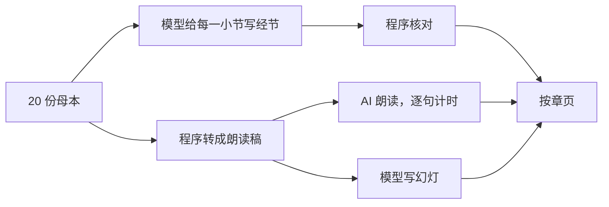

# 马太福音按章页：教授釋經筆記（AI 朗讀）方案

> **读者**：Solution architect、神学编辑
> **类型**：规范
> **状态**：当前（草案，待负责人评审；负责人 2026-11-06 定：母本做与讲道同样的处理，录音用 AI 合成，标为「AI 朗讀」，声音为台湾口音、男声、年长、庄重）
> **与代码对齐**：未核对
> **权威范围**：「教授釋經筆記」这个来源的按章页面：哪几份母本进哪一章、怎样按经节归段、朗读稿怎样从母本得来、AI 朗读怎样生成与标示、幻灯与聆听模式沿用什么。NYSC 讲座的按章页由[马太福音按章释经页：方案](./matthew_chapter_exposition_page_solution.md)管，本文只写与它不同的地方。

**目标：读者打开马太福音某一章，选「教授釋經筆記」，像听 NYSC 讲座那样按经节次序从头听到尾，同时看幻灯和文字；听到的是 AI 朗读的母本原文，页面上一直标明「AI 朗讀」。**

## 目录

- [一、问题](#一问题)
- [二、负责人已定](#二负责人已定)
- [三、与讲座按章页的异同](#三与讲座按章页的异同)
- [四、方案](#四方案)
  - [4.1 选材：哪几份母本进哪一章](#41-选材哪几份母本进哪一章)
  - [4.2 按经节归段](#42-按经节归段)
  - [4.3 朗读稿：程序转换，不改写](#43-朗读稿程序转换不改写)
  - [4.4 AI 朗读](#44-ai-朗读)
  - [4.5 同步幻灯](#45-同步幻灯)
  - [4.6 页面](#46-页面)
- [五、待负责人决定](#五待负责人决定)
- [六、不在本文范围](#六不在本文范围)

## 一、问题

母本是教授释经课笔记整理成的讲稿，同工校对过，共 20 份，讲太 1–16 章并接到 17:1–8，约 23 万字。它们现在只能逐份读：太 5 分在「登山寶訓的結構」「登山寶訓-八福」「義的精意」「登山寶訓的文學結構」四份里，读者想把太 5 从第 1 节跟到第 48 节，要在四份之间来回翻。

讲座那边已经有按章页（太 5–13、15–16 等）：一章一页、按经节分段、幻灯跟着录音走、聆听模式里听、看、跟在一个画面。母本是文字，没有录音，所以缺的只有声音。

## 二、负责人已定

2026-11-06：

1. **母本做与讲道同样的处理**：按章、按经节分段、同步幻灯、聆听模式。
2. **录音由 AI 合成，标为「AI 朗讀」。** 用普通的合成声音，不模仿教授的声音；页面上不能让人以为听到的是他本人。
3. **20 份母本都已完成**，全部纳入。
4. **声音：台湾口音的普通话，男声，年长，庄重。**
5. **注意章节边界，尤其 16 章会跨到 17 章开始。**

## 三、与讲座按章页的异同

| | 讲座按章页 | 母本按章页 |
| --- | --- | --- |
| 材料 | NYSC 讲座逐字稿（口语，释经、见证、问答交错） | 母本（已整理成文，按「釋經／神學意義／生活應用／附錄」分节） |
| 留不留 | 模型逐片段决定，不留的标灰 | **不需要**：母本在整理时已去掉与释经无关的部分，同工校对过。全部保留 |
| 归段 | 模型给每个片段写经节 | 同样由模型给每一小节写经节（4.2） |
| 声音 | 教授原声 | AI 朗读母本原文（4.3、4.4） |
| 时间 | 逐字稿段首时间加语音识别对齐，有误差 | 合成时逐句得到时间（Azure），或对齐逐字相同的朗读稿（Gemini） |
| 幻灯 | 模型读逐字稿写要点，独立审阅 | 同样做法，读的是朗读稿（4.5） |
| 内容类别 | 释经／神学／应用，由模型判断 | 直接用母本自己的分节标题 |

## 四、方案

| 框 | 是什么 | 见 |
| --- | --- | --- |
| 20 份母本 | `notes_to_surmon/<项目>/final.md`，来源类型 `notes_manuscript` | [4.1](#41-选材哪几份母本进哪一章) |
| 模型给每一小节写经节 | 一份母本一次调用 | [4.2](#42-按经节归段) |
| 程序核对 | 每一小节恰好一个决定、经节可解析且在这一章 | [4.2](#42-按经节归段) |
| 程序转成朗读稿 | 去掉排版符号、经文出处改成念法，不改一个字的内容 | [4.3](#43-朗读稿程序转换不改写) |
| AI 朗读，逐句计时 | 一句一句合成，记下每句的起止时间 | [4.4](#44-ai-朗读) |
| 模型写幻灯 | 沿用讲座按章页的写法与审阅 | [4.5](#45-同步幻灯) |
| 按章页 | 讲座按章页的总览与聆听模式，来源选「教授釋經筆記」 | [4.6](#46-页面) |

### 4.1 选材：哪几份母本进哪一章

**母本以知识库登记的 `notes_manuscript` 来源为准**，共 20 份。`notes_to_surmon/` 里另有项目自己标为 `project_type=transcript` 的（如「15_章」「17_章_登山變像_醫治鬼附之子」），那是由讲道逐字稿生成的查经视图，不是母本，不进来（[Solution Architecture 术语](../00-overview/solution_architecture.md#术语)）；没有 `final.md` 的旧草稿文件夹也不进来。

| 章 | 母本 |
| --- | --- |
| 1 | 1章-_耶穌的來歷；馬太福音結構（讲全卷结构，归第 1 章开头） |
| 2 | 2章-东方的博士 |
| 3 | 3_章-_施洗約翰，耶穌受洗 |
| 4 | 4_章_-_耶穌受試探，耶穌應驗預言 |
| 5 | 登山寶訓的結構、登山寶訓-八福、義的精意、登山寶訓的文學結構 |
| 6–7 | 6_章_-_登山寶訓_3 |
| 8 | 耶穌的權柄與人的回應 |
| 9 | 9_章_-_权柄深化 |
| 10 | 使命與誠實 |
| 11 | 衝突與安息-12,13章 |
| 12 | _12章_-_安息日的爭議，褻瀆聖靈的罪 |
| 13 | 13_章 |
| 14–15 | 14章 |
| 16 | 16章釋經、16_章_-_彌賽亞，捨己、16_章_-_生命 |
| 17（开头） | 16_章_-_生命 第七大节（16:28 与 17:1–8 山上变貌，见 [4.2](#42-按经节归段)） |

这张表是起点，不是定论：一份母本讲到别章的小节，按 4.2 归到别章。母本按讲课的单元分份，不按和合本的章，所以跨章是常态：「14章」讲到 15:1–20，「6_章_-_登山寶訓_3」讲到第 7 章，「16_章_-_生命」最后一大节讲到 17:1–8。章与母本的对照和讲座一样写在 `DATA_BASE_DIR/chapter_exposition/chapters.json`，来源写「教授釋經筆記」，加一章不用改代码、不用部署。

### 4.2 按经节归段

母本已经分好小节（`####` 标题），一节讲一处经文或一个题目。**单位是小节**，不再切片段。

一份母本一次模型调用。模型读到这份母本讲到的各章和合本全文（包括相邻一章，如 16 章的母本也读 17 章）和这份母本编号的小节，**给每一小节写它讲哪一章哪几节**；经节可以跨章，写成「16:28–17:8」，不截在章末。讲全卷或全段结构的小节写整段（如 5:1–7:29），归这一段的第一段。模型不写一句给读者看的话。

**跨章的小节在它讲到的每一章都出现**，与讲座页太 8、9 两页都放同一段的做法相同，不去重。例：「16_章_-_生命」第七大节「太 16:28 的解釋與山上變貌作為耶穌再臨的保證」，从 16:28 的原文讲起，接着讲 17:1「過了六天」的时间衔接、山上变貌和彼后 1:16–19。它的论点是 16:28 的「人子降臨在他的國裡」指六天后的山上变貌，所以：

- 在太 16，它在 16:24–28 一段的最后；
- 在太 17，它是 17:1–13 一段的第一行，读者从 17 章开头听，先听到他怎样把 16:28 和变貌连起来；
- 整节一起出现，不在 16 与 17 之间切开，否则 17 章只剩结论、没有 16:28 的前提（论证整段判断，同[讲座方案 4.2](./matthew_chapter_exposition_page_solution.md#42-释经神学应用按定义判断)）。

要确认的不是母本的标题怎么写，而是经文：「16_章_-_彌賽亞，捨己」也提到太 17:24，那是说明地理路程的一句，不是讲解 17 章，不进 17 章。

程序核对，任何一条不过，这一份母本整份不上页面，报给负责人：

- 每一小节编号恰好出现一次；
- 经节可解析，落在马太福音之内；跨章的写法（16:28–17:8）也可解析；
- 程序把每一小节的经节与母本里出现的马太福音出处对照，**小节讲到相邻一章而模型只写了本章的，列出来交负责人看**，不自动改；
- 小节的类别（釋經／神學意義／生活應用／附錄）由程序从母本的 `###` 标题读，不由模型写。

页内分段沿用和合本分段与讲座页同一套规则（[讲座方案 4.4](./matthew_chapter_exposition_page_solution.md#44-按经节次序分段)）：一段里先放讲座各堂，再放母本；同一份母本在一段里是一行，那一行里小节按母本原来的次序。

### 4.3 朗读稿：程序转换，不改写

**AI 念的是母本原文。** 朗读稿由程序从 `final.md` 转出，规则可以逐条列出，模型不参与，所以不会多一句、少一句或换一个说法：

| 母本里 | 朗读稿 | 页面上 |
| --- | --- | --- |
| `#`／`**`／`>` 等排版符号 | 去掉 | 照母本显示 |
| 小节标题 | 念出，前后停顿 | 幻灯标题处显示 |
| 经文出处「太 5:3–10」 | 念成「馬太福音五章三到十節」，书名表与 `backend/api/scripture.py` 共用 | 照原样 |
| 引用的经文（`>` 块） | 照念 | 一节一行带节号 |
| 希腊文、希伯来文字词（20 份里 9 份有，共约 300 处） | 见[第五节](#五待负责人决定)第 1 条 | 照原样，幻灯上显示 |
| 表格（4 份有） | 见第五节第 2 条 | 照原样显示在幻灯上 |

程序另外核对：朗读稿去掉念法改写之后，与母本去掉排版符号后的文字逐字相同。不同就整份不用。

### 4.4 AI 朗读

- **声音**：台湾口音的普通话，男声，年长，庄重（负责人 2026-11-06）；不模仿、不克隆教授的声音。
- **服务与候选**：现成服务里没有一个声音正好是「台湾口音、年长男声」，所以先用同一段母本（约两分钟，含经文出处和一处希腊文）合三个样本给负责人听，定了再跑全部：

  | 候选 | 做法 | 逐句时间 |
  | --- | --- | --- |
  | Azure `zh-TW-YunJheNeural` | Azure 唯一的台湾男声，本身偏年轻；用 SSML 放慢语速、压低音高，求庄重 | 合成时逐字回报，准 |
  | Gemini TTS | 代码里已用过（`backend/webcast_tts.py`）；可用文字指示声音「年长、庄重、台湾口音」，口音能否做到要听了才知道 | 不回报时间；要用语音识别对齐（讲座页已有 `original_audio_index.retimer`） |
  | Azure 大陆男声的「年长男性」角色 | 年长的角色现成，但不是台湾口音 | 准 |

  Azure 的钥匙在 `AZURE_SPEECH_KEY`，代码里已用过（`backend/sermon_to_video/core/audio.py`）。选 Azure 时，**每一句的起止时间是准的**，逐字稿高亮和幻灯切换不用对齐；选 Gemini 时，时间要再对齐一次，误差应小于讲座（朗读稿与音频逐字相同，没有口语的增删）。
- **量与费用**：20 份约 23 万字，按每分钟约 220 字（放慢）计约 17 小时；按 Azure 神经语音的标价约 4 美元，Gemini 另计。
- **存放**：每份母本一个音频档，与逐句时间一起存在 `DATA_BASE_DIR/chapter_exposition/notes_audio/<项目>/`，绑定朗读稿的 SHA；母本改了，朗读稿 SHA 变，才重新合成。
- **标示**：播放器上、聆听模式顶上、总览里每一行都写「AI 朗讀」，与讲座的原声一眼分得开。

### 4.5 同步幻灯

沿用[讲座方案 4.6](./matthew_chapter_exposition_page_solution.md#46-同步幻灯模型读逐字稿写要点)：一份母本一次调用，读朗读稿编号的句子，分成一张张幻灯，标题、二到四条要点、讲哪几节、读到哪些经文；程序核对、独立审阅、最多两轮修正，审不完的交负责人。句子的时间来自 4.4（合成回报或对齐），不用按字数推算。

与讲座不同的一点：母本自己有小节标题，**一张幻灯不跨小节**，幻灯标题优先用小节标题，太长时由模型缩短（不超过 14 字），标为编辑整理。

### 4.6 页面

沿用讲座按章页的总览与聆听模式（[讲座方案 4.8](./matthew_chapter_exposition_page_solution.md#48-聆听模式)），不另做一套：

- 章页的来源分页里，「教授釋經筆記」从现在链到笔记讲稿，改为进这一章的按章页（`?source=教授釋經筆記`）。
- 一段里各小节按母本类别标示：釋經、神學意義、生活應用照常显示；附錄见第五节第 3 条。
- 没有灰色片段（母本全部保留），所以不显示「显示不收的部分」开关。

## 五、待负责人决定

1. **希腊文、希伯来文字词怎么念。** 例：「第1福與第8福的應許句均使用 **εστιν**，即 be 動詞的現在式」。建议：用 Azure 的希腊语、希伯来语声音念原文字词本身（现代发音），其余用普通话声音，同一句里接起来；幻灯上同时显示原文。另一个做法是原文字词不念、只在幻灯上显示，但句子会断掉（「均使用，即 be 動詞……」）。
2. **表格怎么念。** 「13_章」有 30 行表格。建议：表格整张显示在幻灯上，朗读按行念，一行的各格用停顿隔开。
3. **附錄放不放。** 母本每章末有「附錄」，多是课堂例子（如「王老師的轉機比喻」）。建议：放，标为「附錄」，跟在它所属那一大节的后面；它也是同工校对过的母本内容。
4. **用哪一个声音**：听三个样本后定（4.4）。

## 六、不在本文范围

讲座按章页的任何改动；母本内容本身的修订；太 17:9 以后（没有母本）；写文章；发布与部署；观点（CVP）。
